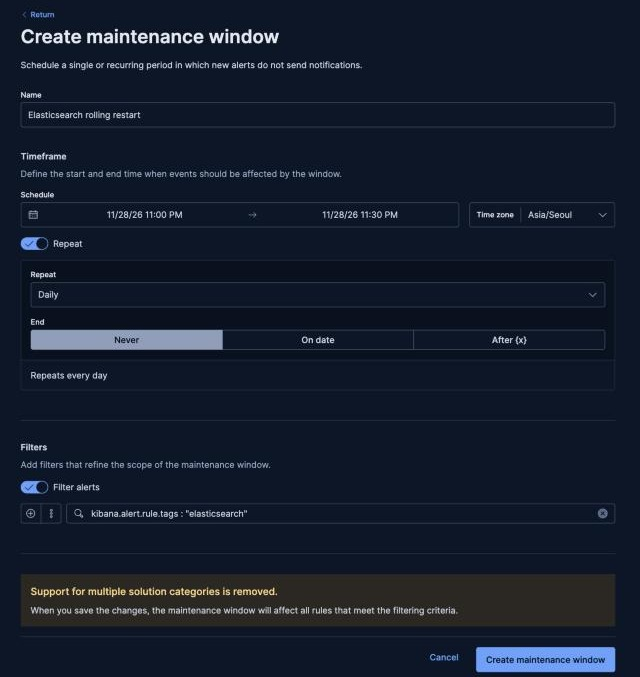

변경 자체보다 변경 직후가 더 위험합니다. template을 바꾼 뒤 다음 rollover까지는 아무 일도 없다가, 새 backing index가 생기는 새벽에 적재가 실패하기 시작합니다. 업그레이드는 끝났는데 일주일 뒤 특정 query만 느려집니다.
그래서 변경은 계획, 실행, 관찰, 롤백 판단까지 한 묶음으로 다룹니다. 변경 종류별 기술 내용은 03부터 10까지의 글에 있습니다.

:::note[기준]
- Elasticsearch, Kibana 9.5.x 기준입니다. 공식 문서는 2026년 11월에 다시 확인했습니다.
- 점검 명령은 [`labs/change/change-process.console`](https://github.com/Munsik/engineering-notes/blob/main/labs/change/change-process.console)에 있습니다.
:::

## 변경을 분류한다

모든 변경에 같은 절차를 적용하면 절차가 무시됩니다. 위험에 따라 나눕니다.

| 분류 | 예 | 승인 | 검증 환경 선행 | 작업 시간 |
| --- | --- | --- | --- | --- |
| 정기 | dashboard 패널 추가, 새 data view, alert 임계값 조정, `@custom` pipeline에 필드 추가 | PR 리뷰 1명 | 권장 | 필요 없음 |
| 일반 | template, mapping 변경, ILM policy 변경, integration 업그레이드, 노드 추가, cluster settings 변경, 인증서 교체 | PR 리뷰와 운영 책임자 승인 | 필수 | 업무 영향이 적은 시간 |
| 고위험 | 메이저와 마이너 업그레이드, 노드 대량 교체, 데이터 이관, reindex | 변경 위원회나 그에 준하는 승인, 롤백 계획 포함 | 필수, 리허설 포함 | 사전 공지한 작업 시간 |
| 긴급 | 보안 patch, 장애 완화 조치 | 사후 승인 | 가능하면 | 즉시 |

긴급 변경도 사후에는 일반 변경과 같은 기록을 남깁니다. 장애 중에 바꾼 cluster setting을 되돌리지 않고 잊어버리는 일이 흔합니다([안정성 운영 10](../../operations/10-incident-runbook/)).

## 검증 환경

검증 환경이 운영과 다르면 검증의 의미가 줄어듭니다. 맞춰야 할 것의 우선순위는 이렇습니다.

1. 버전. 운영과 같은 버전, 업그레이드 검증이라면 목표 버전
2. 설정. 같은 template, pipeline, ILM, `elasticsearch.yml`, `kibana.yml`
3. integration과 그 버전
4. 데이터 형태. 같은 필드와 type, 비슷한 문서 크기
5. 규모. 노드 수나 데이터 양은 줄여도 되지만, shard 수와 노드당 shard 비율은 맞추는 편이 좋습니다

데이터 형태를 맞추는 가장 쉬운 방법은 운영 snapshot에서 일부 index만 검증 클러스터로 복원하는 것입니다. 이때 Kibana feature state는 복원하지 않습니다. Kibana 시스템 index는 버전이 다른 클러스터에서 그대로 쓸 수 없는 경우가 있고, 운영 rule이 검증 환경에서 알림을 보내는 사고도 생깁니다.

```console
POST _snapshot/prod-repo/nightly-2026.11.27/_restore
{
  "indices": "logs-app-default",
  "include_global_state": false
}
```

`include_global_state`가 `false`이면 feature state도 복원하지 않는 것이 기본 동작입니다([Restore a feature state](https://www.elastic.co/docs/deploy-manage/tools/snapshot-and-restore/restore-snapshot#restore-feature-state)). data stream을 지정하면 backing index가 함께 복원됩니다. 같은 이름이 이미 있으면 `rename_pattern`, `rename_replacement`로 바꿔서 복원하고, 이때 backing index 이름도 같이 바뀝니다. 운영 데이터에 개인정보가 있으면 검증 환경에도 같은 접근 통제가 필요합니다.

## 변경 계획서

일반 변경 이상은 아래 항목을 채운 계획서를 PR에 붙입니다.

| 항목 | 쓰는 내용 |
| --- | --- |
| 무엇을 | 대상 층과 객체, 변경 전후 값 |
| 왜 | 업무 이유, 관련 요청이나 장애 |
| 영향 범위 | 영향받는 data stream, dashboard, rule, ML job, transform, 애플리케이션 |
| 사전 점검 | 클러스터 상태, 최근 snapshot, 디스크 여유 |
| 실행 단계 | 순서대로 실행할 요청이나 명령 |
| 검증 | 변경 직후와 관찰 기간에 볼 지표와 기대값 |
| 롤백 조건 | 어떤 신호가 보이면 되돌리는지, 판단자, 판단 시한 |
| 롤백 절차 | 되돌리는 요청이나 명령. 되돌릴 수 없는 변경이면 대안 |
| 담당과 연락 | 실행자, 승인자, 영향받는 팀 |

영향 범위가 가장 자주 빠집니다. 필드 이름 하나를 바꾸면 그 필드를 쓰는 dashboard, detection rule, ML job의 datafeed, transform, alert query가 같이 깨집니다. 찾는 방법은 [04의 영향 분석](../04-data-definitions/#영향-분석)에 있습니다.

## 사전 점검

변경 전에 클러스터가 건강한지 봅니다. 상태가 나쁜 클러스터에서 변경하면 문제가 생겨도 원인을 구분할 수 없습니다.

```console
# 전체 상태와 원인
GET _health_report

# 진행 중인 shard 이동, recovery
GET _cat/recovery?active_only=true&v
GET _cluster/health?filter_path=status,relocating_shards,initializing_shards,unassigned_shards

# 디스크 여유
GET _cat/allocation?v&s=disk.percent:desc

# 최근 snapshot이 성공했는지
GET _slm/policy?filter_path=*.last_success,*.last_failure
GET _cat/snapshots/prod-repo?v&s=end_epoch:desc&h=id,status,end_epoch,indices
```

판단 기준은 [안정성 운영 01. 평소 점검](../../operations/01-daily-checks/)과 같습니다. 일반 변경 이상이라면 GREEN이 아닐 때는 미룹니다.

## 알림 억제

계획된 변경 중에는 alert가 쏟아집니다. 노드를 재시작하면 노드 다운 alert가, 업그레이드 중에는 적재 지연 alert가 납니다. 이때 rule을 끄면 다시 켜는 것을 잊습니다.

Kibana maintenance window를 씁니다. 9.0과 9.1에서는 tech preview, 9.2부터 GA입니다. maintenance window는 만든 space 안의 모든 rule에 적용되고, **Filter alerts**를 켜면 KQL로 대상 alert를 좁힐 수 있습니다. rule category를 고르는 옵션은 9.2에서 없어졌습니다. Stack Monitoring rule처럼 alert에 필요한 필드가 없는 일부 rule에는 filter가 적용되지 않습니다. 동작은 다음과 같습니다([Maintenance windows](https://www.elastic.co/docs/explore-analyze/alerting/alerts/maintenance-windows)).



- alert는 계속 생성되고 알림만 억제됩니다. 기록은 남습니다.
- maintenance window 중에 생긴 alert는 나중에 회복돼도 알림이 가지 않습니다. 작업 시간이 끝난 뒤에도 남아 있는 alert는 Alerts 화면에서 직접 확인해야 합니다.
- window가 시작되기 전에 생긴 alert는 평소처럼 알림이 갑니다.

maintenance window는 구독 조건과 Kibana 권한이 필요합니다. 등급은 [subscription 페이지](https://www.elastic.co/subscriptions)에서 확인합니다.

## 실행

- 한 번에 한 가지를 바꿉니다. template 변경과 integration 업그레이드를 같은 작업 시간에 묶으면 문제가 생겼을 때 원인을 구분할 수 없습니다.
- 실행한 요청과 응답을 그대로 남깁니다. Dev Tools 기록보다 스크립트 실행 로그가 낫습니다.
- template이나 ILM처럼 rollover 때 반영되는 변경은, 작업 시간 안에서 직접 rollover해서 결과를 확인합니다. 다음 자동 rollover까지 기다리면 문제가 새벽에 드러납니다.

```console
# 변경 직후 바로 새 backing index를 만들어 반영 결과를 확인
POST logs-app-default/_rollover

# 새 write index의 설정과 mapping
GET logs-app-default/_mapping
GET _data_stream/logs-app-default?filter_path=data_streams.indices,data_streams.template,data_streams.ilm_policy
```

## 사후 점검

변경 직후에는 사전 점검 항목에 더해 아래를 봅니다.

| 볼 것 | 방법 | 이상 징후 |
| --- | --- | --- |
| 적재 실패 | failure store 문서 수 | 변경 시점 이후 증가 |
| 적재량 | 소스 대비 문서 수([수집 05](../../ingest/05-count-reconciliation/)) | 변경 전 대비 감소 |
| deprecation | deprecation log, `GET _migration/deprecations` | 새 경고 |
| Kibana rule | rule 실행 상태 | error, 실행 지연 |
| Kibana task manager | `GET kbn:/api/task_manager/_health` | `status`가 OK가 아님 |
| 검색 지연 | 대표 query의 응답 시간, search slow log | 변경 전 대비 증가 |

```console
# failure store에 쌓인 문서. 9.2부터 logs-*-* data stream은 기본으로 failure store가 켜져 있음
GET logs-*::failures/_search
{
  "size": 0,
  "query": { "range": { "@timestamp": { "gte": "now-1h" } } },
  "aggs": { "by_stream": { "terms": { "field": "data_stream.dataset", "size": 20 } } }
}

# 업그레이드나 설정 변경 뒤 새로 생긴 deprecation
GET _migration/deprecations
```

요청별로 쓰는 상황입니다.

| 요청 | 쓰는 상황 |
| --- | --- |
| `GET _health_report` | 상태가 GREEN이 아닐 때 원인과 조치까지 한 번에 보고 싶을 때. `_cluster/health`는 색과 shard 수만 알려 주고, health report는 디스크, shard 가용성, ILM, SLM, master 안정성 같은 지표별로 원인과 영향받는 index를 알려 줌 |
| `GET _cluster/health?wait_for_status=green` | rolling restart나 노드 교체 중에 다음 단계로 넘어가도 되는지 스크립트에서 기다릴 때 |
| `GET _migration/deprecations` | 마이너 업그레이드나 설정 변경 뒤, 다음 메이저에서 막힐 설정과 index가 새로 생겼는지 볼 때. 8.19에서는 9.x 업그레이드를 막는 critical 항목을 찾는 데 씀 |
| `GET kbn:/api/task_manager/_health` | rule 실행이 늦거나 alert가 몇 분씩 늦게 올 때. task 적체와 처리량, Kibana 인스턴스별 상태가 나옴 |
| `GET <data stream>::failures/_search` | 변경 뒤 적재가 일부만 실패하는지 볼 때. 수집기 쪽은 성공으로 보여도 문서가 failure store로 가 있을 수 있음 |

failure store는 9.1에서 GA가 됐고, 9.2부터 `logs-*-*` 패턴의 새 data stream은 built-in `logs` template으로 failure store가 켜집니다([Failure store](https://www.elastic.co/docs/manage-data/data-store/data-streams/failure-store)). failure store가 켜져 있지 않은 data stream은 실패한 문서가 수집기 쪽에서 오류로 끝나므로, 수집기 로그와 출력 오류 지표를 같이 봅니다([수집 03](../../ingest/03-no-gap-ingest/)).

## 관찰 기간과 롤백 판단

변경 직후에 이상이 없어도 문제가 늦게 드러나는 변경이 있습니다.

| 변경 | 문제가 드러나는 시점 | 관찰 기간 예 |
| --- | --- | --- |
| template, mapping | 다음 rollover | rollover 1회 이상 |
| ILM policy | 다음 phase 진입 | 가장 짧은 phase 전환 1회 |
| ingest pipeline | 특정 형태의 문서가 들어올 때 | 업무 주기 1회(일간이면 하루) |
| 업그레이드 | 주간 배치, 월말 집계 등 드문 작업 | 1주에서 2주 |
| integration 업그레이드 | 새 버전 Agent가 보낸 첫 데이터 | Agent 배포 완료 뒤 하루 |

롤백 판단은 계획서에 미리 적은 조건으로만 합니다. 현장에서 롤백이 늦어지는 이유는 대개 "조금만 더 보자"입니다. 예를 들면 이렇게 정합니다.

- failure store에 변경 대상 data stream의 문서가 10분간 계속 쌓이면 되돌린다
- 대표 query의 p95가 변경 전보다 두 배 이상 30분간 유지되면 되돌린다
- 판단자는 변경 실행자가 아닌 운영 책임자

되돌릴 수 없는 변경(업그레이드, 삭제, reindex로 인한 원본 교체)은 롤백 대신 대안을 미리 정합니다. [08의 롤백 대안 비교](../08-major-upgrade/#롤백-대안-비교)를 참고합니다.

## 성능 회귀 확인

업그레이드, mapping 변경, index mode 변경(LogsDB, TSDS)은 성능이 달라질 수 있습니다. 운영에서 확인하기 전에 검증 환경에서 같은 부하로 비교합니다.

[Rally](https://esrally.readthedocs.io/)로 변경 전후를 같은 track으로 돌리고 `esrally compare`로 비교하는 방법을 씁니다. 공개 track보다 운영 데이터 형태를 본뜬 custom track이 의미가 큽니다. 볼 지표는 적재 처리량, 대표 query의 지연 분포, merge와 refresh 시간, 디스크 사용량입니다. 측정은 최소 두 번 이상 반복해서 편차를 같이 봅니다. 한 번의 결과로 회귀를 판단하면 노이즈를 회귀로 오인합니다.

## 변경 동결

장애가 났을 때 업무 피해가 가장 큰 기간에는 변경을 멈춥니다. 대형 할인 행사, 결산, 감사 기간이 대표적입니다. 동결 기간에는 긴급 변경만 허용하고, 동결 직전 2주 안에는 고위험 변경을 하지 않습니다. 업그레이드 뒤의 관찰 기간이 동결 기간과 겹치지 않게 하기 위해서입니다.

## 기록

변경이 끝나면 계획서에 결과를 덧붙입니다. 실제 소요 시간, 계획과 달랐던 점, 발견한 문제, 다음에 바꿀 점입니다. 업그레이드처럼 몇 년에 한 번 하는 작업은 이 기록이 다음 담당자의 유일한 자료가 됩니다.

## 참고 문서

- [Maintenance windows](https://www.elastic.co/docs/explore-analyze/alerting/alerts/maintenance-windows)
- [Failure store](https://www.elastic.co/docs/manage-data/data-store/data-streams/failure-store)
- [Restore a snapshot](https://www.elastic.co/docs/deploy-manage/tools/snapshot-and-restore/restore-snapshot)
- [Rally](https://esrally.readthedocs.io/)
