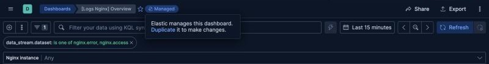
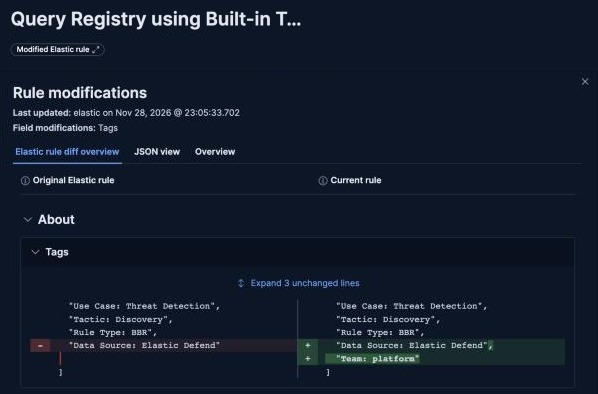
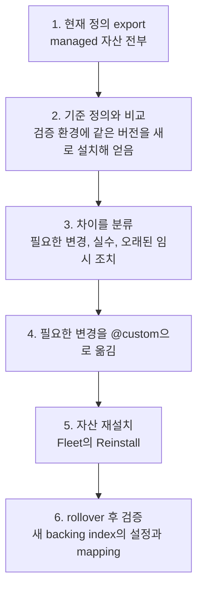
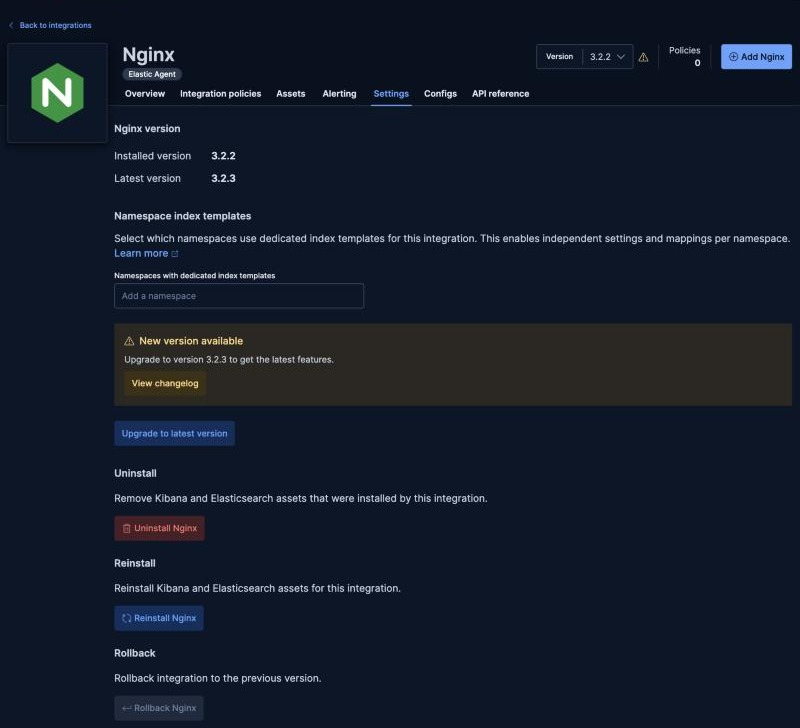

업그레이드를 마치고 며칠 뒤, 보관 기간이 90일이던 로그가 지워지지 않고 계속 쌓이는 것을 발견합니다. integration의 template에 직접 넣어 둔 shard 설정과, built-in ILM policy에 추가했던 delete phase가 업그레이드 때 원래 값으로 돌아간 것입니다. pipeline에 넣어 둔 개인정보 마스킹 processor가 사라져 있기도 합니다.
원인은 같습니다. Elastic이 설치하고 갱신하는 managed 자산을 직접 고쳤기 때문입니다. 이 글은 managed 자산을 알아보는 법과, 바꾸고 싶은 내용을 어디에 넣어야 업그레이드 뒤에도 살아남는지를 정리합니다.

:::note[기준]
- Elasticsearch, Kibana, Fleet 9.5.x 기준입니다. 공식 문서는 2026년 11월에 다시 확인했고, built-in template의 구성은 Elasticsearch 소스 코드(`x-pack/plugin/core/template-resources`)로 확인했습니다.
- 기능마다 도입 버전이 다릅니다. package 수준 `@custom` component template은 9.1부터, namespace index template은 9.5부터 GA입니다.
- 명령 모음은 [`labs/change/managed-assets.console`](https://github.com/Munsik/engineering-notes/blob/main/labs/change/managed-assets.console)에 있습니다.
:::

## managed 자산은 누가 언제 덮어쓰나

managed 자산에는 세 출처가 있습니다.

| 출처 | 예 | 덮어쓰는 시점 |
| --- | --- | --- |
| Elasticsearch built-in | `logs`, `metrics`, `synthetics`, `traces` index template, `logs@settings`, `logs@mappings` 같은 component template, `logs@default-pipeline`, `logs@lifecycle` 같은 ILM policy | Elasticsearch 업그레이드로 내장 정의의 버전이 오를 때 |
| Fleet integration | integration index template, `@package` component template, integration ingest pipeline, integration ILM policy, Kibana dashboard | integration 업그레이드(자동 업그레이드 포함), 자산 재설치, 그 밖에 예고 없이 |
| Kibana 앱 | integration dashboard, prebuilt detection rule | integration 업그레이드, prebuilt rule 업데이트 |

Fleet 문서는 managed 자산을 수정하지 말라고 분명히 적고 있습니다. integration index template, `@package` component template, integration에 들어 있는 ingest pipeline을 고치면 integration을 업그레이드할 때 덮어써지고, 그 밖의 시점에도 예고 없이 덮어써질 수 있습니다([Best practices for integration assets](https://www.elastic.co/docs/reference/fleet/integrations-assets-best-practices#assets-restrictions-editing-assets)). ILM policy도 같습니다. built-in policy는 Elasticsearch나 integration 업데이트로 덮어써질 수 있으니 복제해서 쓰라고 안내합니다([Customize built-in ILM policies](https://www.elastic.co/docs/manage-data/lifecycle/index-lifecycle-management/tutorial-customize-built-in-policies)).

built-in 자산이 업그레이드 때 갱신되는 이유는 정의에 들어 있는 `version`입니다. Elasticsearch 소스의 `logs@template.json`을 보면 `version`이 stack template 버전 변수로 채워지고 `_meta.managed`가 `true`입니다. 새 버전의 Elasticsearch는 클러스터에 있는 정의의 `version`이 없거나 내장 정의보다 낮으면 내장 정의로 다시 씁니다(Elasticsearch 소스 `IndexTemplateRegistry.java` 기준. index template, component template, ingest pipeline, ILM policy 모두 같은 방식). 사용자가 고친 내용은 이때 사라집니다. `version`을 일부러 높여 덮어쓰기를 피하는 방법은 내장 정의의 개선과 수정까지 막으므로 쓰지 않습니다.

자동 업그레이드도 주의해야 합니다. System integration처럼 Fleet 설정 때 기본으로 설치되는 integration은 새 버전이 나오면 자동으로 업그레이드됩니다. Elastic APM처럼 Stack 버전에 맞춰진 integration은 deprecation이 있어도 자동 업그레이드됩니다([Upgrade an integration](https://www.elastic.co/docs/reference/fleet/upgrade-integration), [Deprecated integrations](https://www.elastic.co/docs/reference/fleet/deprecated-integrations)). 사람이 업그레이드 버튼을 누르지 않아도 managed 자산이 바뀔 수 있다는 뜻입니다.

## managed 자산을 알아보는 법

Elasticsearch 쪽 자산은 `_meta`로 구분합니다. built-in 자산은 `_meta.managed: true`, Fleet 자산은 여기에 더해 `_meta.managed_by: fleet`와 `_meta.package.name`이 붙습니다.

```console
# managed 표시가 있는 index template
GET _index_template?filter_path=index_templates.name,index_templates.index_template._meta,index_templates.index_template.priority

# component template의 _meta
GET _component_template?filter_path=component_templates.name,component_templates.component_template._meta

# ingest pipeline의 _meta
GET _ingest/pipeline?filter_path=*._meta

# ILM policy의 _meta
GET _ilm/policy?filter_path=*.policy._meta
```


결과에서 `managed: true`인 것은 고치지 않을 대상, 이름이 `@custom`으로 끝나는 것은 고칠 대상입니다. data stream 하나가 어떤 template과 policy를 쓰는지는 이렇게 봅니다.

```console
GET _data_stream/logs-nginx.access-default?filter_path=data_streams.template,data_streams.ilm_policy,data_streams.next_generation_managed_by

# 그 template이 어떤 component template으로 이뤄졌는지
GET _index_template/logs-nginx.access?filter_path=index_templates.index_template.composed_of,index_templates.index_template.priority
```

Kibana 쪽은 화면에 표시됩니다. integration이 설치한 dashboard는 **Managed** 배지가 붙고 직접 편집할 수 없습니다([Edit a dashboard](https://www.elastic.co/docs/explore-analyze/dashboards/open-dashboard)). prebuilt detection rule은 Rules 표에서 Elastic rule로 구분되고, 수정한 rule에는 9.1부터 **Modified** 배지가 붙습니다.



## 고칠 곳을 정하는 표

| 바꾸려는 것 | 고치지 말 것 | 고칠 곳 |
| --- | --- | --- |
| integration data stream의 mapping, setting(shard 수, refresh 등) | `@package` component template, integration index template | `<data stream>@custom` component template(예: `logs-nginx.access@custom`) |
| integration 하나의 모든 data stream 설정 | 위와 같음 | `<package>@custom`(예: `nginx@custom`). 9.1부터 |
| 로그 전체의 공통 설정 | `logs@settings`, `logs@mappings` | `logs@custom` |
| namespace별 설정(예: production만 보관 기간을 길게) | 복제한 integration index template | namespace index template과 `<namespace>@custom`. 9.5부터 |
| 가공 로직 | integration ingest pipeline, `logs@default-pipeline` | `global@custom`, `logs@custom`, `logs-nginx.integration@custom`, `logs-nginx.access@custom` pipeline |
| 보관 기간과 rollover 조건 | `logs@lifecycle`, integration ILM policy | 새 ILM policy를 만들고 `@custom` component template에서 `index.lifecycle.name`으로 참조 |
| integration dashboard | managed dashboard | 복제한 dashboard |
| prebuilt detection rule | Enterprise가 아닐 때 원본 rule | 복제한 rule, exception |

### component template의 `@custom` 계층

Fleet은 integration을 설치할 때 수정 가능한 `@custom` component template을 만들어 둡니다. 종류와 우선순위는 이렇습니다([Fleet data streams](https://www.elastic.co/docs/reference/fleet/data-streams)).

| 이름 | 적용 범위 | 우선순위 |
| --- | --- | --- |
| `<data stream>@custom` | data stream 하나 | 가장 높음 |
| `<namespace>@custom` | namespace의 모든 data stream(9.5부터, namespace index template을 켰을 때) | 두 번째 |
| `<package>@custom` | integration의 모든 data stream(9.1부터) | 세 번째 |
| `<type>@custom` | type 전체(예: `logs@custom`) | 가장 낮음 |

`composed_of` 목록에서 뒤에 있는 component template이 앞의 것을 덮어씁니다. 같은 설정을 여러 수준에 넣었다면 data stream 수준이 이깁니다.


Fleet 없이 `logs-<dataset>-<namespace>` 이름으로 직접 보내는 애플리케이션 로그는 built-in `logs` template을 탑니다. Elasticsearch 소스 기준으로 이 template은 `logs@mappings`, `logs@settings`, `logs@custom`, `ecs@mappings` 순으로 구성되고, `logs@custom`이 없어도 동작하도록 `ignore_missing_component_templates`에 들어 있습니다. 그래서 이 경우에는 `logs@custom`이 유일한 사용자 수정 지점입니다.

예를 들어 integration 로그 전체의 보관 기간을 바꾸는 순서는 이렇습니다. 먼저 새 policy를 만듭니다. built-in `logs@lifecycle`은 Elasticsearch 소스 기준으로 hot phase의 rollover(50GB, 30일)만 있고 delete phase가 없습니다. 그대로 두면 로그가 지워지지 않습니다.

```console
PUT _ilm/policy/logs-90d
{
  "policy": {
    "_meta": { "owner": "platform-team", "based_on": "logs@lifecycle" },
    "phases": {
      "hot": {
        "actions": {
          "rollover": { "max_primary_shard_size": "50gb", "max_age": "30d" }
        }
      },
      "delete": {
        "min_age": "90d",
        "actions": { "delete": {} }
      }
    }
  }
}
```

다음으로 `@custom`에서 참조합니다. `PUT`은 기존 정의를 통째로 바꾸므로, 이미 `logs@custom`이 있으면 먼저 읽어서 기존 내용을 합칩니다.

```console
GET _component_template/logs@custom

PUT _component_template/logs@custom
{
  "_meta": { "owner": "platform-team", "change": "PR-512 logs retention 90d" },
  "template": {
    "settings": {
      "index.lifecycle.name": "logs-90d"
    }
  }
}
```


새 설정은 다음 rollover로 만들어지는 backing index부터 적용됩니다. 바로 확인하려면 대상 data stream을 rollover합니다. 기존 backing index는 이전 policy로 남아 있으므로, 기존 index에도 새 policy를 적용하려면 `PUT <index>/_settings`로 `index.lifecycle.name`을 따로 바꿉니다. 이 경우 진행 중인 phase는 이전 정의로 마치고 다음 phase부터 새 policy를 따릅니다([04의 ILM](../04-data-definitions/#ilm-policy-변경)).

### pipeline의 `@custom` 계층

integration의 기본 pipeline은 8.4부터 존재하지 않는 `@custom` pipeline을 호출하도록 만들어져 있고, 8.12부터 수준이 나뉩니다([Fleet data streams](https://www.elastic.co/docs/reference/fleet/data-streams#data-streams-pipelines)).

| pipeline 이름 | 적용 범위 |
| --- | --- |
| `global@custom` | 모든 이벤트 |
| `logs@custom`, `metrics@custom` | type 전체 |
| `logs-nginx.integration@custom` | integration 하나의 모든 log 이벤트 |
| `logs-nginx.access@custom` | data stream 하나 |

```console
PUT _ingest/pipeline/logs-nginx.access@custom
{
  "version": 3,
  "_meta": { "owner": "web-team", "change": "PR-530 drop query string" },
  "processors": [
    {
      "script": {
        "description": "URL의 query string 제거",
        "if": "ctx.url?.original != null",
        "source": "int i = ctx.url.original.indexOf('?'); if (i > 0) { ctx.url.original = ctx.url.original.substring(0, i); }"
      }
    }
  ]
}
```

이 이름 규칙에는 함정이 있습니다. 개인용 pipeline을 이 규칙과 같은 모양으로 이름 지으면 다른 integration이 그 pipeline을 호출할 수 있습니다. 공식 문서도 이 이름 규칙을 피해서 개인 pipeline 이름을 정하라고 경고합니다. 공통으로 쓰는 처리 로직은 `team-pii-masking`처럼 규칙과 겹치지 않는 이름의 pipeline으로 만들고, `@custom` pipeline에서 `pipeline` processor로 호출하는 구조가 관리하기 쉽습니다.

Fleet 없이 직접 보내는 `logs-*-*` 데이터도 `logs@default-pipeline`이 `logs@custom` pipeline을 호출합니다(Elasticsearch 소스 기준). 이 경우에도 `logs@default-pipeline`을 고치지 않고 `logs@custom`에 넣습니다.

### namespace별 설정

운영 namespace만 보관 기간을 길게 하고 싶을 때, 예전에는 integration index template을 복제해서 index pattern을 namespace로 좁히고 우선순위를 높이는 방법을 많이 썼습니다. 이 방법은 위험합니다. 복제한 template은 그 시점의 구조로 굳어서, integration이 업그레이드돼도 새 mapping이나 index mode가 반영되지 않습니다. 공식 문서는 이 때문에 indexing이 깨지거나 데이터가 유실될 수 있다고 경고합니다([Cloning the index template](https://www.elastic.co/docs/reference/fleet/integrations-assets-best-practices#assets-restrictions-cloning-index-template)).

9.5부터는 namespace index template을 씁니다. integration 설정에서 namespace를 지정하면 Fleet이 `logs-nginx.access@namespace.production` 같은 template을 우선순위 250으로 만들고, 그 template이 `<namespace>@custom`을 포함합니다([Namespace index templates](https://www.elastic.co/docs/reference/fleet/data-streams-namespace-custom)). 9.4 이하에서 namespace별 설정이 꼭 필요하면 복제 방식밖에 없으므로, integration을 업그레이드할 때마다 복제본을 다시 맞추는 절차를 같이 둡니다.

## `@custom`에도 위험이 있다

`@custom`이 지원되는 수정 지점이라고 해서 무엇이든 넣어도 되는 것은 아닙니다. 공식 문서가 드는 예는 이렇습니다([Creating custom component templates](https://www.elastic.co/docs/reference/fleet/integrations-assets-best-practices#assets-restrictions-custom-component-templates)).

- integration의 `@package`가 일반 data stream에서 TSDS나 LogsDB로 바뀌면, `@custom`에 넣은 설정이나 mapping이 그 index mode와 맞지 않을 수 있습니다.
- ECS 필드의 type을 `keyword`에서 `text`로 바꾸면 그 필드로 집계하는 built-in dashboard가 깨집니다.

그래서 `@custom`에는 shard 수, ILM policy 이름, refresh interval처럼 integration의 데이터 구조와 무관한 설정을 주로 넣고, mapping 변경은 새 필드 추가 정도로 제한하는 편이 안전합니다. integration을 업그레이드하기 전에는 release notes에서 index mode 변경 여부를 확인하고, 검증 환경에서 `@custom`을 얹은 상태로 새 버전을 먼저 설치해 봅니다.

## template 우선순위의 함정

index template끼리는 병합되지 않습니다. 새 index 이름과 맞는 template이 여럿이면 우선순위가 가장 높은 template 하나만 쓰이고, component template은 그 template의 `composed_of` 안에서만 병합됩니다([Template conflicts](https://www.elastic.co/docs/reference/fleet/data-streams-template-conflicts)).

| 우선순위 | 누가 쓰나 |
| --- | --- |
| 100 | Elasticsearch built-in(`logs-*-*`, `metrics-*-*`, `synthetics-*-*` 등) |
| 150, 200 | Fleet integration template(`dataset_is_prefix` data stream은 150) |
| 200, 250 | Fleet namespace index template(기본 template보다 50 높음) |
| 500 초과 | Fleet을 쓰지 않으면서 built-in을 덮고 싶을 때 권장되는 값 |

Fleet이나 Agent를 쓴다면 직접 만드는 template은 100보다 낮게 두라고 공식 문서는 권합니다. Fleet을 쓰지 않으면서 `logs-*` 같은 넓은 패턴의 template을 만들려면 500보다 높게 둡니다([Index templates](https://www.elastic.co/docs/manage-data/data-store/templates)). 현장에서 자주 만나는 사고는 Fleet 환경에서 `logs-*` 패턴의 사용자 template을 우선순위 300 같은 값으로 만들어, integration template을 통째로 밀어내는 경우입니다. integration의 mapping과 pipeline 설정이 빠진 채로 index가 만들어지고, 대시보드가 비고, 파싱이 안 됩니다.

같은 우선순위끼리 패턴이 겹치면 template을 만들 수 없습니다. 그리고 Fleet은 namespace index template의 우선순위를 사용자가 바꿔도 재설치나 재동기화 때 기본값으로 되돌립니다. 우선순위로 Fleet과 경쟁하지 않는 것이 안전합니다.

새 index에 어떤 template이 이기는지는 만들기 전에 확인합니다.

```console
POST _index_template/_simulate_index/logs-nginx.access-production
```

## 업그레이드가 직접 정의를 옮기는 경우

9.3에서는 built-in ILM policy 이름이 바뀌었습니다. 예전 `logs`, `metrics`, `synthetics` policy가 `logs@lifecycle`, `metrics@lifecycle`, `synthetics@lifecycle`로 대체됐습니다. 두 policy를 모두 손대지 않았다면 Fleet이 component template의 참조를 자동으로 옮깁니다. 하나라도 수정했다면 자동으로 옮기지 않으니, 수정 내용을 새 policy로 만들고 `{type}@custom`에서 참조하도록 직접 옮겨야 합니다([Customize built-in ILM policies](https://www.elastic.co/docs/manage-data/lifecycle/index-lifecycle-management/tutorial-customize-built-in-policies)).

이런 변경은 release notes와 breaking changes에 나옵니다. 업그레이드 계획 때 목표 버전까지의 모든 release notes에서 template, pipeline, ILM이라는 단어를 검색해 보는 습관이 도움이 됩니다([08](../08-major-upgrade/)).

## Kibana의 managed 자산

### integration dashboard

managed dashboard는 직접 편집할 수 없고, 복제해서 고칩니다. Managed 배지를 누르면 복제할 수 있습니다([Duplicate dashboards](https://www.elastic.co/docs/explore-analyze/dashboards/duplicate-dashboards)). 복제본은 integration이 업그레이드돼도 바뀌지 않습니다. 반대로 integration이 dashboard를 개선해도 복제본에는 반영되지 않으므로, integration 업그레이드 뒤에 원본과 복제본을 비교해 보는 절차를 둡니다. 복제본은 Git에서 관리합니다([06](../06-dashboards-as-code/)).

### prebuilt detection rule

prebuilt rule을 어떻게 고칠 수 있는지는 구독 등급에 따라 다릅니다([Customize prebuilt rules](https://www.elastic.co/docs/solutions/security/detect-and-alert/customize-prebuilt-rules)).

| 등급 | 직접 수정 | 업데이트 때 |
| --- | --- | --- |
| Stack Enterprise, Serverless Security Complete | 가능(Author, License 제외) | 수정한 필드와 Elastic의 변경을 병합. 겹치면 Review required나 Action required로 표시되고 직접 해결 |
| 그 밖의 등급 | 불가. 복제, exception, action 설정만 가능 | 업데이트가 rule을 Elastic 버전으로 바꿈. 이전에 수정한 내용이 있으면 덮어씀 |

직접 수정할 수 없는 등급에서 rule을 바꾸려면 복제본을 만들어 운영하고, 원본은 꺼 둡니다. 직접 수정할 수 있는 등급이라도 수정이 많아질수록 업데이트 때 충돌 해결 비용이 커집니다. exception으로 해결되는 것은 exception으로 처리하는 편이 낫습니다. 9.1부터는 수정한 rule을 Elastic 버전으로 되돌릴 수 있고, 9.5부터는 변경 이력을 보고 이전 revision으로 복원할 수 있습니다([Update prebuilt rules](https://www.elastic.co/docs/solutions/security/detect-and-alert/update-prebuilt-rules)).



## 이미 managed 자산을 고쳐 놓은 환경

기존 환경을 점검해 보면 managed 자산이 이미 수정돼 있는 경우가 많습니다. 정리 순서는 이렇습니다.



1. managed 자산의 현재 정의를 모두 저장합니다. `GET _index_template/<name>`, `GET _component_template/<name>`, `GET _ingest/pipeline/<name>`, `GET _ilm/policy/<name>`의 응답을 파일로 남깁니다.
2. 같은 버전의 Elasticsearch와 integration을 검증 환경에 새로 설치해서 기준 정의를 얻고, 운영 정의와 비교합니다. `_meta`와 `version`이 같아도 내용이 다를 수 있으니 본문을 비교합니다.
3. 차이를 분류합니다. 지금도 필요한 변경, 실수로 들어간 변경, 장애 때 임시로 넣고 잊은 변경이 섞여 있습니다.
4. 필요한 변경만 `@custom` component template, `@custom` pipeline, 새 ILM policy로 옮깁니다.
5. Fleet의 integration 설정에서 자산을 재설치해 managed 자산을 기준 정의로 되돌립니다. built-in 자산은 다음 업그레이드 때 되돌아가지만, 그전에 정리하려면 검증 환경에서 방법을 먼저 확인합니다. 확인 필요.



6. 대상 data stream을 rollover하고, 새 backing index의 설정과 mapping, 적용된 pipeline과 ILM policy를 확인합니다. failure store에 문서가 쌓이지 않는지도 봅니다.

## 업그레이드 전 점검 항목

[08. 메이저 업그레이드](../08-major-upgrade/)와 마이너 업그레이드 모두에서 아래를 확인합니다.

- managed 자산 중 수정된 것이 없는가. 있으면 위 절차로 먼저 정리
- 사용자 template 중 Fleet template보다 높은 우선순위로 `logs-*`, `metrics-*`를 덮는 것이 없는가
- 복제한 integration template이 있는가. 있으면 새 버전의 구조와 다시 맞춰야 함
- 목표 버전까지의 release notes에 built-in template, ILM policy 이름, integration index mode 변경이 있는가
- 자동 업그레이드되는 integration은 무엇인가
- 개인 pipeline 이름이 `@custom` 규칙과 겹치지 않는가
- prebuilt rule을 수정했다면 구독 등급에 따라 업데이트 때 무엇이 남는가

## 참고 문서

- [Best practices for integration assets](https://www.elastic.co/docs/reference/fleet/integrations-assets-best-practices)
- [Fleet data streams](https://www.elastic.co/docs/reference/fleet/data-streams)
- [Namespace index templates](https://www.elastic.co/docs/reference/fleet/data-streams-namespace-custom)
- [Resolve overlapping index templates](https://www.elastic.co/docs/reference/fleet/data-streams-template-conflicts)
- [Index templates](https://www.elastic.co/docs/manage-data/data-store/templates)
- [Customize built-in ILM policies](https://www.elastic.co/docs/manage-data/lifecycle/index-lifecycle-management/tutorial-customize-built-in-policies)
- [Upgrade an integration](https://www.elastic.co/docs/reference/fleet/upgrade-integration)
- [Duplicate dashboards](https://www.elastic.co/docs/explore-analyze/dashboards/duplicate-dashboards)
- [Customize prebuilt rules](https://www.elastic.co/docs/solutions/security/detect-and-alert/customize-prebuilt-rules)
- [Update prebuilt rules](https://www.elastic.co/docs/solutions/security/detect-and-alert/update-prebuilt-rules)
