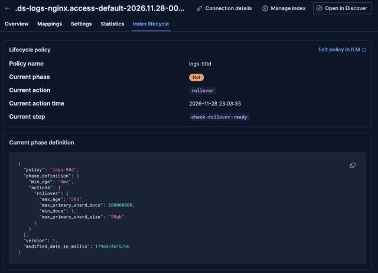

template을 고쳤는데 데이터는 그대로입니다. 반대로 pipeline 하나를 고쳤을 뿐인데 그때부터 적재가 실패합니다. 데이터 정의의 변경은 반영되는 시점이 제각각이라, 바꾼 사람이 기대한 시점과 실제로 영향이 나타나는 시점이 다릅니다.
이 글은 데이터 정의 종류별로 언제 반영되는지, 적용 전에 어떻게 확인하는지, 무엇이 같이 깨지는지를 정리합니다. managed 자산을 어디에 고칠지는 [03](../03-managed-assets/)에서 다룹니다.

:::note[기준]
- Elasticsearch 9.5.x 기준입니다. 공식 문서와 API reference는 2026년 11월에 다시 확인했습니다.
- 이름이 비슷한 simulate API가 둘 있습니다. `POST _ingest/pipeline/_simulate`(simulate pipeline API)는 5.0부터 GA이고, `POST _ingest/_simulate`(simulate ingest API)는 8.12에 들어온 experimental API입니다. 차이는 [pipeline simulate API 두 가지](#pipeline-simulate-api-두-가지)에 정리했습니다.
- 명령 모음은 [`labs/change/data-definitions.console`](https://github.com/Munsik/engineering-notes/blob/main/labs/change/data-definitions.console)에 있습니다.
:::

## 언제 반영되나

| 정의 | 반영 시점 | 기존 데이터 |
| --- | --- | --- |
| index template, component template | 새 index나 새 backing index가 만들어질 때 | 바뀌지 않음 |
| data stream mappings override(`PUT _data_stream/<name>/_mappings`) | 다음 rollover로 만들어지는 write index | 바뀌지 않음 |
| data stream settings override(`PUT _data_stream/<name>/_settings`) | 가능하면 모든 backing index에 바로, 아니면 다음 rollover | 허용된 설정만 바로 반영 |
| 기존 index의 mapping에 필드 추가(`PUT <index>/_mapping`) | 바로 | 이미 색인된 문서는 다시 색인하기 전까지 새 필드로 검색되지 않음 |
| ingest pipeline | 바로. 다음 요청부터 | 이미 색인된 문서는 그대로 |
| ILM policy | 현재 phase는 캐시된 정의로 계속, 다음 phase부터 새 정의 | phase 진행에 따라 |
| data stream lifecycle | 다음 lifecycle 실행부터 | 보관 기간 변경은 기존 backing index에도 적용 |
| synonym set | 갱신하면 그 set을 쓰는 search analyzer가 다시 읽음 | 색인 시점 synonym이면 다시 색인해야 반영 |
| enrich policy | policy를 다시 execute해야 enrich index가 갱신됨 | 이미 enrich된 문서는 그대로 |

template 변경이 기존 index에 영향을 주지 않는다는 것은 API reference에 명시돼 있습니다. component template도 index를 만들 때만 쓰이고, 기존 index와 data stream의 backing index에는 영향이 없습니다([Create or update an index template](https://www.elastic.co/docs/api/doc/elasticsearch/operation/operation-indices-put-index-template), [Create or update a component template](https://www.elastic.co/docs/api/doc/elasticsearch/operation/operation-cluster-put-component-template)).

그래서 template을 바꾼 뒤에는 rollover로 새 backing index를 만들어 결과를 확인합니다. 다음 자동 rollover를 기다리면 문제가 업무 시간이 아닐 때 드러납니다.

```console
POST logs-app-default/_rollover
GET logs-app-default/_mapping
```

## 적용 전에 확인하는 API

| 확인할 것 | API | 상태 |
| --- | --- | --- |
| 새 index에 어떤 template이 이기고, 결과 설정과 mapping이 무엇인지 | `POST _index_template/_simulate_index/<index>` | GA |
| 아직 저장하지 않은 template, 또는 저장된 template 하나의 결과 | `POST _index_template/_simulate`, `POST _index_template/_simulate/<template>` | GA |
| pipeline 하나의 처리 결과와 processor별 변화 | `POST _ingest/pipeline/_simulate`, `POST _ingest/pipeline/<id>/_simulate` | GA(5.0부터) |
| index에 실제로 넣을 때의 전체 흐름(default, final pipeline, reroute)과 mapping 검증 | `POST _ingest/_simulate`, `POST _ingest/<index>/_simulate` | experimental(8.12부터) |

### template simulate API 두 가지

| API | 입력 | 답하는 질문 | 이럴 때 쓴다 |
| --- | --- | --- | --- |
| `_simulate_index/<index>` | index 이름 | "이 이름으로 index가 만들어지면 어떤 template이 이기고 결과가 무엇인가" | `logs-*` 같은 넓은 패턴의 template을 새로 만들기 전에, 기존 integration data stream 이름을 넣어 우선순위 경쟁에서 무엇이 이기는지 확인할 때. 겹치는 template이 있으면 응답의 `overlapping`에 나옴 |
| `_simulate` (본문에 정의) | 저장하지 않은 template 정의 | "이 template을 저장하면 결과 mapping과 설정이 무엇인가" | PR에 올라온 template 변경을 CI에서 검증할 때. component template이 합쳐진 최종 mapping을 리뷰어에게 보여 줄 때 |

```console
# PR의 template 정의를 저장하지 않고 결과만 확인
POST _index_template/_simulate
{
  "index_patterns": ["logs-app-*"],
  "priority": 50,
  "composed_of": ["logs@mappings", "logs@settings", "app-logs-mappings"],
  "data_stream": {}
}
```

### pipeline simulate API 두 가지

이름이 거의 같아서 자주 헷갈립니다. 경로에 `pipeline`이 들어가면 pipeline 하나를 시험하는 GA API이고, 들어가지 않으면 index에 넣는 과정 전체를 시험하는 experimental API입니다. Elasticsearch 명세에서 simulate pipeline API는 `stack since=5.0.0 stability=stable`, simulate ingest API는 `stack since=8.12.0 stability=experimental`로 표시돼 있습니다([elasticsearch-specification](https://github.com/elastic/elasticsearch-specification)).

| | simulate pipeline API | simulate ingest API |
| --- | --- | --- |
| 경로 | `POST _ingest/pipeline/_simulate`, `POST _ingest/pipeline/<id>/_simulate` | `POST _ingest/_simulate`, `POST _ingest/<index>/_simulate` |
| 상태 | GA | experimental. 바뀌거나 없어질 수 있고 GA의 지원 SLA 대상이 아님 |
| 실행하는 것 | 지정한 pipeline 하나(그 안의 `pipeline` processor가 부르는 pipeline 포함) | 대상 index의 default pipeline과 final pipeline. reroute processor가 있으면 새 index의 pipeline까지 |
| 대상 index의 설정 | 보지 않음 | 봄. index 이름으로 default pipeline, final pipeline, mapping을 찾음 |
| mapping 검증 | 하지 않음 | 결과 문서를 적용될 mapping으로 검증해서 오류를 문서마다 표시 |
| 대체 정의 | 본문에 pipeline 하나 | `pipeline_substitutions`, `component_template_substitutions`, `index_template_substitutions`, `mapping_addition` |
| processor별 결과 | `verbose=true`로 processor마다 문서 변화 표시 | 없음. 실행된 pipeline 목록(`executed_pipelines`)만 |
| 저장 | 하지 않음 | 하지 않음 |

공식 설명도 같은 구분을 합니다. simulate pipeline API는 pipeline 하나를 개발할 때, simulate ingest API는 index에 넣을 때 적용되는 여러 pipeline의 상호작용을 문제 해결할 때 더 맞는다고 적혀 있습니다([Simulate data ingestion](https://www.elastic.co/docs/api/doc/elasticsearch/operation/operation-simulate-ingest), [Simulate a pipeline](https://www.elastic.co/docs/api/doc/elasticsearch/operation/operation-ingest-simulate)).

이럴 때 쓴다.

| 상황 | 쓸 API | 이유 |
| --- | --- | --- |
| `@custom` pipeline에 grok processor를 추가하면서 패턴이 맞는지 보고 싶다 | simulate pipeline, `verbose=true` | processor마다 문서가 어떻게 바뀌는지 보여서 어느 단계에서 틀렸는지 바로 보임 |
| CI에서 pipeline 변경을 막는 필수 테스트를 만들고 싶다 | simulate pipeline | GA라 응답 형식이 안정적이고, 기대 결과와 비교하는 테스트로 고정하기 좋음 |
| pipeline을 고쳤더니 문서가 failure store로 간다. pipeline 단독으로는 문제가 없었다 | simulate ingest | final pipeline이나 integration pipeline과의 순서 문제, 결과 필드와 mapping의 type 충돌은 index 단위로 돌려야 보임 |
| `logs-app-default`에 type을 바꾼 component template과 새 pipeline을 같이 배포하려 한다 | simulate ingest와 `component_template_substitutions`, `pipeline_substitutions` | 두 변경을 저장하지 않고 함께 넣었을 때 실제 문서가 mapping 검증을 통과하는지 한 번에 확인 |
| reroute processor로 dataset을 나누는 pipeline을 만들었다 | simulate ingest | 문서가 최종적으로 어느 index로 가는지(`_index`)와 거기서 실행된 pipeline이 응답에 나옴 |
| Agent나 integration 업그레이드 전에 새 버전 Agent가 보낼 문서를 미리 시험하고 싶다 | simulate ingest | 실제 data stream 이름으로 넣어 현재 mapping과 충돌하는지 확인 |

CI에 넣는다면 두 단계로 나눕니다. simulate pipeline API로 만든 테스트는 실패하면 배포를 막는 필수 단계로 두고, simulate ingest API로 만든 테스트는 실패하면 경고를 남기는 단계로 둡니다. experimental API는 버전이 바뀌면 요청이나 응답 형식이 달라질 수 있어서, 필수 단계로 두면 업그레이드 뒤 파이프라인이 이유 없이 깨질 수 있기 때문입니다.

simulate pipeline API의 예입니다. 본문에 pipeline 정의를 넣으면 저장하지 않은 pipeline을 시험할 수 있습니다.

```console
POST _ingest/pipeline/_simulate?verbose=true
{
  "pipeline": {
    "processors": [
      { "gsub": { "tag": "strip-ms", "field": "http.response.time", "pattern": "ms$", "replacement": "" } },
      { "convert": { "tag": "to-long", "field": "http.response.time", "type": "long" } }
    ]
  },
  "docs": [
    { "_source": { "http": { "response": { "time": "35ms" } } } },
    { "_source": { "http": { "response": { "time": "-" } } } }
  ]
}
```

두 번째 문서처럼 값이 `-`인 경우 `convert`가 실패하는 것이 `verbose` 결과에서 `to-long` tag와 함께 보입니다. 운영 로그에서 자주 나오는 예외 값을 표본에 꼭 넣습니다.

simulate ingest API의 예입니다. 실제 index 이름으로 넣고, 아직 저장하지 않은 pipeline과 component template을 대체 정의로 줍니다.

`pipeline_substitutions`는 대상 index의 default pipeline, final pipeline 자리에서 실행되는 pipeline에만 적용됩니다. `logs@custom`처럼 다른 pipeline 안의 `pipeline` processor로 불리는 pipeline은 이름을 넣어도 바뀌지 않았습니다(9.5.5 lab 실행 결과). 그래서 `logs@custom`에 넣을 processor를 시험할 때는 default pipeline인 `logs@default-pipeline` 자리에 기존 processor와 새 processor를 합친 정의를 넣습니다.

```console
POST _ingest/_simulate
{
  "docs": [
    {
      "_index": "logs-app-default",
      "_source": {
        "@timestamp": "2026-11-28T01:00:00Z",
        "message": "GET /api/orders?id=1 200 35ms",
        "http": { "response": { "time": "35ms" } }
      }
    }
  ],
  "pipeline_substitutions": {
    "logs@default-pipeline": {
      "processors": [
        { "set": { "field": "@timestamp", "copy_from": "_ingest.timestamp", "override": false } },
        { "gsub": { "tag": "strip-ms", "field": "http.response.time", "pattern": "ms$", "replacement": "" } },
        { "convert": { "tag": "to-long", "field": "http.response.time", "type": "long" } }
      ]
    }
  },
  "component_template_substitutions": {
    "logs@custom": {
      "template": {
        "mappings": {
          "properties": {
            "http.response.time": { "type": "long" }
          }
        }
      }
    }
  }
}
```


응답에는 처리된 문서, 실행된 pipeline 목록, 저장될 index 이름이 나오고, mapping과 맞지 않으면 그 오류가 문서마다 붙습니다. 다만 9.5.5 lab에서는 logsdb와 standard index 모두에서 모든 문서에 `_id should have been set on the coordinating node` 오류가 붙어, mapping 검증 결과를 확인하지 못했습니다(확인 필요). 앞에서 simulate ingest 테스트를 경고 단계로 두자고 한 것도 이런 경우 때문입니다. 같은 문서로 `component_template_substitutions`를 넣은 요청과 뺀 요청을 각각 돌리면, 새 mapping에서 통과하는지와 아직 rollover되지 않은 현재 mapping에서 통과하는지를 따로 볼 수 있습니다. 배포 순서(template 먼저, pipeline 나중)를 정할 때 이 비교가 근거가 됩니다.

### data stream override API와 template 수정

template을 고치지 않고 data stream 하나에만 mapping이나 설정을 덮어쓰는 API가 있습니다. 둘 다 GA입니다.

| API | 반영 | 이럴 때 쓴다 |
| --- | --- | --- |
| `PUT _data_stream/<name>/_mappings` | 다음 rollover로 만들어지는 write index | 여러 data stream이 같이 쓰는 template은 그대로 두고, 특정 data stream 하나에만 필드를 추가해야 할 때 |
| `PUT _data_stream/<name>/_settings` | 허용된 설정은 모든 backing index에 바로, 아니면 다음 rollover | 한 data stream만 적재량이 급증해서 다음 backing index의 shard 수를 늘리거나 `index.mapping.total_fields.limit`을 올려야 할 때 |

override는 template보다 우선하고, template만 보는 사람에게는 보이지 않습니다. 임시 조치로 쓰고, 계속 필요하면 `<data stream>@custom` component template으로 옮겨 Git에서 관리합니다. 남아 있는 override는 `GET _data_stream/<name>/_mappings`, `GET _data_stream/<name>/_settings`로 확인합니다.

## 깨지는 변경과 깨지지 않는 변경

| 변경 | 깨지나 | 처리 방법 |
| --- | --- | --- |
| 새 필드 추가 | 아니오 | template에 추가하고 rollover |
| 기존 필드에 multi-field 추가(예: `keyword` 하위 필드) | 아니오. 다만 기존 문서는 다시 색인해야 하위 필드가 채워짐 | template 추가 후 rollover, 과거 데이터가 필요하면 update by query |
| 필드 type 변경(`keyword`를 `long`으로 등) | 예 | 새 backing index부터 적용되도록 rollover. data stream 안에서 backing index마다 type이 달라지면 검색, 집계에서 충돌. 과거 데이터까지 맞추려면 reindex |
| 필드 이름 변경 | 예. 그 필드를 쓰는 모든 곳 | `alias` 필드 타입으로 이전 이름을 남겨 두고 단계적으로 이전 |
| 필드 제거 | 그 필드를 쓰는 곳 | mapping에서는 지울 수 없음. 수집을 멈추고 소비하는 곳을 먼저 정리 |
| analyzer 변경 | 검색 결과가 달라짐 | 새 index로 reindex. 색인 시점 analyzer는 기존 index에서 바꿀 수 없음 |
| `index.mode` 변경(standard, LogsDB, TSDS) | 저장 방식과 일부 기능 | rollover로 새 backing index부터. 저장 효과는 [데이터 설계 03](../../data/03-storage-footprint/) |
| `number_of_shards` 변경 | 아니오 | rollover로 새 backing index부터 |

검색할 때만 필요한 계산 필드는 runtime field로 먼저 만들어 보는 방법이 있습니다. mapping을 바꾸지 않고 query 시점에 값을 만들기 때문에 되돌리기 쉽고, 쓸모가 확인되면 그때 색인 필드로 옮깁니다.

필드 수가 늘어나는 변경은 [데이터 설계 06](../../data/06-mappings-and-fields/)의 기준을 같이 봅니다.

### type을 바꿔야 할 때

data stream에서 type을 바꾸면 이전 backing index와 새 backing index의 type이 다릅니다. 같은 data stream을 검색하면 그 필드는 index마다 type이 달라 집계나 정렬에서 오류가 나거나 일부 index만 결과에 들어갑니다. 선택지는 셋입니다.

| 방법 | 절차 | 비용 |
| --- | --- | --- |
| 새 필드 이름으로 추가 | `http.response.time_ms`(long)를 새로 만들고 둘 다 채우다가 이전 필드를 쓰는 곳을 정리 | 저장 공간 일시 증가, 소비처 수정 |
| rollover 후 이전 데이터 보관 기간이 지나길 기다림 | template 변경, rollover, 이전 backing index가 ILM으로 지워질 때까지 혼재 | 혼재 기간의 검색 오류 |
| reindex | 새 data stream으로 reindex 후 전환 | reindex 시간과 부하, 디스크 2배 |

reindex는 일반 `_reindex`로 새 data stream에 넣습니다. 이름이 비슷한 reindex data stream API(`POST _migration/reindex`)는 mapping 변경용이 아닙니다.

| API | 하는 일 | 이럴 때 쓴다 |
| --- | --- | --- |
| `POST _reindex` | 원본 문서를 대상 index나 data stream의 현재 mapping으로 다시 색인 | type 변경, analyzer 변경, 필드 정리처럼 mapping을 바꿔야 할 때 |
| `POST _migration/reindex` (reindex data stream API) | 이전 메이저에서 만든 backing index를 같은 설정과 mapping으로 새로 만들어 교체 | 8.x에서 9.x로 가기 전에 7.x에서 만든 backing index를 정리할 때. Upgrade Assistant가 쓰는 API이고 공식 문서도 Upgrade Assistant를 쓰라고 권함 |

reindex data stream API는 원래 backing index의 설정과 mapping을 그대로 복사합니다([Reindex data stream API](https://www.elastic.co/docs/reference/elasticsearch/rest-apis/reindex-data-stream)). type을 바꾸는 데 쓰면 아무것도 바뀌지 않습니다.

## ingest pipeline 변경

pipeline은 저장하는 순간 다음 요청부터 적용됩니다. 되돌리기는 쉽지만, 잘못된 pipeline으로 처리된 문서는 그대로 남습니다.

- 배포 전에 simulate pipeline API로 processor 단위를 확인하고, simulate ingest API로 실제 index에 넣는 흐름과 mapping 충돌을 확인합니다([pipeline simulate API 두 가지](#pipeline-simulate-api-두-가지)).
- 모든 processor에 `tag`를 붙이면 실패한 문서의 오류 정보에서 어느 processor가 실패했는지 바로 보입니다.
- failure store가 켜져 있으면 pipeline이 실패한 문서는 failure store로 갑니다. 고친 뒤에 다시 넣을 수 있습니다([수집 03](../../ingest/03-no-gap-ingest/)).
- `on_failure`로 실패를 삼키면 데이터는 들어가지만 문제가 숨습니다. 실패 사실을 필드로 남기는 것까지 하고, 그 필드를 alert로 봅니다.
- `version`과 `_meta`를 PR마다 갱신합니다([01](../01-change-map/#drift-확인)).

## ILM policy 변경

ILM은 index가 phase에 들어갈 때 그 phase의 정의를 index 메타데이터에 캐시합니다. policy를 바꾸면 안전하게 바꿀 수 있는 경우에만 캐시를 갱신하고, 아니면 캐시된 정의로 phase를 마칩니다. 다음 phase로 넘어갈 때 새 정의를 씁니다([Update or switch a lifecycle policy](https://www.elastic.co/docs/manage-data/lifecycle/index-lifecycle-management/policy-updates)).

- `min_age` 변경은 캐시에 반영되지 않습니다. 이미 그 phase를 실행 중인 index에는 영향이 없습니다.
- index에 다른 policy를 지정하면, 현재 phase는 이전 policy의 캐시로 마치고 다음 phase부터 새 policy를 따릅니다.
- 보관 기간을 줄이는 변경은 다음 phase 진입 시점에 대량 삭제가 한꺼번에 일어날 수 있습니다. 삭제 대상이 많으면 시간대를 고르고 디스크와 master 부하를 봅니다.

```console
# 각 index가 어느 policy의 어느 phase, 어느 버전에 있는지
GET logs-app-default/_ilm/explain?filter_path=indices.*.policy,indices.*.phase,indices.*.phase_execution.version,indices.*.phase_execution.modified_date_in_millis
```



`phase_execution.version`이 policy의 현재 version보다 낮으면 그 index는 이전 정의로 phase를 실행 중입니다.

ILM과 data stream lifecycle 중 무엇을 쓸지는 [데이터 설계 05](../../data/05-tiers-and-retention/)에서 다룹니다. 같은 data stream에서 둘을 바꿔 탈 때는 `index.lifecycle.prefer_ilm` 설정이 어느 쪽을 쓸지 정합니다.

## 영향 분석

필드 이름이나 type, index 이름을 바꾸기 전에 그것을 쓰는 곳을 찾습니다.

| 소비처 | 찾는 방법 |
| --- | --- |
| dashboard, visualization, Discover session | saved objects를 export해서 필드 이름으로 검색. ES\|QL 패널은 query 문자열에 필드 이름이 들어 있음 |
| data view의 runtime field, field format | data view 정의 |
| detection rule, alerting rule | rule을 export해서 query 검색 |
| ML anomaly detection job | job의 `analysis_config`, datafeed의 query와 index |
| transform | source query, pivot의 group_by와 aggregation |
| enrich policy | `match_field`, `enrich_fields` |
| 애플리케이션, 보고서 | 코드 저장소 검색. 가장 놓치기 쉬움 |

```console
# 필드 이름이 들어간 ML job과 datafeed, transform을 찾기 위한 원본
GET _ml/anomaly_detectors?filter_path=jobs.job_id,jobs.analysis_config
GET _ml/datafeeds?filter_path=datafeeds.datafeed_id,datafeeds.indices,datafeeds.query
GET _transform?filter_path=transforms.id,transforms.source,transforms.pivot
```

Kibana의 saved objects 화면에서 객체마다 Relationships를 보면 data view와 dashboard 사이의 참조를 따라갈 수 있습니다. 다만 ES\|QL 패널처럼 data view 없이 index를 직접 쓰는 패널은 참조 관계에 나오지 않으므로, export한 파일에서 문자열로 찾는 방법을 같이 씁니다.

## integration과 Agent 버전 변경도 데이터 정의 변경이다

integration을 업그레이드하면 그 integration의 template, pipeline, mapping이 바뀝니다. Agent를 업그레이드하면 같은 integration이라도 보내는 필드 구조가 바뀔 수 있습니다. 둘 다 데이터 정의 변경으로 다룹니다.

현장에서 겪은 사례를 업종 수준으로 옮기면 이렇습니다. 일부 Windows Agent를 업그레이드했더니 업그레이드한 Agent에서 온 이벤트만 그 시점부터 failure store로 들어가기 시작했습니다. Agent 상태는 정상으로 표시됐습니다. 새 Agent가 보낸 필드의 type이 기존 data stream의 mapping, 또는 설치된 integration pipeline의 기대와 맞지 않았던 경우입니다. Agent는 정상인데 데이터가 실패한다면 이 방향부터 봅니다.

- integration 업그레이드는 검증 환경에서 먼저 하고, 업그레이드한 Agent 몇 대의 데이터로 failure store와 mapping 충돌을 확인한 뒤 넓힙니다.
- 운영에서는 Agent policy 단위로 단계적으로 배포합니다. Fleet의 자동 업그레이드는 비율을 정해 단계적으로 올릴 수 있습니다(9.1부터, 구독 조건 있음)([Auto-upgrade agents](https://www.elastic.co/docs/reference/fleet/upgrade-elastic-agent#auto-upgrade-agents)).
- 자동으로 업그레이드되는 integration이 무엇인지 알아 둡니다([03](../03-managed-assets/#managed-자산은-누가-언제-덮어쓰나)).
- 업그레이드 뒤에는 rollover로 새 backing index를 만들어 새 mapping으로 데이터가 들어가는지 확인합니다.

Agent 운영 전반은 [수집 08](../../ingest/08-fleet-at-scale/)에 있습니다.

## 함께 관리해야 하는 정의

| 정의 | 변경 시 주의할 점 |
| --- | --- |
| synonym set | 갱신하면 그 set을 쓰는 analyzer가 다시 읽습니다. search time synonym이면 바로 검색 결과가 바뀌므로 검색 품질 측정과 같이 바꿉니다 |
| enrich policy | 정의를 바꾸거나 원본 index가 바뀌면 `_execute`로 enrich index를 다시 만들어야 합니다. 실행 중에는 이전 enrich index가 쓰입니다 |
| inference endpoint | 모델을 바꾸면 이미 만든 embedding과 새 query의 embedding이 맞지 않습니다. 데이터를 다시 처리해야 하므로 사실상 reindex입니다 |
| stored script, search template | 애플리케이션이 이름으로 호출하므로 이름을 바꾸지 말고 새 이름으로 추가한 뒤 전환합니다 |
| query ruleset | 검색 결과의 순서를 바로 바꿉니다. 변경 전후 결과를 표본 query로 비교합니다 |
| transform | 정의를 바꾸면 destination index의 의미가 바뀝니다. 새 transform과 새 destination으로 만들고 전환하는 편이 안전합니다 |

## 참고 문서

- [Create or update an index template](https://www.elastic.co/docs/api/doc/elasticsearch/operation/operation-indices-put-index-template)
- [Create or update a component template](https://www.elastic.co/docs/api/doc/elasticsearch/operation/operation-cluster-put-component-template)
- [Update data stream mappings](https://www.elastic.co/docs/api/doc/elasticsearch/operation/operation-indices-put-data-stream-mappings)
- [Update data stream settings](https://www.elastic.co/docs/api/doc/elasticsearch/operation/operation-indices-put-data-stream-settings)
- [Simulate data ingestion](https://www.elastic.co/docs/api/doc/elasticsearch/operation/operation-simulate-ingest)
- [Modify a data stream](https://www.elastic.co/docs/manage-data/data-store/data-streams/modify-data-stream)
- [Update or switch a lifecycle policy](https://www.elastic.co/docs/manage-data/lifecycle/index-lifecycle-management/policy-updates)
- [Reindex data stream API](https://www.elastic.co/docs/reference/elasticsearch/rest-apis/reindex-data-stream)
