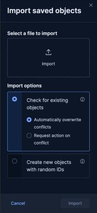
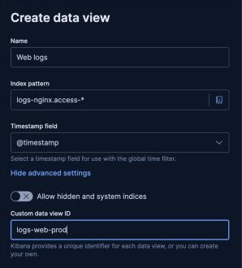
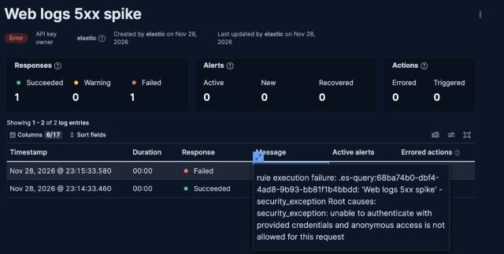
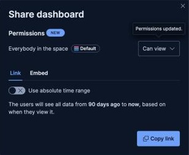

Kibana에는 화면에서 만든 것들이 쌓입니다. dashboard, data view, rule, connector, space, role. 대부분 누군가 UI에서 만들었고, 원본은 운영 Kibana 안에만 있습니다. 개발 환경에서 만든 dashboard를 운영으로 옮기려고 export했더니 import가 안 되고, 담당자가 퇴사하자 rule이 멈춥니다.
이 글은 Kibana 객체를 종류별로 어디서 관리하고, 환경 사이에 어떻게 옮기고, 어떤 설정을 파일로 고정할지 정리합니다. dashboard의 CI/CD는 [06](../06-dashboards-as-code/)에서 따로 다룹니다.

:::note[기준]
- Kibana 9.5.x 기준입니다. 공식 문서와 Kibana API reference는 2026년 11월에 다시 확인했습니다.
- Dashboards API와 Visualizations API는 9.4에서 tech preview, 9.5에서 GA입니다.
- 명령 모음과 export 스크립트는 [`labs/change/kibana-objects/`](https://github.com/Munsik/engineering-notes/tree/main/labs/change/kibana-objects)에 있습니다.
:::

## 객체 종류별 관리 경로

| 객체 | 코드로 두는 방법 | 환경 간 이동 | 메모 |
| --- | --- | --- | --- |
| dashboard | Dashboards API JSON(9.5 GA), Terraform(tech preview) | Dashboards API `PUT` | [06](../06-dashboards-as-code/) |
| library visualization | Visualizations API JSON(9.5 GA) | Visualizations API `PUT` | dashboard 안에 by value로 두면 따로 관리할 필요가 없음 |
| data view | Data views API, Terraform | `id`를 지정해 생성 | UI에서도 custom data view ID를 정할 수 있음 |
| Discover session, tag, map 등 | saved objects export(NDJSON) | saved objects import | 버전 규칙 주의 |
| alerting rule | Alerting API, Terraform | API로 재생성 | API key가 rule에 붙음 |
| connector | Connectors API, Terraform, `kibana.yml`의 preconfigured connector | API 또는 설정 파일 | secret은 encryption key로 암호화 |
| detection rule, exception | Detection engine API(`rule_id`), detection-rules 저장소, Terraform | `rule_id` 기준 import | prebuilt rule은 [03](../03-managed-assets/#prebuilt-detection-rule) |
| SLO | SLO API, Terraform | API로 재생성 | |
| synthetic monitor | Synthetics project(`push`), Terraform | project를 환경마다 `push` | |
| ML anomaly detection job | Elasticsearch ML API, Kibana의 job export와 import | API | datafeed와 함께 |
| space | Spaces API, Terraform | API | |
| Kibana role | Elasticsearch role API(Kibana 권한 포함), Terraform | API | |
| Fleet agent policy, integration policy, output | Fleet API, Terraform, `kibana.yml`의 Fleet preconfiguration | API 또는 설정 파일 | |

한 객체에는 도구를 하나만 정합니다. 같은 rule을 Terraform과 API 스크립트가 함께 관리하면 서로의 변경을 덮어씁니다.

## saved objects NDJSON의 규칙

전용 as-code API가 없는 객체는 saved objects export와 import로 옮깁니다. 지켜야 할 규칙이 있습니다([Import saved objects](https://www.elastic.co/docs/api/kibana/operation/operation-post-saved-objects-import), [Export saved objects](https://www.elastic.co/docs/api/kibana/operation/operation-post-saved-objects-export)).

- import는 같은 버전, 같은 메이저의 더 새로운 마이너, 바로 다음 메이저로만 됩니다. 더 오래된 Kibana로는 import할 수 없습니다. 개발 환경이 운영보다 새 버전이면 개발에서 만든 객체를 운영에 넣을 수 없습니다.
- export 결과는 불투명한(opaque) 데이터로 취급하라고 공식 문서가 명시합니다. 손으로 고치면 알 수 없는 오류나 데이터 손실이 날 수 있습니다.
- export에 들어 있는 `coreMigrationVersion`, `typeMigrationVersion`을 지우면 안 됩니다. Git에 저장할 때 diff를 줄이려고 이 필드를 빼면 다음 버전에서 import가 깨질 수 있습니다.
- 한 번에 export할 수 있는 개수는 `savedObjects.maxImportExportSize`로 제한됩니다.

import 옵션은 셋이고, 서로 함께 쓸 수 없는 조합이 있습니다.

| 옵션 | 동작 | 이럴 때 쓴다 |
| --- | --- | --- |
| `overwrite=true` | 같은 ID가 있으면 덮어씀 | 개발 space에서 고친 Discover session을 운영에 반영할 때. ID가 같아서 운영의 dashboard 참조가 그대로 유지됨 |
| `createNewCopies=true` | ID를 새로 만들고 origin을 초기화 | 팀마다 공용 템플릿 dashboard를 받아 각자 고쳐 쓰게 할 때. 원본과 연결이 끊긴 독립 복사본이 필요할 때. `overwrite`, `compatibilityMode`와 함께 쓸 수 없음 |
| `compatibilityMode=true` | 버전 간 호환을 위한 보정 | 이전 마이너에서 export한 파일을 import했더니 객체가 열리지 않는 등 문제가 있을 때만 |
| 아무 옵션 없음 | 같은 ID가 있으면 충돌 오류 | 대상 환경에 같은 객체가 이미 있는지 먼저 확인하고 싶을 때. 충돌 목록을 보고 `_resolve_import_errors`로 객체별로 처리 |



space 사이로 복사하는 `POST /api/spaces/_copy_saved_objects`는 `createNewCopies`의 기본값이 `true`입니다([Copy saved objects between spaces](https://www.elastic.co/docs/api/kibana/operation/operation-post-spaces-copy-saved-objects)). 기본값 그대로 복사하면 ID가 새로 생겨서, 같은 ID로 관리하려던 계획이 깨집니다. ID를 유지하려면 `createNewCopies: false`와 `overwrite: true`를 명시합니다.

```bash
# 특정 타입을 space 단위로 export. 관련 객체까지 포함
curl -s -X POST "$KIBANA_URL/s/$SPACE/api/saved_objects/_export" \
  -H "Authorization: ApiKey $KIBANA_API_KEY" -H 'kbn-xsrf: true' -H 'Content-Type: application/json' \
  -d '{"type": ["search", "tag", "map"], "includeReferencesDeep": true, "excludeExportDetails": true}' \
  > export.ndjson

# ID를 유지하며 import
curl -s -X POST "$KIBANA_URL/s/$SPACE/api/saved_objects/_import?overwrite=true" \
  -H "Authorization: ApiKey $KIBANA_API_KEY" -H 'kbn-xsrf: true' \
  -F file=@export.ndjson
```

import 응답의 `success`가 `false`이거나 `errors`가 있으면 배포를 실패로 처리합니다. 참조한 객체가 대상 환경에 없으면 `missing_references` 오류가 나옵니다.

## ID 전략

dashboard는 data view와 library visualization을 ID로 참조합니다. 자동 생성된 ID는 환경마다 다르므로, 한 환경에서 export한 dashboard는 다른 환경에서 참조를 찾지 못해 빈 패널이 됩니다([Manage dashboards as code](https://www.elastic.co/docs/explore-analyze/dashboards/manage-dashboards-as-code#dashboards-as-code-portability)).

| 방법 | 내용 |
| --- | --- |
| 참조를 없앤다 | ES\|QL 패널은 query에 index를 직접 쓰므로 data view 참조가 없음. ES\|QL이 맞지 않는 패널은 by value로 두고 ad hoc data view를 씀 |
| ID를 정해서 만든다 | dashboard와 visualization은 `PUT /api/dashboards/{id}`, `PUT /api/visualizations/{id}`로 만들고, data view는 Data views API의 `POST`에 `id`를 넣거나 UI에서 custom data view ID를 지정 |
| Terraform에 맡긴다 | provider가 환경별 ID 대응을 추적 |

ID는 사람이 읽을 수 있는 이름으로 짓습니다. `logs-web-prod` 같은 data view ID, `web-logs-overview` 같은 dashboard ID는 로그와 diff에서 바로 알아볼 수 있습니다. 같은 클러스터 안에서 space만 다르면 같은 ID를 space마다 쓸 수 있습니다. 요청 URL에 `/s/<space_id>`를 붙여 대상 space를 정합니다.

```console
POST kbn:/api/data_views/data_view
{
  "data_view": {
    "id": "logs-web-prod",
    "name": "Web logs",
    "title": "logs-nginx.access-*",
    "timeFieldName": "@timestamp"
  }
}
```



## rule과 API key

Kibana의 alerting rule과 detection rule은 실행할 때 API key를 씁니다. rule을 만들거나 수정한 사용자의 권한으로 key가 만들어지고 rule에 붙습니다. detection rule API 문서는 이 동작을 경고로 적고 있습니다. API key로 rule을 수정하면 그 key가 rule에 붙고, key가 삭제되거나 사용자가 비활성화되면 rule이 멈추고, 권한이 다른 key로 수정하면 rule 동작이 달라질 수 있습니다([Patch a detection rule](https://www.elastic.co/docs/api/kibana/operation/operation-patchrule)).

현장에서 자주 생기는 일은 두 가지입니다.

- 담당자 계정으로 만든 rule이 퇴사나 계정 비활성화 뒤에 일제히 멈춥니다. 오류가 rule 실행 상태에만 나오기 때문에 알림이 오지 않는 것을 "조용하다"로 오해합니다.
- 자동화가 만든 rule을 누군가 운영 화면에서 한 번 수정하면, key가 그 사람의 것으로 바뀝니다. 다음 배포 때 다시 자동화의 key로 돌아가고, 그사이 권한 차이 때문에 결과가 달라집니다.



대응은 [01의 CI/CD 계정 설계](../01-change-map/#cicd-계정-설계)와 같습니다. rule은 전용 계정으로만 만들고 수정합니다. 이미 사람 계정에 붙은 rule이 있다면 전용 계정으로 다시 저장해서 key를 교체합니다. 그리고 rule 실행 실패를 보는 alert를 따로 둡니다. "alert가 없다"가 "rule이 죽었다"일 수 있기 때문입니다.

## encryption key

Kibana는 connector의 비밀번호와 token, rule의 API key 같은 민감한 값을 `xpack.encryptedSavedObjects.encryptionKey`로 암호화해서 저장합니다. 설정하지 않으면 시작할 때 임의의 key를 만들고, 일부 기능은 key를 명시할 때까지 쓸 수 없습니다([Security settings](https://www.elastic.co/docs/reference/kibana/configuration-reference/security-settings)).

변화 관리에서 이 key가 중요한 이유는 이렇습니다.

- 여러 Kibana 인스턴스가 같은 Elasticsearch를 쓰면 모든 인스턴스의 key가 같아야 합니다. 다르면 한 인스턴스가 암호화한 값을 다른 인스턴스가 읽지 못합니다.
- Kibana를 새 서버로 옮기거나 다시 설치할 때 key를 잃으면, 그 key로 암호화한 connector와 rule의 secret을 복구할 방법이 없습니다. 모든 connector를 다시 만들어야 합니다.
- key를 바꿀 때는 새 key를 `encryptionKey`에 넣고, 이전 key를 `xpack.encryptedSavedObjects.keyRotation.decryptionOnlyKeys`에 남깁니다. Kibana는 이전 key를 암호화에는 쓰지 않고 기존 객체를 읽을 때만 씁니다.

key는 비밀 관리 도구에 두고, `kibana.yml`을 Git에 둘 때는 값 대신 환경 변수나 keystore를 참조하게 합니다. ECH에서는 이 설정을 사용자가 정하지 않습니다.

## kibana.yml로 고정할 수 있는 것

UI에서 바꿀 수 없게 파일로 고정하는 방법도 있습니다. 운영에서 바뀌면 안 되는 것에 맞습니다.

| 설정 | 고정하는 대상 |
| --- | --- |
| `xpack.actions.preconfigured` | connector. 파일로 정의한 connector는 UI에서 편집, 삭제할 수 없음 |
| `xpack.fleet.packages` | 설치할 integration과 버전 |
| `xpack.fleet.agentPolicies` | agent policy와 그 안의 integration policy |
| `xpack.encryptedSavedObjects.*` | 앞 절의 encryption key |

```yaml
# kibana.yml
xpack.actions.preconfigured:
  ops-webhook:
    name: "Ops webhook"
    actionTypeId: .webhook
    config:
      url: "https://hooks.example.internal/elastic"
      method: post
    secrets:
      user: "${OPS_WEBHOOK_USER}"
      password: "${OPS_WEBHOOK_PASSWORD}"
```

preconfigured connector는 ID가 고정되므로 rule이 환경과 상관없이 같은 connector ID를 참조할 수 있습니다. 환경마다 URL만 다르게 두면 rule 정의를 바꾸지 않고 환경 간에 옮길 수 있습니다. 설정 항목은 [Alerting and action settings](https://www.elastic.co/docs/reference/kibana/configuration-reference/alerting-settings)와 [Fleet settings](https://www.elastic.co/docs/reference/kibana/configuration-reference/fleet-settings)에 있습니다.

## Kibana 업그레이드와 saved object migration

Kibana는 업그레이드할 때 saved object를 새 버전 형식으로 바꿉니다. 이 과정에 대한 공식 문서의 요구는 이렇습니다([Upgrade Kibana](https://www.elastic.co/docs/deploy-manage/upgrade/deployment-or-cluster/kibana)).

- Kibana는 항상 Elasticsearch 다음에, 같은 버전으로 올립니다.
- rolling upgrade를 지원하지 않습니다. 이전 버전 인스턴스를 모두 내린 뒤 새 버전을 띄웁니다. 이전 버전이 살아 있는 상태로 업그레이드하면 데이터 손실이나 실패가 생길 수 있습니다.
- 모든 인스턴스의 버전, 설정, plugin이 같아야 합니다.
- `.kibana`와 `.kibana_task_manager` index 크기의 두 배 이상 디스크 여유, 충분한 heap, GREEN 상태가 필요합니다.
- 실패하면 이전 버전으로 돌아가기 위해 업그레이드 전 snapshot의 `kibana` feature state가 필요합니다.

인스턴스가 10대를 넘고 saved object가 1만 개를 넘는 대규모 환경에서는 한 대를 먼저 띄워 migration을 끝낸 뒤 나머지를 띄우면 중단 시간을 줄일 수 있다고 공식 문서는 안내합니다. 쓰지 않는 saved object를 업그레이드 전에 정리하면 migration 시간과 실패 가능성이 같이 줄어듭니다.

롤백 절차는 [08](../08-major-upgrade/#kibana-롤백)에 있습니다.

## 운영 space 권한과 변경 추적

- 운영 space에서 dashboard, rule, data view에 쓰기 권한을 가진 사람을 최소로 둡니다. Kibana role의 feature 권한으로 나눕니다.
- 9.x의 dashboard에는 소유자가 다른 사용자의 편집을 막는 설정이 있습니다(`access_control.access_mode`의 `write_restricted`). 자동화가 관리하는 dashboard에 쓰면 실수로 고치는 일을 줄일 수 있습니다([Export and share dashboards](https://www.elastic.co/docs/explore-analyze/dashboards/sharing#manage-dashboard-access)).



- Saved Objects Management 권한은 다른 앱의 객체까지 모두 관리할 수 있게 합니다. 이 권한은 관리자에게만 줍니다([Saved objects](https://www.elastic.co/docs/explore-analyze/find-and-organize/saved-objects)).
- Kibana audit log의 `saved_object_update`, `saved_object_delete` 이벤트로 Git 밖에서 일어난 변경을 찾습니다([01](../01-change-map/#누가-바꿨는지-남긴다)).

## Fleet을 코드로 관리할 때

Fleet 객체를 Terraform으로 관리하는 조직에서 반복해서 들은 함정입니다.

- UI에서 integration을 먼저 업그레이드하면 코드의 integration policy 정의와 어긋납니다. 업그레이드는 코드에서 버전을 바꾸는 것으로만 합니다. UI의 integration policy 화면에서 요청 내용을 보면(Preview API request) 코드에 옮길 정의를 얻을 수 있습니다.
- agent가 등록된 agent policy는 지울 수 없습니다. 코드에서 policy를 교체(삭제 후 생성)하게 만들면 `apply`가 실패합니다. policy는 교체하지 않고 수정하도록 코드를 짜고, 정말 바꿔야 하면 agent를 새 policy로 먼저 옮깁니다.
- UI에서 시험 삼아 만든 policy에 agent를 붙여 두면 나중에 코드로 정리할 때 같은 문제가 생깁니다. 시험은 검증 환경에서 합니다.

## 참고 문서

- [Import saved objects](https://www.elastic.co/docs/api/kibana/operation/operation-post-saved-objects-import)
- [Export saved objects](https://www.elastic.co/docs/api/kibana/operation/operation-post-saved-objects-export)
- [Copy saved objects between spaces](https://www.elastic.co/docs/api/kibana/operation/operation-post-spaces-copy-saved-objects)
- [Manage dashboards as code](https://www.elastic.co/docs/explore-analyze/dashboards/manage-dashboards-as-code)
- [Patch a detection rule](https://www.elastic.co/docs/api/kibana/operation/operation-patchrule)
- [Kibana security settings](https://www.elastic.co/docs/reference/kibana/configuration-reference/security-settings)
- [Alerting and action settings](https://www.elastic.co/docs/reference/kibana/configuration-reference/alerting-settings)
- [Fleet settings](https://www.elastic.co/docs/reference/kibana/configuration-reference/fleet-settings)
- [Upgrade Kibana](https://www.elastic.co/docs/deploy-manage/upgrade/deployment-or-cluster/kibana)
