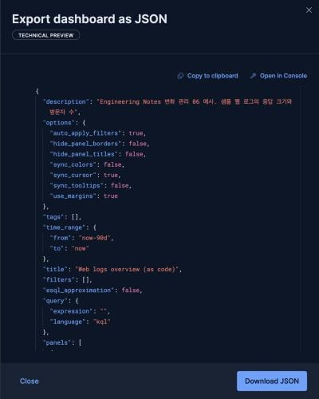
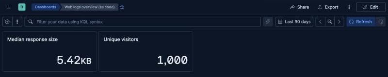

같은 이름의 dashboard가 개발, 검증, 운영 Kibana에 하나씩 있는데 내용이 조금씩 다릅니다. 누가 언제 운영 dashboard의 query를 바꿨는지 아무도 모르고, 이전 상태로 돌리려 해도 이전 상태가 없습니다.
Kibana 9.5에서 Dashboards API가 GA가 되면서 dashboard를 읽기 쉬운 JSON으로 다루고 그대로 다시 적용할 수 있게 됐습니다. 이 API로 dashboard 정의를 Git에 두고 CI/CD로 배포할 수 있습니다.

:::note[기준]
- Kibana 9.5.x 기준입니다. Dashboards API와 Visualizations API는 9.4에서 tech preview, 9.5에서 GA입니다([Create dashboards programmatically](https://www.elastic.co/docs/explore-analyze/dashboards/create-dashboards-programmatically)).
- Terraform의 `elasticstack_kibana_dashboard` 리소스는 tech preview입니다.
- 스크립트, 예시 dashboard, GitHub Actions workflow는 [`labs/change/dashboards-as-code/`](https://github.com/Munsik/engineering-notes/tree/main/labs/change/dashboards-as-code)에 있습니다. 공식 문서와 API reference 기준으로 작성했고, lab 클러스터에서 실행 확인은 하지 않았습니다.
:::

## 무엇이 달라졌나

예전에도 dashboard를 saved objects NDJSON으로 export해서 Git에 둘 수 있었습니다. 문제는 그 파일이 사람이 읽고 리뷰하기 어렵다는 점이었습니다. 패널 설정이 문자열로 직렬화된 JSON 안에 들어 있어서, query 하나를 바꿔도 diff가 한 줄짜리 거대한 문자열로 나옵니다. 공식 문서도 export 결과를 opaque 데이터로 다루라고 안내합니다.

Dashboards API는 dashboard를 구조화된 JSON으로 주고받습니다. 패널, control, section, 표시 옵션이 모두 필드로 나뉘어 있어서 PR diff에서 어느 패널의 어느 query가 바뀌었는지 바로 보입니다.

| | saved objects NDJSON | Dashboards API JSON |
| --- | --- | --- |
| 리뷰 | 어려움. 패널 상태가 문자열 안에 있음 | 쉬움. 필드 단위 diff |
| 손으로 수정 | 권하지 않음 | 가능. schema로 검증됨 |
| 버전 규칙 | 같은 버전, 새 마이너, 다음 메이저로만 import | API schema를 따름 |
| 지원 범위 | 모든 saved object | schema가 있는 패널만 |

Dashboards API가 지원하는 패널은 visualization, Discover session, Markdown, image, control(options list, range slider, time slider, ES\|QL), SLO 패널, synthetics 패널이고, 9.5부터 links, APM service map, ML과 AIOps 패널이 더해졌습니다. Maps처럼 schema가 없는 패널은 쓰기 요청에서 오류가 납니다. 한 dashboard에 최상위 항목(패널과 section 합계) 1,000개, section 하나에 패널 1,000개, pinned control 100개까지이고, 전체 합계도 1,000개를 넘을 수 없습니다([Create dashboards programmatically](https://www.elastic.co/docs/explore-analyze/dashboards/create-dashboards-programmatically#dashboards-api)).

## 흐름


공식 문서가 정리한 네 단계(export, store, review, deploy)에 배포 후 검증과 drift 검사를 더했습니다([Manage dashboards as code](https://www.elastic.co/docs/explore-analyze/dashboards/manage-dashboards-as-code#dashboards-as-code-workflow)). dashboard를 코드로 관리하기 시작하면 Git이 유일한 원본이고, UI에서 직접 바꾼 내용은 다음 배포 때 덮어써집니다.

## 설계 결정 1. 환경이 달라도 깨지지 않는 참조

dashboard를 환경 사이에 옮길 때 가장 큰 문제는 참조입니다. dashboard는 data view와 library visualization을 ID로 참조하는데, 자동 생성된 ID는 환경마다 다릅니다. 공식 문서가 제시하는 해법은 자동화 정도가 높은 순서로 세 가지입니다.

| 방법 | 내용 | 적합한 경우 |
| --- | --- | --- |
| Terraform | provider가 환경별 ID 대응을 추적 | 이미 Terraform을 쓰는 조직 |
| ES\|QL 패널 | visualization 정의를 dashboard 안에 두고, query가 index를 직접 읽어 data view가 필요 없음 | 새로 만드는 dashboard |
| ID를 정해서 생성 | dashboard와 visualization은 `PUT`으로, data view는 `id`를 지정해 생성 | 기존 dashboard를 옮겨 오는 경우 |

외부 참조가 없는 dashboard가 가장 다루기 쉽습니다. ES\|QL로 표현하기 어려운 패널은 by value로 두고 ad hoc data view를 씁니다. library visualization은 여러 dashboard가 공유해야 할 때만 씁니다. 공유하는 순간 배포 순서(visualization 먼저, dashboard 나중)를 관리해야 합니다.

integration이 설치한 managed dashboard는 코드로 관리하지 않습니다. 고쳐 쓰려면 복제하고, 복제본을 코드로 관리합니다([03](../03-managed-assets/#integration-dashboard)).

## 설계 결정 2. API 직접 호출과 Terraform

| | Dashboards API 직접 호출 | Terraform `elasticstack_kibana_dashboard` |
| --- | --- | --- |
| 상태 | GA(9.5) | tech preview |
| 정의 형식 | API JSON. UI의 Export JSON 결과를 그대로 씀 | provider의 HCL schema. export한 JSON을 자동 변환하지 않음 |
| 기존 dashboard | export해서 바로 관리 시작 | `terraform import` 후 설정을 손으로 작성 |
| 지원 패널 | API가 지원하는 전부 | 아직 API의 모든 패널 type과 옵션을 지원하지 않음 |
| 변경 미리보기 | 스크립트로 GET 결과와 비교 | `terraform plan` |
| ID 관리 | 직접 정함 | provider가 추적 |

공식 문서는 Terraform 리소스가 처음부터 코드로 작성하는 dashboard에 적합하고, 이미 있는 dashboard를 가져오는 데는 적합하지 않다고 설명합니다([Automate with Terraform](https://www.elastic.co/docs/explore-analyze/dashboards/manage-dashboards-as-code#dashboards-as-code-terraform)). 분석가가 UI에서 만들고 운영팀이 배포하는 흐름이라면 API 직접 호출이 맞습니다. 아래 내용은 API 직접 호출을 기준으로 합니다.

현장에서는 Terraform으로 dashboard를 많이 관리할 때 plan과 refresh가 몇 분씩 걸린다는 이야기가 나옵니다. dashboard마다 전체 정의를 읽어 와 비교하기 때문입니다. dashboard 수가 많다면 검증 환경에서 소요 시간을 미리 측정합니다.

## 저장소 구조

```text
kibana-dashboards/
├── dashboards/
│   ├── web-logs-overview.json        # Dashboards API의 data 부분
│   └── checkout-latency.json
├── environments/
│   ├── staging.env                   # KIBANA_URL, SPACE
│   └── production.env
├── scripts/
│   ├── export.sh                     # GET 후 data만 저장
│   ├── deploy.sh                     # PUT 후 되읽어 비교
│   └── drift.sh                      # 운영과 Git 비교
└── .github/workflows/dashboards.yml
```

파일 이름이 곧 dashboard ID입니다. `web-logs-overview.json`은 `PUT /api/dashboards/web-logs-overview`로 배포합니다. ID는 소문자와 하이픈으로 짓습니다.

## 구현

### export

GET 응답은 `id`, `data`, `meta`, `warnings`로 나뉩니다. `data`가 dashboard 정의이고, `meta`에는 생성, 수정 시각과 수정한 사용자, 내부 version이 들어 있습니다([Get a dashboard](https://www.elastic.co/docs/api/kibana/operation/operation-get-dashboard)). Git에는 `data`만 저장합니다. `meta`는 환경마다 다르고 매번 바뀌어서 diff를 어지럽힙니다.

```bash
#!/usr/bin/env bash
# scripts/export.sh <dashboard-id> [space]
set -euo pipefail
ID="$1"; SPACE="${2:-${SPACE:-default}}"
curl -sf "$KIBANA_URL/s/$SPACE/api/dashboards/$ID" \
  -H "Authorization: ApiKey $KIBANA_API_KEY" \
  | jq -S '.data' > "dashboards/$ID.json"
```

`jq -S`로 key를 정렬해서 저장하면 같은 내용이 다른 순서로 나와 생기는 diff를 막습니다.

UI에서는 dashboard의 **Export** 메뉴에서 **Export JSON**을 고르면 API가 받는 형식의 JSON을 볼 수 있습니다. 이 화면은 Stack 9.4와 9.5에서 tech preview입니다. 이때 API가 아직 지원하지 않는 패널이나 속성은 빠지고, **Unsupported properties were removed** 아래에 목록으로 표시됩니다([Export JSON](https://www.elastic.co/docs/explore-analyze/dashboards/sharing#export-dashboards)). 이 목록이 비어 있지 않으면 그 dashboard는 아직 코드로 관리할 수 없거나, 빠지는 부분을 다른 패널로 바꿔야 합니다.



### deploy

만드는 API는 둘입니다.

| API | ID | 쓰는 상황 |
| --- | --- | --- |
| `POST /api/dashboards` | Kibana가 새로 만듦. 호출할 때마다 새 dashboard | 공용 템플릿에서 팀별 dashboard를 한 번 찍어 내고 이후는 각 팀이 UI로 관리할 때 |
| `PUT /api/dashboards/{id}` | 요청한 ID. 없으면 만들고 있으면 바꿈 | Git에서 관리하는 dashboard를 환경마다 같은 ID로 배포할 때. CI/CD는 항상 이쪽 |

CI/CD에서 `POST`를 쓰면 배포할 때마다 같은 dashboard가 하나씩 늘어납니다.

`PUT /api/dashboards/{id}`는 없으면 만들고 있으면 통째로 바꿉니다. 요청에 없는 패널은 지워집니다([Upsert a dashboard](https://www.elastic.co/docs/api/kibana/operation/operation-upsert-dashboard)). 일부만 바꾸는 요청은 없으니, 항상 Git의 전체 정의를 보냅니다.

```bash
#!/usr/bin/env bash
# scripts/deploy.sh <env>  예: deploy.sh staging
set -euo pipefail
source "environments/$1.env"
fail=0
for f in dashboards/*.json; do
  id="$(basename "$f" .json)"
  resp="$(curl -s -w '\n%{http_code}' -X PUT "$KIBANA_URL/s/$SPACE/api/dashboards/$id" \
    -H "Authorization: ApiKey $KIBANA_API_KEY" -H 'kbn-xsrf: true' \
    -H 'Content-Type: application/json' --data-binary @"$f")"
  code="$(tail -n1 <<<"$resp")"; body="$(sed '$d' <<<"$resp")"
  if [[ "$code" != 200 && "$code" != 201 ]]; then
    echo "FAIL $id HTTP $code: $body"; fail=1; continue
  fi
  # 응답의 warnings: 검증에 실패해 빠진 패널이나 속성
  if [[ "$(jq '.warnings // [] | length' <<<"$body")" != 0 ]]; then
    echo "WARN $id"; jq '.warnings' <<<"$body"; fail=1
  fi
  echo "OK   $id ($code)"
done
exit $fail
```

응답의 `warnings`는 검증에 실패해서 빠진 패널이나 속성을 알려 줍니다. 빠진 채로 저장된 것이므로 배포 실패로 처리합니다.

### 배포 후 검증

배포한 뒤 다시 GET해서 Git의 정의와 비교합니다. API가 기본값을 채워 넣는 필드가 있으면 차이가 나므로, 처음에는 차이를 확인하고 그 필드를 Git 정의에 명시해 둡니다. 그다음부터는 차이가 없어야 정상입니다.



```bash
for f in dashboards/*.json; do
  id="$(basename "$f" .json)"
  diff <(jq -S . "$f") \
       <(curl -sf "$KIBANA_URL/s/$SPACE/api/dashboards/$id" -H "Authorization: ApiKey $KIBANA_API_KEY" | jq -S '.data') \
    || { echo "MISMATCH $id"; exit 1; }
done
```

패널이 실제로 데이터를 보여 주는지는 API로 알 수 없습니다. 대상 환경에 index가 없거나, ES\|QL query가 그 환경의 필드와 맞지 않으면 빈 패널이 됩니다. 패널마다 쓰는 ES\|QL query를 `_query` API로 대상 환경에서 한 번씩 실행해 보는 smoke test를 두면 이 경우를 잡을 수 있습니다.

### CI 파이프라인

```yaml
# .github/workflows/dashboards.yml
name: dashboards
on:
  pull_request:
    paths: ['dashboards/**']
  push:
    branches: [main]
    paths: ['dashboards/**']

jobs:
  validate:
    runs-on: ubuntu-latest
    steps:
      - uses: actions/checkout@v4
      - name: JSON 형식과 필수 필드
        run: |
          for f in dashboards/*.json; do
            jq -e '.title and (.panels | type == "array")' "$f" > /dev/null || { echo "invalid: $f"; exit 1; }
            n=$(jq '[.panels[] | (.panels // [.]) | length] | add // 0' "$f")
            [ "$n" -le 1000 ] || { echo "too many panels: $f ($n)"; exit 1; }
          done

  staging:
    needs: validate
    runs-on: ubuntu-latest
    environment: staging
    steps:
      - uses: actions/checkout@v4
      - run: ./scripts/deploy.sh staging
        env: { KIBANA_API_KEY: '${{ secrets.KIBANA_API_KEY_STAGING }}' }
      - run: ./scripts/verify.sh staging
        env: { KIBANA_API_KEY: '${{ secrets.KIBANA_API_KEY_STAGING }}' }

  production:
    if: github.ref == 'refs/heads/main'
    needs: staging
    runs-on: ubuntu-latest
    environment: production   # 승인자를 지정한 환경
    steps:
      - uses: actions/checkout@v4
      - run: ./scripts/deploy.sh production
        env: { KIBANA_API_KEY: '${{ secrets.KIBANA_API_KEY_PROD }}' }
      - run: ./scripts/verify.sh production
        env: { KIBANA_API_KEY: '${{ secrets.KIBANA_API_KEY_PROD }}' }
```

PR에서는 정적 검사와 검증 space 배포까지만 하고, main에 merge되면 승인을 거쳐 운영에 배포합니다. 운영 Kibana가 폐쇄망에 있으면 GitHub-hosted runner 대신 내부망의 self-hosted runner를 씁니다.

### 배포 계정

API key는 배포 대상 space의 Dashboard 권한만 가진 전용 계정에서 만듭니다. 사람 계정의 key를 쓰면 `meta.updated_by`가 그 사람으로 기록되고, 그 사람이 떠나면 key도 사라집니다([01의 CI/CD 계정 설계](../01-change-map/#cicd-계정-설계)). 환경마다 key를 따로 두고 만료와 교체 일정을 정합니다.

### 롤백

롤백은 `git revert` 후 같은 파이프라인으로 배포하면 됩니다. 운영에서 급히 되돌려야 하면 이전 커밋의 JSON을 `PUT`하면 됩니다. dashboard를 지울 때는 Git에서 파일을 지우는 것만으로는 운영에서 사라지지 않습니다. 삭제는 `DELETE /api/dashboards/{id}`를 따로 실행하거나, 배포 스크립트가 Git에 없는 관리 대상 dashboard를 지우게 만듭니다. 후자라면 관리 대상을 tag나 ID 접두어로 분명히 구분해서, 사람이 만든 dashboard를 지우지 않게 합니다.

## drift 검사

운영에서 누군가 UI로 dashboard를 고치면 Git과 달라집니다. 정기적으로 비교합니다.

```bash
# scripts/drift.sh production
source "environments/$1.env"
for f in dashboards/*.json; do
  id="$(basename "$f" .json)"
  live="$(curl -sf "$KIBANA_URL/s/$SPACE/api/dashboards/$id" -H "Authorization: ApiKey $KIBANA_API_KEY")"
  if ! diff -q <(jq -S . "$f") <(jq -S '.data' <<<"$live") > /dev/null; then
    echo "DRIFT $id updated_at=$(jq -r '.meta.updated_at' <<<"$live") updated_by=$(jq -r '.meta.updated_by' <<<"$live")"
  fi
done
```

`meta.updated_by`는 사용자 프로필 ID입니다. 누가 고쳤는지 따라가려면 Kibana audit log의 `saved_object_update` 이벤트와 같이 봅니다.

drift를 발견했을 때의 정책은 미리 정합니다([01의 UI 변경 정책](../01-change-map/#source-of-truth를-정한다)).

| 정책 | drift를 발견하면 | 막는 장치 |
| --- | --- | --- |
| UI 변경 금지 | 다음 배포로 덮어씀. 변경한 사람에게 PR로 다시 올리도록 안내 | 운영 space의 Dashboard 권한을 읽기로, dashboard에 `write_restricted` 접근 모드 |
| UI 변경 되가져오기 | export해서 PR을 자동으로 만들고 리뷰 | drift 검사를 배포 직전에도 실행해서, 되가져오지 않은 변경이 있으면 배포를 멈춤 |

현장에서 들은 가장 흔한 사고는 정책 없이 시작해서, 관계없는 dashboard의 배포가 누군가의 UI 변경을 지우는 경우입니다. 배포 직전 drift 검사는 어느 정책이든 넣어 두는 편이 안전합니다.

## 운영 중 주의할 점

- 시간 범위: dashboard 정의에 `time_range`를 넣으면 dashboard와 함께 저장됩니다. 시간 범위를 저장하지 않는 dashboard를 API로 정의하는 방법은 문서에서 찾지 못했습니다. 확인 필요.
- 지원되지 않는 패널: Maps 패널이 있는 dashboard는 API로 쓸 수 없습니다. 그 dashboard는 saved objects NDJSON으로 관리하거나, 지도 패널을 다른 패널로 바꿉니다.
- drilldown과 links 패널이 다른 dashboard를 ID로 가리키면 그 dashboard도 같은 ID로 배포돼야 합니다. 배포 대상 목록에 같이 넣습니다.
- 여러 dashboard가 공유하는 library visualization은 Visualizations API로 먼저 배포하고, dashboard를 나중에 배포합니다.
- tag는 ID로 참조됩니다. tag도 같은 ID로 환경마다 만들거나, tag 없이 운영합니다.
- 큰 dashboard 하나보다 작은 dashboard 여러 개가 리뷰와 배포 모두 쉽습니다.

## 정리

| 결정할 것 | 권하는 기본값 |
| --- | --- |
| 도구 | Dashboards API 직접 호출. 이미 Terraform을 쓰고 새로 작성하는 dashboard라면 Terraform 검토 |
| 패널 | ES\|QL 패널이나 by value 패널로 외부 참조 없이 |
| ID | 파일 이름 = dashboard ID, 사람이 읽을 수 있게 |
| 저장 형식 | GET 응답의 `data`를 key 정렬해서 |
| 배포 | `PUT` 후 `warnings` 확인, 되읽어 비교 |
| 운영 UI 변경 | 금지가 기본. 배포 직전 drift 검사 |
| 계정 | 환경별 전용 API key, 대상 space 권한만 |

## 참고 문서

- [Manage dashboards as code](https://www.elastic.co/docs/explore-analyze/dashboards/manage-dashboards-as-code)
- [Create dashboards programmatically](https://www.elastic.co/docs/explore-analyze/dashboards/create-dashboards-programmatically)
- [Export and share dashboards](https://www.elastic.co/docs/explore-analyze/dashboards/sharing)
- [Import a dashboard](https://www.elastic.co/docs/explore-analyze/dashboards/import-dashboards)
- [Dashboards API reference](https://www.elastic.co/docs/api/kibana/group/endpoint-dashboards)
- [Upsert a dashboard](https://www.elastic.co/docs/api/kibana/operation/operation-upsert-dashboard)
- [elasticstack_kibana_dashboard resource](https://registry.terraform.io/providers/elastic/elasticstack/latest/docs/resources/kibana_dashboard)
- [Kibana dashboards as code: GitOps with Terraform](https://www.elastic.co/search-labs/blog/kibana-dashboards-as-code-terraform-api)
