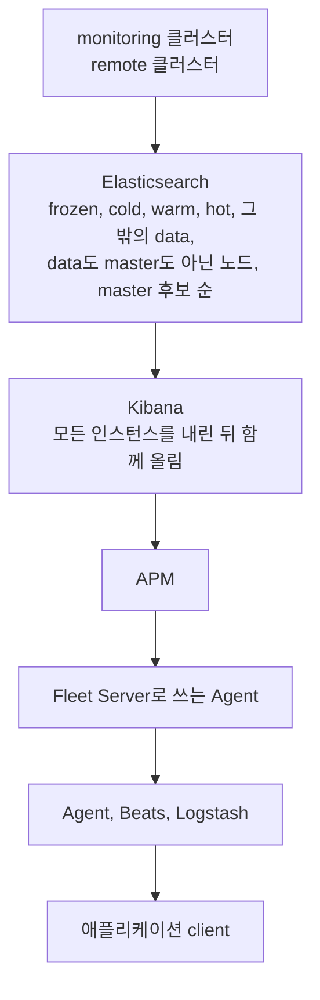

"문제가 생기면 이전 버전으로 돌아갈 수 있습니까?" 업그레이드 승인 회의에서 거의 반드시 나오는 질문입니다. 정직한 답은 "그대로는 돌아갈 수 없습니다"입니다. 그래서 롤백 계획은 "이전 버전으로 되돌리기"가 아니라 "이전 버전의 새 클러스터로 서비스를 옮기기"로 세워야 하고, 그 사이에 쌓인 데이터를 어떻게 할지까지 정해야 합니다.
이 글은 그 전제에서 메이저 업그레이드를 계획하는 방법을 정리합니다. 마이너 업그레이드에도 대부분 그대로 적용됩니다.

:::note[기준]
- 8.19.x에서 9.5.x로 올리는 self-managed 업그레이드 기준입니다. 공식 문서는 2026년 11월에 다시 확인했습니다. ECH, ECE, ECK는 다른 점만 적었습니다.
- 점검 명령은 [`labs/change/upgrade-precheck.console`](https://github.com/Munsik/engineering-notes/blob/main/labs/change/upgrade-precheck.console)에 있습니다.
:::

## 되돌릴 수 없는 이유

공식 문서의 표현은 분명합니다([Upgrade Elasticsearch](https://www.elastic.co/docs/deploy-manage/upgrade/deployment-or-cluster/elasticsearch), [Prepare to upgrade](https://www.elastic.co/docs/deploy-manage/upgrade/prepare-to-upgrade)).

- Elasticsearch는 이전 버전으로 downgrade를 지원하지 않습니다.
- 노드 하나라도 목표 버전으로 올라가면 클러스터가 되돌릴 수 없는 변경을 할 수 있으므로, 시작한 업그레이드는 마지막 노드까지 끝내야 합니다.
- 중간에 멈춰야 하면 기존 클러스터를 이전 버전으로 돌릴 수 없고, 이전 버전의 빈 클러스터를 새로 만들어 업그레이드 전 snapshot에서 복원해야 합니다.
- snapshot은 더 오래된 버전의 Elasticsearch에 복원할 수 없습니다([Snapshot compatibility](https://www.elastic.co/docs/deploy-manage/tools/snapshot-and-restore#snapshot-restore-version-compatibility)). 9.x에서 만든 snapshot은 8.x 클러스터에 복원되지 않습니다.
- Kibana는 업그레이드 때 saved object를 새 형식으로 바꿉니다. 이전 버전 Kibana로 돌아가려면 업그레이드 전 snapshot의 `kibana` feature state가 필요합니다.

## 롤백 대안 비교

규제나 내부 정책 때문에 롤백 계획이 필요하다면, 선택지와 각각의 비용을 표로 보여 주는 것이 승인에 도움이 됩니다.

| 방법 | 절차 | 업그레이드 뒤 쌓인 데이터 | 비용 |
| --- | --- | --- | --- |
| 업그레이드 전 snapshot 복원 | 이전 버전으로 새 클러스터를 만들고 snapshot 복원 | 잃음. 원천에서 다시 넣어야 함 | 복원 시간 동안 서비스 중단. 클러스터 하나분 하드웨어(임시) |
| 원천 재처리 | 위 복원 뒤 Kafka 같은 메시지 큐의 offset을 업그레이드 시점으로 되돌려 다시 적재 | 복구됨. 큐 보관 기간 안에서만 | 큐가 있어야 함. 재적재 시간 |
| 병행 클러스터(blue/green) | 새 버전 클러스터를 따로 만들고 수집 계층에서 양쪽에 함께 씀. 검증 뒤 전환 | 양쪽에 있음 | 하드웨어 두 배, 이중 적재 구성 |
| Logstash로 새 데이터를 이전 클러스터에 복사 | 업그레이드 뒤 9.x의 데이터를 Logstash `elasticsearch` input으로 읽어 8.19 클러스터에 output으로 씀 | 복구됨. `_source`가 있어야 함 | 복사 시간. 이전 클러스터를 계속 유지해야 함 |
| CCR로 이전 버전 follower 유지 | 불가 | | follower 클러스터는 leader와 같거나 더 새 버전이어야 함([CCR version compatibility](https://www.elastic.co/docs/deploy-manage/tools/cross-cluster-replication)) |
| VM이나 디스크 snapshot으로 되돌리기 | 지원하지 않음 | | 공식 문서는 snapshot만이 신뢰할 수 있고 지원되는 백업 방법이며, 파일 시스템 수준의 복사본에서 복원하는 방법은 지원하지 않는다고 명시함. 노드를 멈추고 복사하거나 원자적인 파일 시스템 snapshot을 써도 마찬가지 |

Logstash 방식은 8.19의 Logstash가 9.x Elasticsearch와 호환된다는 점에 기댑니다. 공식 문서는 8.19의 Agent, Beats, Logstash가 모든 9.x Elasticsearch와 호환된다고 적고 있습니다([Prepare to upgrade](https://www.elastic.co/docs/deploy-manage/upgrade/prepare-to-upgrade#prepare-upgrade-from-8.x)). 그래서 8.19 Logstash 하나로 9.x에서 읽고 8.19에 쓸 수 있습니다. 다만 이것은 롤백 전용 공식 절차가 아니라 호환 범위를 이용한 방법이므로, 리허설에서 반드시 시험합니다. 이전 클러스터의 template과 mapping이 새 데이터를 받을 수 있어야 하고, 9.x에서 새로 생긴 필드나 type은 8.19에서 받지 못할 수 있습니다.

현장에서 롤백 계획을 승인받은 조합은 대개 "업그레이드 전 snapshot 복원 + 원천 재처리"였습니다. 수집 계층에 Kafka가 있으면 업그레이드 시점의 offset을 기록해 두는 것만으로 롤백 비용이 크게 줄어듭니다([수집 03](../../ingest/03-no-gap-ingest/)). 큐가 없고 업그레이드 뒤 데이터도 잃으면 안 된다면 병행 클러스터나 Logstash 방식을 검토합니다.

## 업그레이드 전용 snapshot

롤백의 바탕은 업그레이드 직전 snapshot입니다. 현장에서 실제로 있었던 일입니다. Kibana 업그레이드가 실패해서 공식 롤백 절차를 따르려 했는데, 업그레이드 전 snapshot이 SLM의 보관 정책으로 이미 지워져 있었습니다. 결국 공식 롤백을 하지 못하고 Kibana 시스템 index의 write block을 직접 푸는 방식으로 수습해야 했습니다.

그래서 업그레이드용 snapshot은 SLM과 따로 만듭니다.

```console
# SLM policy에 속하지 않는 수동 snapshot. SLM retention이 지우지 않음
PUT _snapshot/prod-repo/pre-upgrade-8.19.20-to-9.5.7?wait_for_completion=false
{
  "indices": "*",
  "include_global_state": true,
  "feature_states": ["kibana", "security", "fleet"],
  "metadata": { "reason": "pre-upgrade", "change": "CHG-2026-1130" }
}

# 성공 확인
GET _snapshot/prod-repo/pre-upgrade-8.19.20-to-9.5.7?filter_path=snapshots.state,snapshots.feature_states,snapshots.failures
```

SLM retention은 SLM이 만든 snapshot만 지웁니다. 수동으로 만든 snapshot은 남지만, 저장소를 정리하는 다른 스크립트가 있다면 예외로 등록합니다. 이 snapshot은 관찰 기간이 끝날 때까지 지우지 않습니다. `feature_states`를 지정하지 않아도 `include_global_state: true`면 모든 feature state가 들어가지만, 롤백에 필요한 것을 명시해 두면 확인이 쉽습니다.

## 준비 절차

### 업그레이드 경로

- 9.x로 가려면 먼저 8.19.x로 올라가야 합니다. 9.1 이상으로 가는 경우 8.19가 필수이고, 이미 8.19라도 최신 8.19 patch로 올린 뒤 진행하라고 공식 문서는 권합니다. 최신 Upgrade Assistant와 업그레이드에 영향을 주는 수정이 들어 있기 때문입니다.
- release candidate 빌드에서 올리는 것은 지원하지 않습니다.

### Upgrade Assistant와 deprecation

- 8.19 Kibana의 Upgrade Assistant로 critical 문제를 모두 해결합니다. 호환되지 않는 index가 있으면 9.x 노드가 시작하지 않습니다. Upgrade Assistant는 Elasticsearch deprecation info API, Elasticsearch deprecation log, Kibana deprecations API 세 곳에서 문제를 모아 보여 주고, 외부 서비스에 의존하지 않아 폐쇄망에서도 씁니다([Upgrade Assistant](https://www.elastic.co/docs/deploy-manage/upgrade/prepare-to-upgrade/upgrade-assistant)).
- 7.x 이전에 만든 index는 업그레이드 전에 reindex, 삭제, archive(read-only 처리) 중 하나로 정리합니다. 9.x에서는 archive 기능으로 snapshot에 있는 7.x 이하 index를 읽을 수도 있습니다([Reading indices from older versions](https://www.elastic.co/docs/deploy-manage/upgrade/deployment-or-cluster/reading-indices-from-older-elasticsearch-versions)).
- reindex하면 index 이름이 바뀌므로 그 index를 쓰는 alert, transform, 코드도 같이 고쳐야 합니다.
- deprecation log에서 애플리케이션이 9.x에서 지원되지 않거나 다르게 동작하는 기능을 쓰는지 봅니다. 목표 버전까지의 모든 9.x release의 breaking changes를 확인합니다.
- Kibana, ML, Security 같은 기능의 system index도 새 메이저에 맞게 옮겨야 합니다. Upgrade Assistant의 system index 단계가 `GET _migration/system_features`로 상태를 보고 `POST _migration/system_features`로 옮깁니다. 이 API는 이럴 때 직접 씁니다. Upgrade Assistant 화면이 멈춘 것처럼 보일 때 어떤 기능이 `MIGRATION_NEEDED`, `IN_PROGRESS`, `ERROR`인지 확인할 때입니다.
- 7.x에서 만든 backing index가 있는 data stream은 Upgrade Assistant가 reindex data stream API(`POST _migration/reindex`)로 정리합니다. 이 API는 설정과 mapping을 그대로 복사해 새 버전 index로 바꾸는 용도라 mapping 변경에는 쓰지 않습니다([04](../04-data-definitions/#type을-바꿔야-할-때)).
- 이전 업그레이드에서 남은 archived setting이 있으면 지웁니다([Archived settings](https://www.elastic.co/docs/deploy-manage/upgrade/deployment-or-cluster/archived-settings)).

변경 요청서나 점검 스크립트에 남길 때는 화면 대신 같은 정보를 API로 받습니다.

```console
# Elasticsearch 쪽 deprecation. 항목마다 level이 critical이면 업그레이드 전에 해결
GET _migration/deprecations

# Kibana 쪽까지 합친 준비 상태. readyForUpgrade가 false면 details에 남은 문제 수가 나옴
GET kbn:/api/upgrade_assistant/status
```

`GET _migration/deprecations`의 응답은 `cluster_settings`, `node_settings`, `index_settings`, `data_streams`, `templates`, `ilm_policies`, `ml_settings`로 나뉩니다. 공식 문서는 이 API를 Upgrade Assistant가 쓰는 것으로 두고, 문제를 고칠 때는 Upgrade Assistant 화면을 쓰라고 권합니다([Get deprecation information](https://www.elastic.co/docs/api/doc/elasticsearch/operation/operation-migration-deprecations)). API는 업그레이드 전후 상태를 기록으로 남기는 용도로 씁니다(해석). 두 요청 모두 9.5.5 lab에서 실행해 응답 구조를 확인했습니다. 8.19에서의 실제 항목은 확인하지 못했습니다.

### client

8.x Elasticsearch client는 기본으로 REST API compatibility를 써서 9.x와 통신합니다. 이것은 업그레이드 동안의 다리일 뿐 같은 동작을 보장하지 않으므로, 업그레이드 뒤 client도 9.x로 올립니다.

### 함께 확인할 것

| 항목 | 기준 |
| --- | --- |
| plugin | 목표 버전용 plugin이 있는지([07](../07-cluster-config/#plugin)) |
| Kibana 메모리 | Platinum, Enterprise는 9.x 전에 Kibana 인스턴스를 2GB 이상으로. 부족하면 detection rule, reporting, workflow, Agent Builder 같은 기능이 중단될 수 있음 |
| monitoring 클러스터 | 운영 클러스터보다 먼저 올림. 감시 대상과 같거나 새 버전이어야 함 |
| remote cluster | cross-cluster search: 9.x는 이전 마이너, 같은 버전, 같은 메이저의 더 새 마이너만 검색 가능. CCR: follower가 같거나 새 버전 |
| ML job | 업그레이드 중 부하를 줄이려면 닫았다가 끝나고 엶(선택) |
| managed 자산 | 수정된 managed template, pipeline, ILM이 없는지, 9.3의 policy 이름 변경 대상인지([03](../03-managed-assets/#업그레이드-전-점검-항목)) |
| integration | 자동 업그레이드되는 integration과 index mode 변경 여부 |
| Kibana 디스크 | `.kibana`, `.kibana_task_manager` 크기의 두 배 이상 여유 |

### 리허설

검증 환경에서 같은 경로로 업그레이드를 끝까지 해 봅니다. 단계별 소요 시간, 나온 경고, 해결 방법을 기록합니다. 이 기록이 운영 변경 계획서의 실행 단계와 예상 시간이 됩니다. 롤백 대안도 리허설에서 한 번 실행해 봐야 실제로 쓸 수 있습니다.

## 구성 요소 순서



Elasticsearch 노드는 node role 그룹 순서로 한 대씩 올립니다. data 노드를 tier 순서로 먼저(frozen, cold, warm, hot, 그 밖의 data), 그다음 data도 master도 아닌 노드(ml, ingest, coordinating, transform, remote_cluster_client), 마지막에 master 후보입니다. 새 버전 노드는 이전 버전 master가 있는 클러스터에 들어갈 수 있지만, 이전 버전 노드는 새 버전 master가 있는 클러스터에 들어가지 못할 수 있기 때문입니다. 순서를 어기면 `cannot allocate replica shard to a node with version [x] since this is older than the primary version [y]` 같은 오류가 업그레이드가 끝날 때까지 이어질 수 있습니다([Nodes upgrade order](https://www.elastic.co/docs/deploy-manage/upgrade/deployment-or-cluster/elasticsearch#upgrade-order)).

Kibana는 Elasticsearch 다음에 같은 버전으로 올립니다. rolling upgrade를 지원하지 않으므로 이전 버전 인스턴스를 모두 내린 뒤 새 버전을 띄웁니다([Upgrade Kibana](https://www.elastic.co/docs/deploy-manage/upgrade/deployment-or-cluster/kibana)).

수집 구성 요소는 Agent, Beats, Logstash, custom client 순서로 올리고, Fleet이 관리하는 Agent라면 Fleet Server로 쓰는 Agent를 먼저 올립니다([Upgrade ingest components](https://www.elastic.co/docs/deploy-manage/upgrade/ingest-components)). 8.19의 Agent, Beats, Logstash는 모든 9.x Elasticsearch와 호환되므로 수집 계층은 Elasticsearch 업그레이드 뒤에 여유를 두고 올려도 됩니다.

## 업그레이드 당일

1. 변경 창 시작 전에 maintenance window를 켭니다([02](../02-change-process/#알림-억제)).
2. 사전 점검(GREEN, 진행 중 recovery 없음, 디스크 여유)을 확인합니다.
3. 업그레이드 전용 snapshot을 만들고 성공을 확인합니다.
4. 수집 계층에 큐가 있으면 offset을 기록합니다.
5. 노드마다 [rolling restart](../07-cluster-config/#rolling-restart) 절차로 올립니다. 노드가 돌아올 때마다 `GET _cat/nodes?v&h=name,version,node.role`로 버전을 확인하고 GREEN을 기다립니다.
6. 모든 노드가 올라가면 Kibana를 올리고, Kibana 로그에서 saved object migration 완료를 확인합니다.
7. [사후 점검](../02-change-process/#사후-점검)을 합니다.

혼합 버전 상태는 업그레이드 동안에만 유효합니다. 이전 버전과 새 버전이 섞인 채로 며칠씩 두면 안 됩니다. 새 버전 노드의 shard는 이전 버전 노드로 복제되지 않기 때문입니다.

## Kibana 롤백

Kibana 업그레이드가 migration 실패로 끝나고 원인을 해결할 수 없을 때의 공식 절차입니다([Roll back Kibana](https://www.elastic.co/docs/deploy-manage/upgrade/deployment-or-cluster/kibana-roll-back)).

1. 롤백할 버전의 Kibana가 현재 Elasticsearch와 호환되는지 확인합니다. 호환되지 않으면 Elasticsearch도 되돌려야 하고, 이는 snapshot에서 새 클러스터로 복원하는 일입니다.
2. migration을 실행 중인 인스턴스가 없도록 모든 Kibana를 내립니다.
3. 업그레이드 전 snapshot에서 `kibana` feature state만 복원합니다.
4. 이전 버전 Kibana를 띄웁니다.

```console
POST _snapshot/prod-repo/pre-upgrade-8.19.20-to-9.5.7/_restore
{
  "indices": "-*",
  "feature_states": ["kibana"]
}
```

업그레이드 뒤 Kibana에서 바꾼 내용은 롤백하면 모두 사라집니다. Fleet 화면까지 원래대로 돌리려면 `fleet`, `security` feature state도 함께 필요할 수 있습니다([Restore a feature state](https://www.elastic.co/docs/deploy-manage/tools/snapshot-and-restore/restore-snapshot#restore-feature-state)).

8.x snapshot을 9.x 클러스터에 직접 복원하는 것은 업그레이드 경로를 건너뛰는 지름길이 아닙니다. Kibana 시스템 index가 8.18.0보다 오래된 버전으로 마지막에 쓰였다면 9.x Kibana는 migration을 시작하지 않고 오류를 냅니다. 이 경우 8.19 클러스터에 먼저 복원해 Kibana를 띄워 migration을 끝낸 뒤 다시 snapshot을 만들어 옮깁니다([Kibana compatibility](https://www.elastic.co/docs/deploy-manage/tools/snapshot-and-restore#kib-compatibility)).

## 업그레이드 뒤 관찰

- 관찰 기간은 주간 배치나 월말 집계처럼 드문 작업이 한 번 돌 때까지, 보통 1주에서 2주입니다.
- 대표 query의 지연, 적재 처리량, merge 시간, heap 사용 패턴을 업그레이드 전 기준선과 비교합니다.
- failure store와 수집기 오류에서 새 mapping 충돌을 봅니다.
- 다음 메이저를 위해 deprecation log를 계속 모읍니다. 지금 고치면 다음 업그레이드가 가벼워집니다.
- 관찰 기간이 끝나면 업그레이드 전용 snapshot의 보관 여부를 결정하고, 결과를 계획서에 기록합니다.

## patch 버전 고르기

목표 마이너의 최신 patch로 가는 것이 기본입니다. 다만 최신 patch가 나온 직후라면 known issues를 먼저 봅니다. 특정 patch에 큰 문제가 있어 바로 다음 patch로 가라는 안내가 나온 사례가 실제로 있었습니다. 버전 선택 기준은 [09의 버전 고르기](../09-security-advisory/#어느-버전으로-갈지-고르기)에 정리했습니다.

## ECH, ECE, ECK

| 배포 | 다른 점 |
| --- | --- |
| ECH | 콘솔이나 API에서 버전을 바꾸면 플랫폼이 노드를 순서대로 교체합니다. 업그레이드 전 snapshot은 `cloud-snapshot-policy` 외에 수동으로 하나 더 만들어 둡니다. Upgrade Assistant와 deprecation 확인은 똑같이 필요합니다 |
| ECE | 플랫폼 자체(ECE)와 deployment의 업그레이드가 따로 있습니다. 목표 Stack 버전을 ECE가 지원하는지 먼저 확인합니다 |
| ECK | manifest의 `version`을 바꾸면 operator가 rolling 방식으로 적용합니다. operator 버전이 목표 Stack 버전을 지원하는지 먼저 확인합니다 |

## 참고 문서

- [Plan your upgrade](https://www.elastic.co/docs/deploy-manage/upgrade/plan-upgrade)
- [Prepare to upgrade](https://www.elastic.co/docs/deploy-manage/upgrade/prepare-to-upgrade)
- [Upgrade Elasticsearch](https://www.elastic.co/docs/deploy-manage/upgrade/deployment-or-cluster/elasticsearch)
- [Upgrade Kibana](https://www.elastic.co/docs/deploy-manage/upgrade/deployment-or-cluster/kibana)
- [Roll back Kibana](https://www.elastic.co/docs/deploy-manage/upgrade/deployment-or-cluster/kibana-roll-back)
- [Upgrade ingest components](https://www.elastic.co/docs/deploy-manage/upgrade/ingest-components)
- [Snapshot and restore](https://www.elastic.co/docs/deploy-manage/tools/snapshot-and-restore)
- [Elasticsearch known issues](https://www.elastic.co/docs/release-notes/elasticsearch/known-issues)
