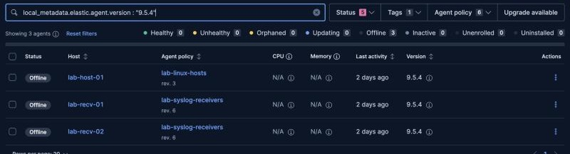

보안 공지가 나오면 보안 조직은 당일 영향도를 묻습니다. "우리 Elasticsearch가 해당되나요, 언제 조치하나요?" 이때 운영 조직이 구성 요소별 버전을 바로 내놓지 못하면, 해당 여부를 판단하는 데만 하루가 갑니다. 취약점 스캐너가 Elasticsearch 설치 경로의 JDK를 잡아 "치명적"으로 보고하는 일도 흔합니다.
공지를 읽고, 해당 여부를 판단하고, 목표 버전을 고르고, 보고하기까지를 순서대로 봅니다.

:::note[기준]
- Elastic Stack 9.x 기준입니다. 공식 페이지는 2026년 11월에 다시 확인했습니다.
- 버전 인벤토리 스크립트는 [`labs/change/version-inventory.sh`](https://github.com/Munsik/engineering-notes/blob/main/labs/change/version-inventory.sh)에 있습니다.
:::

## 공식 정보가 나오는 곳

| 정보 | 위치 |
| --- | --- |
| 보안 공지(Elastic Security Advisory, ESA) | [Product security](https://www.elastic.co/product-security) 페이지와 [Security Announcements 포럼](https://discuss.elastic.co/c/announcements/security-announcements/31). 포럼은 [RSS](https://discuss.elastic.co/c/announcements/security-announcements.rss)로 구독 가능 |
| 버전별 수정 내용 | 제품별 release notes(예: [Elasticsearch release notes](https://www.elastic.co/docs/release-notes/elasticsearch)) |
| 알려진 문제 | 제품별 known issues(예: [Elasticsearch known issues](https://www.elastic.co/docs/release-notes/elasticsearch/known-issues), [Fleet Server known issues](https://www.elastic.co/docs/release-notes/fleet-server/known-issues)) |
| 유지보수 기간 | [End of life](https://www.elastic.co/support/eol) 페이지, [support policy](https://www.elastic.co/support_policy) |

RSS를 팀 채널에 연결해 두면 공지를 가장 빨리 받습니다. 공지를 받는 사람과 판단하는 사람을 미리 정해 둡니다.

## 공지 읽는 법

ESA에서 확인할 항목은 다섯 가지입니다.

1. 영향받는 제품과 버전 범위
2. 수정된 버전
3. 취약점이 동작하는 조건. 특정 기능을 켰을 때만, 인증된 사용자만, 특정 설정에서만 등
4. 완화책. 업그레이드 전에 설정으로 막을 수 있는지
5. 심각도와 CVE 번호

3번이 가장 중요합니다. 영향 버전에 해당해도 동작 조건에 맞지 않으면 실제 위험은 낮습니다. 예를 들어 특정 plugin이나 기능을 쓸 때만 동작하는 취약점이라면, 그 기능을 쓰는지가 판단의 핵심입니다. 보고서에는 버전 해당 여부와 조건 해당 여부를 따로 적습니다.

## 버전 인벤토리

공지가 나온 뒤에 버전을 모으면 늦습니다. 평소에 구성 요소별 버전 표를 만들어 둡니다.

| 구성 요소 | 확인 방법 |
| --- | --- |
| Elasticsearch | `GET _nodes?filter_path=nodes.*.name,nodes.*.version,nodes.*.jvm.version,nodes.*.jvm.vm_vendor,nodes.*.os.name` |
| Elasticsearch plugin | `GET _cat/plugins?v` |
| Kibana | `GET kbn:/api/status`의 `version.number`. 인스턴스가 여럿이면 각각 |
| Fleet 관리 Agent | Fleet API `GET kbn:/api/fleet/agents`의 `local_metadata.elastic.agent.version`. Fleet 화면에서는 검색창에 `local_metadata.elastic.agent.version : "9.5.4"`처럼 KQL로 거름 |
| standalone Agent, Beats | 구성 관리 도구의 인벤토리, 또는 Agent와 Beats가 보내는 monitoring 데이터의 버전 필드 |
| Logstash | `GET :9600/` 노드 API의 `version` |
| 애플리케이션 client | 각 애플리케이션의 의존성 목록 |
| OS | `_nodes`의 `os` 정보 |



```console
# Elasticsearch 노드별 버전과 JVM
GET _nodes?filter_path=nodes.*.name,nodes.*.version,nodes.*.jvm.version,nodes.*.jvm.vm_vendor,nodes.*.jvm.using_bundled_jdk,nodes.*.os.pretty_name

# Fleet Agent 목록. 결과의 local_metadata.elastic.agent.version으로 집계. page, perPage로 나눠 받음
GET kbn:/api/fleet/agents?perPage=100&page=1
```

`jvm.using_bundled_jdk`가 `true`이면 Elasticsearch에 들어 있는 JDK를 쓰는 노드입니다. 스크립트는 이 결과들을 하나의 표로 모아 날짜와 함께 저장합니다. 매주 자동으로 돌려 두면 공지가 나온 날에는 최신 표를 바로 꺼낼 수 있습니다.

## 번들 JDK 취약점의 판단

Elasticsearch는 OpenJDK를 함께 배포합니다. 공식 문서는 번들 JVM을 Elasticsearch의 다른 의존성과 똑같이 다루며, Elastic이 업데이트와 보안 대응을 맡는다고 설명합니다. 그리고 Elasticsearch는 JVM 기능의 일부만 쓰기 때문에 번들 JVM의 버그와 취약점은 Elasticsearch가 쓰지 않는 기능에 관한 경우가 많고, Elastic이 의존성 취약점을 분석해 필요하면 ESA를 낸다고 밝힙니다([Installing Elasticsearch](https://www.elastic.co/docs/deploy-manage/deploy/self-managed/installing-elasticsearch)).

그래서 판단 순서는 이렇습니다.

1. 해당 JDK 취약점에 대한 ESA가 있는지 봅니다. 있으면 ESA의 수정 버전을 따릅니다.
2. ESA가 없으면 Elastic이 분석했을 때 영향이 없다고 본 경우가 많습니다. 보안 조직에는 위 공식 문구와 함께, 번들 JVM의 지원 정책이 Elastic의 support policy와 EOL 일정을 따른다는 점을 근거로 설명합니다.
3. 스캐너가 지적한 JDK 버전이 실제로 쓰이는지 봅니다. `ES_JAVA_HOME`으로 별도 JDK를 쓰고 있다면 그 JDK는 직접 관리 대상입니다.
4. 결론과 관계없이 다음 정기 patch 업그레이드에서 최신 번들 JDK로 올라가게 계획합니다.

판단이 서지 않으면 Elastic 지원에 문의합니다. 이때 노드의 `jvm.version`과 스캐너 보고서를 같이 보냅니다.

## 어느 버전으로 갈지 고르기

수정 버전이 여러 줄기(예: 8.19.x, 9.4.x, 9.5.x)에 나오는 경우가 많습니다. 고르는 기준입니다.

| 상황 | 갈 버전 |
| --- | --- |
| 현재 마이너에 수정 patch가 있음 | 현재 마이너의 최신 patch. 위험이 가장 작음 |
| 현재 마이너가 유지보수 종료 | 지원 중인 마이너의 최신 patch. 마이너 업그레이드 절차를 따름 |
| 8.x 사용 중 | 8.19의 수정 patch로 먼저 막고, 9.x 업그레이드는 따로 계획 |
| 업그레이드 전에 시간이 필요 | ESA의 완화책을 먼저 적용하고 patch 일정을 잡음 |

후보 버전을 정한 뒤에는 그 버전의 release notes와 known issues를 꼭 봅니다. 보안 patch가 나온 직후에 다른 큰 문제가 발견되어 바로 다음 patch로 가라는 안내가 나온 사례가 실제로 있었습니다. 같은 마이너 안에서 patch를 올리는 것은 일반 변경으로, 마이너를 올리는 것은 고위험 변경으로 다룹니다([02](../02-change-process/#변경을-분류한다)).

모든 구성 요소를 한꺼번에 올릴 필요는 없습니다. ESA가 Kibana만 해당하면 Kibana만 같은 마이너의 patch로 올리면 됩니다. 다만 Kibana는 Elasticsearch와 같은 버전이어야 하므로, 실제로는 Elasticsearch도 같은 patch로 올리게 되는 경우가 많습니다([Upgrade Kibana](https://www.elastic.co/docs/deploy-manage/upgrade/deployment-or-cluster/kibana)).

## 보안 조직에 보고하는 양식

| 항목 | 예 |
| --- | --- |
| 공지 | ESA 번호, CVE, 발표일 |
| 영향 제품과 버전 | 공지 원문의 범위 |
| 우리 환경의 버전 | 인벤토리 표(날짜 포함) |
| 버전 해당 여부 | 해당, 비해당 |
| 동작 조건 해당 여부 | 해당 기능을 쓰는지, 노출 경로가 있는지 |
| 현재 완화 상태 | 적용한 설정, 네트워크 통제 |
| 조치 계획 | 목표 버전, 검증 환경 적용일, 운영 적용일 |
| 판단 근거 | ESA 원문, 공식 문서 링크 |

"버전 해당"과 "조건 해당"을 나누면 보안 조직이 위험을 정확히 판단할 수 있고, 운영 조직은 불필요한 긴급 변경을 피할 수 있습니다.

## 평소에 해 둘 것

- 보안 공지 RSS 구독과 담당자 지정
- 구성 요소 버전 인벤토리 주간 자동 수집
- 현재 사용 버전의 EOL 날짜를 달력에 등록
- 분기마다 같은 마이너의 최신 patch로 올리는 정기 patch 주기. patch를 미뤄 두면 보안 공지 때 여러 patch를 한꺼번에 건너뛰게 되고, 변경 범위가 커집니다
- 검증 환경을 운영과 같은 버전으로 유지

## 참고 문서

- [Product security](https://www.elastic.co/product-security)
- [Security Announcements](https://discuss.elastic.co/c/announcements/security-announcements/31)
- [End of life](https://www.elastic.co/support/eol)
- [Installing Elasticsearch (bundled JVM)](https://www.elastic.co/docs/deploy-manage/deploy/self-managed/installing-elasticsearch)
- [Elasticsearch release notes](https://www.elastic.co/docs/release-notes/elasticsearch)
- [Elasticsearch known issues](https://www.elastic.co/docs/release-notes/elasticsearch/known-issues)
