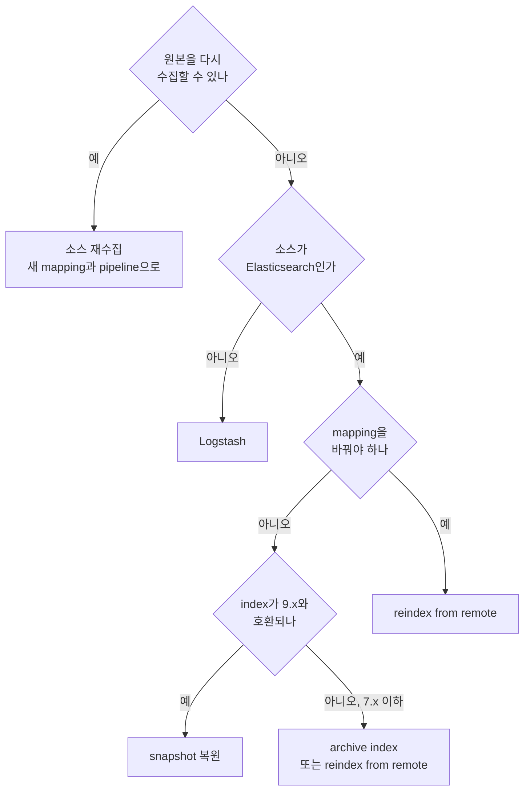
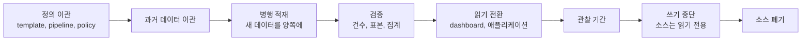

데이터를 옮기는 일 자체보다 옮긴 뒤가 어렵습니다. 문서 수는 맞는데 같은 query의 결과가 다르고, 집계 값이 미묘하게 어긋나고, 일부 필드는 검색이 안 됩니다. 원인은 대개 mapping과 analyzer의 차이, 옮기는 도중 들어온 데이터, 날짜와 시간대 처리입니다.
그래서 이관 방식을 고를 때부터 검증 방법과 전환 순서를 같이 정해 둡니다.

:::note[기준]
- 대상은 Elasticsearch 9.5.x입니다. 공식 문서는 2026년 11월에 다시 확인했습니다.
- 다른 플랫폼에 대한 평가는 하지 않습니다. 공개 자료로 확인할 수 있는 호환성 차이만 적었습니다.
- 명령 모음과 검증 스크립트는 [`labs/change/data-migration.console`](https://github.com/Munsik/engineering-notes/blob/main/labs/change/data-migration.console)에 있습니다.
:::

## 이관 방식 비교

| 방식 | 소스 | 조건 | 장점 | 한계 |
| --- | --- | --- | --- | --- |
| reindex from remote | Elasticsearch 거의 모든 버전 | 대상 클러스터 `elasticsearch.yml`의 `reindex.remote.whitelist`, 소스 index의 `_source` | 대상 mapping으로 다시 색인됨. 중간 저장소 불필요 | 네트워크로 모든 문서를 읽음. 대용량은 느림 |
| snapshot 복원 | 호환되는 Elasticsearch 버전 | 대상이 소스보다 새 버전이고 index가 호환 범위 안 | 가장 빠름. 문서를 다시 색인하지 않음 | 소스의 mapping과 설정을 그대로 가져옴. 다른 플랫폼에는 쓸 수 없음 |
| archive index, searchable snapshot | 7.x 이하에서 만든 index의 snapshot | 9.x의 archive 기능 | 오래된 데이터를 다시 색인하지 않고 읽기 | read-only. 기능 제한 |
| Logstash | Elasticsearch, OpenSearch 등 | Logstash `elasticsearch` input이 소스를 읽을 수 있어야 함 | 버전과 플랫폼 차이를 흡수. 중간에 가공 가능 | Logstash 구성과 처리량 관리 |
| 소스 재수집 | 원본 로그, DB, 메시지 큐 | 원본이 남아 있어야 함 | 새 mapping, 새 pipeline으로 깨끗하게 | 원본 보관 기간 안에서만 |

reindex from remote는 공식 문서가 "만날 가능성이 있는 거의 모든 버전의 Elasticsearch"와 동작하도록 만들었다고 설명합니다. 7.10보다 오래된 소스에서는 point in time을 쓰지 못하고 scroll로 읽습니다([Reindex from remote](https://www.elastic.co/docs/reference/elasticsearch/rest-apis/reindex-indices#reindex-remote-compatibility)). snapshot은 더 오래된 버전으로 복원할 수 없고, index가 대상 버전과 호환돼야 합니다. 7.17 index를 9.x에 넣으려면 archive 기능이나 searchable snapshot을 써야 합니다([Snapshot compatibility](https://www.elastic.co/docs/deploy-manage/tools/snapshot-and-restore#snapshot-restore-version-compatibility)).

다른 플랫폼과는 snapshot 형식과 API가 달라서 snapshot 복원과 reindex from remote를 그대로 쓸 수 있다고 기대하면 안 됩니다. 이 경우 Logstash의 `elasticsearch` input으로 읽어 Elasticsearch output으로 쓰거나, 소스에서 다시 수집하는 방법이 현실적입니다. Logstash input이 특정 플랫폼 버전을 읽을 수 있는지는 시험해서 확인합니다.

## 고르는 기준



- 이관을 계기로 mapping을 정리하고 싶다면 snapshot보다 reindex나 재수집이 적합합니다. snapshot은 소스의 문제까지 그대로 옮깁니다.
- 보관 기간이 정해진 로그라면, 오래된 데이터는 옮기지 않고 소스 클러스터를 보관 기간 동안 읽기 전용으로 두는 선택도 있습니다. cross-cluster search로 함께 검색할 수 있는지는 버전 조건을 확인합니다([08의 함께 확인할 것](../08-major-upgrade/#함께-확인할-것)).
- 대용량이라면 방식을 섞습니다. 최근 데이터는 재수집이나 reindex, 오래된 데이터는 snapshot이나 archive로 나눕니다.

## mapping과 수명주기 정책 옮기기

데이터보다 정의를 먼저 옮깁니다.

1. 소스의 index template, mapping, analyzer, ingest pipeline, ILM policy를 export합니다.
2. 대상 버전에서 바뀐 것을 반영합니다. deprecated 설정, 사라진 type, 이름이 바뀐 옵션을 확인합니다. 다른 플랫폼이라면 같은 이름의 설정도 동작이 다를 수 있습니다.
3. 대상에 template과 policy를 먼저 만들고, `_index_template/_simulate_index`로 결과를 확인합니다([04](../04-data-definitions/#적용-전에-확인하는-api)).
4. 로그나 metric이라면 이 기회에 data stream과 LogsDB, TSDS로 옮길지 정합니다([데이터 설계 03](../../data/03-storage-footprint/), [데이터 설계 07](../../data/07-time-series/)).

analyzer는 특히 주의합니다. 같은 문장이라도 tokenizer와 filter가 다르면 검색 결과가 달라집니다. 소스와 대상에서 같은 문장을 `_analyze`로 돌려 token을 비교합니다.

## reindex from remote 실행

```yaml
# 대상 클러스터 elasticsearch.yml. 노드 재시작 필요
reindex.remote.whitelist: ["old-es-01:9200", "old-es-02:9200"]
```

소스가 사설 CA 인증서를 쓰면 대상 노드가 그 CA를 신뢰하도록 설정해야 합니다([Remote reindex with a private CA](https://www.elastic.co/docs/manage-data/migrate/migrate-from-a-self-managed-cluster-with-a-self-signed-certificate-using-remote-reindex)).

```console
POST _reindex?wait_for_completion=false
{
  "source": {
    "remote": {
      "host": "https://old-es-01:9200",
      "username": "migrator",
      "password": "<secret>"
    },
    "index": "app-logs-2026.10.*",
    "size": 2000,
    "query": { "range": { "@timestamp": { "lt": "2026-11-01" } } }
  },
  "dest": {
    "index": "logs-app-default",
    "op_type": "create"
  }
}

# 진행 상황
GET _tasks?actions=*reindex&detailed=true
```

- data stream으로 넣을 때는 `op_type: create`가 필요합니다.
- 원격 reindex는 slicing을 지원하지 않습니다. 처리량을 높이려면 index나 기간을 나눠 여러 요청을 동시에 돌립니다. 소스 클러스터의 부하를 같이 봅니다.
- 원격 요청의 `size`는 배치 크기입니다. 원격 reindex는 대상 노드의 on-heap buffer(기본 최대 100MB)에 배치를 받으므로, 문서가 크면 `size`를 줄입니다.
- 실패한 문서는 응답의 `failures`에 남습니다. 대상 mapping과 맞지 않는 문서가 대부분입니다.

## 검증

문서 수만 맞추고 끝내면 안 됩니다. 네 단계로 확인합니다.

| 단계 | 방법 | 기준 |
| --- | --- | --- |
| 문서 수 | 같은 기간, 같은 조건으로 `_count` 비교 | 일치. 다르면 기간을 나눠 어디서 다른지 좁힘 |
| 표본 문서 | ID나 고유 키로 무작위 표본을 뽑아 필드별 비교 | 의도한 변환 외에는 일치 |
| 집계 결과 | 대표 dashboard와 보고서가 쓰는 집계를 양쪽에서 실행 | 일치. 근사 집계(cardinality 등)는 허용 오차를 미리 정함 |
| 검색 결과 | 대표 query 상위 결과 비교 | analyzer를 바꿨다면 차이를 설명할 수 있어야 함 |

```console
# 기간별 문서 수. 소스와 대상에서 같은 요청을 실행해 비교
GET logs-app-default/_search
{
  "size": 0,
  "query": { "range": { "@timestamp": { "gte": "2026-10-01", "lt": "2026-11-01" } } },
  "aggs": {
    "per_day": { "date_histogram": { "field": "@timestamp", "calendar_interval": "day", "time_zone": "Asia/Seoul" } }
  }
}
```

날짜별 비교에서는 `time_zone`을 양쪽에서 같게 둡니다. 시간대를 빼면 하루 경계가 달라져 날짜마다 조금씩 어긋나 보입니다. 소스 시스템이 날짜를 시간대 없이 저장했는지도 확인합니다. 원본 대비 건수를 맞추는 방법은 [수집 05](../../ingest/05-count-reconciliation/)의 접근을 그대로 쓸 수 있습니다.

## 전환 순서



- 과거 데이터를 옮기는 동안 들어오는 데이터는 병행 적재로 받습니다. 수집 계층에서 양쪽에 쓰거나, 큐에서 두 소비자를 둡니다. 이관 기준 시각을 하나 정해서 그 이전은 이관으로, 이후는 병행 적재로 채우면 겹치거나 빠지는 구간이 생기지 않습니다.
- 애플리케이션은 index 이름 대신 alias를 보게 하면 전환이 alias 교체 한 번으로 끝납니다.
- 읽기를 전환한 뒤에도 소스는 관찰 기간 동안 쓰기를 유지합니다. 문제가 생기면 읽기만 되돌리면 됩니다.
- Kibana 객체(dashboard, rule)는 [05](../05-kibana-objects/)와 [06](../06-dashboards-as-code/)의 방법으로 옮깁니다. 다른 플랫폼의 시각화 객체는 형식이 다르므로 다시 만드는 것을 전제로 계획합니다.

## 참고 문서

- [Reindex indices examples (remote 포함)](https://www.elastic.co/docs/reference/elasticsearch/rest-apis/reindex-indices)
- [Reindex from a self-managed cluster using a private CA](https://www.elastic.co/docs/manage-data/migrate/migrate-from-a-self-managed-cluster-with-a-self-signed-certificate-using-remote-reindex)
- [Reindex data stream API](https://www.elastic.co/docs/reference/elasticsearch/rest-apis/reindex-data-stream)
- [Snapshot and restore](https://www.elastic.co/docs/deploy-manage/tools/snapshot-and-restore)
- [Reading indices from older Elasticsearch versions](https://www.elastic.co/docs/deploy-manage/upgrade/deployment-or-cluster/reading-indices-from-older-elasticsearch-versions)
