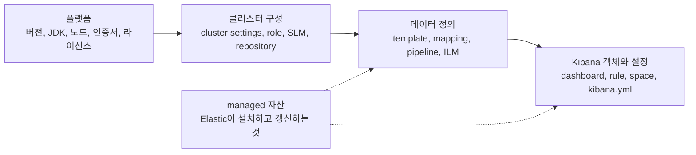

Elastic 환경은 한 번 구축하면 끝나지 않습니다. 버전이 오르고, integration이 업데이트되고, 누군가는 template을 고치고, 누군가는 운영 Kibana에서 dashboard를 직접 수정합니다.
문제는 이 변경들이 서로 다른 곳에 기록되거나, 아예 기록되지 않는다는 점입니다. 업그레이드 뒤에 직접 고친 pipeline이 초기화되고, 개발과 운영의 dashboard가 조금씩 달라지고, 되돌리려고 보니 이전 상태가 어디에도 없습니다.
이 컬렉션은 바뀌는 대상을 네 층으로 나누고, 층마다 원본을 어디에 두고 어떻게 적용하고 어떻게 되돌리는지를 정리합니다.

:::note[기준]
- Elasticsearch, Kibana 9.5.x 기준입니다(2026년 11월 현재 최신 9.5.7). 공식 문서는 2026년 11월에 다시 확인했습니다. 9.x 안에서 기능마다 GA 버전이 다른 경우는 본문에 따로 적었습니다.
- self-managed를 기준으로 쓰고, Elastic Cloud Hosted(ECH), ECE, ECK와 다른 점은 글마다 적었습니다.
- 근거는 공식 문서, API reference, Elasticsearch와 Kibana 소스 코드입니다. 출처가 없는 판단과 권장은 제 현장 경험에서 나온 것이고, 공식 문서로 확인하지 못한 내용에는 "확인 필요"라고 표시했습니다.
- 명령 모음과 스크립트는 저장소의 [`labs/change/`](https://github.com/Munsik/engineering-notes/tree/main/labs/change)에 있습니다.
:::

## 바뀌는 것의 네 층

위층의 변경은 아래층에 영향을 줍니다. 버전을 올리면 built-in template이 갱신되고, template이 바뀌면 dashboard가 기대하는 필드가 달라집니다. 그래서 변경 하나를 계획할 때도 아래층까지 같이 봅니다.

## 구성

| 단계 | 글 | 다루는 내용 |
| --- | --- | --- |
| 기반 | [01. 바뀌는 것의 지도](01-change-map/) | 네 층의 기준 원본, 되돌릴 수 있는 것과 없는 것, 코드화 도구, drift 확인, 누가 바꿨는지 추적 |
| 절차 | [02. 변경 절차](02-change-process/) | 변경 분류, 환경 구성, 변경 계획서, 알림 억제, 사후 점검, 롤백 판단, 성능 회귀 확인 |
| 데이터 정의 | [03. managed 자산](03-managed-assets/) | 업그레이드 때 덮어써지는 template, pipeline, ILM policy, dashboard, prebuilt rule과 `@custom`에 얹는 방법 |
| 데이터 정의 | [04. 데이터 정의 변경](04-data-definitions/) | template, mapping, pipeline, ILM 변경이 반영되는 시점, 미리 확인하는 API, 영향 분석 |
| Kibana | [05. Kibana 객체와 설정](05-kibana-objects/) | saved objects 이동 규칙, rule과 API key, encryption key, kibana.yml로 고정하는 설정 |
| Kibana | [06. Dashboard CI/CD](06-dashboards-as-code/) | Dashboards API로 dashboard를 Git에 두고 환경마다 배포하는 파이프라인 |
| 클러스터 | [07. 클러스터 구성 변경](07-cluster-config/) | 노드 교체, rolling restart, 인증서, 라이선스, JDK와 plugin, cluster settings |
| 플랫폼 | [08. 메이저 업그레이드](08-major-upgrade/) | 되돌릴 수 없다는 전제의 롤백 대안, 준비 절차, 구성 요소 순서, 업그레이드 뒤 관찰 |
| 플랫폼 | [09. 보안 공지 대응](09-security-advisory/) | 공지 읽는 법, 버전 인벤토리, patch 버전 선택, 보고 양식 |
| 플랫폼 | [10. 데이터 이관](10-data-migration/) | reindex from remote, snapshot, Logstash, 재수집 비교와 검증, 전환 순서 |

## 자주 받는 질문

| 질문 | 먼저 볼 글 |
| --- | --- |
| 업그레이드했더니 직접 고친 ILM, pipeline이 사라졌다 | [03](03-managed-assets/) |
| integration의 shard 수나 보관 기간을 바꾸고 싶다 | [03](03-managed-assets/#고칠-곳을-정하는-표) |
| template을 고쳤는데 데이터에 반영되지 않는다 | [04](04-data-definitions/#언제-반영되나) |
| 필드 type을 바꿔야 한다 | [04](04-data-definitions/#깨지는-변경과-깨지지-않는-변경) |
| 개발 Kibana의 dashboard를 운영으로 옮기고 싶다 | [05](05-kibana-objects/), [06](06-dashboards-as-code/) |
| 담당자가 퇴사했더니 rule이 멈췄다 | [05](05-kibana-objects/#rule과-api-key) |
| dashboard를 Git으로 관리하고 싶다 | [06](06-dashboards-as-code/) |
| 인증서 만료가 다가온다 | [07](07-cluster-config/#tls-인증서-교체) |
| 업그레이드 롤백 계획이 없으면 승인이 안 난다 | [08](08-major-upgrade/#롤백-대안-비교) |
| 보안 공지가 나왔는데 우리가 해당되는지 모르겠다 | [09](09-security-advisory/) |
| OpenSearch나 오래된 Elasticsearch의 데이터를 옮기고 싶다 | [10](10-data-migration/) |

## 읽는 순서

처음이라면 01과 02로 전체 틀을 잡고, 지금 겪는 문제에 맞는 글로 넘어가면 됩니다. 업그레이드를 앞두고 있다면 03, 08, 09를 이어서 읽기를 권합니다. 업그레이드에서 가장 자주 사고가 나는 곳이 managed 자산이기 때문입니다.
