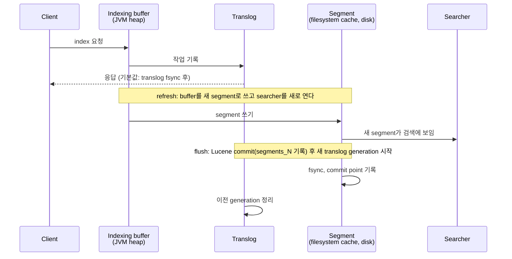
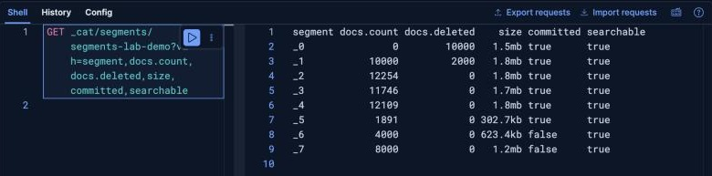
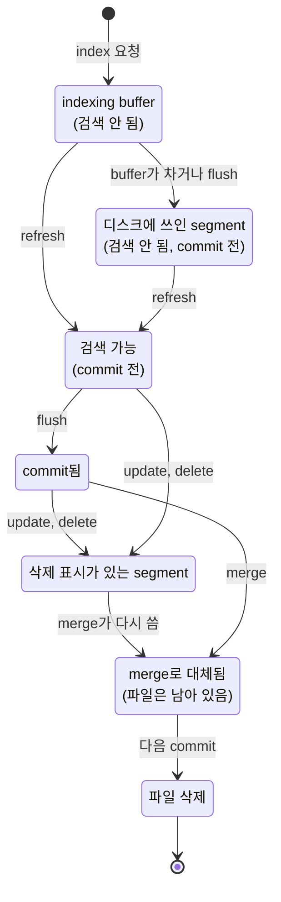

운영하다 보면 설명이 잘 안 되는 증상을 자주 만납니다.
문서를 넣었는데 바로 검색이 안 됩니다. update만 했는데 디스크가 늘어납니다. merge가 끝났는데도 용량이 그대로입니다. 재시작하면 shard가 늦게 올라옵니다.
이 증상들은 모두 shard 안에서 segment가 어떻게 생기고 사라지는지로 설명됩니다. 이 구조를 모르면 `refresh_interval`, translog, force merge 같은 설정을 감으로 바꾸게 됩니다.

이 글은 segment의 생애를 Lucene 수준에서 따라갑니다. merge와 force merge는 [다음 글](../02-merge-and-force-merge/)에서 다룹니다.

:::note[기준]
- Elasticsearch 9.5.5(Lucene 10.5.1) 기준입니다. 공식 문서는 2026년 11월에 다시 확인했습니다.
- 공식 문서에 없는 기본값과 동작은 Elasticsearch 9.5.5 빌드 commit(`48acba6`)과 Lucene 10.5.1 소스로 확인했고, 해당 문장에 근거 파일을 적었습니다.
- 실측은 Elastic Cloud Hosted 9.5.5에서 했습니다. hot node 2대(노드당 RAM 8GB, JVM heap 4GB, vCPU 2), primary 1개, replica 0개 인덱스입니다. 실험 코드와 결과는 저장소 [`labs/data/segments-and-merge/`](https://github.com/Munsik/engineering-notes/tree/main/labs/data/segments-and-merge)에 있습니다.
- 절대값은 환경마다 다릅니다. 조건 사이의 차이를 보는 용도로 읽어 주세요.
:::

## 증상과 원인

| 증상 | 원인 | 이 글의 절 |
| --- | --- | --- |
| 넣은 문서가 몇 초 동안 검색되지 않는다 | 아직 refresh가 안 돼서 새 segment가 열리지 않았다 | [쓰기 경로](#문서-하나가-검색되기까지) |
| 검색이 없는 인덱스는 1초가 지나도 검색되지 않는다 | search idle 상태에서는 주기 refresh를 건너뛴다 | [refresh 주기 실측](#실측-refresh_interval에-따라-segment가-어떻게-생기나) |
| update만 했는데 디스크가 늘어난다 | update는 삭제 표시와 새 문서 추가다. 옛 문서는 merge 전까지 남는다 | [삭제와 update](#삭제와-update) |
| merge가 끝났는데 `store.size`가 그대로다 | 마지막 commit point가 merge 전 segment 파일을 아직 잡고 있다 | [commit point가 잡고 있는 파일](#commit-point가-잡고-있는-파일) |
| 재시작하면 shard가 늦게 올라온다 | 마지막 commit 이후 작업을 translog에서 다시 실행한다 | [translog와 flush](#translog와-flush) |
| 대량 적재가 생각보다 느리다 | segment를 자주 만들고 merge하느라 IO를 쓴다 | [refresh 주기 실측](#실측-refresh_interval에-따라-segment가-어떻게-생기나), [다음 글](../02-merge-and-force-merge/) |

## Shard는 Lucene index다

Elasticsearch shard 하나는 Lucene index 하나입니다.
Lucene에서 index는 segment 여러 개와 commit point 하나를 묶은 것입니다([Near real-time search](https://www.elastic.co/docs/manage-data/data-store/near-real-time-search)).

- **segment**: 문서 묶음 하나를 검색할 수 있게 만든 독립된 작은 index입니다. inverted index, doc values, stored fields, points, vectors를 따로 갖고 있습니다.
- **commit point**: 지금 디스크에 안전하게 기록된 segment 목록입니다. `segments_N` 파일입니다.

segment는 한 번 쓰면 고치지 않습니다([Merge settings](https://www.elastic.co/docs/reference/elasticsearch/index-settings/merge)).
문서를 추가하면 새 segment가 생기고, 문서를 지우면 기존 segment에 "지웠다"는 표시만 붙습니다. segment를 실제로 줄이거나 없애는 일은 merge가 합니다.
그래서 이 글에 나오는 증상 대부분이 "고치지 않고 새로 쓴다"는 이 성질에서 나옵니다.

### segment를 이루는 파일

Lucene 10.5.1의 기본 codec 문서(`lucene/core/.../codecs/lucene104/package-info.java`)에 정리된 파일 구성입니다.

| 확장자 | 내용 | Elasticsearch에서 쓰는 곳 |
| --- | --- | --- |
| `segments_N` | commit point. 이 commit에 포함된 segment 목록 | 복구할 때 시작점 |
| `.si` | segment 메타데이터 | |
| `.cfs`, `.cfe` | compound file. 작은 segment의 파일들을 하나로 묶은 것 | 아래 설명 참고 |
| `.fnm` | 필드 정보 | |
| `.tim`, `.tip` | term dictionary와 그 index | `text`, `keyword` 검색 |
| `.doc`, `.pos`, `.pay` | postings. term이 나온 문서, 빈도, 위치 | match, phrase 검색 |
| `.nvd`, `.nvm` | norms. 필드 길이 정보 | relevance 점수 계산 |
| `.dvd`, `.dvm` | doc values. 문서별 열 단위 값 | 정렬, aggregation, ES\|QL |
| `.fdt`, `.fdx` | stored fields | `_source`, `_id` |
| `.kdd`, `.kdi`, `.kdm` | points(BKD tree) | 숫자, 날짜, IP의 range 검색 |
| `.vec`, `.veq`, `.vex` 등 | 원본 vector, quantized vector(int8, int4), HNSW graph | kNN 검색 |
| `.liv` | live docs. 어떤 문서가 살아 있는지 | 삭제 표시 |

Elasticsearch는 필드 종류와 index mode에 따라 postings와 doc values format 일부를 자체 구현으로 바꿔 씁니다(Elasticsearch 소스 `PerFieldFormatSupplier.java`). 그래서 실제 디스크의 파일 이름은 이 표와 조금 다를 수 있습니다. 구성 요소의 역할은 같습니다.
vector도 마찬가지입니다. BBQ로 quantize한 vector는 `.veq` 대신 Elasticsearch 형식인 `.veb`에 저장됩니다([Tune approximate kNN search](https://www.elastic.co/docs/deploy-manage/production-guidance/optimize-performance/approximate-knn-search)). 9.5.5에서 384차원 이상 `dense_vector`의 기본값이 `bbq_hnsw`이므로, 옵션 없이 만든 vector 인덱스에서는 `.veb`를 보게 됩니다.

작은 segment는 이 파일들을 `.cfs` 하나로 묶습니다. 파일 수가 줄어서 file handle을 덜 씁니다.
Elasticsearch는 buffer에서 새로 쓴 segment를 compound file로 만들고(소스 `EngineConfig.java`), merge로 만든 segment는 1GB 이하일 때만 compound file로 만듭니다(`index.compound_format` 기본값 `1gb`, 소스 `MergePolicyConfig.java`). `_cat/segments`의 `compound` 열로 확인할 수 있습니다.

### 실측: 저장 공간은 어디에 쓰이나

[Analyze index disk usage API](https://www.elastic.co/docs/api/elasticsearch/operation/operation-indices-disk-usage)는 필드별로, 구성 요소별로 저장 공간을 나눠 보여 줍니다.
아래 실험 A의 `refresh-off` 인덱스(synthetic 로그 100만 건, segment 3개)에서 실행한 결과입니다.

```console
POST segments-lab-refresh-off/_disk_usage?run_expensive_tasks=true
```

| 구성 요소 | 크기 | 비율 | 주로 차지한 필드 |
| --- | --- | --- | --- |
| stored fields | 105.2MB | 69% | `_source` 98.3MB, `_id` 6.9MB |
| inverted index | 31.9MB | 21% | `message` 23.6MB, `_id` 6.5MB |
| doc values | 8.1MB | 5% | `event.duration`, `@timestamp`, `_seq_no` |
| points | 6.7MB | 4% | `event.duration` 3.5MB, `@timestamp` 1.9MB |
| norms | 1.0MB | 1% | `message` |

이 데이터에서는 원본 JSON인 `_source`가 전체의 3분의 2를 차지했습니다(실측).
logsdb나 synthetic `_source`가 저장 공간을 크게 줄이는 이유가 여기 있습니다. 이 비교는 데이터 설계 컬렉션의 저장 용량 글에서 따로 다룰 예정입니다.

## 문서 하나가 검색되기까지

문서 하나가 들어와서 검색되고, 디스크에 안전하게 남기까지는 세 단계가 따로 움직입니다.



| 단계 | 무엇이 일어나나 | 언제 일어나나 | 결과 |
| --- | --- | --- | --- |
| indexing | 문서를 indexing buffer에 넣고 translog에 기록 | 요청마다 | 아직 검색 안 됨. 응답은 나감 |
| refresh | buffer 내용을 새 segment로 쓰고 searcher를 다시 연다 | `refresh_interval`마다, 검색이 있을 때만(아래 참고) | 검색에 보임. 아직 commit 안 됨 |
| flush | Lucene commit. segment를 fsync하고 `segments_N`을 쓴 뒤 translog를 새로 시작 | translog 크기, 경과 시간, 유휴 상태 | 디스크에 commit됨 |

여기서 세 가지를 구분해야 합니다. "검색에 보인다", "디스크에 segment 파일이 있다", "commit됐다"는 서로 다른 상태입니다.

### refresh와 search idle

refresh는 buffer의 문서를 새 segment로 쓰고 열어서 검색에 보이게 하는 작업입니다. fsync를 하지 않기 때문에 commit보다 훨씬 가볍습니다. 새 segment는 먼저 filesystem cache에 쓰입니다([Near real-time search](https://www.elastic.co/docs/manage-data/data-store/near-real-time-search)).

기본 주기는 1초입니다. 다만 최근 30초 안에 검색 요청을 한 번이라도 받은 인덱스만 1초마다 refresh합니다.
`refresh_interval`을 명시적으로 설정하면 이 동작에서 빠지고 설정한 주기대로 refresh합니다([Tune for indexing speed](https://www.elastic.co/docs/deploy-manage/production-guidance/optimize-performance/indexing-speed)).
30초라는 기준은 `index.search.idle.after` 설정입니다(기본값 `30s`, 소스 `IndexSettings.java`).

Elastic Cloud Serverless는 기본 주기가 다릅니다. `refresh_interval`은 `-1`이거나 `5s` 이상이어야 합니다(같은 문서).

### indexing buffer

새 문서는 refresh 전까지 indexing buffer에 있습니다. buffer는 노드 하나에 하나이고, 그 노드에서 쓰기 중인 shard들이 나눠 씁니다.
기본 크기는 JVM heap의 10%이고 최소 48MB입니다([Indexing buffer settings](https://www.elastic.co/docs/reference/elasticsearch/configuration-reference/indexing-buffer-settings)).
공식 문서는 쓰기가 많은 shard 하나에 512MB 넘게 줘도 보통 빨라지지 않는다고 설명합니다([Tune for indexing speed](https://www.elastic.co/docs/deploy-manage/production-guidance/optimize-performance/indexing-speed)).

buffer가 가득 차면 refresh 주기와 상관없이 segment가 디스크에 쓰입니다.
노드 전체 사용량이 buffer 크기를 넘으면 Elasticsearch는 buffer를 쓰고 있는 shard를 shard ID 순서로 돌아가며 골라 메모리를 비웁니다. 가장 많이 쓰는 shard부터 고르지 않는 이유는 그쪽이 벤치마크에서 더 나빴기 때문이라고 소스 주석에 적혀 있습니다(소스 `IndexingMemoryController.java`).
고른 shard에서는 보통 가장 큰 대기 segment 하나를 디스크에 씁니다. 이 segment는 디스크에 있지만 다음 refresh 전까지 검색에는 안 보입니다.
예외가 있습니다. 같은 `_id`를 덮어쓰는 작업이 많아 version map이 buffer보다 메모리를 더 쓰고 있으면, segment 하나만 쓰는 대신 refresh를 합니다. flush 기준(크기나 시간)의 절반을 이미 넘었다면 flush를 합니다. 이때는 그 시점까지의 문서가 검색에 보이게 됩니다(소스 `InternalEngine.writeIndexingBuffer`, `reclaimVersionMapMemory`).

shard가 많을수록 buffer가 잘게 나뉘고, segment도 작아집니다. 노드당 shard 수가 indexing 성능에 영향을 주는 이유 중 하나입니다(해석).

### translog와 flush

Lucene은 commit할 때만 변경 내용을 디스크에 확실히 남깁니다. commit은 비싸서 요청마다 할 수 없습니다.
그래서 Elasticsearch는 모든 index, delete 작업을 응답하기 전에 translog에 씁니다. 프로세스가 죽으면 마지막 commit 이후 작업을 translog에서 다시 실행해서 복구합니다([Translog settings](https://www.elastic.co/docs/reference/elasticsearch/index-settings/translog)).

| 설정 | 기본값 | 의미 | 근거 |
| --- | --- | --- | --- |
| `index.translog.durability` | `request` | primary와 모든 replica에서 translog를 fsync한 뒤 응답 | 공식 문서 |
| `index.translog.sync_interval` | `5s` | `async`일 때 fsync 주기 | 공식 문서 |
| `index.translog.flush_threshold_size` | `10gb` | translog가 이만큼 쌓이면 flush | 공식 문서 |
| `index.translog.flush_threshold_age` | `1m` | 마지막 flush 후 이 시간이 지나면 flush | 소스 `IndexSettings.java` |
| `indices.memory.shard_inactive_time` | `5m` | 이 시간 동안 쓰기가 없으면 shard를 유휴로 보고 flush | 소스 `IndexingMemoryController.java` |

Elasticsearch에서 flush는 Lucene commit을 하고 새 translog generation을 시작하는 작업입니다. translog는 디스크의 1%를 넘지 않습니다(공식 문서).
`async`로 바꾸면 쓰기 처리량은 오르지만, 장애가 나면 마지막 fsync 이후 응답한 작업을 잃을 수 있습니다.

용어 하나를 주의해야 합니다. Lucene에서 "flush"는 buffer를 segment 파일로 쓰는 것을 말합니다. Elasticsearch의 flush는 Lucene의 commit입니다. 같은 단어가 다른 일을 가리킵니다.

### 세 상태를 `_cat/segments`로 보기

`_cat/segments`의 `committed`, `searchable` 열이 위의 상태를 그대로 보여 줍니다.
아래는 데모 인덱스에 6만 건을 넣고 flush한 뒤, 그중 1만 2천 건을 같은 `_id`로 다시 넣은 직후의 화면입니다.



- `_0`부터 `_5`까지는 flush 전에 만들어져 commit된 segment입니다.
- `_6`, `_7`은 flush 뒤에 refresh로 만들어졌습니다. 검색은 되지만 아직 commit되지 않았습니다. 이 상태에서 노드가 죽으면 이 두 segment는 버려지고, translog에서 다시 만들어집니다.
- `_0`은 살아 있는 문서가 없고 삭제 표시만 1만 건입니다. update로 옛 버전이 전부 지워진 segment입니다. 이 segment는 다음 flush 때 사라졌습니다(실측).
- `_1`은 1만 건 중 2천 건에 삭제 표시가 붙었습니다. 이런 segment는 merge가 다시 써야 공간이 돌아옵니다.

### 실측: refresh_interval에 따라 segment가 어떻게 생기나

같은 synthetic 로그 100만 건(문서당 약 350바이트)을 `refresh_interval`만 바꿔 넣었습니다. client 하나가 2,000건씩 bulk로 보냈고, 적재에는 네 경우 모두 84초 정도 걸렸습니다.
기본값(미설정) 인덱스는 만든 뒤 40초를 기다려서 search idle 상태에서 적재를 시작했습니다. 같은 실험을 두 번 돌렸고, 표는 1회차 값과 2회차 값을 같이 적었습니다.

| `refresh_interval` | 적재 중 refresh | 적재 직후 segment (검색 가능 / commit) | merge | 적재 직후 `store.size` |
| --- | --- | --- | --- | --- |
| 미설정, 검색 없음 | 2회 / 2회 | 4개 (0 / 3), 두 번 같음 | 0회 / 0회 | 159.9MB / 160.1MB |
| `1s` | 83회 / 84회 | 45개 (19 / 27) / 47개 (21 / 27) | 2회 / 2회 | 218.0MB / 216.4MB |
| `30s` | 5회 / 5회 | 4개 (4 / 2), 두 번 같음 | 0회 / 0회 | 161.6MB / 161.6MB |
| `-1` | 2회 / 2회 | 2개 (0 / 1), 두 번 같음 | 0회 / 0회 | 148.3MB / 148.3MB |

refresh 횟수는 `_stats`의 `refresh.external_total`입니다. 미설정과 `-1` 인덱스의 2회는 인덱스를 만들 때 shard가 열리면서 생긴 값입니다. 문서를 넣기 전에도 2였습니다(로컬 9.5.5에서 확인). 두 번의 결과가 거의 같아서 아래 설명은 두 회차 모두에 해당합니다. 결과 원본은 [`results/A_refresh.csv`](https://github.com/Munsik/engineering-notes/blob/main/labs/data/segments-and-merge/results/A_refresh.csv)에 있습니다.

결과에서 읽을 것은 세 가지입니다.

- **검색이 없으면 기본값도 refresh를 거의 안 합니다.** 미설정 인덱스는 적재하는 84초 동안 주기 refresh가 한 번도 없었고, `-1`과 거의 같게 움직였습니다. 적재 직후 `_cat/segments`에서 검색 가능한 segment가 0개였고, 수동 `_refresh` 뒤에야 5개가 됐습니다.
- **refresh를 꺼도 segment는 디스크에 쓰입니다.** `-1`과 미설정 인덱스에도 commit된 segment가 있습니다. 적재가 1분을 넘기자 `flush_threshold_age`(1분) 때문에 flush가 일어났기 때문입니다. refresh를 꺼도 디스크 기록과 commit은 계속됩니다.
- **1초 refresh는 segment를 많이 만들고 merge를 부릅니다.** `1s` 인덱스는 segment가 적재 중 최대 40개까지 쌓였고, 40만 건 정도를 한 번에 합치는 merge가 두 번 있었습니다. merge는 IO 제한(throttle)에 22초 동안 걸렸습니다. 이 merge 방식은 [다음 글](../02-merge-and-force-merge/#merge-policy는-두-가지다)에서 설명합니다.

대량 적재 중에는 `refresh_interval`을 `-1`로 두라는 공식 권장(같은 문서)은 이 결과와 맞습니다. 적재 중 검색을 안 한다면 기본값으로 둬도 search idle 덕분에 비슷하게 움직입니다. 다만 대시보드나 alert rule이 그 인덱스를 30초 안에 한 번이라도 검색하면 1초 refresh로 돌아갑니다(해석).

### commit point가 잡고 있는 파일

위 표에서 `1s` 인덱스만 `store.size`가 218MB로 다른 인덱스보다 35% 컸습니다.
merge가 끝났는데도 merge 전 segment 27개가 `committed: true, searchable: false`로 남아 있었습니다. 마지막 commit point가 merge 전 segment 목록을 가리키고 있어서 파일을 지울 수 없었던 것입니다.
flush가 한 번 더 일어난 뒤에는 segment가 19개로 정리되고 `store.size`가 163.2MB로 줄었습니다(실측).

merge 직후의 `store.size`에는 다음 commit 때 지워질 파일이 섞여 있습니다. 용량을 비교하는 측정은 flush 뒤에 해야 합니다.
`store.size`는 기본 10초 동안 캐시되기도 합니다(`index.store.stats_refresh_interval`, 소스 `Store.java`). 이번 실측도 처음에는 적재 직후 값을 바로 읽었다가 이전 값이 나와서, 모든 측정 전에 15초를 기다리도록 바꿨습니다.

## 삭제와 update

Lucene에서 Elasticsearch가 하는 쓰기 작업은 두 가지뿐입니다. 새 문서를 추가하거나, 기존 문서를 지웁니다. update는 옛 문서를 지우고 새 문서를 추가하는 작업을 원자적으로 하는 것입니다([History retention settings](https://www.elastic.co/docs/reference/elasticsearch/index-settings/history-retention)).

segment는 고칠 수 없기 때문에 "지운다"는 것은 표시를 붙이는 일입니다.

- Lucene은 segment마다 살아 있는 문서 목록(`.liv`)을 따로 둡니다.
- Elasticsearch는 여기에 soft delete를 씁니다. 지운 문서를 바로 버리지 않고 `__soft_deletes`라는 doc values 필드로 표시해 둡니다(소스 `Lucene.java`). 복구 중인 replica나 cross-cluster replication follower에게 삭제 작업을 다시 보내려면 지운 문서 정보가 필요하기 때문입니다.
- 어떤 작업까지 남겨 둘지는 shard history retention lease가 정합니다. lease가 잡고 있는 작업은 merge 때도 버리지 않습니다. lease는 기본 12시간 뒤 만료됩니다(`index.soft_deletes.retention_lease.period`, 같은 문서).

결국 지운 문서가 차지한 공간은 merge가 그 segment를 다시 쓸 때 돌아옵니다. replica가 오래 떨어져 있거나 CCR follower가 밀리면, lease가 풀릴 때까지 merge를 해도 공간이 돌아오지 않을 수 있습니다(해석).

### 실측: 같은 문서를 반복 update

문서 20만 건을 넣고, 같은 `_id`로 전체를 다섯 번 다시 넣었습니다. `@timestamp` 대신 `ts` 필드를 써서 update가 많은 인덱스에 흔한 TieredMergePolicy가 적용되게 했습니다([다음 글](../02-merge-and-force-merge/#merge-policy는-두-가지다) 참고).

| 단계 | `docs.count` | `docs.deleted` | `store.size` | 검색 가능 segment |
| --- | --- | --- | --- | --- |
| 처음 적재 | 200,000 | 0 | 31.6MB | 2 |
| 1회차 update | 200,000 | 200,000 | 62.8MB | 6 |
| 2회차 update | 200,000 | 49,885 | 102.1MB | 6 |
| 3회차 update | 200,000 | 16,000 | 81.6MB | 4 |
| 5회차 update | 200,000 | 16,000 | 86.8MB | 3 |
| `only_expunge_deletes` | 200,000 | 16,000 | 34.1MB | 3 |
| 같은 작업, `expunge_deletes_allowed: 0` | 200,000 | 0 | 31.5MB | 3 |

- 1회차 update 직후에는 옛 버전 20만 건이 모두 `docs.deleted`로 남았고, 디스크는 정확히 두 배가 됐습니다.
- 이후에는 merge가 삭제 문서를 꾸준히 걷어 냈습니다. 그래도 `store.size`는 처음의 2.6배에서 3.2배 사이를 오갔습니다. 대부분은 앞 절에서 본 "commit point가 잡고 있는 merge 전 파일"입니다. force merge는 끝난 뒤 flush를 하기 때문에 그 파일이 정리되면서 34.1MB로 떨어졌습니다.
- `only_expunge_deletes`를 실행해도 삭제 문서 1만 6천 건이 남았습니다. 그 segment의 삭제 비율이 8%라서 기준값 10%(`index.merge.policy.expunge_deletes_allowed`) 아래였기 때문입니다. 기준을 0으로 낮추자 모두 사라졌습니다. 이 인덱스는 `ts` 필드를 쓴 TieredMergePolicy 인덱스라서 10% 기준이 적용됐습니다. `@timestamp` 인덱스는 이 기준이 없어 동작이 다릅니다([다음 글](../02-merge-and-force-merge/#지운-문서만-정리하기-only_expunge_deletes) 참고).
이때 기록된 retention lease는 최신 작업보다 3만 4천 건 정도 뒤에 있었지만(`retaining_seq_no` 1,166,000, 전체 작업 약 120만 건) 공간 회수를 막지 않았습니다.

결과 원본은 [`results/B_update.csv`](https://github.com/Munsik/engineering-notes/blob/main/labs/data/segments-and-merge/results/B_update.csv)에 있습니다.

#### replica가 있을 때

같은 실험을 replica 1개로 한 번 더 했습니다. 시점마다 남은 삭제 문서 수는 0에서 5만 건 사이로 오르내렸습니다. merge가 언제 끝났는지에 따라 달라지는 값이라 회차 사이 비교에는 의미가 없습니다.
retention lease는 shard copy마다 하나씩 있었습니다. 마지막 update가 끝나고 15초 뒤에 보니 lease가 가장 최근 작업보다 9만 건 정도 뒤에 있었습니다(`retaining_seq_no` 1,110,000, `max_seq_no` 1,199,999). 그래도 `expunge_deletes_allowed: 0`으로 정리하자 삭제 문서가 모두 사라졌습니다.
replica가 정상일 때는 lease가 공간 회수를 막지 않았습니다(실측). lease 때문에 공간이 안 돌아오는 경우는 replica가 내려가 있거나 CCR follower가 밀린 경우로 보면 됩니다(해석). 결과 원본은 [`results/B_update_replica1.csv`](https://github.com/Munsik/engineering-notes/blob/main/labs/data/segments-and-merge/results/B_update_replica1.csv)에 있습니다.

## Segment의 생애 한눈에 보기



## 운영에서 볼 것

아래는 제가 운영 점검 때 보는 순서입니다(해석).

| 확인할 것 | 요청 | 이상 신호 |
| --- | --- | --- |
| segment 수와 상태 | `GET _cat/segments/<index>?v&h=shard,prirep,segment,docs.count,docs.deleted,size,committed,searchable` | 같은 shard에 작은 segment가 수십 개 이상 계속 남아 있음 |
| 삭제 문서 비율 | `GET _cat/indices/<index>?v&h=index,docs.count,docs.deleted,store.size` | Tiered 인덱스에서 `docs.deleted`가 `docs.count`의 20%를 넘는 상태가 오래 감. `@timestamp` 인덱스는 추세가 계속 오르는지 봄 |
| refresh 부담 | `GET <index>/_stats/refresh` | 쓰기가 많은 인덱스에서 `external_total`이 초 단위로 늘어남 |
| flush와 translog | `GET <index>/_stats/flush,translog` | `translog.uncommitted_size_in_bytes`가 계속 큼. 재시작 시 복구가 길어짐 |
| retention lease | `GET <index>/_stats?level=shards&filter_path=**.retention_leases` | `retaining_seq_no`가 오래 앞으로 가지 않음 |

`_cat/segments`는 primary와 replica의 segment를 모두 나열합니다. replica가 있는 인덱스는 `prirep` 열로 나눠서 봅니다.
20%는 TieredMergePolicy가 삭제 문서를 많다고 보는 기본 기준(`index.merge.policy.deletes_pct_allowed`, 소스 `MergePolicyConfig.java`)에서 가져온 값입니다.
`@timestamp`가 있어 LogByteSizeMergePolicy를 쓰는 인덱스에는 이 기준이 없습니다. 삭제 비율로 merge 대상을 고르지 않기 때문에 update나 delete가 많으면 삭제 문서가 더 오래 남을 수 있습니다(같은 소스, [lucene#16701](https://github.com/apache/lucene/issues/16701)). 두 policy의 차이는 [다음 글](../02-merge-and-force-merge/#merge-policy는-두-가지다)에서 다룹니다.

## 다음 글

- [02. Merge와 force merge](../02-merge-and-force-merge/): merge policy 두 가지, merge가 indexing을 늦추는 조건, force merge를 해도 되는 때와 하면 안 되는 때
- 이 글의 실측 코드: [`labs/data/segments-and-merge/`](https://github.com/Munsik/engineering-notes/tree/main/labs/data/segments-and-merge)

## 참고 문서

- [Near real-time search](https://www.elastic.co/docs/manage-data/data-store/near-real-time-search)
- [Translog settings](https://www.elastic.co/docs/reference/elasticsearch/index-settings/translog)
- [Indexing buffer settings](https://www.elastic.co/docs/reference/elasticsearch/configuration-reference/indexing-buffer-settings)
- [Tune for indexing speed](https://www.elastic.co/docs/deploy-manage/production-guidance/optimize-performance/indexing-speed)
- [History retention settings](https://www.elastic.co/docs/reference/elasticsearch/index-settings/history-retention)
- [Merge settings](https://www.elastic.co/docs/reference/elasticsearch/index-settings/merge)
- [Analyze index disk usage API](https://www.elastic.co/docs/api/elasticsearch/operation/operation-indices-disk-usage)
- [Tune approximate kNN search](https://www.elastic.co/docs/deploy-manage/production-guidance/optimize-performance/approximate-knn-search)
- Lucene 이슈: [lucene#16701 LogMergePolicy has no explicit delete-driven merge selection](https://github.com/apache/lucene/issues/16701)
- Lucene 10.5.1 소스: [`codecs/lucene104/package-info.java`](https://github.com/apache/lucene/blob/releases/lucene/10.5.1/lucene/core/src/java/org/apache/lucene/codecs/lucene104/package-info.java)
- Elasticsearch 9.5.5 소스: [`IndexSettings.java`](https://github.com/elastic/elasticsearch/blob/48acba663b09e70b115dd879329141506c377890/server/src/main/java/org/elasticsearch/index/IndexSettings.java), [`IndexingMemoryController.java`](https://github.com/elastic/elasticsearch/blob/48acba663b09e70b115dd879329141506c377890/server/src/main/java/org/elasticsearch/indices/IndexingMemoryController.java), [`InternalEngine.java`](https://github.com/elastic/elasticsearch/blob/48acba663b09e70b115dd879329141506c377890/server/src/main/java/org/elasticsearch/index/engine/InternalEngine.java), [`EngineConfig.java`](https://github.com/elastic/elasticsearch/blob/48acba663b09e70b115dd879329141506c377890/server/src/main/java/org/elasticsearch/index/engine/EngineConfig.java), [`MergePolicyConfig.java`](https://github.com/elastic/elasticsearch/blob/48acba663b09e70b115dd879329141506c377890/server/src/main/java/org/elasticsearch/index/MergePolicyConfig.java), [`Store.java`](https://github.com/elastic/elasticsearch/blob/48acba663b09e70b115dd879329141506c377890/server/src/main/java/org/elasticsearch/index/store/Store.java), [`Lucene.java`](https://github.com/elastic/elasticsearch/blob/48acba663b09e70b115dd879329141506c377890/server/src/main/java/org/elasticsearch/common/lucene/Lucene.java), [`PerFieldFormatSupplier.java`](https://github.com/elastic/elasticsearch/blob/48acba663b09e70b115dd879329141506c377890/server/src/main/java/org/elasticsearch/index/codec/PerFieldFormatSupplier.java)
