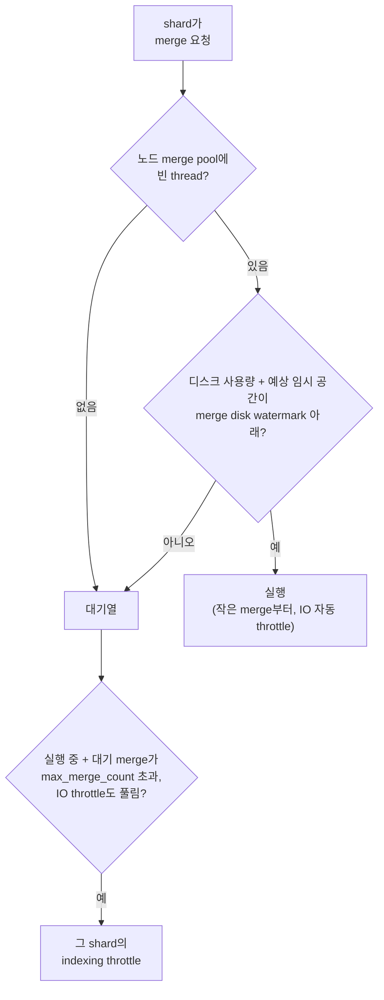
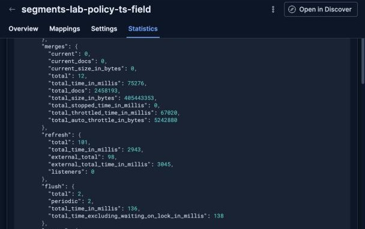
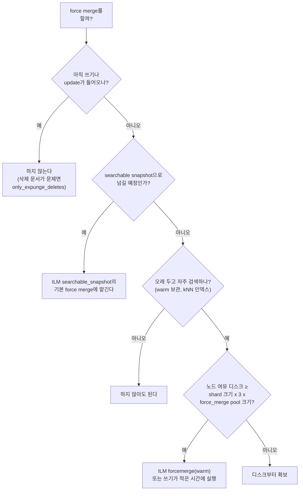

segment가 많아서 검색이 느리다는 얘기를 듣고 force merge를 매일 밤 돌리는 환경을 자주 봅니다.
그런데 쓰기 중인 인덱스에 force merge를 하면 디스크가 순간 세 배로 뛰고, snapshot이 매번 전체 크기로 올라가고, 나중에는 지운 문서가 정리되지 않는 segment가 남습니다.
merge는 Elasticsearch가 알아서 하는 일이라 평소에는 신경 쓸 일이 적습니다. 그래도 언제 끼어들어야 하는지, 언제 두어야 하는지는 구조를 알아야 판단할 수 있습니다.

segment가 무엇이고 왜 쌓이는지는 [01. Segment의 생애](../01-segments/)에서 다뤘습니다.

:::note[기준]
- Elasticsearch 9.5.5(Lucene 10.5.1) 기준입니다. 공식 문서는 2026년 11월에 다시 확인했습니다.
- merge policy 세부 설정과 기본값은 현재 공식 문서에 따로 정리돼 있지 않아 Elasticsearch 9.5.5 빌드 commit(`48acba6`)과 Lucene 10.5.1 소스로 확인했습니다. 해당 문장마다 근거 파일을 적었습니다.
- 실측은 [01](../01-segments/)과 같은 환경입니다. Elastic Cloud Hosted 9.5.5, hot node 2대(노드당 RAM 8GB, JVM heap 4GB, vCPU 2), primary 1개, replica 0개 인덱스입니다. 실험 코드와 결과는 [`labs/data/segments-and-merge/`](https://github.com/Munsik/engineering-notes/tree/main/labs/data/segments-and-merge)에 있습니다.
- force merge는 Elastic Cloud Serverless에서는 쓸 수 없습니다([Tune for indexing speed](https://www.elastic.co/docs/deploy-manage/production-guidance/optimize-performance/indexing-speed)).
:::

## Merge가 하는 일

merge는 segment 여러 개를 읽어서 새 segment 하나로 다시 씁니다. 다시 쓰는 동안 삭제 표시가 붙은 문서는 빼고 씁니다. 새 segment가 열리면 옛 segment는 다음 commit 뒤에 지워집니다([Force merge API](https://www.elastic.co/docs/api/elasticsearch/operation/operation-indices-forcemerge)).

얻는 것은 두 가지입니다.

- **검색할 segment 수가 줄어듭니다.** query는 segment마다 따로 실행됩니다. 특히 kNN 검색은 segment마다 HNSW graph가 따로 있어서 segment가 적을수록 여러 배 빨라질 수 있습니다([Tune approximate kNN search](https://www.elastic.co/docs/deploy-manage/production-guidance/optimize-performance/approximate-knn-search)).
- **지운 문서의 공간이 돌아옵니다.** update와 delete가 남긴 문서는 merge가 그 segment를 다시 써야 사라집니다. retention lease가 잡고 있는 문서는 예외입니다([01](../01-segments/#삭제와-update) 참고).

대신 데이터를 읽고 다시 쓰는 만큼 디스크 IO와 CPU를 쓰고, 끝날 때까지 새 파일과 옛 파일이 같이 있어서 디스크도 잠시 더 씁니다.

## Merge policy는 두 가지다

Elasticsearch는 인덱스 매핑에 따라 merge policy를 둘 중 하나로 고릅니다(소스 `MergePolicyConfig.java`, `IndexShard.java`).

| 구분 | TieredMergePolicy | LogByteSizeMergePolicy |
| --- | --- | --- |
| 적용 조건 | 아래 조건이 아닌 인덱스 | 매핑에 `@timestamp` 필드가 date 타입으로 있는 인덱스 |
| 대표 예 | 상품 카탈로그, 문서 검색, update가 많은 entity 인덱스 | data stream, 로그, 메트릭, 시간 기반 인덱스 |
| 무엇을 합치나 | 크기가 비슷한 segment끼리. 위치는 상관없음 | 바로 옆에 붙은 segment끼리만 |
| merge 결과 상한 | 5GB | 100GB |
| 한 단계에 허용하는 segment 수 | 8개(`segments_per_tier`) | 32개가 모이면 합침(`merge_factor`) |
| 작은 segment 기준 | 16MB 미만은 16MB로 취급(`floor_segment`) | 같음 |

- 상한은 노드 설정 `indices.merge.policy.max_merged_segment`(기본 5GB)와 `indices.merge.policy.max_time_based_merged_segment`(기본 100GB)입니다. 시간 기반 데이터는 보통 rollover되니 상한이 크게 의미 없고, 상한 때문에 merge가 잘게 쪼개지면 다시 쓰는 양이 늘어난다는 이유로 일부러 높게 잡았다고 소스 주석에 적혀 있습니다.
- 바로 옆 segment끼리만 합치는 이유도 소스 주석에 있습니다. 시간 순서로 들어온 데이터는 segment마다 시간 범위가 겹치지 않게 됩니다. 그러면 `@timestamp` range 조건이 segment 하나를 통째로 포함하거나 통째로 건너뛰게 돼서 검색이 빨라집니다. 최근 데이터만 자주 보는 패턴과도 맞습니다.
- `segments_per_tier`와 `floor_segment`는 9.5에서 바뀌었습니다. 9.4까지는 각각 10과 2MB였습니다(9.3, 9.4 브랜치와 9.5.5의 `MergePolicyConfig.java` 비교).
- 인덱스 설정 `index.merge.policy.type`(`unset`, `tiered`, `time_based`)으로 policy를 직접 고를 수도 있습니다(소스). 공식 문서에 없는 설정이라 운영에서는 기본 판정에 맡기는 쪽을 권합니다(해석).

Lucene 수준에서 보면 두 policy 모두 큰 segment를 merge 대상에서 뺍니다.
TieredMergePolicy는 상한의 절반(2.5GB)을 넘는 segment를 삭제 비율이 낮으면 후보에서 뺍니다. LogByteSizeMergePolicy는 상한 이상인 segment를 건너뜁니다(Lucene 소스 `TieredMergePolicy.java`, `LogMergePolicy.java`).

### 판정은 shard가 열릴 때 한 번 한다

`@timestamp`가 있는지는 shard의 engine을 만들 때 한 번만 봅니다(소스 `IndexShard.java`의 `newEngineConfig`).
그래서 매핑 없이 인덱스를 만들고 첫 문서의 `@timestamp`가 dynamic mapping으로 date가 된 경우, 그 shard는 다시 열리기 전까지 TieredMergePolicy로 움직입니다. 아래 실측으로 확인했습니다.

data stream은 만들 때부터 `@timestamp` 매핑이 있어야 하므로 이 문제가 없습니다. 일반 인덱스를 시간 기반으로 쓴다면 index template에 `@timestamp`를 date로 넣어 두는 게 안전합니다(해석).

### 실측: 같은 데이터, 다른 policy

[01의 refresh 실험](../01-segments/#실측-refresh_interval에-따라-segment가-어떻게-생기나)과 같은 조건(100만 건, `refresh_interval: 1s`, 2,000건씩 bulk)에서 시간 필드만 바꿨습니다.

| 인덱스 | 시간 필드 | 적용된 policy | merge 횟수 | merge가 다시 쓴 문서 | merge가 다시 쓴 크기 | merge IO throttle | 적재 후 segment |
| --- | --- | --- | --- | --- | --- | --- | --- |
| `refresh-1s` | `@timestamp` (만들 때 매핑) | LogByteSize | 2 | 79.6만 | 134MB | 22.3초 | 19 |
| `policy-ts-field` | `ts` | Tiered | 12 | 245.8만 | 405MB | 67.0초 | 5 |
| `policy-dynamic-ts` | `@timestamp` (dynamic) | Tiered | 12 | 178.0만 | 542MB | 68.5초 | 5 |
| `policy-dynamic-ts`, close/open 후 60만 건 추가 | `@timestamp` (dynamic) | LogByteSize | 1 | 40.2만 | 124MB | 19.5초 | 22 |

`policy-dynamic-ts`는 dynamic mapping이 `message`에 `keyword` 하위 필드까지 만들어서 크기를 다른 인덱스와 바로 비교할 수 없습니다. merge 횟수와 segment 수만 보세요. 결과 원본은 [`results/D_policy.csv`](https://github.com/Munsik/engineering-notes/blob/main/labs/data/segments-and-merge/results/D_policy.csv)에 있습니다.

- **Tiered는 segment를 적게 유지하는 대신 많이 다시 씁니다.** 100만 건을 넣는 동안 문서를 245만 번 다시 썼습니다. LogByteSize는 79.6만 번이었습니다. Tiered 쪽이 merge IO 제한에 걸린 시간도 세 배였습니다.
- **LogByteSize는 작은 segment를 32개 가까이 모았다가 한 번에 합칩니다.** 적재 중 segment 수가 40개까지 올라갔다가 13개로 떨어지는 패턴이 나왔습니다. 검색할 segment가 많아지는 대신 쓰기 비용이 적습니다.
- **dynamic `@timestamp` 인덱스는 Tiered처럼 움직였습니다.** merge 12회, 최종 segment 5개로 `ts` 인덱스와 같은 모양입니다. close/open으로 shard를 다시 연 뒤에는 60만 건을 더 넣는 동안 merge가 한 번만 일어나고 segment가 52개까지 쌓였습니다. LogByteSize로 바뀐 것입니다.

## Merge가 indexing을 늦추는 조건

merge는 백그라운드 작업이지만 밀리면 indexing을 직접 늦춥니다. 구조는 이렇습니다([Merge settings](https://www.elastic.co/docs/reference/elasticsearch/index-settings/merge), [Merge resource limits settings](https://www.elastic.co/docs/reference/elasticsearch/configuration-reference/merge-settings)).



| 제한 | 범위 | 설정과 기본값 |
| --- | --- | --- |
| 노드 전체에서 동시에 도는 merge 수 | 노드 | merge thread pool. 기본 최대 크기는 할당된 processor 수 |
| shard 하나가 동시에 돌리는 merge 수 | shard | `index.merge.scheduler.max_thread_count`. 9.4부터 JVM이 보는 processor 수의 절반, 최소 1 |
| shard 하나의 실행 중 + 대기 merge 한도 | shard | `index.merge.scheduler.max_merge_count`. `max_thread_count + 5` |
| merge를 시작하지 않는 디스크 기준 | 노드 | `indices.merge.disk.watermark.high`. 기본값은 flood stage watermark(95%)와 같고 max headroom 100GB. 5초마다 확인 |

- 노드의 모든 shard가 merge thread pool 하나를 나눠 씁니다. 작은 merge가 큰 merge보다 먼저 실행됩니다.
- 이미 시작한 merge는 디스크 기준을 넘어도 중단되지 않습니다. 새 merge만 시작을 미룹니다.
- 대기 merge가 한도를 넘고 디스크 IO 제한도 이미 풀린 상태라면, 그 shard의 indexing을 throttle합니다. 소스 주석 기준으로 shard당 indexing thread를 1개로 줄이는 방식입니다(`Engine.java`의 `IndexThrottle`).
- 디스크 IO 자동 throttle은 초당 20MB에서 시작해 merge 부하에 따라 5MB에서 10GB 사이로 조절됩니다(소스 `ThreadPoolMergeExecutorService.java`).

이번 실험 노드는 vCPU 2개라 merge thread pool 최대 크기가 2였습니다(`GET _cat/thread_pool/merge,force_merge?v`로 확인).

### merge 상태를 보는 곳

Kibana Index Management에서 인덱스를 열고 Statistics 탭을 보면 `merges` 항목이 있습니다. 위 `policy-ts-field` 인덱스의 화면입니다.



| 필드 | 의미 | 볼 때 |
| --- | --- | --- |
| `merges.current` | 지금 실행 중인 merge 수 | 계속 0보다 크면 merge가 밀리고 있음 |
| `merges.total_docs` | 지금까지 merge가 다시 쓴 문서 수 | `indexing.index_total`과 비교하면 쓰기 증폭을 가늠 |
| `merges.total_throttled_time_in_millis` | merge가 IO 제한에 걸린 시간 | 디스크 IO가 merge를 따라가지 못하는지 |
| `merges.total_auto_throttle_in_bytes` | 현재 merge IO 제한 속도(초당 바이트) | 낮은 값에 머물면 merge 부하가 적은 상태 |
| `indexing.throttle_time_in_millis` | indexing이 merge 때문에 throttle된 시간 | 0이 아니면 merge가 indexing을 막은 적이 있음 |

같은 값은 `GET <index>/_stats/merge,indexing`으로도 볼 수 있습니다. 노드 단위로는 `GET _cat/thread_pool/merge?v&h=node_name,active,queue`를 봅니다.

## Force merge

force merge는 merge policy를 건너뛰고 지정한 segment 수까지 강제로 합칩니다. 끝나면 기본으로 flush도 합니다(`flush` 파라미터 기본값 `true`).

```console
POST my-index-000001/_forcemerge?max_num_segments=1
```

### 해도 되는 때

공식 문서가 권하는 경우는 더 이상 쓰기가 없는 인덱스입니다([Force merge API](https://www.elastic.co/docs/api/elasticsearch/operation/operation-indices-forcemerge)).

- **rollover가 끝난 data stream backing index**: 쓰기가 멈춘 뒤 segment 1개로 합치면, 경우에 따라 더 단순하고 효율적인 자료 구조로 검색할 수 있습니다.
- **searchable snapshot으로 넘기기 전**: ILM `searchable_snapshot` action은 기본으로 force merge를 먼저 합니다(`force_merge_index` 기본값 `true`). searchable snapshot 성능이 force merge 여부에 달려 있기 때문입니다. 9.2부터는 replica 0개짜리 clone을 만들어 그 위에서 force merge합니다(`force_merge_on_clone` 기본값 `true`). replica마다 같은 merge를 반복하지 않기 위해서입니다([Searchable snapshot action](https://www.elastic.co/docs/reference/elasticsearch/index-lifecycle-actions/ilm-searchable-snapshot)).
- **대량 적재가 끝난 kNN 인덱스**: segment 수가 kNN 검색 속도를 직접 좌우합니다. 공식 문서는 force merge 말고도 적재 중 `refresh_interval: -1`로 처음부터 큰 segment를 만드는 방법, `index.merge.policy.max_merged_segment`를 10GB에서 20GB로 올리는 방법을 같이 제시합니다([Tune approximate kNN search](https://www.elastic.co/docs/deploy-manage/production-guidance/optimize-performance/approximate-knn-search)).

ILM `forcemerge` action은 hot과 warm phase에서 쓸 수 있고, hot phase에서는 `rollover` action이 같이 있어야 합니다. `index_codec: best_compression`을 주면 ILM이 인덱스를 닫았다가 다시 연 뒤 force merge하므로 그동안 읽기와 쓰기가 모두 안 됩니다([ILM force merge action](https://www.elastic.co/docs/reference/elasticsearch/index-lifecycle-actions/ilm-forcemerge)).

### 하면 안 되는 때

쓰기가 계속 들어오는 인덱스에는 하지 않습니다. 공식 문서가 드는 이유는 두 가지입니다(Force merge API).

- **merge 대상에서 빠지는 큰 segment가 생깁니다.** force merge는 5GB가 넘는 segment를 만들 수 있고, 이 segment는 일반 merge 대상에서 빠집니다. 이후 update와 delete로 생긴 삭제 문서가 그 segment에 계속 쌓여 디스크와 검색 성능이 나빠집니다.
- **snapshot이 증분으로 올라가지 않습니다.** segment 파일이 통째로 바뀌기 때문에 다음 snapshot은 인덱스 전체를 새로 올립니다.

5GB는 TieredMergePolicy의 기본 상한입니다. `@timestamp`가 있는 인덱스는 상한이 100GB라서, 같은 크기의 segment라도 일반 merge 대상에서 빠지는 기준이 다릅니다(소스 기준). 다만 시간 기반 인덱스는 어차피 rollover 뒤에 force merge하므로, 실제로 문제가 되는 곳은 update가 많은 Tiered 인덱스입니다(해석).

비용도 큽니다.

- `max_num_segments=1`이면 shard 크기의 최대 세 배까지 디스크를 씁니다.
- force merge task는 취소할 수 없습니다. 연결이 끊겨도 백그라운드에서 계속 돕니다.
- shard마다 노드의 `force_merge` thread pool에서 실행합니다. 크기는 `max(1, 할당된 processor 수 / 8)`로 고정입니다. vCPU 2개인 이번 실험 노드는 1이었습니다.

### 실측: force merge 전후

#### 진행 중 디스크 사용량

segment 22개, 478MB인 인덱스를 `max_num_segments=1`로 force merge하면서 150ms마다 `store.size`를 읽었습니다. store 통계 캐시를 끄기 위해 `index.store.stats_refresh_interval: 0s`로 바꿨습니다(인덱스 reopen 필요).

| 시점 | `store.size` | 원래 크기 대비 |
| --- | --- | --- |
| 시작 전 (segment 22개) | 478.3MB | 1.00배 |
| 13.7초 | 948.0MB | 1.98배 |
| 14.3초 (최대) | 1,416.5MB | 2.96배 |
| 끝난 뒤 (segment 1개) | 471.5MB | 0.99배 |

전체 14.8초 중 대부분은 새 segment를 쓰는 시간이었고, 사용량은 원래 크기의 두 배 근처까지 천천히 올랐습니다. 마지막 1초 동안 세 배 가까이 뛰었다가 바로 내려왔습니다.
새 segment가 1GB 이하라서 Lucene이 다 쓴 파일을 다시 compound file(`.cfs`)로 묶는 단계가 있고, 그동안 옛 segment, 새 segment 파일, `.cfs`가 함께 있었던 것으로 봅니다(해석, compound 기준은 [01](../01-segments/#segment를-이루는-파일) 참고). 측정 원본은 [`results/C_peak_samples.csv`](https://github.com/Munsik/engineering-notes/blob/main/labs/data/segments-and-merge/results/C_peak_samples.csv)에 있습니다.

공식 문서의 "최대 세 배"가 그대로 나왔습니다. 짧게 지나가서 모니터링 주기가 길면 안 보일 수도 있습니다. 여유 공간은 최대치로 잡아야 합니다.

#### snapshot 증분

segment 19개, 163MB인 인덱스를 force merge 전후로 snapshot했습니다. repository는 Elastic Cloud Hosted 기본 `found-snapshots`입니다.

| snapshot | 새로 올린 파일 | 새로 올린 크기 | 전체 크기 |
| --- | --- | --- | --- |
| 1. force merge 전 | 0개 | 0MB | 163.2MB |
| 2. 변경 없이 한 번 더 | 0개 | 0MB | 163.2MB |
| 3. force merge 후 | 4개 | 161.7MB | 161.7MB |

1번이 0MB인 것은 배포의 기본 snapshot 정책이 이미 이 인덱스를 올려 두었기 때문입니다. force merge 뒤에는 인덱스 전체가 다시 올라갔습니다(실측). 쓰기 중인 인덱스를 매일 force merge하면 snapshot 저장소가 매일 그 인덱스 크기만큼 늘어납니다.

#### 줄어든 용량

삭제 문서가 없는 두 인덱스에서 force merge 뒤 `store.size`는 1%에서 1.4%밖에 줄지 않았습니다(163.2MB에서 161.7MB, 478.3MB에서 471.5MB). force merge로 디스크를 줄이려면 지울 문서가 있어야 합니다. 저장 용량 비교를 force merge 뒤에 하는 이유는 줄이려는 게 아니라 조건을 맞추기 위해서입니다(해석).

### 지운 문서만 정리하기: only_expunge_deletes

`only_expunge_deletes=true`는 삭제 문서가 있는 segment만 다시 씁니다. segment를 1개로 합치지 않습니다.
삭제 비율이 `index.merge.policy.expunge_deletes_allowed`(기본 10%) 이하인 segment는 건너뜁니다(소스 `MergePolicyConfig.java`).

[01의 update 실측](../01-segments/#실측-같은-문서를-반복-update)에서 삭제 비율 8%인 segment가 남은 것이 이 기준 때문이었습니다. 기준을 0으로 낮추면 모두 정리됐습니다.
update가 많은 인덱스에서 쓰기를 멈추지 않고 공간만 돌려받고 싶을 때 `max_num_segments=1`보다 부담이 적은 선택지입니다(해석).

## 판단 기준

이 절은 위의 사실과 실측을 바탕으로 한 제 판단입니다(해석).



| 상황 | 권장 |
| --- | --- |
| 로그, 메트릭 data stream | ILM에서 rollover 뒤 warm phase `forcemerge`, 또는 searchable snapshot action의 기본 force merge. hot phase에서 수동으로 하지 않는다 |
| update가 많은 카탈로그, entity 인덱스 | force merge를 일정으로 돌리지 않는다. `docs.deleted` 비율을 보고 필요할 때 `only_expunge_deletes` |
| 처음 한 번 대량 적재 후 검색만 하는 인덱스(kNN 포함) | 적재 중 `refresh_interval: -1`, replica 0으로 큰 segment를 먼저 만들고, 적재가 끝난 뒤 한 번 force merge |
| 디스크 사용률이 이미 높은 노드 | force merge 전에 여유 공간부터 계산. merge는 flood stage 근처에서 새로 시작하지 않으므로 merge가 밀리기 시작하면 indexing도 같이 느려진다 |
| merge 때문에 indexing이 느린지 의심될 때 | `indexing.throttle_time_in_millis`, `merges.current`, `merges.total_throttled_time_in_millis`를 같이 본다. refresh 주기를 늘리고 bulk 크기를 조정하는 것부터 해 본다 |

디스크 여유는 이렇게 계산합니다. 한 노드에서 동시에 force merge되는 shard 수는 `force_merge` thread pool 크기와 같습니다. 그래서 필요한 여유 공간은 "그 노드에서 가장 큰 shard 크기 x 3 x `force_merge` thread pool 크기"입니다. vCPU 16개 노드라면 thread pool이 2이므로, 50GB shard 기준으로 300GB가 필요합니다(예시 값).

## 다음 글

- 저장 용량 비교(logsdb, `best_compression`, synthetic `_source`)는 데이터 설계 컬렉션의 다음 글에서 다룰 예정입니다. 비교는 모두 force merge와 flush 뒤의 크기로 합니다.
- 이 글의 실측 코드: [`labs/data/segments-and-merge/`](https://github.com/Munsik/engineering-notes/tree/main/labs/data/segments-and-merge)

## 참고 문서

- [Merge settings](https://www.elastic.co/docs/reference/elasticsearch/index-settings/merge)
- [Merge resource limits settings](https://www.elastic.co/docs/reference/elasticsearch/configuration-reference/merge-settings)
- [Force merge API](https://www.elastic.co/docs/api/elasticsearch/operation/operation-indices-forcemerge)
- [ILM force merge action](https://www.elastic.co/docs/reference/elasticsearch/index-lifecycle-actions/ilm-forcemerge)
- [ILM searchable snapshot action](https://www.elastic.co/docs/reference/elasticsearch/index-lifecycle-actions/ilm-searchable-snapshot)
- [Tune approximate kNN search](https://www.elastic.co/docs/deploy-manage/production-guidance/optimize-performance/approximate-knn-search)
- [Tune for indexing speed](https://www.elastic.co/docs/deploy-manage/production-guidance/optimize-performance/indexing-speed)
- Elasticsearch 9.5.5 소스: [`MergePolicyConfig.java`](https://github.com/elastic/elasticsearch/blob/48acba663b09e70b115dd879329141506c377890/server/src/main/java/org/elasticsearch/index/MergePolicyConfig.java), [`IndexShard.java`](https://github.com/elastic/elasticsearch/blob/48acba663b09e70b115dd879329141506c377890/server/src/main/java/org/elasticsearch/index/shard/IndexShard.java), [`ThreadPoolMergeScheduler.java`](https://github.com/elastic/elasticsearch/blob/48acba663b09e70b115dd879329141506c377890/server/src/main/java/org/elasticsearch/index/engine/ThreadPoolMergeScheduler.java), [`ThreadPoolMergeExecutorService.java`](https://github.com/elastic/elasticsearch/blob/48acba663b09e70b115dd879329141506c377890/server/src/main/java/org/elasticsearch/index/engine/ThreadPoolMergeExecutorService.java), [`Engine.java`](https://github.com/elastic/elasticsearch/blob/48acba663b09e70b115dd879329141506c377890/server/src/main/java/org/elasticsearch/index/engine/Engine.java)
- Lucene 10.5.1 소스: [`TieredMergePolicy.java`](https://github.com/apache/lucene/blob/releases/lucene/10.5.1/lucene/core/src/java/org/apache/lucene/index/TieredMergePolicy.java), [`LogMergePolicy.java`](https://github.com/apache/lucene/blob/releases/lucene/10.5.1/lucene/core/src/java/org/apache/lucene/index/LogMergePolicy.java)
