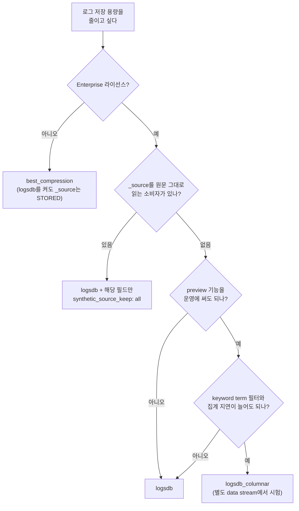

보관 기간을 두 배로 늘려 달라는 요구가 오면 디스크도 두 배 필요한지부터 계산하게 됩니다.
이때 "logsdb를 켜면 60%가 준다", "65%가 준다", "77%가 준다" 같은 숫자를 자주 듣습니다. 세 숫자 모두 공식 자료에 나오지만 비교 기준이 서로 다릅니다.
기준을 모르고 숫자를 sizing에 넣으면, 이미 `best_compression`을 쓰는 환경에서 절감 폭을 크게 잡거나 반대로 너무 보수적으로 잡게 됩니다.

이 글은 같은 로그를 다섯 가지 설정으로 넣고 크기, 적재 비용, 조회 지연, 돌아오는 `_source`를 같이 비교합니다.
저장 공간이 segment 파일 어디에 쓰이는지는 [01. Segment의 생애](../01-segments/#실측-저장-공간은-어디에-쓰이나)에서, 비교 전에 force merge를 하는 이유는 [02. Merge와 force merge](../02-merge-and-force-merge/#줄어든-용량)에서 다뤘습니다.

:::note[기준]
- Elasticsearch 9.5.5(Lucene 10.5.1) 기준입니다. 공식 문서는 2026년 11월에 다시 확인했습니다.
- `logsdb`는 8.17부터 GA이고, 9.0부터 새로 만드는 `logs-*-*` data stream에 기본으로 켜집니다. `columnar`, `logsdb_columnar`는 9.5에서 tech preview입니다([Columnar index mode](https://www.elastic.co/docs/reference/elasticsearch/columnar)).
- synthetic `_source`는 Enterprise 라이선스가 필요합니다. 실측은 trial 라이선스로 했고, 라이선스가 없을 때의 동작은 basic 라이선스에서 따로 확인했습니다.
- 실측 환경은 로컬 Elasticsearch 9.5.5 단일 노드(vCPU 1, JVM heap 1GB)입니다. 적재 클라이언트도 같은 머신에서 돌았기 때문에 적재 속도와 조회 지연은 경향만 보고, 크기는 그대로 읽어도 됩니다. 실험 코드와 결과는 [`labs/data/storage-footprint/`](https://github.com/Munsik/engineering-notes/tree/main/labs/data/storage-footprint)에 있습니다.
:::

## 절감률은 baseline과 함께 읽는다

공개 자료에 나오는 대표 수치와 그 비교 기준입니다.

| 출처 | 수치 | 무엇과 비교했나 |
| --- | --- | --- |
| [Logs data streams](https://www.elastic.co/docs/manage-data/data-store/data-streams/logs-data-stream) 문서 | 최대 60%, indexing 성능 10%에서 20% 영향 | 기준 설정은 적혀 있지 않음. 데이터와 버전에 따라 다르다고 명시 |
| [logsdb GA 블로그](https://www.elastic.co/search-labs/blog/elasticsearch-logsdb-index-mode) (8.17) | 최대 65% | logsdb를 쓰지 않는 최근 버전 |
| [Observability Labs, LogsDB storage evolution](https://www.elastic.co/observability-labs/blog/elasticsearch-logsdb-storage-evolution) (2026년 4월) | 77% (161.9GB에서 37.5GB) | nightly benchmark의 logsdb 미사용 인덱스, Enterprise 라이선스 |
| [General index settings](https://www.elastic.co/docs/reference/elasticsearch/index-settings/index-modules) 문서의 `index.codec` | 최대 약 28% | `best_compression` 대 `default` codec |

같은 logsdb라도 비교 대상이 `default` codec이면 절감률이 크게 나오고, 이미 `best_compression`을 쓰던 인덱스와 비교하면 작게 나옵니다.
기존 Elastic Agent 통합의 `logs-*` 템플릿은 `logs@settings`에서 이미 `best_compression`을 켜 둡니다(9.5.5의 `logs@settings` component template 기준). 이런 환경에서 logsdb 전환 효과를 가늠할 때는 standard + `best_compression`을 baseline으로 잡아야 합니다(해석).

## 저장 공간을 차지하는 네 가지 구조

로그 문서 하나는 디스크에 여러 번 저장됩니다.

| 구조 | 담는 것 | 쓰는 곳 |
| --- | --- | --- |
| stored fields (`_source`) | 원본 JSON | 검색 결과, GET, reindex, update |
| inverted index | term에서 문서로 가는 색인 | `term`, `match` 같은 검색 |
| doc values | 필드별 열(column) 저장 | 정렬, 집계, ES\|QL, synthetic `_source` 재구성 |
| points (BKD) | 숫자, 날짜, IP의 범위 색인 | `range` 검색 |

각 설정이 줄이는 대상이 다릅니다.

- `best_compression`: stored fields 압축을 LZ4에서 ZSTD로 바꿉니다. 8.16부터 ZSTD입니다. 나머지 구조는 그대로입니다.
- synthetic `_source`: 원본 JSON을 저장하지 않고, 조회할 때 doc values와 stored field에서 다시 만듭니다([_source field](https://www.elastic.co/docs/reference/elasticsearch/mapping-reference/mapping-source-field#synthetic-source)).
- `logsdb`: synthetic `_source`, `best_compression`, `host.name`과 `@timestamp` 기준 index sorting, 숫자와 keyword doc values 전용 codec을 한꺼번에 켭니다([Configure a logs data stream](https://www.elastic.co/docs/manage-data/data-store/data-streams/logs-data-stream-configure)).
- `logsdb_columnar`: logsdb의 기본값에 더해, text가 아닌 필드를 doc values로만 저장하고 색인하지 않습니다. 매핑도 평탄하게(flat) 바꿉니다([Columnar index mode](https://www.elastic.co/docs/reference/elasticsearch/columnar)).

## 실측: 같은 로그, 다섯 가지 설정

### 실험 방법

- 데이터: 공통 생성기 [`labs/_datagen/loggen.py`](https://github.com/Munsik/engineering-notes/blob/main/labs/_datagen/loggen.py)로 만든 ECS 형태 synthetic 로그입니다. 기본 데이터셋은 필드 20개 안팎, message 평균 67바이트, JSON 기준 문서당 약 760바이트입니다.
- 데이터셋 4종:
  - `base`: host 50개, 30만 건
  - `hicard`: host 5만 개, 30만 건
  - `fields200`: `attr.*` 필드 180개 추가, 10만 건
  - `longmsg`: message가 1.5KB에서 2.5KB인 stack trace, 10만 건
- 매핑: 다섯 설정 모두 같은 명시 매핑을 씁니다. 문자열은 `keyword`, `message`는 `match_only_text`입니다. ECS 로그 템플릿이 `message`를 `match_only_text`로 매핑하는 것과 맞췄습니다.
- 설정 5종: 모두 index template으로 만든 data stream, primary 1개, replica 0개입니다.

| 이름 | 설정 | 실제 적용된 값 |
| --- | --- | --- |
| `std` | `index.mode: standard` | codec `default`, source STORED, 정렬 없음 |
| `std-bc` | + `index.codec: best_compression` | codec `best_compression` |
| `std-syn` | + `index.mapping.source.mode: synthetic` | codec `default`, source synthetic |
| `logsdb` | `index.mode: logsdb` | codec `best_compression`, source SYNTHETIC, 정렬 `host.name` asc, `@timestamp` desc |
| `columnar` | `index.mode: logsdb_columnar` | codec `best_compression`, source SYNTHETIC, 정렬 `host.name` asc, `@timestamp` desc |

- 절차: 5,000건씩 `_bulk`로 적재하고, refresh와 flush 뒤 크기를 잽니다. 그다음 `max_num_segments=1`로 force merge하고 다시 잽니다. 비교는 force merge 뒤의 primary `store.size`로 했습니다. 조합마다 두 번 돌렸습니다.

### 크기

force merge 뒤 문서당 바이트입니다. 두 번 모두 1% 안쪽으로 같아서 2회차 값만 적었습니다. 괄호 안은 같은 데이터셋의 `std` 대비 감소율입니다.

| 데이터셋 | `std` | `std-bc` | `std-syn` | `logsdb` | `columnar` |
| --- | --- | --- | --- | --- | --- |
| `base` (host 50) | 335 | 214 (36%) | 153 (54%) | 118 (65%) | 76 (77%) |
| `hicard` (host 5만) | 362 | 245 (32%) | 167 (54%) | 148 (59%) | 87 (76%) |
| `fields200` (필드 200개) | 1,951 | 1,118 (43%) | 612 (69%) | 532 (73%) | 259 (87%) |
| `longmsg` (message 2KB) | 642 | 375 (42%) | 403 (37%) | 247 (62%) | 199 (69%) |

전체 결과는 [`results/summary.csv`](https://github.com/Munsik/engineering-notes/blob/main/labs/data/storage-footprint/results/summary.csv)에 있습니다.

- **`base`의 logsdb 65%, columnar 77%는 `default` codec 대비입니다.** `best_compression`을 baseline으로 잡으면 logsdb는 45%, columnar는 65% 줄었습니다(214바이트에서 118바이트, 76바이트).
- **host cardinality가 높으면 logsdb 절감 폭이 줄어듭니다.** host가 5만 개면 30만 건 안에서 같은 host의 문서가 몇 건밖에 이어지지 않아 정렬 효과가 약해집니다. logsdb는 65%에서 59%로 내려갔고, synthetic `_source`만 켠 `std-syn`은 54% 그대로였습니다. 정렬 이득만 빠졌다는 뜻입니다(해석).
- **필드가 많을수록 `_source` 제거 효과가 커집니다.** 필드 200개짜리 문서는 `_source`가 대부분을 차지해서 `std-syn`만으로 69%가 줄었습니다.
- **message가 길면 synthetic `_source`만으로는 부족합니다.** `std-syn`(37%)이 `std-bc`(42%)보다 덜 줄었습니다. `match_only_text`는 synthetic `_source`를 위해 원문을 따로 저장하는데, `std-syn`은 codec이 `default`라서 그 원문을 LZ4로 저장하기 때문입니다. 아래 `_disk_usage`에서 확인할 수 있습니다.
- force merge 전후 크기 차이는 2% 안쪽이었습니다. 적재 직후 크기로 sizing해도 크게 틀리지 않습니다.

### 어디가 줄었나: `_disk_usage`

`base` 2회차, force merge 뒤 `POST <index>/_disk_usage?run_expensive_tasks=true` 결과를 구조별로 합쳤습니다. 단위는 MB입니다.

| 설정 | 전체 | stored fields | inverted index | doc values | points | 가장 큰 필드 |
| --- | --- | --- | --- | --- | --- | --- |
| `std` | 100.5 | 63.4 | 16.6 | 15.5 | 4.6 | `_source` 61.3 |
| `std-bc` | 64.1 | 27.0 | 16.7 | 15.5 | 4.6 | `_source` 26.1 |
| `std-syn` | 46.0 | 8.6 | 16.8 | 15.8 | 4.6 | `trace.id` 17.4 |
| `logsdb` | 35.4 | 1.0 | 14.9 | 16.7 | 2.7 | `trace.id` 17.4 |
| `columnar` | 22.7 | 0.0 | 5.8 | 16.9 | 0.0 | `message` 7.7 |

- `best_compression`은 stored fields만 줄였습니다(63.4MB에서 27.0MB).
- synthetic `_source`를 켜면 stored fields가 거의 사라지고, 남은 8.6MB 대부분은 `message._original`(6.4MB)입니다. `match_only_text`의 원문 보관용 필드입니다.
- `_source`가 빠지고 나면 가장 큰 필드는 32자리 hex인 `trace.id`였습니다(17.4MB, inverted index와 doc values 합). 값이 거의 모두 다른 ID 필드는 정렬과 codec이 줄여 줄 수 있는 것이 적습니다. logsdb 전환 뒤에도 크기가 기대만큼 줄지 않으면, 이런 고 cardinality keyword 필드가 색인과 doc values를 모두 갖고 있는지부터 봅니다(해석).
- `columnar`는 keyword 필드를 색인하지 않아서 inverted index가 `message`의 5.8MB만 남았고, points도 0이 됐습니다. `trace.id`는 5.0MB로 줄었습니다.

`longmsg`에서는 `std-syn`의 `message._original`이 24.5MB로 `std-bc`의 `_source` 전체(22.0MB)보다 컸습니다. logsdb는 같은 원문을 11.1MB로 저장했습니다. 원본 표는 [`results/disk_usage_run2.csv`](https://github.com/Munsik/engineering-notes/blob/main/labs/data/storage-footprint/results/disk_usage_run2.csv)에 있습니다.

### 적재 비용

1회차는 첫 조합에서 JVM warm-up 영향이 커서 2회차 값으로 봅니다. `base` 기준 Elasticsearch 프로세스 CPU 시간(문서 1천 건당)은 `std` 31.1ms, `std-bc` 31.7ms, `std-syn` 27.8ms, `logsdb` 32.5ms, `columnar` 27.4ms였습니다(실측).
다른 데이터셋에서도 설정 사이 차이는 대부분 10% 안쪽이었고, 회차마다 순서가 바뀌었습니다. vCPU 1개 환경이라 이 정도 차이는 구분하기 어렵습니다.
공식 문서의 "indexing 10%에서 20% 영향"은 이 규모에서는 드러나지 않았다고만 적어 둡니다. 실제 적재 비용은 운영 하드웨어에서 Rally 같은 도구로 재야 합니다(해석).

### 조회 지연

2회차 median(ms)입니다. 같은 요청을 15번 반복했고 request cache는 껐습니다.

| 요청 | `std` | `std-bc` | `std-syn` | `logsdb` | `columnar` |
| --- | --- | --- | --- | --- | --- |
| `service.name` term + 건수 (`base`) | 1.9 | 1.9 | 1.9 | 2.9 | 4.6 |
| `@timestamp` range + `host.name` terms 집계 (`base`) | 7.4 | 6.9 | 6.8 | 6.0 | 14.7 |
| 같은 집계 (`hicard`) | 5.5 | 4.9 | 5.4 | 10.5 | 24.0 |
| `_source` 100건 가져오기 (`base`) | 9.7 | 18.7 | 12.1 | 14.6 | 10.3 |

- `best_compression`은 `_source`를 읽을 때 느립니다. 100건 fetch가 9.7ms에서 18.7ms로 늘었습니다. 공식 문서도 get by id 지연이 10%에서 33% 늘 수 있다고 적고 있습니다.
- `columnar`는 keyword에 inverted index가 없어서 term 조건을 doc values로 걸러야 합니다. 이 데이터에서는 term 건수 조회가 두 배 넘게, `hicard`의 집계가 네 배 넘게 느렸습니다. 9.5의 columnar는 아직 preview이고, Labs 글은 keyword도 우선 블록 압축만 쓴다고 설명합니다([One field, one copy](https://www.elastic.co/search-labs/blog/columnar-storage-elasticsearch-index-modes)). 조회 성능은 GA까지 바뀔 수 있는 부분입니다.
- synthetic `_source` 재구성 비용은 이 규모에서는 크지 않았습니다(9.7ms 대 12.1ms).

### 돌아오는 `_source`가 다르다

같은 문서 하나를 네 가지 설정에 넣고 검색으로 꺼냈습니다. 원본은 아래와 같습니다. `debug`는 `enabled: false`인 객체입니다.

```json
{
  "@timestamp": "2026-11-26T10:00:00.000Z",
  "host": { "name": "host-1" },
  "message": "dns lookup ok",
  "dns": { "answers": ["10.0.0.3", "10.0.0.1", "10.0.0.3"] },
  "links": [ { "trace_id": "t1", "span_id": "s1" }, { "trace_id": "t2", "span_id": "s2" } ],
  "service.name": "checkout",
  "debug": { "raw": { "k": "v" } }
}
```

| 항목 | `std` | `std-syn` (keep 없음) | `logsdb` (keep `arrays`) | `logsdb_columnar` |
| --- | --- | --- | --- | --- |
| `dns.answers` IP 배열 | 원본 그대로 | `["10.0.0.1", "10.0.0.3"]` 정렬, 중복 제거 | 원본 순서와 중복 유지 | 원본 순서와 중복 유지 |
| `links` 객체 배열 | 원본 그대로 | `{"span_id": [...], "trace_id": [...]}`로 쪼개짐 | 원본 그대로 | `links.trace_id`, `links.span_id` 두 배열로 쪼개짐 |
| `service.name` 점 표기 | 원본 그대로 | `service: {name}` 객체로 바뀜 | `service: {name}` 객체로 바뀜 | `service.name` 그대로 |
| `host.name` | 객체 | 객체 | 객체 | `"host.name"` 평탄한 키 |
| `enabled: false`인 `debug` | 있음 | 있음 | 있음 | 사라짐 |
| 필드 순서 | 원본 순서 | 알파벳순 | 알파벳순 | 알파벳순 |

결과 원본은 [`results/fidelity.json`](https://github.com/Munsik/engineering-notes/blob/main/labs/data/storage-footprint/results/fidelity.json)에 있습니다.

- logsdb는 `index.mapping.synthetic_source_keep` 기본값이 `arrays`라서 배열 순서와 중복, 객체 배열 묶음을 지켰습니다. 대신 그만큼 저장 공간을 더 씁니다([Configure a logs data stream](https://www.elastic.co/docs/manage-data/data-store/data-streams/logs-data-stream-configure#synthetic-source)).
- standard 인덱스에 synthetic `_source`만 켜면 keep 기본값이 `none`이라 IP 배열이 정렬되고 중복이 사라졌습니다. DNS 응답처럼 순서와 중복이 의미 있는 필드는 이렇게 바뀝니다.
- `logsdb_columnar`는 객체 배열의 짝을 되살릴 수 없고, 매핑되지 않은 내용은 버립니다. 필드 하나만 원본을 보관하는 옵션(`synthetic_source_keep`, `store: true`)도 거부합니다. 짝이 중요한 객체 배열은 `nested`로 매핑해야 합니다([What columnar `_source` preserves](https://www.elastic.co/docs/reference/elasticsearch/columnar#columnar-source-fidelity)).

`_source`를 그대로 읽는 소비자가 있다면 전환 전에 이 차이를 확인해야 합니다. reindex 대상 시스템, `params._source['a.b']`처럼 점 표기로 원본을 읽는 script, 원문 그대로 다른 시스템에 넘기는 연동이 대표적입니다(해석).

## 라이선스와 index template에 따라 달라지는 것

실측 중에 문서만 보고는 놓치기 쉬운 동작 두 가지를 확인했습니다.

### synthetic `_source`는 라이선스가 없으면 조용히 STORED가 된다

basic 라이선스에서 확인한 결과입니다(로컬 9.5.5).

| 요청한 설정 | 실제 `index.mapping.source.mode` | 경고 |
| --- | --- | --- |
| `index.mapping.source.mode: synthetic` | STORED | 없음 (HTTP 200) |
| `index.mode: logsdb` | STORED | 없음 |
| `index.mode: logsdb_columnar` | COLUMNAR_STORED | 없음 |

공식 문서도 필요한 subscription이 없으면 logsdb가 원래 `_source`를 쓴다고 적고 있습니다.
요청한 설정이 바뀌어도 응답에는 아무 표시가 없었습니다. 소스 코드에서는 라이선스가 synthetic `_source`를 허용하지 않을 때 settings provider가 source mode를 덮어씁니다(Elasticsearch 9.5.5 `LogsdbIndexModeSettingsProvider.java`). 필요한 라이선스는 Enterprise입니다(`LogsdbLicenseService.java`).
그래서 sizing에 logsdb 절감률을 넣기 전에 라이선스를 먼저 확인하고, 운영 중에는 backing index의 `index.mapping.source.mode`를 직접 봅니다.

```console
GET logs-*/_settings/index.mode,index.mapping.source.mode,index.sort.field?include_defaults=true&flat_settings=true
```

### `host.name` 정렬은 index template으로 줄 때만 붙는다

create index 요청에 `index.mode: logsdb`를 직접 넣으면, `host.name`을 keyword로 매핑해도 정렬이 `@timestamp` 하나만 걸렸습니다.
같은 설정을 index template(또는 `logs-*-*` 패턴의 기본 동작)으로 주면 `host.name`, `@timestamp` 두 필드로 정렬했습니다(로컬 9.5.5 실측).
소스에서도 `host.name` 정렬과 필드 주입은 template에서 결정된 index mode를 기준으로 합니다(`LogsdbIndexModeSettingsProvider.java`).

일반 인덱스 두 개를 만들고 reindex해서 비교하는 방식으로 logsdb 효과를 재면, 실제 data stream보다 정렬 이득이 빠진 숫자가 나올 수 있습니다. 이 글의 실험은 모두 index template으로 만든 data stream으로 했습니다.

## 적용 방법

### 새 data stream

9.0 이후 클러스터에서 `logs-<dataset>-<namespace>` 이름으로 새로 만드는 data stream은 이미 logsdb입니다. 다른 이름이라면 index template에 index mode를 넣습니다.

```console
PUT _index_template/app-logs
{
  "index_patterns": ["app-logs-*"],
  "data_stream": {},
  "priority": 200,
  "template": {
    "settings": {
      "index.mode": "logsdb"
    }
  }
}
```

`logsdb_columnar`를 시험해 보려면 같은 위치에 `"index.mode": "logsdb_columnar"`를 넣습니다. preview 기능이고, 만든 뒤에는 mode를 바꿀 수 없으니 별도 data stream에서 먼저 시험합니다.

### 기존 data stream, 통합(integration) data stream

- 8.x에서 9.x로 올린 클러스터는 기존 `logs-*-*` data stream이 자동으로 logsdb가 되지 않습니다([Logs data streams](https://www.elastic.co/docs/manage-data/data-store/data-streams/logs-data-stream#logsdb-availability)).
- 템플릿을 바꾸면 다음 rollover부터 적용됩니다. 이미 만들어진 backing index는 그대로입니다.
- 통합 data stream은 managed 템플릿을 직접 고치지 않고 dataset별 `@custom` component template에 넣습니다([Enable logsdb for integrations](https://www.elastic.co/docs/manage-data/data-store/data-streams/logs-data-stream-integrations)).

```console
PUT _component_template/logs-nginx.access@custom
{
  "template": {
    "settings": {
      "index.mode": "logsdb"
    }
  }
}

POST logs-nginx.access-default/_rollover
```

전환 전에 확인할 것입니다.

- `host.name`이 keyword가 아닌 다른 타입으로 이미 매핑돼 있으면 매핑 오류가 날 수 있습니다. 이때는 정렬 필드를 바꾸거나 `@timestamp`만으로 정렬합니다.
- logsdb는 `ignore_malformed: true`, `ignore_above: 8191`, `ignore_dynamic_beyond_limit: true`를 기본으로 켭니다. 잘못된 값이 거부되지 않고 저장되는 쪽으로 동작이 바뀝니다.
- `_source`를 그대로 읽는 소비자가 있는지 위의 표로 점검합니다.

## 판단 기준

이 절은 위의 사실과 실측을 바탕으로 한 제 판단입니다(해석).



| 상황 | 권장 |
| --- | --- |
| 보관 기간 연장 sizing | 지금 쓰는 설정을 baseline으로 잡고, 운영 데이터 일부를 두 설정에 넣어 문서당 바이트를 잰다. 공개 자료의 절감률을 그대로 곱하지 않는다 |
| 이미 `best_compression`을 쓰는 로그 | logsdb 전환 효과는 이 실험 기준 45% 안팎. host cardinality가 높으면 더 작다 |
| 필드가 많은 보안 이벤트, 감사 로그 | `_source` 비중이 커서 logsdb 효과가 크다. 이 실험에서 73% |
| 긴 stack trace가 많은 애플리케이션 로그 | standard에 synthetic `_source`만 켜는 조합은 피한다. 원문 보관 필드가 LZ4로 저장돼 `best_compression`보다 덜 줄었다 |
| 크기가 기대만큼 줄지 않을 때 | `_disk_usage`로 필드별 크기를 보고, 고 cardinality ID 필드가 색인과 doc values를 모두 갖고 있는지 확인한다 |
| 우리 데이터의 절감률을 미리 보고 싶을 때 | 하루치 정도를 template 기반 data stream 두 개에 넣고 force merge 뒤 `store.size`와 `_disk_usage`를 비교한다. 측정 스크립트는 `labs/data/storage-footprint/run.py` |

## 다음 글

- shard 수와 크기, bulk 형태는 [04. Shard와 bulk](../04-shards-and-bulk/)에서 다룹니다.
- 이 글의 실측 코드: [`labs/data/storage-footprint/`](https://github.com/Munsik/engineering-notes/tree/main/labs/data/storage-footprint)

## 참고 문서

- [Logs data streams](https://www.elastic.co/docs/manage-data/data-store/data-streams/logs-data-stream)
- [Configure a logs data stream](https://www.elastic.co/docs/manage-data/data-store/data-streams/logs-data-stream-configure)
- [Enable logsdb for integrations](https://www.elastic.co/docs/manage-data/data-store/data-streams/logs-data-stream-integrations)
- [_source field](https://www.elastic.co/docs/reference/elasticsearch/mapping-reference/mapping-source-field)
- [Columnar index mode](https://www.elastic.co/docs/reference/elasticsearch/columnar)
- [General index settings](https://www.elastic.co/docs/reference/elasticsearch/index-settings/index-modules)
- [Analyze the index disk usage API](https://www.elastic.co/docs/api/elasticsearch/operation/operation-indices-disk-usage)
- Search Labs: [LogsDB index mode](https://www.elastic.co/search-labs/blog/elasticsearch-logsdb-index-mode), [One field, one copy: How Elasticsearch columnar storage drops the inverted index](https://www.elastic.co/search-labs/blog/columnar-storage-elasticsearch-index-modes)
- Observability Labs: [Elasticsearch over the years: how LogsDB cuts index size](https://www.elastic.co/observability-labs/blog/elasticsearch-logsdb-storage-evolution)
- Elasticsearch 9.5.5 소스: [`LogsdbIndexModeSettingsProvider.java`](https://github.com/elastic/elasticsearch/blob/v9.5.5/x-pack/plugin/logsdb/src/main/java/org/elasticsearch/xpack/logsdb/LogsdbIndexModeSettingsProvider.java), [`LogsdbLicenseService.java`](https://github.com/elastic/elasticsearch/blob/v9.5.5/x-pack/plugin/logsdb/src/main/java/org/elasticsearch/xpack/logsdb/LogsdbLicenseService.java)
