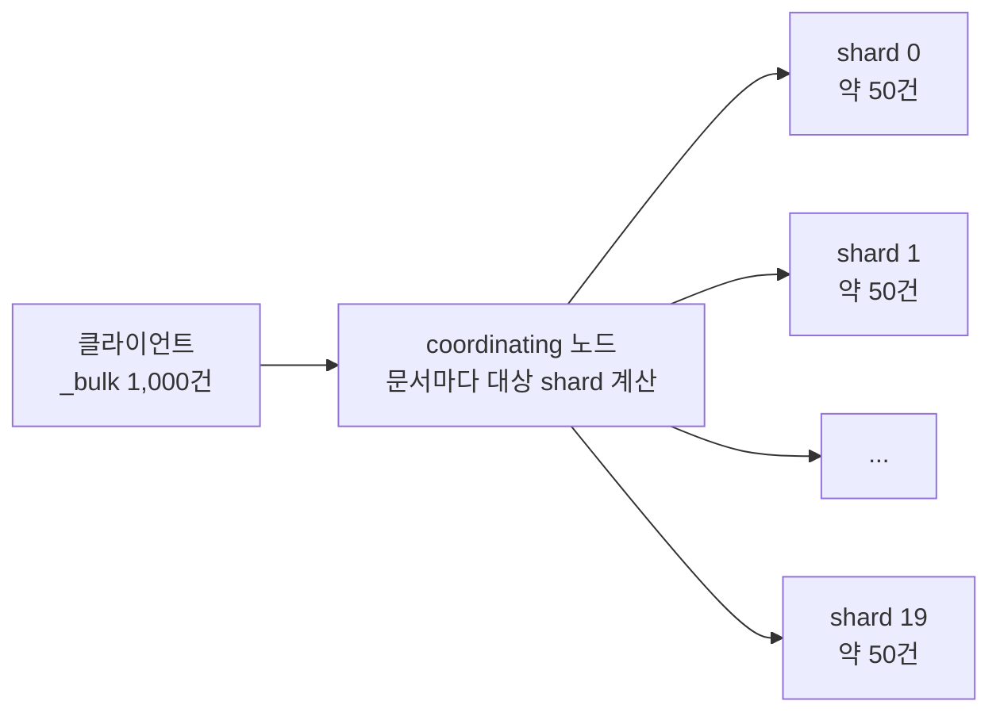
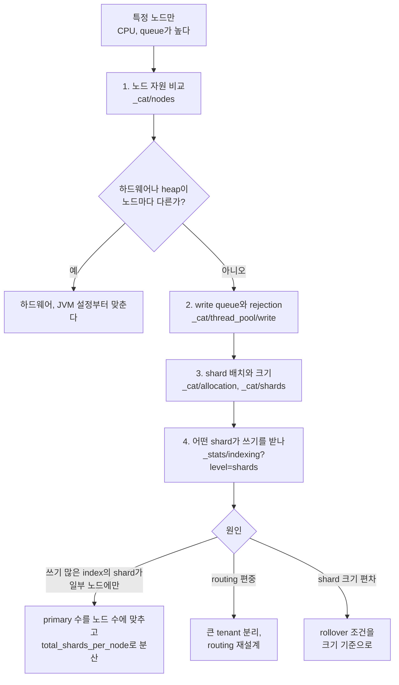

처음 클러스터를 만들 때 정한 primary shard 수를 몇 년째 그대로 쓰는 환경을 자주 봅니다.
그사이 데이터는 열 배가 됐는데 shard는 그대로라 하나가 수백 GB가 되거나, 반대로 고객사나 서비스마다 data stream을 따로 만들어 shard가 수천 개로 불어나 있습니다.
shard 수는 index를 만든 뒤에는 바꾸기 어렵고, bulk 형태는 클라이언트 코드에 묻혀 있어서 문제가 생기기 전까지 잘 보지 않습니다.

이 글은 shard 수와 크기, bulk 크기를 어떤 기준으로 정하는지, 잘못 정하면 무엇이 비싸지는지를 실측으로 보여 줍니다.

:::note[기준]
- Elasticsearch 9.5.5 기준입니다. 공식 문서는 2026년 11월에 다시 확인했습니다. self-managed와 Elastic Cloud Hosted를 기준으로 썼습니다.
- Elastic Cloud Serverless는 Elastic이 sharding을 직접 관리하고 자동으로 조정합니다. custom routing도 쓸 수 없습니다([Differences from other Elasticsearch offerings](https://www.elastic.co/docs/deploy-manage/deploy/elastic-cloud/differences-from-other-elasticsearch-offerings)). 이 글의 shard 수 결정은 Serverless에는 해당하지 않습니다.
- 실측은 로컬 Elasticsearch 9.5.5 단일 노드(vCPU 1, JVM heap 1GB)에서 했습니다. 기획 단계에서는 3노드 구성을 생각했지만, 이번에는 노드 사이 분산이 아니라 shard와 요청 수가 만드는 비용만 쟀습니다. 절대값보다 조건 사이의 비율을 보세요. 실험 코드와 결과는 [`labs/data/shards-and-bulk/`](https://github.com/Munsik/engineering-notes/tree/main/labs/data/shards-and-bulk)에 있습니다.
:::

## Shard가 비용이 되는 지점

shard 하나는 Lucene index 하나입니다([01](../01-segments/#shard는-lucene-index다)). shard마다 segment, 매핑, 통계가 따로 있어서, 같은 데이터라도 shard가 많으면 관리 비용이 늘어납니다.

| 비용 | 내용 | 근거 |
| --- | --- | --- |
| 검색 | 검색은 shard마다 thread 하나로 실행됩니다. shard가 많으면 search thread pool을 빨리 소모합니다 | [Size your shards](https://www.elastic.co/docs/deploy-manage/production-guidance/optimize-performance/size-shards) |
| heap | index, shard, segment, 매핑된 필드마다 heap을 씁니다. segment마다 필드 이름 복사본도 들고 있습니다 | 같은 문서 |
| master | master-eligible 노드는 heap 1GB당 index 3,000개 미만으로 관리하라고 권합니다 | 같은 문서 |
| 클러스터 한도 | `cluster.max_shards_per_node` 기본 1,000. 한도는 이 값에 frozen이 아닌 data node 수를 곱한 값입니다. frozen은 따로 `cluster.max_shards_per_node.frozen` 기본 3,000 | [Miscellaneous cluster settings](https://www.elastic.co/docs/reference/elasticsearch/configuration-reference/miscellaneous-cluster-settings) |

`cluster.max_shards_per_node`는 shard를 새로 만드는 요청만 막습니다. 노드 하나에 실제로 몇 개가 올라가는지는 제한하지 않습니다. 노드별 배치를 제한하려면 `cluster.routing.allocation.total_shards_per_node`나 index 설정 `index.routing.allocation.total_shards_per_node`를 씁니다(같은 문서).

### 크기 기준

공식 가이드의 출발점은 다음과 같습니다([Size your shards](https://www.elastic.co/docs/deploy-manage/production-guidance/optimize-performance/size-shards)).

- shard 하나를 10GB에서 50GB 사이로 둡니다.
- shard 하나의 문서 수를 2억 건 아래로 둡니다. Lucene의 하드 한도는 shard당 2,147,483,519건이고, 삭제 표시된 문서도 이 수에 포함됩니다.
- ILM을 쓰면 rollover의 `max_primary_shard_size`를 50GB, `min_primary_shard_size`를 10GB로 잡습니다.

가이드는 이 범위가 출발점이라고도 적고 있습니다. 실제 하드웨어와 데이터로 벤치마크해서 정하라는 뜻입니다.

### 기본 rollover 조건

관리 방식에 따라 기본 rollover 조건이 다릅니다. 9.5.5에서 직접 확인한 값입니다.

| 관리 방식 | 기본 rollover 조건 | 확인한 곳 |
| --- | --- | --- |
| ILM 내장 `logs` 정책 | `max_age: 30d`, `max_primary_shard_size: 50gb` | `GET _ilm/policy/logs` |
| data stream lifecycle | `max_age=auto`, `max_primary_shard_size=50gb`, `min_docs=1`, `max_primary_shard_docs=200000000` | `cluster.lifecycle.default.rollover` 기본값 |

ILM의 `max_age`만 쓰면 데이터가 적은 data stream도 기간마다 새 index가 생겨 작은 shard가 쌓입니다. 공식 가이드도 보관 정책이 허락하면 `max_age` 대신 `max_primary_shard_size`를 쓰라고 권합니다.

## Bulk와 shard의 관계

bulk 요청 하나는 coordinating 노드에서 대상 shard별로 쪼개져 각 shard의 primary로 갑니다(Elasticsearch 9.5.5 소스 `BulkOperation.java`의 `groupRequestsByShards`).



그래서 shard가 많을수록 같은 bulk가 더 잘게 쪼개집니다. 쪼개진 요청마다 shard 수준의 처리 비용(쓰기 thread 배정, translog 기록과 fsync, 응답 취합)이 따로 듭니다.
노드 통계의 `indices.bulk.total_operations`가 이 shard 단위 bulk 요청 수입니다. 클라이언트 요청 수로 나누면 요청 하나가 몇 조각으로 나뉘는지 볼 수 있습니다.

### 실측: bulk 크기 x primary shard 수

같은 데이터(문서당 약 760바이트)를 primary 1, 5, 20개인 인덱스에 bulk 1, 10, 100, 1,000, 5,000건씩 넣었습니다. 클라이언트 하나가 순서대로 보냈고, replica 0개, `refresh_interval: 30s`, auto-generated id입니다.
두 번 돌렸고 칸마다 "1회차 / 2회차"로 적었습니다. primary 1개 행의 2회차는 노드를 재시작한 직후에 돌아 JVM warm-up 영향이 커서, JVM이 충분히 돈 뒤 다시 잰 3회차 값으로 바꿨습니다.

초당 적재 문서 수:

| bulk 크기 (요청 크기) | primary 1 | primary 5 | primary 20 |
| --- | --- | --- | --- |
| 1건 (0.8KB) | 328 / 292 | 468 / 389 | 502 / 539 |
| 10건 (7.7KB) | 3,343 / 2,714 | 2,220 / 2,297 | 1,529 / 1,682 |
| 100건 (76KB) | 18,446 / 16,135 | 10,831 / 12,748 | 4,650 / 5,723 |
| 1,000건 (758KB) | 29,600 / 29,902 | 26,225 / 25,314 | 18,430 / 20,733 |
| 5,000건 (3.7MB) | 30,731 / 31,572 | 30,301 / 28,912 | 27,032 / 27,907 |

문서 1천 건당 Elasticsearch CPU 시간(ms)과 요청 하나가 나뉜 shard 조각 수:

| bulk 크기 | primary 1 | primary 5 | primary 20 |
| --- | --- | --- | --- |
| 1건 | 1,904 / 2,466 (1조각) | 1,028 / 1,594 (1조각) | 968 / 940 (1조각) |
| 10건 | 165 / 258 (1조각) | 207 / 240 (4.5조각) | 301 / 296 (8조각) |
| 100건 | 36 / 45 (1조각) | 55 / 50 (5조각) | 106 / 95 (19.9조각) |
| 1,000건 | 25 / 28 (1조각) | 31 / 33 (5조각) | 40 / 41 (20조각) |
| 5,000건 | 27 / 26 (1조각) | 29 / 30 (5조각) | 32 / 33 (20조각) |

write thread pool rejection은 모든 조건에서 0이었습니다. 결과 원본은 [`results/A_bulk_shards.csv`](https://github.com/Munsik/engineering-notes/blob/main/labs/data/shards-and-bulk/results/A_bulk_shards.csv)에 있습니다.

- **한 건씩 보내면 bulk 1,000건보다 60배에서 100배 느립니다.** 문서 1천 건을 넣는 데 CPU를 1초 가까이 썼습니다. bulk 1,000건이면 25ms에서 40ms였습니다. 요청 하나를 받고 처리하고 응답하는 고정 비용이 문서 처리 비용보다 훨씬 크기 때문입니다(해석).
- **shard가 많을수록 같은 bulk가 작아집니다.** primary 20개에 100건씩 보내면 shard마다 5건씩 20조각이 됩니다. 처리량은 primary 1개일 때의 3분의 1 이하로 떨어졌고, CPU는 문서당 두 배 넘게 썼습니다. "bulk 100건"이 shard 입장에서는 "bulk 5건"이 된 셈입니다.
- **bulk가 충분히 크면 shard 수 차이가 줄어듭니다.** 5,000건(3.7MB)에서는 primary 1개와 20개의 처리량 차이가 10% 안쪽이었습니다. 처리량은 primary 1개 기준 1,000건 근처에서 이미 거의 평평해졌습니다.
- bulk 1건 조건만 shard가 많을수록 오히려 조금 빨랐습니다. primary 1개 칸이 매 라운드 맨 처음에 돌았기 때문일 수 있어서 이 차이는 해석하지 않습니다.

### 공식 권장과 맞춰 보기

공식 문서는 bulk 크기를 문서 수로 정하지 않고, shard 하나짜리 단일 노드에서 100건부터 두 배씩 늘리며 처리량이 평평해지는 지점을 찾으라고 권합니다. 비슷하면 작은 쪽을 고르고, 동시 요청이 많을 때 메모리 압박이 생기니 요청 하나가 수십 MB를 넘지 않게 하라고 합니다([Tune for indexing speed](https://www.elastic.co/docs/deploy-manage/production-guidance/optimize-performance/indexing-speed)).
이 실측에서 평평해진 지점은 1,000건, 약 750KB 근처였습니다. 문서 크기가 다르면 건수도 달라지므로, 실제 기준은 요청 크기(MB)로 잡는 편이 옮겨 쓰기 쉽습니다(해석).

함께 볼 기본값입니다.

| 항목 | 기본값 | 근거 |
| --- | --- | --- |
| `write` thread pool 크기 | 할당된 processor 수 | [Thread pool settings](https://www.elastic.co/docs/reference/elasticsearch/configuration-reference/thread-pool-settings) |
| `write` queue 크기 | `max(10000, processor 수 x 750)`. 9.1까지는 10,000 | 같은 문서 |
| HTTP 요청 최대 크기 | `http.max_content_length` 100MB | 9.5.5 기본값 확인 |
| indexing pressure 한도 | `indexing_pressure.memory.limit` heap의 10%. 넘으면 429 | 9.5.5 기본값 확인 |

429(TOO_MANY_REQUESTS)를 받으면 잠시 멈췄다가 지수 backoff로 다시 보냅니다. 클라이언트 하나로는 클러스터를 다 쓰지 못하므로 여러 worker로 보내되, 한 shard에 너무 많은 worker가 몰리지 않게 합니다(Tune for indexing speed).

## Multi-tenant 설계

고객사나 사업부(tenant)마다 데이터를 나눠야 할 때 흔히 고르는 방법은 세 가지입니다.

| 방법 | 구조 | 장점 | 비용과 제약 |
| --- | --- | --- | --- |
| tenant별 data stream | `logs-app-tenant042` 처럼 tenant마다 따로 | 보관 기간, 권한, 삭제를 tenant별로 다르게 하기 쉽다 | shard 수가 tenant 수에 비례한다. 작은 shard가 많아진다 |
| 공용 data stream + tenant 필드 | 하나의 data stream에 `tenant.id` 필드 | shard 수가 tenant 수와 무관하다 | tenant별 보관 기간을 다르게 하기 어렵다. 권한은 document level security나 filtered alias로 건다 |
| 공용 + custom routing | 공용 index에 `routing: tenant.id` | 한 tenant의 조회가 shard 하나만 본다 | 큰 tenant가 한 shard에 몰린다. data stream은 template에 `allow_custom_routing`을 켜야 쓸 수 있고, Serverless에서는 쓸 수 없다 |

### 실측: tenant별 data stream 300개 대 공용 data stream

tenant 100개 x dataset 3종(app, access, audit)을 가정했습니다. 같은 30만 건을 두 가지 구조로 넣었습니다. 모두 logsdb, primary 1개, replica 0개입니다.

- tenant별: `mt-tenant-042-app` 같은 data stream 300개
- 공용: `mt-shared-app` 같은 data stream 3개, 문서에 `tenant.id`

| 항목 | tenant별 (300개) | 공용 (3개) |
| --- | --- | --- |
| 늘어난 shard | 300 | 3 |
| 늘어난 segment | 653 / 657 | 4 / 4 |
| cluster state 크기 (metadata, routing table JSON) | 약 800KB 증가 | 약 8KB 증가 |
| data node의 필드 매핑 heap 추정치 | 17.2MB | 0.17MB |
| 저장 크기 (primary) | 64.1MB | 38.5MB |
| 초당 적재 문서 수 | 4,285 / 4,853 | 14,285 / 16,961 |
| 문서 1천 건당 CPU | 191 / 153ms | 48 / 38ms |
| bulk 하나가 나뉜 조각 수 | 300 | 3 |
| tenant 하나 조회 (log level 집계) | 14.5 / 8.4ms | 14.3 / 7.3ms |
| 전체 tenant 집계 (`mt-*`, 시간 범위 + tenant terms) | 245 / 187ms | 15.6 / 9.8ms |

필드 매핑 heap 추정치는 `GET _nodes/stats`의 `indices.mappings.total_estimated_overhead_in_bytes`입니다. 결과 원본은 [`results/B_multitenant.csv`](https://github.com/Munsik/engineering-notes/blob/main/labs/data/shards-and-bulk/results/B_multitenant.csv)에 있습니다.

- **적재가 3.5배 느렸습니다.** bulk 5,000건이 data stream 300개로 흩어져 shard마다 평균 17건이 됐습니다. 위 실험 A에서 본 "shard가 많으면 bulk가 작아진다"가 그대로 나타났습니다.
- **저장 크기가 1.7배였습니다.** shard가 작으면 logsdb 정렬과 압축이 묶을 수 있는 문서가 적고, shard마다 고정으로 드는 파일도 있습니다(해석).
- **tenant 하나만 조회할 때는 차이가 거의 없었습니다.** 공용 data stream도 `tenant.id` term 조건이면 충분히 빨랐습니다. 반면 여러 tenant를 한꺼번에 보는 집계는 shard 300개를 돌아야 해서 12배에서 19배 느렸습니다.
- cluster state와 필드 매핑 heap이 100배 늘었습니다. 300개로는 문제가 되지 않지만, tenant 1,000개에 dataset 10종이면 data stream 1만 개가 되고, rollover가 돌 때마다 index 수는 더 늘어납니다. 그때는 master heap 기준(1GB당 3,000개)과 shard 한도에 바로 걸립니다(해석).

매핑 원본 크기(`total_deduplicated_mapping_size`)는 두 구조 모두 357바이트 증가로 같았습니다. 같은 매핑은 cluster state에서 중복 제거되기 때문입니다. 줄지 않는 것은 data node의 필드별 heap입니다.

이 실측을 바탕으로 한 제 기준은 이렇습니다(해석).

- 기본은 공용 data stream + `tenant.id`로 둡니다.
- 보관 기간이나 규제 요구가 다른 소수의 큰 tenant만 별도 data stream으로 뺍니다.
- tenant별로 나눴다면 rollover를 `max_primary_shard_size` 기준으로 잡아 작은 shard가 쌓이지 않게 합니다.

## 한 shard나 노드에 쓰기가 몰릴 때

hot spotting은 노드 사이 자원 사용이 고르지 않은 상태입니다. 하드웨어 차이, shard 배치, 특정 index에 몰린 쓰기가 대표 원인입니다([Hot spotting](https://www.elastic.co/docs/troubleshoot/elasticsearch/hotspotting)).

### 실측: routing 편중으로 shard 하나만 커지는 경우

primary 4개 인덱스에 `routing: tenant.id`로 20만 건을 넣었습니다. 문서의 70%를 tenant 하나에 몰았습니다. `_cat/shards`와 shard 단위 indexing 통계로 본 결과입니다.

| shard | 문서 수 | 크기 | 누적 indexing 시간 |
| --- | --- | --- | --- |
| 0 | 23,841 | 9.6MB | 855ms |
| 1 | 15,079 | 6.3MB | 497ms |
| 2 | 12,087 | 5.2MB | 468ms |
| 3 | 148,993 | 53.7MB | 5,299ms |

shard 3 하나가 문서의 75%, indexing 시간의 74%를 차지했습니다. 노드가 여러 대라면 shard 3이 있는 노드만 write queue가 쌓이고 CPU가 높게 나옵니다. shard 수를 늘려도 같은 routing 값은 같은 shard로 가므로 풀리지 않습니다.
`index.routing_partition_size`로 routing 값 하나를 여러 shard에 나눌 수 있지만, index를 만들 때만 정할 수 있고 join 필드와 같이 쓸 수 없으며, 요청마다 검색할 shard가 늘어납니다([_routing field](https://www.elastic.co/docs/reference/elasticsearch/mapping-reference/mapping-routing-field)). 큰 tenant는 routing에서 빼거나 별도 index로 옮기는 편이 단순합니다(해석). 결과 원본은 [`results/C_skew.json`](https://github.com/Munsik/engineering-notes/blob/main/labs/data/shards-and-bulk/results/C_skew.json)에 있습니다.

### 진단 순서

아래 순서는 제가 쓰는 방법입니다(해석). 각 요청은 공식 Hot spotting 문서에 나오는 것입니다.



```console
GET _cat/nodes?v&s=name&h=name,node.role,heap.percent,cpu,disk.used_percent,available_processors
GET _cat/thread_pool/write,search?v&s=n,nn&h=n,nn,q,a,r,c
GET _cat/allocation?v&s=node&h=node,shards,disk.percent,disk.indices
GET _cat/shards?v&h=index,shard,prirep,docs,store,node&s=store:desc
GET _stats/indexing?level=shards&filter_path=indices.*.shards.*.routing.node,indices.*.shards.*.indexing.index_total
```

노드 통계는 노드가 뜬 뒤 누적값입니다. 몇 분 간격으로 두 번 받아 차이를 봐야 지금 몰리는 곳이 보입니다(Hot spotting 문서).

### 노드당 shard 한도에 가까워질 때의 신호

- index나 data stream을 만들거나 rollover할 때 `this action would add [x] shards, but this cluster currently has [y]/[z] maximum normal shards open` 오류가 납니다. 한도를 올리는 것은 임시 조치이고, 노드를 늘리거나 shard 수를 줄이는 것이 근본 해결입니다([Size your shards](https://www.elastic.co/docs/deploy-manage/production-guidance/optimize-performance/size-shards)).
- `GET _cluster/stats?filter_path=indices.shards.total`로 전체 shard 수를 보고, 문서가 거의 없는 index는 `GET _cat/count/<index>`로 찾아 지웁니다.
- 쓰기가 끝난 index는 shrink로 shard 수를 줄이거나, 짧은 기간의 index를 reindex로 합칩니다.

## 판단 기준

이 절은 위의 사실과 실측을 바탕으로 한 제 판단입니다(해석).

| 결정 | 기준 |
| --- | --- |
| primary shard 수 | 쓰기가 많은 data stream은 hot node 수에 맞춘다. 그보다 많이 잡지 않는다. 쓰기가 적은 data stream은 1개로 시작한다 |
| shard 크기 | rollover를 `max_primary_shard_size: 50gb` 기준으로. `max_age`만 쓰지 않는다 |
| bulk 크기 | 운영 데이터로 처리량이 평평해지는 크기를 찾는다. 이 실측에서는 약 750KB, 1,000건. 보통 수 MB 안쪽 |
| bulk와 shard 수 | bulk 하나가 shard마다 수백 건 이상 가도록 잡는다. shard를 늘렸다면 bulk도 같이 키운다 |
| multi-tenant | 공용 data stream + `tenant.id`를 기본으로. 보관 기간이나 규제가 다른 큰 tenant만 분리 |
| 한 shard로만 쓰기가 몰릴 때 | routing을 쓰는지부터 본다. shard 수를 늘려도 같은 routing 값은 풀리지 않는다 |

## 다음 글

- 오래된 데이터를 어디에 두고 어떻게 꺼내 볼지는 [05. 오래된 데이터](../05-tiers-and-retention/)에서 다룹니다.
- 이 글의 실측 코드: [`labs/data/shards-and-bulk/`](https://github.com/Munsik/engineering-notes/tree/main/labs/data/shards-and-bulk)

## 참고 문서

- [Size your shards](https://www.elastic.co/docs/deploy-manage/production-guidance/optimize-performance/size-shards)
- [Tune for indexing speed](https://www.elastic.co/docs/deploy-manage/production-guidance/optimize-performance/indexing-speed)
- [Hot spotting](https://www.elastic.co/docs/troubleshoot/elasticsearch/hotspotting)
- [Total number of shards for an index on a single node exceeded](https://www.elastic.co/docs/troubleshoot/elasticsearch/increase-shard-limit)
- [Miscellaneous cluster settings](https://www.elastic.co/docs/reference/elasticsearch/configuration-reference/miscellaneous-cluster-settings)
- [Thread pool settings](https://www.elastic.co/docs/reference/elasticsearch/configuration-reference/thread-pool-settings)
- [_routing field](https://www.elastic.co/docs/reference/elasticsearch/mapping-reference/mapping-routing-field)
- [Differences from other Elasticsearch offerings](https://www.elastic.co/docs/deploy-manage/deploy/elastic-cloud/differences-from-other-elasticsearch-offerings)
- Elasticsearch 9.5.5 소스: [`BulkOperation.java`](https://github.com/elastic/elasticsearch/blob/v9.5.5/server/src/main/java/org/elasticsearch/action/bulk/BulkOperation.java)
