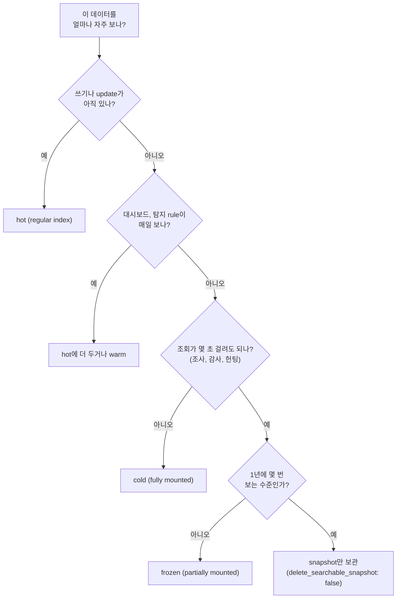

"최근 2주는 자주 보고, 1년치는 가끔 보고, 3년치는 감사 때만 본다." 로그 보관 요구는 대개 이렇습니다.
모든 데이터를 hot node의 NVMe에 replica까지 두면 비용이 감당되지 않습니다. 그렇다고 오래된 데이터를 snapshot으로만 두면 감사 요청이 올 때마다 복원부터 해야 합니다.
data tier와 searchable snapshot은 이 사이를 메우는 기능입니다. 다만 frozen 데이터를 잘못 건드리면 대시보드와 탐지 rule이 느려지거나 일부 실패합니다.

tier를 나누는 기준, 오래된 데이터를 조회하는 방법, 그때 주의할 점을 차례로 봅니다.

:::note[기준]
- Elasticsearch 9.5.5 기준입니다. 공식 문서는 2026년 11월에 다시 확인했습니다.
- searchable snapshot은 Enterprise 라이선스가 필요합니다([Searchable snapshots](https://www.elastic.co/docs/deploy-manage/tools/snapshot-and-restore/searchable-snapshots)). data stream lifecycle의 frozen 전환(`frozen_after`)은 Stack 9.5부터 GA이고 Serverless에서는 쓸 수 없습니다. Serverless에는 data tier가 없습니다.
- 실측은 로컬 Elasticsearch 9.5.5 단일 노드(vCPU 1, JVM heap 1GB, shared cache 1GB)에서 trial 라이선스로 했습니다. snapshot repository는 같은 디스크의 `fs` 타입입니다. S3 같은 object storage는 요청마다 지연이 훨씬 크므로, 아래 frozen 첫 조회 지연은 가장 좋은 경우로 읽어야 합니다. 실험 코드와 결과는 [`labs/data/tiers-and-retention/`](https://github.com/Munsik/engineering-notes/tree/main/labs/data/tiers-and-retention)에 있습니다.
:::

## Tier별 역할

| tier | 데이터 | 저장 방식 | replica | 쓰기 |
| --- | --- | --- | --- | --- |
| hot | 최근 데이터, 쓰기와 잦은 검색 | regular index, 로컬 디스크 | 보통 1개 이상 | 가능 |
| warm | 가끔 검색, 쓰기 거의 없음 | regular index | 보통 1개 이상 | 가능 |
| cold | 드물게 검색 | fully mounted searchable snapshot, 또는 replica를 둔 regular index | searchable snapshot은 기본 0개, snapshot이 복구 원본 | searchable snapshot은 불가 |
| frozen | 아주 드물게 검색 | partially mounted searchable snapshot | 기본 0개 | 불가 |

[Data tiers](https://www.elastic.co/docs/manage-data/lifecycle/data-tiers)와 [Searchable snapshots](https://www.elastic.co/docs/deploy-manage/tools/snapshot-and-restore/searchable-snapshots) 문서를 기준으로 정리했습니다.

- cold의 fully mounted index는 shard 전체를 로컬에 둡니다. 검색 성능은 보통 regular index와 비슷합니다. replica가 없어도 노드가 죽으면 snapshot에서 다시 받아 오므로, 같은 데이터를 regular index로 둘 때보다 노드와 디스크가 절반이면 됩니다.
- frozen의 partially mounted index는 최근에 검색한 부분만 노드의 shared cache에 둡니다. cache에 없는 부분은 검색할 때 repository에서 받아 옵니다. cache는 노드를 재시작하면 비워집니다.
- shared cache 크기는 dedicated frozen node에서 기본으로 "디스크의 90%"와 "디스크에서 100GB를 뺀 값" 중 큰 쪽입니다. 4,000GB 디스크면 3,900GB, 400GB 디스크면 360GB입니다. dedicated frozen node가 아니면 기본 0이라 `xpack.searchable.snapshot.shared_cache.size`를 직접 잡아야 합니다(같은 문서).
- cold와 frozen tier의 데이터도 repository에는 전체가 있어야 합니다. object storage 용량은 frozen까지 보관할 전체 기간의 primary 크기로 잡습니다. 크기 자체를 줄이는 방법은 [03. 저장 용량 비교](../03-storage-footprint/)에서 다뤘습니다.

## 설계 결정

### ILM 단계와 searchable snapshot

hot에서 frozen으로 바로 보내는 ILM 정책의 예입니다.

```console
PUT _ilm/policy/logs-1y
{
  "policy": {
    "phases": {
      "hot": {
        "actions": {
          "rollover": { "max_primary_shard_size": "50gb", "max_age": "1d" }
        }
      },
      "frozen": {
        "min_age": "14d",
        "actions": {
          "searchable_snapshot": { "snapshot_repository": "my-s3-repo" }
        }
      },
      "delete": {
        "min_age": "365d",
        "actions": { "delete": {} }
      }
    }
  }
}
```

ILM `searchable_snapshot` action에서 알아 둘 동작입니다([Searchable snapshot action](https://www.elastic.co/docs/reference/elasticsearch/index-lifecycle-actions/ilm-searchable-snapshot)).

- hot, cold, frozen phase에 쓸 수 있습니다. frozen에서는 partially mounted index(`partial-` 접두사)를, 나머지에서는 fully mounted index(`restored-` 접두사)를 만듭니다.
- hot과 cold 둘 다에 넣지 않습니다. cold로 옮기는 단계가 실패할 수 있습니다.
- data stream의 write index에는 실행되지 않습니다. hot phase에 rollover가 있어야 합니다.
- `force_merge_index` 기본값이 `true`입니다. force merge는 이 action 바로 앞 tier(hot이나 warm)에서 실행되므로, 그 tier 노드에 여유 디스크가 필요합니다([02](../02-merge-and-force-merge/#해도-되는-때) 참고).
- `force_merge_on_clone`(9.2.1부터, 기본 `true`)은 replica 0개짜리 clone 위에서 force merge합니다.
- delete phase의 `delete` action은 기본으로 그 snapshot도 지웁니다. 남기려면 `delete_searchable_snapshot: false`를 줍니다.
- `replicate_for`를 주면 지정한 기간만 replica 하나를 붙여 mount합니다. 첫 searchable snapshot action에만 쓸 수 있습니다.

### data stream lifecycle로 frozen 보내기

9.5부터는 ILM 없이 data stream lifecycle만으로도 frozen 전환을 할 수 있습니다([Searchable snapshots for data streams](https://www.elastic.co/docs/manage-data/lifecycle/data-stream/dlm-searchable-snapshots)).

- 클러스터에 default snapshot repository가 등록돼 있어야 합니다.
- lifecycle에 `frozen_after`를 줍니다. 예를 들어 `frozen_after: 30d`, `data_retention: 365d`이면 30일이 지난 backing index를 frozen으로 바꾸고, 365일이 지나면 지웁니다.
- 전환 순서는 write block, replica가 있으면 0개짜리 clone, 1 segment force merge, snapshot, partially mounted index로 mount, data stream 안에서 교체입니다. mount된 index 이름은 `dlm-frozen-<원래 이름>`입니다.

## 실측

### mount 방식별 저장 크기

로그 100만 건을 logsdb data stream에 넣고 rollover한 뒤, 이전 backing index를 force merge하고 snapshot했습니다. 같은 snapshot을 fully mounted와 partially mounted로 각각 mount했습니다.

| index | 로컬 `store.size` | `_tier_preference` | mount 시간 |
| --- | --- | --- | --- |
| regular (원본) | 110MB | `data_hot` | 해당 없음 |
| fully mounted | 110MB | `data_cold,data_warm,data_hot` | 0.5초 |
| partially mounted | 0MB | `data_frozen` | 0.3초 |

snapshot은 3.2초 걸렸습니다. 로컬 `fs` repository라서 mount와 snapshot이 모두 빨랐습니다.
partially mounted index는 `store.size`가 0으로 나왔습니다. 데이터는 노드의 shared cache에 올라가고, index 자체의 저장 크기로 잡히지 않습니다. frozen node의 디스크 사용량은 index 크기가 아니라 shared cache 크기로 봐야 합니다.

### 첫 조회와 반복 조회

세 index에 같은 요청을 보내고, 첫 실행과 이후 10번 반복의 median(ms)을 측정했습니다. 2회차는 노드를 재시작해서 shared cache를 비운 뒤 다시 측정했습니다. 재시작 직후라 JVM warm-up이 안 된 상태여서 regular index의 첫 실행도 함께 느려졌습니다. 칸마다 "1회차 / 2회차"입니다.

| 요청 | regular 첫 실행 | regular 반복 | fully mounted 첫 실행 | fully mounted 반복 | partially mounted 첫 실행 | partially mounted 반복 |
| --- | --- | --- | --- | --- | --- | --- |
| `@timestamp` range + terms 집계 | 157 / 408 | 16 / 30 | 66 / 322 | 18 / 27 | 506 / 595 | 36 / 41 |
| `service.name` term 건수 | 5 / 17 | 4 / 8 | 6 / 11 | 4 / 10 | 103 / 115 | 6 / 9 |
| ERROR 100건, 시간순 정렬 fetch | 241 / 341 | 102 / 113 | 135 / 156 | 117 / 119 | 1,885 / 1,869 | 104 / 100 |

결과 원본은 [`results/latency.jsonl`](https://github.com/Munsik/engineering-notes/blob/main/labs/data/tiers-and-retention/results/latency.jsonl)에 있습니다.

- **fully mounted는 regular index와 같은 수준이었습니다.** 노드를 재시작한 뒤에도 다시 받아 오지 않고 로컬 데이터를 그대로 썼습니다. 공식 문서도 fully mounted index의 로컬 데이터는 재시작 뒤에도 유지된다고 설명합니다.
- **partially mounted는 첫 조회만 느렸습니다.** 같은 디스크의 `fs` repository인데도 `_source`를 읽는 fetch는 첫 실행이 1.9초였습니다. 반복 조회는 regular index와 비슷했습니다.
- shared cache 통계(`GET _searchable_snapshots/cache/stats`)를 보면, 위 요청들이 16MB region 7개, 약 116MB를 cache에 썼습니다. 110MB짜리 index를 거의 통째로 올린 셈입니다. 이 실험의 index가 작아서 생긴 결과입니다. 실제 frozen 데이터는 cache보다 훨씬 크므로, 검색 범위가 넓으면 cache에서 밀려나고 다시 받아 오는 일이 반복됩니다.
- object storage에서는 첫 조회 지연이 이 값보다 훨씬 클 수 있습니다(확인 필요: 이 실험에서 S3는 측정하지 않았습니다). 오래 걸리는 frozen 검색은 async search로 보내라고 공식 문서가 권합니다.

### ILM이 frozen으로 보내는 과정

ILM poll 주기를 5초로, 정책을 "10만 건에서 rollover, 20초 뒤 frozen"으로 줄여 12만 건을 넣었습니다. `_ilm/explain`을 2초마다 읽어 단계가 바뀐 시점을 기록했습니다.

| 경과(초) | index | phase / action / step |
| --- | --- | --- |
| 21 | `.ds-ilm-lab-...-000001` | hot / rollover / check-rollover-ready |
| 25 | `.ds-ilm-lab-...-000001` | hot / complete. 새 write index `000002` 생성 |
| 51 | `.ds-ilm-lab-...-000001` | frozen / searchable_snapshot / wait-for-shard-history-leases |
| 55 | `.ds-ilm-lab-...-000001` | frozen / searchable_snapshot / check-ts-end-time-passed |
| 61 | `.ds-ilm-lab-...-000001` | frozen / searchable_snapshot / forcemerge |
| 66 | `.ds-ilm-lab-...-000001` | frozen / searchable_snapshot / segment-count |
| 72 | `.ds-ilm-lab-...-000001` | frozen / searchable_snapshot / wait-for-index-color |
| 74 | `partial-.ds-ilm-lab-...-000001` | frozen / complete |

2초 간격으로 읽었기 때문에 그보다 짧게 끝난 단계는 표에 없습니다. 이 index는 replica가 0개라 clone 단계가 보이지 않았습니다.
data stream의 backing index 목록에서 원본이 `partial-` 접두사 index로 바뀌었고, snapshot 이름은 `<날짜>-<index 이름>-<정책 이름>-<임의 문자열>` 형식이었습니다. 결과 원본은 [`results/ilm.jsonl`](https://github.com/Munsik/engineering-notes/blob/main/labs/data/tiers-and-retention/results/ilm.jsonl)에 있습니다.

### regular index로 되돌리기

frozen 데이터를 수정해야 하거나 frozen tier를 없애야 할 때는 원래 snapshot에서 새 regular index로 복원합니다. mount된 index를 제자리에서 바꾸는 방법은 없습니다([Restore searchable snapshot data to a regular index](https://www.elastic.co/docs/deploy-manage/tools/snapshot-and-restore/restore-searchable-snapshot-to-regular-index)).

```console
GET partial-lab/_settings?filter_path=**.index.store.snapshot

POST _snapshot/lab-repo/snap-1/_restore?wait_for_completion=true
{
  "indices": ".ds-tier-lab-2026.11.26-000001",
  "rename_pattern": "(.+)",
  "rename_replacement": "rehydrated-lab",
  "include_aliases": false,
  "index_settings": {
    "index.number_of_replicas": 0,
    "index.routing.allocation.include._tier_preference": "data_hot"
  },
  "ignore_index_settings": ["index.lifecycle.name"]
}
```

`indices`에는 mount된 index 이름이 아니라 `index.store.snapshot.index_name` 값을 넣습니다. ILM이 clone 위에서 force merge했다면 `fm-clone-*` 같은 중간 이름이 들어 있습니다.
로컬 실측에서 110MB 복원은 3.2초 걸렸고, 복원하는 동안과 그 뒤에는 mount된 index와 regular index가 같은 데이터를 따로 갖습니다. 복원할 tier에 전체 크기만큼 디스크가 있어야 합니다. 원래 snapshot은 regular index를 확인하고 mount된 index를 지운 뒤에 정리합니다.

## Frozen 데이터를 조회하는 query와 rule

### `_tier`로 frozen 제외하기

넓은 index pattern으로 검색하면 frozen index까지 같이 봅니다. `_tier` 메타데이터 필드로 frozen을 뺄 수 있습니다([_tier field](https://www.elastic.co/docs/reference/elasticsearch/mapping-reference/mapping-tier-field)).

```console
GET .ds-tier-lab-*,full-lab,partial-lab/_search
{
  "size": 0,
  "query": {
    "bool": { "must_not": { "terms": { "_tier": ["data_frozen"] } } }
  },
  "aggs": { "by_index": { "terms": { "field": "_index" } } }
}
```

실측에서 응답의 `_shards`는 total 3, skipped 1이었습니다. partially mounted index의 shard는 검색 전 단계에서 건너뛰어 cache를 읽지 않았습니다.
ES|QL도 요청 본문의 `filter`에 같은 Query DSL을 넣으면 frozen index를 결과에서 뺐습니다(로컬 9.5.5 실측).

```console
POST _query
{
  "query": "FROM .ds-tier-lab-*,full-lab,partial-lab METADATA _index | STATS c = COUNT(*) BY _index",
  "filter": { "bool": { "must_not": { "terms": { "_tier": ["data_frozen"] } } } }
}
```

`_tier`는 index의 `_tier_preference` 첫 번째 값으로 판정합니다. fully mounted index는 `data_cold`로 잡힙니다.

### 탐지 rule

Elastic Security는 cold, frozen 데이터를 rule 실행에서 빼는 방법을 두 가지로 안내합니다([Set rule data sources](https://www.elastic.co/docs/solutions/security/detect-and-alert/set-rule-data-sources)).

- space 단위: Kibana advanced setting `securitySolution:excludedDataTiersForRuleExecution`에 `data_frozen`(필요하면 `data_cold`)을 넣습니다. Data view 필드 목록용 `data_views:fields_excluded_data_tiers`는 따로 있습니다. machine learning rule에는 적용되지 않습니다.
- rule 단위: rule의 Query DSL filter에 위의 `_tier` `must_not` 조건을 넣습니다. ES|QL rule과 ML rule에는 쓸 수 없습니다.

같은 문서의 권고입니다.

- 원본 데이터를 hot이나 warm에 최소 24시간 둔 뒤 cold, frozen으로 보냅니다. 더 빨리 보내면 rule 실행 오류가 날 수 있습니다.
- frozen index는 기본 replica가 0개라 shard 하나가 빠지면 rule이 부분 실패할 수 있습니다. 업그레이드 중에도 생깁니다. shard가 돌아오면 그 시간대를 수동으로 다시 실행합니다.
- indicator match와 event correlation rule은 filter를 넣어도 index pattern에 걸리는 cold, frozen shard를 쓸 수 없는 상태면 실패할 수 있습니다. 이때는 index pattern을 hot 데이터만 가리키게 바꿉니다.

frozen node 재시작 중에 넓은 pattern 검색과 tier 제외 검색이 어떻게 다른지는 단일 노드라 이번에 재현하지 못했습니다. 노드가 하나면 재시작 동안 모든 검색이 실패하기 때문입니다(확인 필요: 다중 노드에서 재현 예정).

## Snapshot repository 운영 규칙

searchable snapshot index의 유일한 완전한 복사본은 repository의 snapshot입니다. 로컬 cache는 불완전해서 복구에 쓸 수 없습니다([Searchable snapshots](https://www.elastic.co/docs/deploy-manage/tools/snapshot-and-restore/searchable-snapshots)).

| 규칙 | 근거 |
| --- | --- |
| mount된 index가 있는 동안 repository를 등록 해제하지 않는다 | Searchable snapshots |
| mount된 index의 snapshot을 지우지 않는다. 지워도 첫 cache miss 전까지는 정상처럼 보이다가 shard 이동이나 재시작 때 데이터가 사라진다 | 같은 문서 |
| 여러 클러스터가 같은 repository를 쓰면 쓰기는 한 곳만, 나머지는 `readonly: true`로 등록한다 | [Self-managed snapshot repositories](https://www.elastic.co/docs/deploy-manage/tools/snapshot-and-restore/self-managed) |
| 다른 클러스터가 쓰기 권한을 가진 repository에서 mount했다면 그 클러스터가 snapshot을 지우지 않게 한다 | Searchable snapshots |
| repository를 쓰는 클러스터는 모두 같은 버전으로 맞춘다 | Self-managed snapshot repositories |
| repository 내용을 저장소 수준에서 백업할 때는 쓰기를 막는다. 등록을 해제하거나 `readonly: true`로 다시 등록한다 | 같은 문서 |
| snapshot repository와 클러스터는 같은 region에 둔다 | Searchable snapshots |
| S3 호환 저장소(MinIO 등)는 repository analysis API로 적합성을 확인한다 | Searchable snapshots |

저장소 점검처럼 repository에 쓰기를 멈춰야 할 때의 순서는 아래가 제가 쓰는 방법입니다.

1. `POST _slm/stop`으로 SLM을 멈추고, 진행 중인 snapshot이 끝났는지 `GET _snapshot/_current`로 확인합니다.
2. 점검 시간 안에 searchable snapshot action이나 delete phase에 들어갈 index가 있는지 `GET */_ilm/explain`으로 봅니다. 있으면 `POST _ilm/stop`으로 ILM도 멈춥니다. data stream lifecycle의 `frozen_after` 전환도 같은 repository를 씁니다.
3. 점검이 끝나면 repository 연결을 `POST _snapshot/<repo>/_verify`로 확인하고 ILM, SLM을 다시 시작합니다.

mount된 index는 점검 중에도 cache에 있는 부분은 검색됩니다. cache에 없는 부분을 읽는 검색과 shard 복구는 실패합니다.

## Frozen보다 비용을 더 줄이는 보관 방법

검색은 거의 하지 않지만 몇 년은 보관해야 하는 데이터가 있습니다. 공식 기능 범위에서는 두 가지 방법이 있습니다.

- ILM delete phase에 `delete_searchable_snapshot: false`를 주면 index는 지우고 snapshot은 repository에 남깁니다. 필요하면 다시 mount합니다. 이때 snapshot은 ILM이 아니라 사람이 관리해야 합니다.
- 일반 snapshot(SLM)만 남기고 필요할 때 restore합니다. 검색하려면 복원을 기다려야 합니다.

Elastic Search Labs의 Deepfreeze 글은 여기서 한 단계 더 나가, repository를 주기적으로 새로 만들고 오래된 repository를 등록 해제한 뒤 그 S3 경로를 Glacier로 옮기는 방법을 소개합니다([Reducing Elasticsearch frozen tier costs with Deepfreeze](https://www.elastic.co/search-labs/blog/s3-glacier-archiving-elasticsearch-deepfreeze)).
Elasticsearch에 내장된 기능이 아니라 cron 등으로 돌리는 별도 Python 도구이고, 글 작성 시점에는 AWS만 지원합니다. Glacier에 옮긴 데이터를 다시 쓰려면 AWS 복원 시간을 기다린 뒤 mount합니다. 운영에 쓰려면 도구의 지원 범위를 따로 확인해야 합니다(확인 필요).

## 판단 기준



| 상황 | 권장 |
| --- | --- |
| 일반 로그, 1년 보관 | hot 7일에서 14일, frozen 나머지. Hot-Frozen 구성이 단순하고 cache만 잘 잡으면 충분하다 |
| 보안 로그 | hot은 최소 24시간 이상, 탐지 rule의 lookback보다 길게. rule에서 frozen을 제외하는 설정을 같이 건다 |
| frozen node sizing | 디스크는 shared cache 크기로 본다. 자주 조회하는 기간의 데이터가 cache에 들어가는지 계산한다 |
| hot에서 frozen으로 넘길 때 | force merge가 hot node에서 돈다. 가장 큰 shard의 세 배 여유를 남긴다 |
| frozen 데이터를 고쳐야 할 때 | 원래 snapshot에서 새 regular index로 복원한다. 복원할 tier에 전체 크기만큼 디스크를 확보한다 |
| repository 운영 | 클러스터마다 쓰기 repository는 하나. 다른 클러스터는 read-only. mount된 snapshot은 지우지 않는다 |

## 다음 글

- [06. Mapping과 필드 수](../06-mappings-and-fields/): 필드 수가 heap과 master에 주는 비용, 한도를 넘었을 때의 동작, template 계층을 다룹니다.
- 이 글의 실측 코드: [`labs/data/tiers-and-retention/`](https://github.com/Munsik/engineering-notes/tree/main/labs/data/tiers-and-retention)

## 참고 문서

- [Data tiers](https://www.elastic.co/docs/manage-data/lifecycle/data-tiers)
- [Searchable snapshots](https://www.elastic.co/docs/deploy-manage/tools/snapshot-and-restore/searchable-snapshots)
- [ILM searchable snapshot action](https://www.elastic.co/docs/reference/elasticsearch/index-lifecycle-actions/ilm-searchable-snapshot)
- [Searchable snapshots for data streams](https://www.elastic.co/docs/manage-data/lifecycle/data-stream/dlm-searchable-snapshots)
- [Restore searchable snapshot data to a regular index](https://www.elastic.co/docs/deploy-manage/tools/snapshot-and-restore/restore-searchable-snapshot-to-regular-index)
- [Self-managed snapshot repositories](https://www.elastic.co/docs/deploy-manage/tools/snapshot-and-restore/self-managed)
- [_tier field](https://www.elastic.co/docs/reference/elasticsearch/mapping-reference/mapping-tier-field)
- [Security: Set rule data sources](https://www.elastic.co/docs/solutions/security/detect-and-alert/set-rule-data-sources)
- Search Labs: [Reducing Elasticsearch frozen tier costs with Deepfreeze S3 Glacier archival](https://www.elastic.co/search-labs/blog/s3-glacier-archiving-elasticsearch-deepfreeze)
