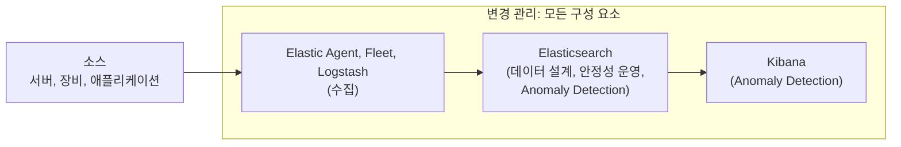

Elastic은 Elasticsearch 하나를 바탕으로 Search, Observability, Security를 제공합니다([Elastic](https://www.elastic.co/)). 용도는 달라도 데이터를 수집하고, 저장하고, 검색한다는 점은 같습니다. 그래서 shard 설계, 수집 구성, 장애 대응, 변경 관리 같은 운영 문제도 대부분 겹칩니다.
이 영역은 그런 운영 문제를 업무 문제별 컬렉션으로 나눠 정리합니다. 기능 설명은 공식 문서를 보시면 되고, 여기서는 구축하고 운영하면서 직접 정해야 하는 설정과 절차를 다룹니다.

:::note[기준]
- Elastic Stack 9.x 기준입니다. 공식 문서는 2026년 11월에 다시 확인했습니다. 컬렉션과 글마다 기준 버전과 GA 상태를 따로 적었습니다.
- 배포 형태(self-managed, Elastic Cloud Hosted 등)에 따라 달라지는 점은 글마다 적었습니다.
:::

## 다루는 구성 요소

Elastic Stack은 데이터를 수집하고, 저장하고, 검색하고, 시각화하는 제품들로 이뤄집니다. 모든 배포에 Elasticsearch와 Kibana가 들어가고, 용도에 따라 Elastic Agent, Logstash 같은 수집 제품을 더합니다([The Elastic Stack](https://www.elastic.co/docs/get-started/the-stack)).

| 구성 요소 | 하는 일 | 주로 다루는 컬렉션 |
| --- | --- | --- |
| Elasticsearch | 데이터 저장, 검색, 분석. 여러 노드로 클러스터를 구성하고 index를 shard 단위로 나눠 저장 | [데이터 설계](../data/), [안정성 운영](../operations/), [Anomaly Detection in Production](../ml/anomaly-detection/) |
| Kibana | UI, dashboard, alert, Stack 관리 | [변경 관리](../change/), [Anomaly Detection in Production](../ml/anomaly-detection/) |
| Elastic Agent와 Fleet | 호스트에서 로그, 메트릭, 보안 데이터를 수집하는 agent와 중앙 관리 도구 | [수집](../ingest/), [변경 관리](../change/) |
| Logstash | 데이터 변환과 중계 | [수집](../ingest/) |

## 구성 요소와 컬렉션

데이터가 흐르는 순서대로 구성 요소를 놓고, 괄호 안에 주로 다루는 컬렉션을 적었습니다. 변경 관리는 모든 구성 요소에 걸칩니다.

## 컬렉션

| 컬렉션 | 다루는 문제 |
| --- | --- |
| [데이터 설계](../data/) | shard 내부 구조, 저장 용량, shard 수와 bulk, 데이터 tier와 보관 기간 |
| [수집](../ingest/) | 수집기 선택, 파싱 위치, 무중단 구성, UDP syslog, 건수 정합성, 수집 계층 사이징, 대규모 Fleet 운영 |
| [안정성 운영](../operations/) | 평소 점검, RED와 YELLOW, 노드 장애, 디스크 부족, 성능 저하, 복구 설계, 폐쇄망 점검, 장애 첫 30분 |
| [변경 관리](../change/) | 업그레이드, 구성 변경, template과 pipeline, Kibana 객체를 롤백할 수 있게 바꾸고 코드로 관리하는 방법 |
| [Anomaly Detection in Production](../ml/anomaly-detection/) | ML anomaly detection의 job 설계, 결과 해석, noise 처리, 운영 |

## 읽는 순서

제가 권하는 순서입니다.

- 새로 구축한다면 [데이터 설계](../data/), [수집](../ingest/), [안정성 운영](../operations/) 순서로 읽습니다. 앞에서 정한 shard와 tier 구성이 수집 사이징과 운영 기준의 전제가 됩니다.
- 이미 운영 중인 클러스터를 맡았다면 [안정성 운영의 평소 점검](../operations/01-daily-checks/)과 [장애 첫 30분](../operations/10-incident-runbook/)부터 읽습니다.
- 업그레이드나 큰 변경을 앞두고 있다면 [변경 관리의 01. 변경 대상과 관리 기준](../change/01-change-map/)부터 읽습니다.
- 이상 탐지를 도입하려면 [Anomaly Detection in Production](../ml/anomaly-detection/)을 처음부터 읽습니다.
