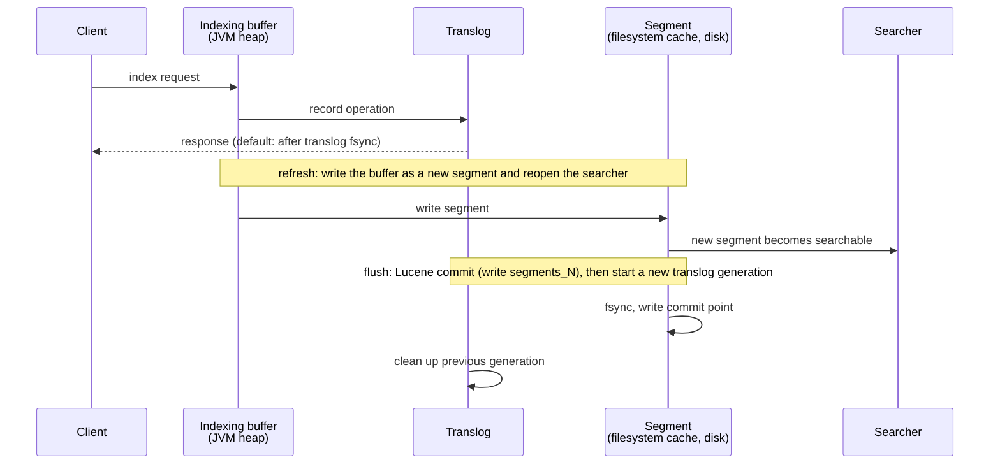
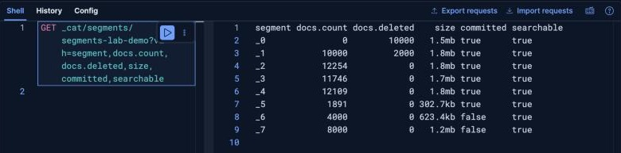
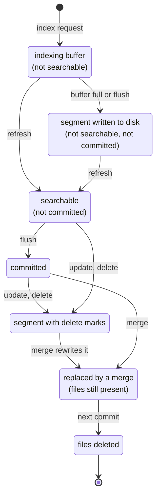

Some symptoms come up again and again in operations and are hard to explain.
You index a document and it is not searchable right away. You only ran updates and the disk grew. A merge finished and the size did not change. After a restart, a shard takes a long time to come back.
All of these are explained by how segments are created and removed inside a shard. Without that picture, settings like `refresh_interval`, translog and force merge get changed by guesswork.

This article follows a segment from creation to removal at the Lucene level. Merge and force merge are covered in the [next article](../02-merge-and-force-merge/).

:::note[Baseline]
- Elasticsearch 9.5.5 (Lucene 10.5.1). The official documentation was rechecked in November 2026.
- Defaults and behavior that the documentation does not describe were checked against the Elasticsearch 9.5.5 build commit (`48acba6`) and the Lucene 10.5.1 source. The source file is named next to each such statement.
- Measurements were taken on Elastic Cloud Hosted 9.5.5: two hot nodes (8GB RAM, 4GB JVM heap, 2 vCPU each), indices with one primary and zero replicas. Experiment code and results are in the repository under [`labs/data/segments-and-merge/`](https://github.com/Munsik/engineering-notes/tree/main/labs/data/segments-and-merge).
- Absolute numbers vary by environment. Read them for the differences between conditions.
:::

## Symptoms and causes

| Symptom | Cause | Section |
| --- | --- | --- |
| A new document is not searchable for a few seconds | No refresh yet, so the new segment is not open | [Write path](#from-one-document-to-search) |
| On an index nobody searches, documents are not searchable even after 1 second | Periodic refresh is skipped while the shard is search idle | [Measured refresh intervals](#measured-how-refresh_interval-shapes-segments) |
| Only updates were run, yet the disk grew | An update is a delete mark plus a new document. The old document stays until a merge | [Deletes and updates](#deletes-and-updates) |
| A merge finished, but `store.size` did not change | The last commit point still holds the pre-merge segment files | [Files held by the commit point](#files-held-by-the-commit-point) |
| A shard comes back slowly after a restart | Operations since the last commit are replayed from the translog | [Translog and flush](#translog-and-flush) |
| Bulk indexing is slower than expected | Frequent segment creation and merging consume IO | [Measured refresh intervals](#measured-how-refresh_interval-shapes-segments), [next article](../02-merge-and-force-merge/) |

## A shard is a Lucene index

One Elasticsearch shard is one Lucene index.
In Lucene, an index is a set of segments plus one commit point ([Near real-time search](https://www.elastic.co/docs/manage-data/data-store/near-real-time-search)).

- **segment**: a small, self-contained index that makes one batch of documents searchable. It has its own inverted index, doc values, stored fields, points and vectors.
- **commit point**: the list of segments safely recorded on disk right now. It is the `segments_N` file.

A segment is never modified once written ([Merge settings](https://www.elastic.co/docs/reference/elasticsearch/index-settings/merge)).
Adding documents creates new segments. Deleting a document only adds a "deleted" mark to an existing segment. Actually shrinking or removing segments is the job of merges.
Most of the symptoms in this article come from this one property: segments are rewritten, never edited.

### Files that make up a segment

The file layout as documented for the default codec in Lucene 10.5.1 (`lucene/core/.../codecs/lucene104/package-info.java`):

| Extension | Contents | Used in Elasticsearch for |
| --- | --- | --- |
| `segments_N` | Commit point. The list of segments in this commit | Starting point for recovery |
| `.si` | Segment metadata | |
| `.cfs`, `.cfe` | Compound file. The files of a small segment packed into one | See below |
| `.fnm` | Field info | |
| `.tim`, `.tip` | Term dictionary and its index | `text` and `keyword` search |
| `.doc`, `.pos`, `.pay` | Postings. Documents, frequencies and positions for each term | match and phrase search |
| `.nvd`, `.nvm` | Norms. Field length information | Relevance scoring |
| `.dvd`, `.dvm` | Doc values. Per-document columnar values | Sorting, aggregations, ES\|QL |
| `.fdt`, `.fdx` | Stored fields | `_source`, `_id` |
| `.kdd`, `.kdi`, `.kdm` | Points (BKD tree) | Range search on numbers, dates and IPs |
| `.vec`, `.veq`, `.vex` and others | Raw vectors, quantized vectors (int8, int4), HNSW graph | kNN search |
| `.liv` | Live docs. Which documents are still alive | Delete marks |

Depending on field type and index mode, Elasticsearch replaces some postings and doc values formats with its own implementations (Elasticsearch source `PerFieldFormatSupplier.java`). File names on disk can therefore differ slightly from this table. The role of each component is the same.
Vectors work the same way. Vectors quantized with BBQ are stored in Elasticsearch's own `.veb` format instead of `.veq` ([Tune approximate kNN search](https://www.elastic.co/docs/deploy-manage/production-guidance/optimize-performance/approximate-knn-search)). In 9.5.5, `bbq_hnsw` is the default for `dense_vector` fields with 384 or more dimensions, so a vector index created without options will show `.veb` files.

Small segments pack these files into a single `.cfs`. Fewer files means fewer file handles.
Elasticsearch writes segments flushed from the buffer as compound files (source `EngineConfig.java`), and segments produced by merges only when they are 1GB or smaller (`index.compound_format`, default `1gb`, source `MergePolicyConfig.java`). The `compound` column of `_cat/segments` shows which is which.

### Measured: where does the storage go

The [Analyze index disk usage API](https://www.elastic.co/docs/api/elasticsearch/operation/operation-indices-disk-usage) breaks storage down by field and by structure.
This is the result on the `refresh-off` index from experiment A below (1 million synthetic log documents, 3 segments).

```console
POST segments-lab-refresh-off/_disk_usage?run_expensive_tasks=true
```

| Structure | Size | Share | Largest fields |
| --- | --- | --- | --- |
| stored fields | 105.2MB | 69% | `_source` 98.3MB, `_id` 6.9MB |
| inverted index | 31.9MB | 21% | `message` 23.6MB, `_id` 6.5MB |
| doc values | 8.1MB | 5% | `event.duration`, `@timestamp`, `_seq_no` |
| points | 6.7MB | 4% | `event.duration` 3.5MB, `@timestamp` 1.9MB |
| norms | 1.0MB | 1% | `message` |

In this data the original JSON, `_source`, took two thirds of the total (measured).
That is why logsdb and synthetic `_source` cut storage so much. The comparison is in [03. Storage footprint](../03-storage-footprint/).

## From one document to search

Between a document arriving, becoming searchable and being safely on disk, three separate steps run on their own schedules.



| Step | What happens | When | Result |
| --- | --- | --- | --- |
| indexing | The document goes into the indexing buffer and the translog | Every request | Not searchable yet. The response is sent |
| refresh | The buffer is written as a new segment and the searcher is reopened | Every `refresh_interval`, only while the index is searched (see below) | Searchable. Not committed yet |
| flush | Lucene commit. Segments are fsynced, `segments_N` is written, a new translog starts | Translog size, elapsed time, idle state | Committed to disk |

Three states need to be kept apart: "visible to search", "segment file exists on disk" and "committed" are different things.

### Refresh and search idle

A refresh writes the buffered documents into a new segment and opens it so they become searchable. It does not fsync, so it is much cheaper than a commit. The new segment goes to the filesystem cache first ([Near real-time search](https://www.elastic.co/docs/manage-data/data-store/near-real-time-search)).

The default interval is 1 second, but only indices that received at least one search request in the last 30 seconds are refreshed every second.
Setting `refresh_interval` explicitly opts the index out of this behavior and refreshes it on the configured schedule ([Tune for indexing speed](https://www.elastic.co/docs/deploy-manage/production-guidance/optimize-performance/indexing-speed)).
The 30 seconds come from `index.search.idle.after` (default `30s`, source `IndexSettings.java`).

Elastic Cloud Serverless uses a different default. There, `refresh_interval` must be `-1` or at least `5s` (same page).

### Indexing buffer

New documents stay in the indexing buffer until a refresh. There is one buffer per node, shared by the shards that are indexing on that node.
The default size is 10% of the JVM heap, with a minimum of 48MB ([Indexing buffer settings](https://www.elastic.co/docs/reference/elasticsearch/configuration-reference/indexing-buffer-settings)).
The documentation notes that giving a single heavily written shard more than 512MB rarely makes it faster ([Tune for indexing speed](https://www.elastic.co/docs/deploy-manage/production-guidance/optimize-performance/indexing-speed)).

When the buffer is full, a segment is written to disk regardless of the refresh interval.
When total usage on the node exceeds the buffer size, Elasticsearch frees memory by picking indexing shards in round-robin order of shard ID. A source comment explains that picking the largest user first did worse in benchmarks (source `IndexingMemoryController.java`).
On the chosen shard it usually writes the largest pending segment to disk. That segment is on disk but not visible to search until the next refresh.
There are exceptions. If many operations overwrite the same `_id` and the version map uses more memory than the buffer, it refreshes instead of writing one segment. If the shard is already past half of a flush threshold (size or age), it flushes. In those cases everything indexed so far becomes searchable (source `InternalEngine.writeIndexingBuffer`, `reclaimVersionMapMemory`).

The more shards a node has, the more finely the buffer is split and the smaller the segments. That is one reason the number of shards per node affects indexing performance.

### Translog and flush

Lucene only makes changes durable on disk at commit time, and a commit is too expensive to do on every request.
So Elasticsearch writes every index and delete operation to the translog before responding. If the process dies, operations since the last commit are replayed from the translog during recovery ([Translog settings](https://www.elastic.co/docs/reference/elasticsearch/index-settings/translog)).

| Setting | Default | Meaning | Source |
| --- | --- | --- | --- |
| `index.translog.durability` | `request` | Respond after the translog is fsynced on the primary and all replicas | Documentation |
| `index.translog.sync_interval` | `5s` | fsync interval when durability is `async` | Documentation |
| `index.translog.flush_threshold_size` | `10gb` | Flush when the translog reaches this size | Documentation |
| `index.translog.flush_threshold_age` | `1m` | Flush when this much time has passed since the last flush | Source `IndexSettings.java` |
| `indices.memory.shard_inactive_time` | `5m` | Treat a shard with no writes for this long as idle and flush it | Source `IndexingMemoryController.java` |

In Elasticsearch, a flush performs a Lucene commit and starts a new translog generation. The translog never takes more than 1% of the disk (documentation).
Switching to `async` raises write throughput, but a failure can lose acknowledged operations since the last fsync.

One term needs care. In Lucene, "flush" means writing the buffer out as segment files. In Elasticsearch, flush means a Lucene commit. The same word names two different things.

### Seeing the three states in `_cat/segments`

The `committed` and `searchable` columns of `_cat/segments` show these states directly.
Below is a demo index right after indexing 60,000 documents, flushing, and then reindexing 12,000 of them with the same `_id`.



- `_0` to `_5` were created before the flush and are committed.
- `_6` and `_7` were created by refreshes after the flush. They are searchable but not committed. If the node died now, these two segments would be discarded and rebuilt from the translog.
- `_0` has no live documents, only 10,000 delete marks. Every old version in it was replaced by an update. This segment disappeared at the next flush (measured).
- `_1` has delete marks on 2,000 of its 10,000 documents. Space in a segment like this only comes back when a merge rewrites it.

### Measured: how refresh_interval shapes segments

The same 1 million synthetic log documents (about 350 bytes each) were indexed with only `refresh_interval` changed. One client sent bulks of 2,000 documents, and indexing took about 84 seconds in all four cases.
The default (unset) index waited 40 seconds after creation so that indexing started in the search idle state. The experiment was run twice; the table shows run 1 and run 2 side by side.

| `refresh_interval` | Refreshes during indexing | Segments right after indexing (searchable / committed) | Merges | `store.size` right after indexing |
| --- | --- | --- | --- | --- |
| Unset, no searches | 2 / 2 | 4 (0 / 3), same both runs | 0 / 0 | 159.9MB / 160.1MB |
| `1s` | 83 / 84 | 45 (19 / 27) / 47 (21 / 27) | 2 / 2 | 218.0MB / 216.4MB |
| `30s` | 5 / 5 | 4 (4 / 2), same both runs | 0 / 0 | 161.6MB / 161.6MB |
| `-1` | 2 / 2 | 2 (0 / 1), same both runs | 0 / 0 | 148.3MB / 148.3MB |

The refresh count is `refresh.external_total` from `_stats`. The 2 refreshes on the unset and `-1` indices come from opening the shards at index creation; the count was already 2 before any document was indexed (verified on a local 9.5.5 node). Both runs gave nearly identical results, so the notes below apply to both. Raw results are in [`results/A_refresh.csv`](https://github.com/Munsik/engineering-notes/blob/main/labs/data/segments-and-merge/results/A_refresh.csv).

Three things stand out.

- **Without searches, even the default barely refreshes.** The unset index had no periodic refresh during the 84 seconds of indexing and behaved almost like `-1`. Right after indexing, `_cat/segments` showed zero searchable segments; only a manual `_refresh` made 5 of them searchable.
- **Turning refresh off does not stop segments being written.** The `-1` and unset indices also have committed segments. Indexing took more than a minute, so `flush_threshold_age` (1 minute) triggered a flush. Disk writes and commits continue with refresh off.
- **A 1-second refresh creates many segments and invites merges.** The `1s` index piled up as many as 40 segments during indexing, and two merges each combined about 400,000 documents at once. The merges were throttled for 22 seconds. This merge behavior is explained in the [next article](../02-merge-and-force-merge/#there-are-two-merge-policies).

This matches the official recommendation to set `refresh_interval` to `-1` during bulk loads (same page). If nobody searches during the load, the default behaves similarly thanks to search idle. But as soon as a dashboard or alert rule searches the index once within 30 seconds, it goes back to refreshing every second.

### Files held by the commit point

In the table above, only the `1s` index had a `store.size` of 218MB, 35% larger than the others.
After the merges finished, 27 pre-merge segments were still there as `committed: true, searchable: false`. The last commit point still listed them, so their files could not be deleted.
After one more flush, the index was down to 19 segments and `store.size` dropped to 163.2MB (measured).

Right after a merge, `store.size` includes files that will be deleted at the next commit. Measure sizes for comparison only after a flush.
`store.size` can also be cached for 10 seconds by default (`index.store.stats_refresh_interval`, source `Store.java`). These measurements first read the value immediately after indexing and got a stale number, so every measurement was changed to wait 15 seconds first.

## Deletes and updates

At the Lucene level, Elasticsearch only does two kinds of writes: add a new document or delete an existing one. An update atomically deletes the old document and adds the new one ([History retention settings](https://www.elastic.co/docs/reference/elasticsearch/index-settings/history-retention)).

Because segments cannot be changed, deleting means adding a mark.

- Lucene keeps a separate list of live documents (`.liv`) for each segment.
- Elasticsearch uses soft deletes on top of that. Deleted documents are not dropped right away but marked with a doc values field called `__soft_deletes` (source `Lucene.java`). The delete information is needed to replay deletes to a recovering replica or a cross-cluster replication follower.
- Shard history retention leases decide how far back operations are kept. Operations held by a lease are not discarded even during merges. A lease expires after 12 hours by default (`index.soft_deletes.retention_lease.period`, same page).

In the end, the space taken by deleted documents comes back when a merge rewrites their segment. If a replica is disconnected for a long time or a CCR follower falls behind, merges may not reclaim space until the lease is released.

### Measured: updating the same documents repeatedly

200,000 documents were indexed and then all of them were reindexed five times with the same `_id`. The time field was named `ts` instead of `@timestamp` so that TieredMergePolicy applied, as is typical for update-heavy indices (see the [next article](../02-merge-and-force-merge/#there-are-two-merge-policies)).

| Step | `docs.count` | `docs.deleted` | `store.size` | Searchable segments |
| --- | --- | --- | --- | --- |
| Initial load | 200,000 | 0 | 31.6MB | 2 |
| Update round 1 | 200,000 | 200,000 | 62.8MB | 6 |
| Update round 2 | 200,000 | 49,885 | 102.1MB | 6 |
| Update round 3 | 200,000 | 16,000 | 81.6MB | 4 |
| Update round 5 | 200,000 | 16,000 | 86.8MB | 3 |
| `only_expunge_deletes` | 200,000 | 16,000 | 34.1MB | 3 |
| Same, with `expunge_deletes_allowed: 0` | 200,000 | 0 | 31.5MB | 3 |

- Right after the first update round, all 200,000 old versions remained as `docs.deleted` and the disk usage doubled exactly.
- After that, merges steadily removed deleted documents. Even so, `store.size` moved between 2.6 and 3.2 times the original. Most of that was the pre-merge files held by the commit point, as in the previous section. A force merge flushes when it finishes, which cleared those files and brought the size down to 34.1MB.
- `only_expunge_deletes` left 16,000 deleted documents behind. Their segment had 8% deletes, below the 10% threshold (`index.merge.policy.expunge_deletes_allowed`). Lowering the threshold to 0 removed them all. The 10% threshold applied because this was a TieredMergePolicy index using a `ts` field. `@timestamp` indices have no such threshold and behave differently (see the [next article](../02-merge-and-force-merge/#reclaiming-deleted-documents-only-only_expunge_deletes)).
The retention lease recorded right after the last update was about 34,000 operations behind the latest one (`retaining_seq_no` 1,166,000 of about 1.2 million operations in total). When the expunge was rerun with the threshold at 0, the lease had caught up with the latest operation (1,200,000) and all deleted documents were cleaned up.

Raw results are in [`results/B_update.csv`](https://github.com/Munsik/engineering-notes/blob/main/labs/data/segments-and-merge/results/B_update.csv).

#### With a replica

The same experiment was repeated with one replica. The number of remaining deleted documents went up and down between 0 and 50,000 at each point. It depends on when merges happened to finish, so comparing rounds says little.
There was one retention lease per shard copy. Fifteen seconds after the last update, the lease was about 90,000 operations behind the latest (`retaining_seq_no` 1,110,000, `max_seq_no` 1,199,999). Even so, cleaning up with `expunge_deletes_allowed: 0` removed every deleted document.
With a healthy replica, the lease did not block space reclamation (measured). Expect leases to hold space only when a replica is down or a CCR follower is behind. Raw results are in [`results/B_update_replica1.csv`](https://github.com/Munsik/engineering-notes/blob/main/labs/data/segments-and-merge/results/B_update_replica1.csv).

## Segment lifecycle at a glance



## What to watch in operations

This is the order I check things during operational reviews.

| What to check | Request | Warning sign |
| --- | --- | --- |
| Segment count and state | `GET _cat/segments/<index>?v&h=shard,prirep,segment,docs.count,docs.deleted,size,committed,searchable` | Dozens of small segments stay on the same shard |
| Share of deleted documents | `GET _cat/indices/<index>?v&h=index,docs.count,docs.deleted,store.size` | On a Tiered index, `docs.deleted` stays above 20% of `docs.count` for a long time. On a `@timestamp` index, watch whether the trend keeps rising |
| Refresh load | `GET <index>/_stats/refresh` | `external_total` climbs every second on a write-heavy index |
| Flush and translog | `GET <index>/_stats/flush,translog` | `translog.uncommitted_size_in_bytes` stays large. Recovery after a restart takes longer |
| Retention leases | `GET <index>/_stats?level=shards&filter_path=**.retention_leases` | `retaining_seq_no` does not move forward for a long time |

`_cat/segments` lists the segments of both primaries and replicas. For indices with replicas, split them with the `prirep` column.
The 20% comes from the default threshold at which TieredMergePolicy considers deletes high (`index.merge.policy.deletes_pct_allowed`, source `MergePolicyConfig.java`).
Indices with `@timestamp` use LogByteSizeMergePolicy, which has no such threshold. It does not pick merges by delete ratio, so with many updates or deletes, deleted documents can stay around longer (same source, [lucene#16701](https://github.com/apache/lucene/issues/16701)). The difference between the two policies is covered in the [next article](../02-merge-and-force-merge/#there-are-two-merge-policies).

## References

- [Near real-time search](https://www.elastic.co/docs/manage-data/data-store/near-real-time-search)
- [Translog settings](https://www.elastic.co/docs/reference/elasticsearch/index-settings/translog)
- [Indexing buffer settings](https://www.elastic.co/docs/reference/elasticsearch/configuration-reference/indexing-buffer-settings)
- [Tune for indexing speed](https://www.elastic.co/docs/deploy-manage/production-guidance/optimize-performance/indexing-speed)
- [History retention settings](https://www.elastic.co/docs/reference/elasticsearch/index-settings/history-retention)
- [Merge settings](https://www.elastic.co/docs/reference/elasticsearch/index-settings/merge)
- [Analyze index disk usage API](https://www.elastic.co/docs/api/elasticsearch/operation/operation-indices-disk-usage)
- [Tune approximate kNN search](https://www.elastic.co/docs/deploy-manage/production-guidance/optimize-performance/approximate-knn-search)
- Lucene issue: [lucene#16701 LogMergePolicy has no explicit delete-driven merge selection](https://github.com/apache/lucene/issues/16701)
- Lucene 10.5.1 source: [`codecs/lucene104/package-info.java`](https://github.com/apache/lucene/blob/releases/lucene/10.5.1/lucene/core/src/java/org/apache/lucene/codecs/lucene104/package-info.java)
- Elasticsearch 9.5.5 source: [`IndexSettings.java`](https://github.com/elastic/elasticsearch/blob/48acba663b09e70b115dd879329141506c377890/server/src/main/java/org/elasticsearch/index/IndexSettings.java), [`IndexingMemoryController.java`](https://github.com/elastic/elasticsearch/blob/48acba663b09e70b115dd879329141506c377890/server/src/main/java/org/elasticsearch/indices/IndexingMemoryController.java), [`InternalEngine.java`](https://github.com/elastic/elasticsearch/blob/48acba663b09e70b115dd879329141506c377890/server/src/main/java/org/elasticsearch/index/engine/InternalEngine.java), [`EngineConfig.java`](https://github.com/elastic/elasticsearch/blob/48acba663b09e70b115dd879329141506c377890/server/src/main/java/org/elasticsearch/index/engine/EngineConfig.java), [`MergePolicyConfig.java`](https://github.com/elastic/elasticsearch/blob/48acba663b09e70b115dd879329141506c377890/server/src/main/java/org/elasticsearch/index/MergePolicyConfig.java), [`Store.java`](https://github.com/elastic/elasticsearch/blob/48acba663b09e70b115dd879329141506c377890/server/src/main/java/org/elasticsearch/index/store/Store.java), [`Lucene.java`](https://github.com/elastic/elasticsearch/blob/48acba663b09e70b115dd879329141506c377890/server/src/main/java/org/elasticsearch/common/lucene/Lucene.java), [`PerFieldFormatSupplier.java`](https://github.com/elastic/elasticsearch/blob/48acba663b09e70b115dd879329141506c377890/server/src/main/java/org/elasticsearch/index/codec/PerFieldFormatSupplier.java)
