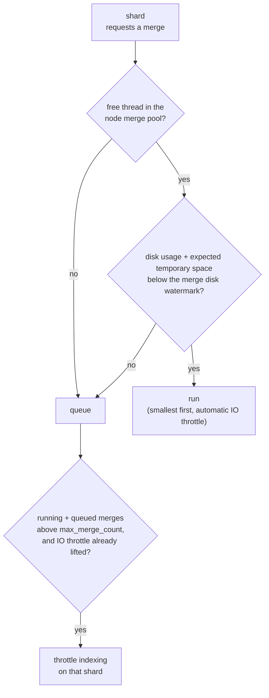
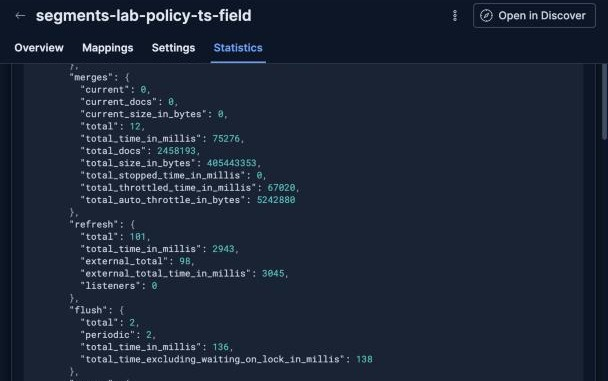
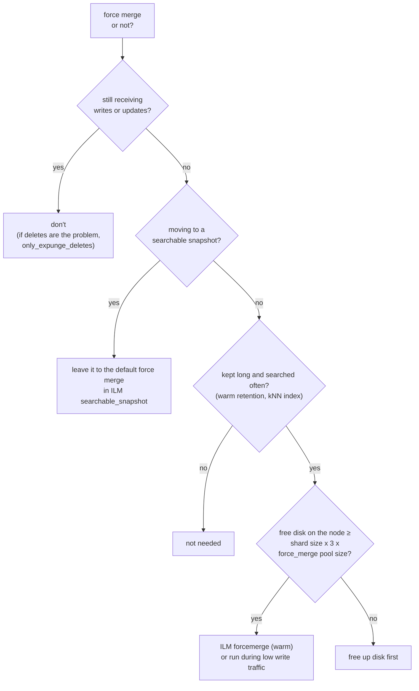

A common pattern: someone hears that too many segments make search slow, so a force merge runs every night.
On an index that is still being written to, that force merge briefly triples disk usage, makes every snapshot upload the whole index, and eventually leaves segments whose deleted documents never get cleaned up.
Elasticsearch handles merges on its own, so most of the time there is little to do. Deciding when to step in and when to leave it alone still requires knowing how it works.

What segments are and why they pile up is covered in [01. Segment lifecycle](../01-segments/).

:::note[Baseline]
- Elasticsearch 9.5.5 (Lucene 10.5.1). The official documentation was rechecked in November 2026.
- Merge policy settings and defaults are not documented in detail at the moment, so they were checked against the Elasticsearch 9.5.5 build commit (`48acba6`) and the Lucene 10.5.1 source. The source file is named next to each statement.
- Measurements use the same environment as [01](../01-segments/): Elastic Cloud Hosted 9.5.5, two hot nodes (8GB RAM, 4GB JVM heap, 2 vCPU each), indices with one primary and zero replicas. Experiment code and results are in [`labs/data/segments-and-merge/`](https://github.com/Munsik/engineering-notes/tree/main/labs/data/segments-and-merge).
- The per-policy behavior of `only_expunge_deletes` and the merge disk watermark were additionally checked on a local single-node Elasticsearch 9.5.5.
- Force merge is not available on Elastic Cloud Serverless ([Tune for indexing speed](https://www.elastic.co/docs/deploy-manage/production-guidance/optimize-performance/indexing-speed)).
:::

## What a merge does

A merge reads several segments and writes them out as one new segment, leaving out documents marked as deleted. Once the new segment is open, the old segments are deleted after the next commit ([Force merge API](https://www.elastic.co/docs/api/elasticsearch/operation/operation-indices-forcemerge)).

You get two things:

- **Fewer segments to search.** A query runs separately on each segment. kNN search in particular has a separate HNSW graph per segment, so fewer segments can make it several times faster ([Tune approximate kNN search](https://www.elastic.co/docs/deploy-manage/production-guidance/optimize-performance/approximate-knn-search)).
- **Space back from deleted documents.** Documents left behind by updates and deletes only disappear when a merge rewrites their segment. Documents held by a retention lease are the exception (see [01](../01-segments/#deletes-and-updates)).

The cost is the disk IO and CPU to read and rewrite the data, plus extra disk while old and new files exist side by side until the merge finishes.

## There are two merge policies

Elasticsearch picks one of two merge policies based on the index mapping (source `MergePolicyConfig.java`, `IndexShard.java`).

| | TieredMergePolicy | LogByteSizeMergePolicy |
| --- | --- | --- |
| Applies to | Indices that do not match the condition on the right | Indices whose mapping has an `@timestamp` field of type date |
| Typical examples | Product catalogs, document search, update-heavy entity indices | Data streams, logs, metrics, time-based indices |
| What it merges | Segments of similar size, regardless of position | Only adjacent segments |
| Max merged segment | 5GB | 100GB |
| Segments allowed per level | 8 (`segments_per_tier`) | Merges once 32 accumulate (`merge_factor`) |
| Small segment floor | Segments under 16MB count as 16MB (`floor_segment`) | Same |
| Reclaiming deletes | A segment becomes a merge candidate once its delete ratio exceeds `deletes_pct_allowed` (default 20%) | No delete-ratio criterion. Deletes only reduce the size used in calculations |

- The caps are the node settings `indices.merge.policy.max_merged_segment` (default 5GB) and `indices.merge.policy.max_time_based_merged_segment` (default 100GB). A source comment explains the high time-based cap: time-based data is usually rolled over anyway, and a low cap would split merges and increase how much gets rewritten. The documentation ([ILM force merge action](https://www.elastic.co/docs/reference/elasticsearch/index-lifecycle-actions/ilm-forcemerge), [Tune approximate kNN search](https://www.elastic.co/docs/deploy-manage/production-guidance/optimize-performance/approximate-knn-search)) only mentions 5GB as the automatic merge cap. The 100GB comes from the source.
- Using LogByteSizeMergePolicy for time-based data has been the default since 8.8.0 ([PR #92684](https://github.com/elastic/elasticsearch/pull/92684); merge factor 32 in [PR #94134](https://github.com/elastic/elasticsearch/pull/94134)).
- The source also explains why deletes are handled differently. A comment notes that `deletes_pct_allowed` and `expunge_deletes_allowed` only apply to TieredMergePolicy and that LogByteSizeMergePolicy has no equivalent (`MergePolicyConfig.java`). Lucene has an open issue on the same gap ([lucene#16701](https://github.com/apache/lucene/issues/16701)).
- So does merging only adjacent segments. Data arriving in time order gives each segment a non-overlapping time range, so an `@timestamp` range filter either covers a whole segment or skips it entirely, which makes search faster. It also fits the usual pattern of mostly querying recent data.
- `segments_per_tier` and `floor_segment` changed in 9.5. Up to 9.4 they were 10 and 2MB (comparing `MergePolicyConfig.java` on the 9.3 and 9.4 branches with 9.5.5).
- The index setting `index.merge.policy.type` (`unset`, `tiered`, `time_based`) selects the policy explicitly (source). It is not documented, so in production I recommend leaving the choice to the default. It is a dynamic setting and takes effect immediately. Switching a large index with many accumulated deletes to `tiered` can trigger a burst of postponed delete-reclaiming merges.

At the Lucene level, both policies exclude large segments from merging.
TieredMergePolicy drops segments larger than half the cap (2.5GB) from the candidates unless their delete ratio is high. LogByteSizeMergePolicy skips segments at or above the cap (Lucene source `TieredMergePolicy.java`, `LogMergePolicy.java`).

### The policy is decided once, when the shard opens

Whether `@timestamp` exists is only checked when the shard's engine is created (source `IndexShard.java`, `newEngineConfig`). The engine is created when a shard copy opens, and again during some recovery steps (`rollbackEngineToGlobalCheckpoint`).
So if an index is created without a mapping and the first document's `@timestamp` becomes a date through dynamic mapping, that shard runs TieredMergePolicy until it is reopened. The measurement below confirms this.

Data streams require an `@timestamp` mapping at creation, so they do not have this problem. A copy opened later by a restart, relocation or new replica allocation decides based on the mapping at that time, so copies of the same index can end up with different policies (unverified).

For a regular index, decide whether to include `@timestamp` from its write pattern:

- **Append-only time-based index**: put `@timestamp` as a date in the index template and it runs LogByteSize from the start.
- **Index with many updates or deletes**: with `@timestamp`, it gets LogByteSize, which is poor at reclaiming deletes. Naming the time field something other than `@timestamp` keeps it on Tiered. Elastic is also considering narrowing this rule to data streams ([elasticsearch#159981](https://github.com/elastic/elasticsearch/issues/159981), open as of November 2026).

### Measured: same data, different policy

Same conditions as the [refresh experiment in 01](../01-segments/#measured-how-refresh_interval-shapes-segments) (1 million documents, `refresh_interval: 1s`, bulks of 2,000), with only the time field changed. Run twice; each cell shows "run 1 / run 2".

| Index | Time field | Policy applied | Merges | Documents rewritten by merges | Bytes rewritten by merges | Merge IO throttle | Segments after indexing |
| --- | --- | --- | --- | --- | --- | --- | --- |
| `refresh-1s` | `@timestamp` (mapped at creation) | LogByteSize | 2 / 2 | 796K / 775K | 134MB / 131MB | 22.3s / 21.7s | 19 / 21 |
| `policy-ts-field` | `ts` | Tiered | 12 / 10 | 2.458M / 1.822M | 405MB / 301MB | 67.0s / 49.4s | 5 / 10 |
| `policy-dynamic-ts` | `@timestamp` (dynamic) | Tiered | 12 / 11 | 1.780M / 1.693M | 542MB / 517MB | 68.5s / 67.5s | 5 / 4 |
| `policy-dynamic-ts`, 600K more after close/open | `@timestamp` (dynamic) | LogByteSize | 1 / 1 | 402K / 406K | 124MB / 125MB | 19.5s / 19.8s | 22 / 21 |

On `policy-dynamic-ts`, dynamic mapping also created a `keyword` subfield for `message`, so its size is not directly comparable. Compare only merge counts and segment counts. Raw results are in [`results/D_policy.csv`](https://github.com/Munsik/engineering-notes/blob/main/labs/data/segments-and-merge/results/D_policy.csv).

- **Tiered keeps few segments but rewrites a lot.** Indexing 1 million documents rewrote documents 1.82 to 2.46 million times. LogByteSize was around 780,000 in both runs. That is 2.3 to 3.1 times more rewriting and 2.3 to 3 times more time throttled on merge IO. Tiered varied a lot between runs depending on when merges happened; LogByteSize was nearly identical.
- **LogByteSize collects close to 32 small segments and merges them at once.** During indexing the segment count climbed to 40 and dropped to 13. More segments to search, but lower write cost.
- **The dynamic `@timestamp` index behaved like Tiered.** 11 to 12 merges, the same pattern as the `ts` index. After a close/open reopened the shard, indexing 600,000 more documents triggered only one merge and segments built up to 51 to 52. Both runs switched to LogByteSize.

## When merges slow down indexing

Merges run in the background, but when they fall behind they slow indexing directly. This is how it fits together ([Merge settings](https://www.elastic.co/docs/reference/elasticsearch/index-settings/merge), [Merge resource limits settings](https://www.elastic.co/docs/reference/elasticsearch/configuration-reference/merge-settings)).



| Limit | Scope | Setting and default |
| --- | --- | --- |
| Merges running at once across the node | Node | Merge thread pool. Default maximum is the number of allocated processors |
| Merges one shard runs at once | Shard | `index.merge.scheduler.max_thread_count`. Since 9.4, half the processors visible to the JVM, minimum 1 |
| Running plus queued merges per shard | Shard | `index.merge.scheduler.max_merge_count`. `max_thread_count + 5` |
| Disk level at which merges are not started | Node | `indices.merge.disk.watermark.high`. Defaults to the flood stage watermark (95%) with a max headroom of 100GB. Checked every 5 seconds |

- All shards on a node share one merge thread pool. Smaller merges run before larger ones.
- A merge that has already started is not stopped when the disk crosses the threshold. Only new merges are held back.
- When queued merges exceed the limit and disk IO throttling has already been lifted, indexing on that shard is throttled. Per a source comment, this limits indexing to one thread per shard (`IndexThrottle` in `Engine.java`).
- Automatic disk IO throttling starts at 20MB per second and adjusts between 5MB and 10GB per second with merge load (source `ThreadPoolMergeExecutorService.java`).

The test nodes had 2 vCPU, so the merge thread pool maximum was 2 (checked with `GET _cat/thread_pool/merge,force_merge?v`).

### Where to see merge activity

Open an index in Kibana Index Management and go to the Statistics tab to find the `merges` section. This is the `policy-ts-field` index from above.



| Field | Meaning | What to look for |
| --- | --- | --- |
| `merges.current` | Merges running now | Staying above 0 means merges are falling behind |
| `merges.total_docs` | Documents rewritten by merges so far | Compare with `indexing.index_total` to estimate write amplification |
| `merges.total_throttled_time_in_millis` | Time merges spent throttled on IO | Whether disk IO keeps up with merges |
| `merges.total_auto_throttle_in_bytes` | Current merge IO limit (bytes per second) | Staying low means merge load is light |
| `indexing.throttle_time_in_millis` | Time indexing was throttled by merges | Non-zero means merges have blocked indexing |

The same values are available from `GET <index>/_stats/merge,indexing`. Per node, use `GET _cat/thread_pool/merge?v&h=node_name,active,queue`.

## Force merge

Force merge bypasses the merge policy and merges down to the requested number of segments. It flushes by default when it finishes (`flush` parameter, default `true`).

```console
POST my-index-000001/_forcemerge?max_num_segments=1
```

### When it is fine

The documentation recommends it for indices that no longer receive writes ([Force merge API](https://www.elastic.co/docs/api/elasticsearch/operation/operation-indices-forcemerge)).

- **Data stream backing indices after rollover**: merging into one segment once writes stop can let searches use simpler, more efficient data structures.
- **Before moving to a searchable snapshot**: the ILM `searchable_snapshot` action force merges first by default (`force_merge_index`, default `true`), because searchable snapshot performance depends on it. Since 9.2 it force merges on a clone with zero replicas (`force_merge_on_clone`, default `true`), so the same merge is not repeated on every replica ([Searchable snapshot action](https://www.elastic.co/docs/reference/elasticsearch/index-lifecycle-actions/ilm-searchable-snapshot)). This force merge runs on the tier before the phase that holds the searchable snapshot action (hot or warm), so the "up to three times" free space discussed below is needed on those nodes ([ILM force merge action](https://www.elastic.co/docs/reference/elasticsearch/index-lifecycle-actions/ilm-forcemerge)).
- **kNN indices after a bulk load**: segment count directly drives kNN search speed. Besides force merge, the documentation suggests building large segments from the start with `refresh_interval: -1` during the load, and raising `index.merge.policy.max_merged_segment` to 10 to 20GB ([Tune approximate kNN search](https://www.elastic.co/docs/deploy-manage/production-guidance/optimize-performance/approximate-knn-search)). The `vectordb_document` index mode, GA since 9.5, enables settings that run merges with internal parallelism and no IO throttling (same page).

I also tried this in a small lab. With 30,000 384-dimension vectors, 40 segments were created on purpose (`index.merge.policy.segments_per_tier: 64`), and the `took` of the same 200 kNN queries (`k: 10`, `num_candidates: 100`) was compared before and after a force merge. Averaged over two runs, it was 3.4ms and 4.2ms with 40 segments, and 3.0ms to 3.1ms with one segment (measured). At this scale the difference was under 1ms.
I think that is because the whole data set, 50MB, fit in memory and each search took only a few milliseconds. The several-times difference in the documentation should be read as applying to indices with many vectors and large segments. In 9.5.5, a 384-dimension `dense_vector` created without options got `bbq_hnsw` by default (per the mapping response). Raw results are in [`results/E_knn.csv`](https://github.com/Munsik/engineering-notes/blob/main/labs/data/segments-and-merge/results/E_knn.csv).

The ILM `forcemerge` action can be used in the hot and warm phases, and in the hot phase it requires a `rollover` action. With `index_codec: best_compression`, ILM closes and reopens the index before the force merge, so neither reads nor writes work in the meantime ([ILM force merge action](https://www.elastic.co/docs/reference/elasticsearch/index-lifecycle-actions/ilm-forcemerge)).

### When not to

Do not force merge an index that is still receiving writes. The documentation gives two reasons (Force merge API):

- **It creates large segments that regular merges skip.** Force merge can produce segments over 5GB, and those are excluded from regular merging. Deletes from later updates and deletes keep piling up in them, hurting disk usage and search performance. Per the Lucene source, the pile-up is not unbounded: TieredMergePolicy makes a large segment a candidate again once both its own delete ratio and the index-wide delete ratio exceed `deletes_pct_allowed` (20%). Until then it carries the deleted documents (Lucene `TieredMergePolicy.java`).
- **Snapshots stop being incremental.** The segment files are replaced wholesale, so the next snapshot uploads the entire index again.

5GB is the default cap of TieredMergePolicy. Indices with `@timestamp` have a 100GB cap, so the size at which a segment drops out of regular merging differs (per the source). Time-based indices are force merged after rollover anyway, so the real problem is update-heavy indices. On Tiered indices, deletes pile up in the large segments a force merge created; on regular indices with `@timestamp`, the policy itself has no delete-reclaiming criterion.

It is also expensive:

- With `max_num_segments=1`, it uses up to three times the shard size on disk.
- A force merge task cannot be cancelled. It keeps running in the background even if the connection drops.
- Each shard runs in the node's `force_merge` thread pool. The default size is `max(1, allocated processors / 8)`, which was 1 on the 2-vCPU test nodes. `thread_pool.force_merge.size` can raise it, but the documentation calls it an advanced setting to increase gradually while watching the cluster ([ILM force merge action](https://www.elastic.co/docs/reference/elasticsearch/index-lifecycle-actions/ilm-forcemerge)).

### Measured: before and after a force merge

#### Disk usage during the merge

An index with 22 segments and 478MB was force merged with `max_num_segments=1`, reading `store.size` every 150ms. The store stats cache was disabled with `index.store.stats_refresh_interval: 0s` (requires reopening the index).

| Point in time | `store.size` | Relative to original |
| --- | --- | --- |
| Before (22 segments) | 478.3MB | 1.00x |
| 13.7s | 948.0MB | 1.98x |
| 14.3s (peak) | 1,416.5MB | 2.96x |
| After (1 segment) | 471.5MB | 0.99x |

Most of the 14.8 seconds went into writing the new segment, and usage rose slowly to about twice the original size. In the last second it jumped to nearly three times and then dropped right away.
My reading is that, because the new segment was under 1GB, Lucene repacked the finished files into a compound file (`.cfs`), and during that step the old segments, the new segment files and the `.cfs` all existed at once (compound threshold: see [01](../01-segments/#files-that-make-up-a-segment)). Raw samples are in [`results/C_peak_samples.csv`](https://github.com/Munsik/engineering-notes/blob/main/labs/data/segments-and-merge/results/C_peak_samples.csv).

The same was measured on another index with one replica (3 segments per copy, 161.6MB primary). The primary peaked at 397.9MB, 2.46 times. Primary plus replica peaked at 720.9MB and ended at 322.9MB. Primary and replica force merge at the same time on their own nodes, so every node holding a copy needs the extra disk (measured).

2.46x and 2.96x on the two indices match the documented "up to three times". The peak is brief, so a long monitoring interval may miss it. Plan free space for the peak.

#### Snapshot increments

An index with 19 segments and 163MB was snapshotted before and after a force merge. The repository was the Elastic Cloud Hosted default, `found-snapshots`.

| Snapshot | New files uploaded | New bytes uploaded | Total size |
| --- | --- | --- | --- |
| 1. Before force merge | 0 | 0MB | 163.2MB |
| 2. Again, no changes | 0 | 0MB | 163.2MB |
| 3. After force merge | 4 | 161.7MB | 161.7MB |

Snapshot 1 uploaded 0MB because the deployment's default snapshot policy had already uploaded this index. After the force merge, the whole index was uploaded again (measured). Force merging a live index every day grows the snapshot repository by that index's size every day.

#### Space saved

On the two indices without deleted documents, `store.size` shrank by only 1% to 1.4% after the force merge (163.2MB to 161.7MB, 478.3MB to 471.5MB). A force merge only saves disk when there are deleted documents to drop. The storage comparisons in this collection are done after a force merge to align conditions, not to shrink anything.

### Reclaiming deleted documents only: only_expunge_deletes

`only_expunge_deletes=true` rewrites only segments that contain deleted documents. Which segments it picks depends on the merge policy (source `MergePolicyConfig.java`, Lucene `LogMergePolicy.java`).

- **TieredMergePolicy**: skips segments whose delete ratio is at or below `index.merge.policy.expunge_deletes_allowed` (default 10%). It does not merge down to one segment.
- **LogByteSizeMergePolicy** (`@timestamp` indices): no such threshold. Every segment with even one deleted document is rewritten, and adjacent segments like that are combined, up to `merge_factor` (32) at a time. The merge size cap is not checked either.

Checked on a local single-node 9.5.5 with 4 segments, each with 2% of its documents deleted. The `ts` index kept all 4 segments and their deleted documents; the `@timestamp` index merged into one segment and all deleted documents disappeared (measured). The requests to reproduce it are in [`labs/data/segments-and-merge/expunge-by-policy.console`](https://github.com/Munsik/engineering-notes/blob/main/labs/data/segments-and-merge/expunge-by-policy.console).

The segment with 8% deletes left behind in [the update measurement in 01](../01-segments/#measured-updating-the-same-documents-repeatedly) was also there because that index was Tiered. Lowering the threshold to 0 cleaned everything up.
On an update-heavy Tiered index, this is a lighter way than `max_num_segments=1` to get space back without stopping writes. On a `@timestamp` index it rewrites every segment with deletes, so check those segments' sizes and the free disk first.

## Decision guide



| Situation | Recommendation |
| --- | --- |
| Log and metrics data streams | ILM warm phase `forcemerge` after rollover, or the default force merge of the searchable snapshot action. Do not run it by hand in the hot phase |
| Update-heavy catalog or entity indices | Do not schedule force merges. First check whether the mapping has `@timestamp`. Watch the `docs.deleted` ratio and use `only_expunge_deletes` when needed |
| Indices loaded once and then only searched (including kNN) | Build large segments during the load with `refresh_interval: -1` and zero replicas, then force merge once after the load |
| Nodes whose disk is already highly used | Calculate free space before a force merge. Merges are not started near flood stage, so once merges fall behind, indexing slows down too |
| Suspecting merges are slowing indexing | Look at `indexing.throttle_time_in_millis`, `merges.current` and `merges.total_throttled_time_in_millis` together. Start by lengthening the refresh interval and adjusting bulk size |

On a node held back by the merge disk watermark, a force merge never finishes either. On a local 9.5.5 node, once free disk fell below the threshold (95%), new merges queued up and the `_forcemerge` request kept waiting without a response. The log warned every 5 seconds that there was not enough disk space to start merges, and lowering the threshold let the queued merges run immediately (measured). Since a force merge task cannot be cancelled, check the disk before running it.

Calculate free disk like this: the number of shards force merged at once on a node equals the `force_merge` thread pool size. So the free space needed is "largest shard on that node x 3 x `force_merge` thread pool size". If you changed the pool size, use that value. A 16-vCPU node has a pool size of 2, so with 50GB shards it needs 300GB (example values).

## References

- [Merge settings](https://www.elastic.co/docs/reference/elasticsearch/index-settings/merge)
- [Merge resource limits settings](https://www.elastic.co/docs/reference/elasticsearch/configuration-reference/merge-settings)
- [Force merge API](https://www.elastic.co/docs/api/elasticsearch/operation/operation-indices-forcemerge)
- [ILM force merge action](https://www.elastic.co/docs/reference/elasticsearch/index-lifecycle-actions/ilm-forcemerge)
- [ILM searchable snapshot action](https://www.elastic.co/docs/reference/elasticsearch/index-lifecycle-actions/ilm-searchable-snapshot)
- [Tune approximate kNN search](https://www.elastic.co/docs/deploy-manage/production-guidance/optimize-performance/approximate-knn-search)
- [Tune for indexing speed](https://www.elastic.co/docs/deploy-manage/production-guidance/optimize-performance/indexing-speed)
- Elasticsearch PRs and issues: [PR #92684](https://github.com/elastic/elasticsearch/pull/92684), [PR #94134](https://github.com/elastic/elasticsearch/pull/94134), [elasticsearch#159981](https://github.com/elastic/elasticsearch/issues/159981)
- Lucene issue: [lucene#16701](https://github.com/apache/lucene/issues/16701)
- Elasticsearch 9.5.5 source: [`MergePolicyConfig.java`](https://github.com/elastic/elasticsearch/blob/48acba663b09e70b115dd879329141506c377890/server/src/main/java/org/elasticsearch/index/MergePolicyConfig.java), [`IndexShard.java`](https://github.com/elastic/elasticsearch/blob/48acba663b09e70b115dd879329141506c377890/server/src/main/java/org/elasticsearch/index/shard/IndexShard.java), [`ThreadPoolMergeScheduler.java`](https://github.com/elastic/elasticsearch/blob/48acba663b09e70b115dd879329141506c377890/server/src/main/java/org/elasticsearch/index/engine/ThreadPoolMergeScheduler.java), [`ThreadPoolMergeExecutorService.java`](https://github.com/elastic/elasticsearch/blob/48acba663b09e70b115dd879329141506c377890/server/src/main/java/org/elasticsearch/index/engine/ThreadPoolMergeExecutorService.java), [`Engine.java`](https://github.com/elastic/elasticsearch/blob/48acba663b09e70b115dd879329141506c377890/server/src/main/java/org/elasticsearch/index/engine/Engine.java)
- Lucene 10.5.1 source: [`TieredMergePolicy.java`](https://github.com/apache/lucene/blob/releases/lucene/10.5.1/lucene/core/src/java/org/apache/lucene/index/TieredMergePolicy.java), [`LogMergePolicy.java`](https://github.com/apache/lucene/blob/releases/lucene/10.5.1/lucene/core/src/java/org/apache/lucene/index/LogMergePolicy.java)
