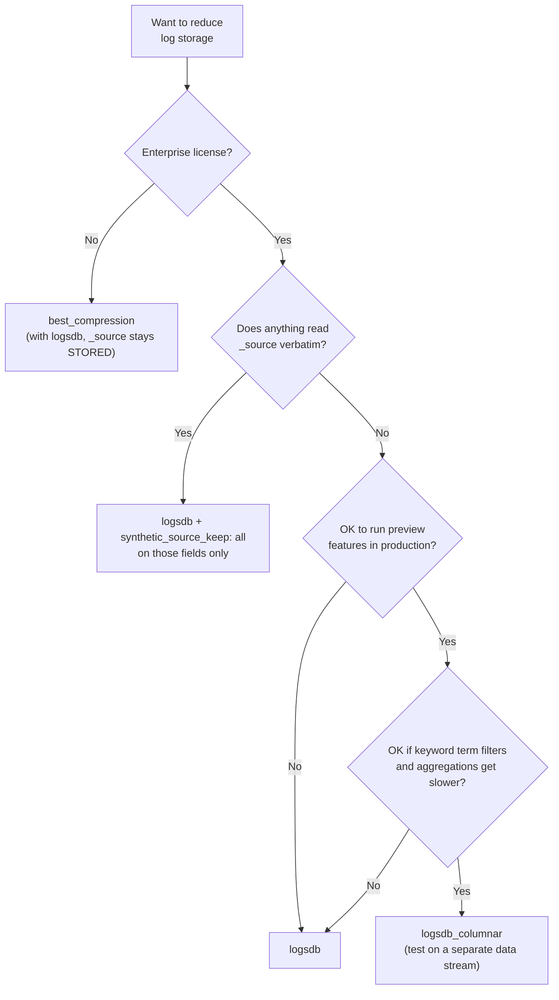

When someone asks to double the retention period, the first question is whether disk has to double too.
Numbers like "logsdb saves 60%", "65%" or "77%" come up often at that point. All three appear in official material, but each is measured against a different baseline.
Put one of them into sizing without knowing its baseline, and you either overstate the savings for a cluster that already uses `best_compression` or plan far too conservatively.

So I loaded the same logs with five settings and compared size, indexing cost, query latency and the `_source` that comes back.
Where storage goes inside segment files is covered in [01. Segment lifecycle](../01-segments/#measured-where-does-the-storage-go), and why the comparison runs after a force merge is covered in [02. Merge and force merge](../02-merge-and-force-merge/#space-saved).

:::note[Baseline]
- Elasticsearch 9.5.5 (Lucene 10.5.1). The official documentation was rechecked in November 2026.
- `logsdb` has been GA since 8.17 and is enabled by default for new `logs-*-*` data streams from 9.0. `columnar` and `logsdb_columnar` are tech preview in 9.5 ([Columnar index mode](https://www.elastic.co/docs/reference/elasticsearch/columnar)).
- Synthetic `_source` requires an Enterprise license. Measurements used a trial license, and the behavior without a license was checked separately on a basic license.
- The test environment is a local single-node Elasticsearch 9.5.5 (1 vCPU, 1GB JVM heap). The indexing client ran on the same machine, so read indexing throughput and query latency as trends only. Sizes can be read as they are. Experiment code and results are in [`labs/data/storage-footprint/`](https://github.com/Munsik/engineering-notes/tree/main/labs/data/storage-footprint).
:::

## Read a savings figure together with its baseline

Representative figures from public material and what each was compared with:

| Source | Figure | Compared with |
| --- | --- | --- |
| [Logs data streams](https://www.elastic.co/docs/manage-data/data-store/data-streams/logs-data-stream) documentation | Up to 60%, 10% to 20% indexing impact | Baseline settings not stated. Says results vary by data and version |
| [logsdb GA blog](https://www.elastic.co/search-labs/blog/elasticsearch-logsdb-index-mode) (8.17) | Up to 65% | A recent version without logsdb |
| [Observability Labs, LogsDB storage evolution](https://www.elastic.co/observability-labs/blog/elasticsearch-logsdb-storage-evolution) | 77% in the text (161.9GB to 37.5GB), up to 75% in the title | Same data loaded without logsdb in the nightly benchmark. The logsdb side uses an Enterprise license |
| `index.codec` in the [General index settings](https://www.elastic.co/docs/reference/elasticsearch/index-settings/index-modules) documentation | Up to about 28% | `best_compression` versus the `default` codec |

The same logsdb shows a large saving when compared with the `default` codec and a much smaller one when compared with an index that already used `best_compression`.
The `logs@settings` component template built into 9.5.5 also sets `index.codec: best_compression` (checked with `GET _component_template/logs@settings` on a local 9.5.5 node). Integration templates and your own templates depend on how they were set up, so check the actual `index.codec` of the backing indices first. If the cluster already uses `best_compression`, estimate the effect of logsdb with standard + `best_compression` as the baseline.

## Four structures that take up space

A log document is stored on disk several times.

| Structure | Holds | Used by |
| --- | --- | --- |
| stored fields (`_source`) | The original JSON | Search hits, GET, reindex, update |
| inverted index | Term-to-document index | Searches such as `term` and `match` |
| doc values | Per-field columnar storage | Sorting, aggregations, ES\|QL, synthetic `_source` reconstruction |
| points (BKD) | Range index for numbers, dates and IPs | `range` searches |

Each setting shrinks a different structure.

- `best_compression`: switches stored fields compression from LZ4 to ZSTD. It moved from DEFLATE to ZSTD in 8.16 ([LogsDB storage evolution](https://www.elastic.co/observability-labs/blog/elasticsearch-logsdb-storage-evolution)). The other structures are unchanged.
- synthetic `_source`: does not store the original JSON and rebuilds it from doc values and stored fields at read time ([_source field](https://www.elastic.co/docs/reference/elasticsearch/mapping-reference/mapping-source-field#synthetic-source)).
- `logsdb`: turns on synthetic `_source`, `best_compression`, index sorting on `host.name` and `@timestamp`, and dedicated codecs for numeric and keyword doc values, all at once ([Configure a logs data stream](https://www.elastic.co/docs/manage-data/data-store/data-streams/logs-data-stream-configure)).
- `logsdb_columnar`: on top of the logsdb defaults, stores non-text fields only as doc values without indexing them. It also flattens the mapping ([Columnar index mode](https://www.elastic.co/docs/reference/elasticsearch/columnar)).

## Measured: same logs, five settings

### Method

- Data: ECS-style synthetic logs from the shared generator [`labs/_datagen/loggen.py`](https://github.com/Munsik/engineering-notes/blob/main/labs/_datagen/loggen.py). The base dataset has about 20 fields, an average `message` of 67 bytes, and about 760 bytes per document as JSON.
- Four datasets:
  - `base`: 50 hosts, 300,000 documents
  - `hicard`: 50,000 hosts, 300,000 documents
  - `fields200`: 180 extra `attr.*` fields, 100,000 documents
  - `longmsg`: stack trace messages of 1.5KB to 2.5KB, 100,000 documents
- Mapping: all five settings use the same explicit mapping. Strings are `keyword` and `message` is `match_only_text`, matching how the ECS logs template maps `message`.
- Five settings: each is a data stream created from an index template, with one primary and zero replicas.

| Name | Setting | Applied values |
| --- | --- | --- |
| `std` | `index.mode: standard` | codec `default`, source STORED, no sorting |
| `std-bc` | + `index.codec: best_compression` | codec `best_compression` |
| `std-syn` | + `index.mapping.source.mode: synthetic` | codec `default`, source synthetic |
| `logsdb` | `index.mode: logsdb` | codec `best_compression`, source SYNTHETIC, sort `host.name` asc, `@timestamp` desc |
| `columnar` | `index.mode: logsdb_columnar` | codec `best_compression`, source SYNTHETIC, sort `host.name` asc, `@timestamp` desc |

- Procedure: index with `_bulk` in batches of 5,000, measure size after refresh and flush, then force merge with `max_num_segments=1` and measure again. The comparison uses primary `store.size` after the force merge. Each combination ran twice.

### Size

Bytes per document after force merge. Both runs agreed within 1%, so only the second run is shown. The figure in parentheses is the reduction against `std` for the same dataset.

| Dataset | `std` | `std-bc` | `std-syn` | `logsdb` | `columnar` |
| --- | --- | --- | --- | --- | --- |
| `base` (50 hosts) | 335 | 214 (36%) | 153 (54%) | 118 (65%) | 76 (77%) |
| `hicard` (50,000 hosts) | 362 | 245 (32%) | 167 (54%) | 148 (59%) | 87 (76%) |
| `fields200` (200 fields) | 1,951 | 1,118 (43%) | 612 (69%) | 532 (73%) | 259 (87%) |
| `longmsg` (2KB message) | 642 | 375 (42%) | 403 (37%) | 247 (62%) | 199 (69%) |

Full results are in [`results/summary.csv`](https://github.com/Munsik/engineering-notes/blob/main/labs/data/storage-footprint/results/summary.csv).

- **The 65% for logsdb and 77% for columnar on `base` are against the `default` codec.** With `best_compression` as the baseline, logsdb saved 45% and columnar 65% (214 bytes down to 118 and 76 bytes).
- **High host cardinality reduces the logsdb saving.** With 50,000 hosts in 300,000 documents, only a few documents from the same host end up next to each other, so sorting helps less. logsdb dropped from 65% to 59%, while `std-syn`, which only enables synthetic `_source`, stayed at 54%. Only the sorting gain was lost.
- **The more fields, the more removing `_source` helps.** In 200-field documents `_source` takes most of the space, so `std-syn` alone saved 69%.
- **With long messages, synthetic `_source` alone is not enough.** `std-syn` (37%) saved less than `std-bc` (42%). `match_only_text` stores the original text separately for synthetic `_source`, and because `std-syn` uses the `default` codec, that text is stored with LZ4. The `_disk_usage` breakdown below shows this.
- Size before and after force merge differed by less than 5%. The largest difference was logsdb on `hicard` (46.4MB to 44.3MB). At this scale, sizing from the size right after indexing would not have been far off.

### Where the space went: `_disk_usage`

Results of `POST <index>/_disk_usage?run_expensive_tasks=true` for `base`, second run, after force merge, summed by structure. Unit is MB.

| Setting | Total | stored fields | inverted index | doc values | points | Largest field |
| --- | --- | --- | --- | --- | --- | --- |
| `std` | 100.5 | 63.4 | 16.6 | 15.5 | 4.6 | `_source` 61.3 |
| `std-bc` | 64.1 | 27.0 | 16.7 | 15.5 | 4.6 | `_source` 26.1 |
| `std-syn` | 46.0 | 8.6 | 16.8 | 15.8 | 4.6 | `trace.id` 17.4 |
| `logsdb` | 35.4 | 1.0 | 14.9 | 16.7 | 2.7 | `trace.id` 17.4 |
| `columnar` | 22.7 | 0.0 | 5.8 | 16.9 | 0.0 | `message` 7.7 |

- `best_compression` only shrank stored fields (63.4MB to 27.0MB).
- With synthetic `_source`, stored fields almost disappear. Most of the remaining 8.6MB is `message._original` (6.4MB), the field `match_only_text` uses to keep the original text.
- Once `_source` is gone, the largest field was `trace.id`, a 32-character hex value (17.4MB, inverted index and doc values combined). An ID field where almost every value is unique leaves little for sorting and codecs to compress. If size does not drop as expected after moving to logsdb, first check whether high-cardinality keyword fields like this have both an index and doc values.
- `columnar` does not index keyword fields, so the inverted index shrank to the 5.8MB of `message`, and points went to zero. `trace.id` dropped to 5.0MB.

On `longmsg`, `message._original` in `std-syn` was 24.5MB, larger than the entire `_source` of `std-bc` (22.0MB). logsdb stored the same text in 11.1MB. The raw table is in [`results/disk_usage_run2.csv`](https://github.com/Munsik/engineering-notes/blob/main/labs/data/storage-footprint/results/disk_usage_run2.csv).

### Indexing cost

The first run was heavily affected by JVM warm-up on the first combination, so the second run is used. Elasticsearch process CPU time per 1,000 documents on `base` was 31.1ms for `std`, 31.7ms for `std-bc`, 27.8ms for `std-syn`, 32.5ms for `logsdb` and 27.4ms for `columnar` (measured).
In the second run, logsdb was within 5% of `std` on all four datasets (4% less on `fields200`, 4% to 5% more on the others). `columnar` used 19% to 20% less than `std` on `hicard` and `fields200`, and the same on `longmsg`. The saving seems to grow with the number of keyword fields that are no longer indexed.
With one vCPU and the client on the same machine, differences around 5% are hard to separate from measurement noise. All I can say is that the "10% to 20% indexing impact" in the official documentation did not show up at this scale. Real indexing cost has to be measured on production hardware with a tool such as Rally.

### Query latency

Second-run median (ms). Each request ran 15 times with the request cache disabled.

| Request | `std` | `std-bc` | `std-syn` | `logsdb` | `columnar` |
| --- | --- | --- | --- | --- | --- |
| `service.name` term + count (`base`) | 1.9 | 1.9 | 1.9 | 2.9 | 4.6 |
| `@timestamp` range + `host.name` terms aggregation (`base`) | 7.4 | 6.9 | 6.8 | 6.0 | 14.7 |
| Same aggregation (`hicard`) | 5.5 | 4.9 | 5.4 | 10.5 | 24.0 |
| Fetch 100 `_source` documents (`base`) | 9.7 | 18.7 | 12.1 | 14.6 | 10.3 |

- `best_compression` is slower to read `_source`. Fetching 100 documents went from 9.7ms to 18.7ms. The official documentation also says get-by-id latency can increase by 10% to 33%.
- logsdb was almost twice as slow as `std` for the aggregation on `hicard` (5.5ms versus 10.5ms). On `base` there was no difference. This experiment did not isolate the cause (unverified).
- `columnar` has no inverted index for keywords, so term conditions have to be filtered through doc values. On this data, the term count query was more than twice as slow, and the aggregation on `hicard` more than four times as slow. Columnar in 9.5 is still a preview. According to the Labs article, the 9.5.0 columnar mode does not yet choose between dictionary and block compression based on cardinality, so it stores doc values for both keyword and text with block compression only ([One field, one copy](https://www.elastic.co/search-labs/blog/columnar-storage-elasticsearch-index-modes)). Query performance may change before GA.
- Rebuilding synthetic `_source` was not expensive at this scale (9.7ms versus 12.1ms).

### The `_source` you get back is different

I indexed the same document with four settings and read it back with a search. The original is below. `debug` is an object with `enabled: false`.

```json
{
  "@timestamp": "2026-11-26T10:00:00.000Z",
  "host": { "name": "host-1" },
  "message": "dns lookup ok",
  "dns": { "answers": ["10.0.0.3", "10.0.0.1", "10.0.0.3"] },
  "links": [ { "trace_id": "t1", "span_id": "s1" }, { "trace_id": "t2", "span_id": "s2" } ],
  "service.name": "checkout",
  "debug": { "raw": { "k": "v" } }
}
```

| Item | `std` | `std-syn` (no keep) | `logsdb` (keep `arrays`) | `logsdb_columnar` |
| --- | --- | --- | --- | --- |
| `dns.answers` IP array | Unchanged | `["10.0.0.1", "10.0.0.3"]`, sorted and deduplicated | Original order and duplicates kept | Original order and duplicates kept |
| `links` object array | Unchanged | Split into `{"span_id": [...], "trace_id": [...]}` | Unchanged | Split into two arrays, `links.trace_id` and `links.span_id` |
| `service.name` dotted key | Unchanged | Becomes a `service: {name}` object | Becomes a `service: {name}` object | `service.name` unchanged |
| `host.name` | Object | Object | Object | Flat key `"host.name"` |
| `debug` with `enabled: false` | Present | Present | Present | Dropped |
| Field order | Original order | Alphabetical | Alphabetical | Alphabetical |

Raw results are in [`results/fidelity.json`](https://github.com/Munsik/engineering-notes/blob/main/labs/data/storage-footprint/results/fidelity.json).

- In logsdb, `index.mapping.synthetic_source_keep` defaults to `arrays`, so array order, duplicates and object array grouping were preserved. That costs extra storage in return ([Configure a logs data stream](https://www.elastic.co/docs/manage-data/data-store/data-streams/logs-data-stream-configure#synthetic-source)).
- Enabling only synthetic `_source` on a standard index leaves the keep default at `none`, so the IP array was sorted and its duplicates removed. Fields where order and duplicates carry meaning, such as DNS answers, change this way.
- `logsdb_columnar` cannot restore the pairing inside object arrays and drops unmapped content. It also rejects the options that keep the original for a single field (`synthetic_source_keep`, `store: true`). Object arrays where pairing matters must be mapped as `nested` ([What columnar `_source` preserves](https://www.elastic.co/docs/reference/elasticsearch/columnar#columnar-source-fidelity)).

If anything reads `_source` as it is, check these differences before switching. Typical consumers are reindex targets, scripts that read the original with dotted keys such as `params._source['a.b']`, and integrations that pass the original document to another system unchanged.

## What changes with the license and the index template

During the measurements I found two behaviors that are easy to miss from the documentation alone.

### Without a license, synthetic `_source` silently becomes stored

Checked on a basic license (local 9.5.5).

| Requested setting | Actual `index.mapping.source.mode` | Warning |
| --- | --- | --- |
| `index.mapping.source.mode: synthetic` | STORED | None (HTTP 200) |
| `index.mode: logsdb` | STORED | None |
| `index.mode: logsdb_columnar` | COLUMNAR_STORED | None |

The official documentation also says logsdb falls back to the original `_source` without the required subscription.
The response gave no sign that the requested setting had changed. In the source code, the settings provider overrides the source mode when the license does not allow synthetic `_source` (Elasticsearch 9.5.5 `LogsdbIndexModeSettingsProvider.java`). The required license is Enterprise (`LogsdbLicenseService.java`).
So check the license before putting a logsdb saving into sizing, and in operation look at `index.mapping.source.mode` on the backing indices directly.

```console
GET logs-*/_settings/index.mode,index.mapping.source.mode,index.sort.field?include_defaults=true&flat_settings=true
```

### `host.name` sorting only applies through a data stream template

The official documentation says logsdb sorts on `host.name` and `@timestamp` by default ([Configure a logs data stream](https://www.elastic.co/docs/manage-data/data-store/data-streams/logs-data-stream-configure#logsdb-sort-settings)). On a local 9.5.5 node the result depended on how the index was created.

| How it was created | Resulting `index.sort.field` |
| --- | --- |
| `index.mode: logsdb` in a create index request, `host.name` mapped as keyword | `["@timestamp"]` |
| `index.mode: logsdb` in an index template without `data_stream` | `["@timestamp"]`, and the `host.name` field is not injected |
| `index.mode: logsdb` in an index template with `data_stream: {}` | `["host.name", "@timestamp"]` |
| A data stream named `logs-*-*` (default behavior since 9.0) | `["host.name", "@timestamp"]` |

The source shows the same condition. Sorting and field injection are based on the index mode read from the template (`LogsdbIndexModeSettingsProvider.java`), and the function that reads the index mode from a template returns nothing unless it is a data stream template (`retrieveIndexModeFromTemplate` in `ProjectMetadata.java`).

If you measure logsdb by creating two plain indices and reindexing into them, the result can miss the sorting gain that a real data stream gets. Every experiment in this article used data streams created from data stream templates.

## How to apply it

### New data streams

On a 9.0 or later cluster, a data stream newly created with the name `logs-<dataset>-<namespace>` is already logsdb. For other names, set the index mode in the index template.

```console
PUT _index_template/app-logs
{
  "index_patterns": ["app-logs-*"],
  "data_stream": {},
  "priority": 200,
  "template": {
    "settings": {
      "index.mode": "logsdb"
    }
  }
}
```

To try `logsdb_columnar`, put `"index.mode": "logsdb_columnar"` in the same place. It is a preview feature and the mode cannot be changed after creation, so test it on a separate data stream first.

### Existing data streams and integration data streams

- On a cluster upgraded from 8.x to 9.x, existing `logs-*-*` data streams do not become logsdb automatically ([Logs data streams](https://www.elastic.co/docs/manage-data/data-store/data-streams/logs-data-stream#logsdb-availability)).
- A template change applies from the next rollover. Backing indices that already exist stay as they are.
- For integration data streams, do not edit the managed template. Put the setting in the per-dataset `@custom` component template ([Enable logsdb for integrations](https://www.elastic.co/docs/manage-data/data-store/data-streams/logs-data-stream-integrations)).

```console
PUT _component_template/logs-nginx.access@custom
{
  "template": {
    "settings": {
      "index.mode": "logsdb"
    }
  }
}

POST logs-nginx.access-default/_rollover
```

Check these before switching:

- If `host.name` is already mapped as a type other than keyword, you can get a mapping error. In that case change the sort field or sort on `@timestamp` only.
- logsdb enables `ignore_malformed: true`, `ignore_above: 8191` and `ignore_dynamic_beyond_limit: true` by default. Bad values are stored instead of rejected.
- Use the table above to check whether anything reads `_source` as it is.

## Decision guide



| Situation | Recommendation |
| --- | --- |
| Sizing for a longer retention period | Use your current settings as the baseline, load part of your production data with both settings, and measure bytes per document. Do not multiply by a published savings figure |
| Logs that already use `best_compression` | The logsdb gain is around 45% in this experiment, and smaller with high host cardinality |
| Security events and audit logs with many fields | `_source` is a large share, so logsdb helps a lot. 73% in this experiment |
| Application logs with many long stack traces | Avoid standard + synthetic `_source` alone. The original-text field is stored with LZ4 and saved less than `best_compression` |
| Switching a running data stream to logsdb | Before switching, check node CPU headroom and write thread pool `rejected`. The official documentation says indexing cost can rise by 10% to 20%, and in the field, clusters that already had no CPU headroom saw more write rejections after the switch. Switch a few data streams first and watch rejections |
| Size does not drop as much as expected | Look at per-field size with `_disk_usage` and check whether high-cardinality ID fields have both an index and doc values |
| Estimating the saving for your own data in advance | Load about a day of data into two template-based data streams, force merge, and compare `store.size` and `_disk_usage`. The measurement script is `labs/data/storage-footprint/run.py` |

## References

- [Logs data streams](https://www.elastic.co/docs/manage-data/data-store/data-streams/logs-data-stream)
- [Configure a logs data stream](https://www.elastic.co/docs/manage-data/data-store/data-streams/logs-data-stream-configure)
- [Enable logsdb for integrations](https://www.elastic.co/docs/manage-data/data-store/data-streams/logs-data-stream-integrations)
- [_source field](https://www.elastic.co/docs/reference/elasticsearch/mapping-reference/mapping-source-field)
- [Columnar index mode](https://www.elastic.co/docs/reference/elasticsearch/columnar)
- [General index settings](https://www.elastic.co/docs/reference/elasticsearch/index-settings/index-modules)
- [Analyze the index disk usage API](https://www.elastic.co/docs/api/elasticsearch/operation/operation-indices-disk-usage)
- Search Labs: [LogsDB index mode](https://www.elastic.co/search-labs/blog/elasticsearch-logsdb-index-mode), [One field, one copy: How Elasticsearch columnar storage drops the inverted index](https://www.elastic.co/search-labs/blog/columnar-storage-elasticsearch-index-modes)
- Observability Labs: [Elasticsearch over the years: how LogsDB cuts index size](https://www.elastic.co/observability-labs/blog/elasticsearch-logsdb-storage-evolution)
- Elasticsearch 9.5.5 source: [`ProjectMetadata.java`](https://github.com/elastic/elasticsearch/blob/v9.5.5/server/src/main/java/org/elasticsearch/cluster/metadata/ProjectMetadata.java), [`LogsdbIndexModeSettingsProvider.java`](https://github.com/elastic/elasticsearch/blob/v9.5.5/x-pack/plugin/logsdb/src/main/java/org/elasticsearch/xpack/logsdb/LogsdbIndexModeSettingsProvider.java), [`LogsdbLicenseService.java`](https://github.com/elastic/elasticsearch/blob/v9.5.5/x-pack/plugin/logsdb/src/main/java/org/elasticsearch/xpack/logsdb/LogsdbLicenseService.java)
