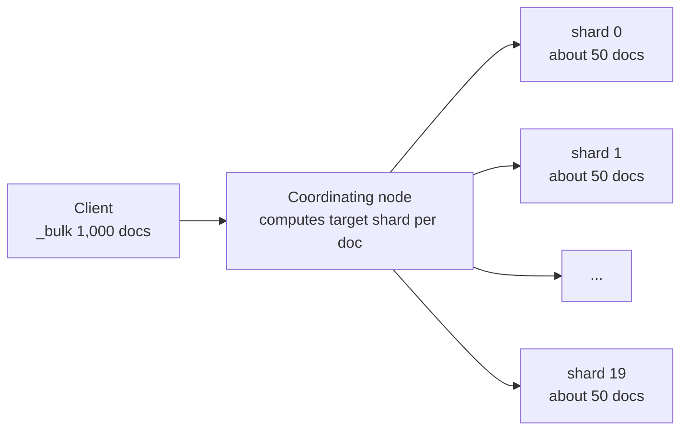
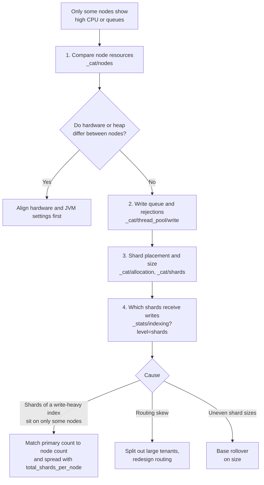

I often see clusters still using the primary shard count chosen on day one, years later.
The data has grown tenfold while the shard count stayed the same, so a single shard is now hundreds of GB. Or the opposite: a data stream was created per customer or per service, and the cluster has thousands of shards.
Shard count is hard to change once an index exists, and bulk shape is buried in client code, so nobody looks at either until something goes wrong.

This article covers how to set shard count, shard size and bulk size, and measures the cost of getting them wrong.

:::note[Baseline]
- Elasticsearch 9.5.5. The official documentation was rechecked in November 2026. Written for self-managed and Elastic Cloud Hosted.
- On Elastic Cloud Serverless, Elastic manages and adjusts sharding automatically, and custom routing is not available ([Differences from other Elasticsearch offerings](https://www.elastic.co/docs/deploy-manage/deploy/elastic-cloud/differences-from-other-elasticsearch-offerings)). The shard count decisions in this article do not apply to Serverless.
- Measurements ran on a local single-node Elasticsearch 9.5.5 (1 vCPU, 1GB JVM heap). The plan was a three-node cluster, but this round measures only the cost created by shard and request counts, not distribution across nodes. Look at ratios between conditions rather than absolute values. Experiment code and results are in [`labs/data/shards-and-bulk/`](https://github.com/Munsik/engineering-notes/tree/main/labs/data/shards-and-bulk).
:::

## Where shards start to cost

A shard is a Lucene index ([01](../01-segments/#a-shard-is-a-lucene-index)). Each shard has its own segments, mappings and statistics, so the same data spread over more shards costs more to manage.

| Cost | What happens | Source |
| --- | --- | --- |
| Search | A search runs one thread per shard. Many shards use up the search thread pool quickly | [Size your shards](https://www.elastic.co/docs/deploy-manage/production-guidance/optimize-performance/size-shards) |
| Heap | Each index, shard, segment and mapped field uses heap. Each segment also keeps its own copy of field names | Same page |
| Master | Keep fewer than 3,000 indices per 1GB of heap on master-eligible nodes | Same page |
| Cluster limit | `cluster.max_shards_per_node` defaults to 1,000. The limit is this value times the number of non-frozen data nodes. Frozen has its own `cluster.max_shards_per_node.frozen`, default 3,000 | [Miscellaneous cluster settings](https://www.elastic.co/docs/reference/elasticsearch/configuration-reference/miscellaneous-cluster-settings) |

`cluster.max_shards_per_node` only blocks requests that create new shards. It does not limit how many shards actually land on one node. To limit placement per node, use `cluster.routing.allocation.total_shards_per_node` or the index setting `index.routing.allocation.total_shards_per_node` (same page).

### Size guidelines

The starting point in the official guide ([Size your shards](https://www.elastic.co/docs/deploy-manage/production-guidance/optimize-performance/size-shards)):

- Keep each shard between 10GB and 50GB.
- Keep each shard under 200 million documents. Lucene's hard limit is 2,147,483,519 documents per shard, and documents marked as deleted count toward it.
- With ILM, set rollover `max_primary_shard_size` to 50GB and `min_primary_shard_size` to 10GB.

The guide presents these ranges as a starting point. The intent is to benchmark on your own hardware and data.

### Default rollover conditions

Default rollover conditions depend on how the data is managed. Values checked directly on 9.5.5:

| Management | Default rollover conditions | Where checked |
| --- | --- | --- |
| Built-in ILM `logs` policy | `max_age: 30d`, `max_primary_shard_size: 50gb` | `GET _ilm/policy/logs` |
| Data stream lifecycle | `max_age=auto`, `max_primary_shard_size=50gb`, `min_docs=1`, `max_primary_shard_docs=200000000` | Default of `cluster.lifecycle.default.rollover` |

With only ILM `max_age`, even a data stream with little data gets a new index every period, and small shards pile up. The official guide also recommends `max_primary_shard_size` over `max_age` when the retention policy allows it.

## How bulk and shards interact

On the coordinating node, a bulk request is split by target shard and each part goes to that shard's primary (Elasticsearch 9.5.5 source, `groupRequestsByShards` in `BulkOperation.java`).



The more shards, the finer the same bulk is split. Each piece carries its own shard-level cost: assigning a write thread, writing and fsyncing the translog, and collecting the response.
`indices.bulk.total_operations` in node stats counts these shard-level bulk requests. Divide by the number of client requests to see how many pieces each request became.

### Measured: bulk size x primary shard count

The same data (about 760 bytes per document) was indexed into indices with 1, 5 and 20 primaries, in bulks of 1, 10, 100, 1,000 and 5,000 documents. One client sent requests sequentially, with zero replicas, `refresh_interval: 30s` and auto-generated IDs.
Each condition ran twice, shown as "run 1 / run 2". The second run of the one-primary row ran right after a node restart and was heavily affected by JVM warm-up, so it was replaced by a third run measured after the JVM had warmed up.

Documents indexed per second:

| Bulk size (request size) | 1 primary | 5 primaries | 20 primaries |
| --- | --- | --- | --- |
| 1 doc (0.8KB) | 328 / 292 | 468 / 389 | 502 / 539 |
| 10 docs (7.7KB) | 3,343 / 2,714 | 2,220 / 2,297 | 1,529 / 1,682 |
| 100 docs (76KB) | 18,446 / 16,135 | 10,831 / 12,748 | 4,650 / 5,723 |
| 1,000 docs (758KB) | 29,600 / 29,902 | 26,225 / 25,314 | 18,430 / 20,733 |
| 5,000 docs (3.7MB) | 30,731 / 31,572 | 30,301 / 28,912 | 27,032 / 27,907 |

Elasticsearch CPU time per 1,000 documents (ms), and the number of shard pieces each request was split into:

| Bulk size | 1 primary | 5 primaries | 20 primaries |
| --- | --- | --- | --- |
| 1 doc | 1,904 / 2,466 (1 piece) | 1,028 / 1,594 (1 piece) | 968 / 940 (1 piece) |
| 10 docs | 165 / 258 (1 piece) | 207 / 240 (4.5 pieces) | 301 / 296 (8 pieces) |
| 100 docs | 36 / 45 (1 piece) | 55 / 50 (5 pieces) | 106 / 95 (19.9 pieces) |
| 1,000 docs | 25 / 28 (1 piece) | 31 / 33 (5 pieces) | 40 / 41 (20 pieces) |
| 5,000 docs | 27 / 26 (1 piece) | 29 / 30 (5 pieces) | 32 / 33 (20 pieces) |

Write thread pool rejections were zero in every condition. Raw results are in [`results/A_bulk_shards.csv`](https://github.com/Munsik/engineering-notes/blob/main/labs/data/shards-and-bulk/results/A_bulk_shards.csv).

- **Sending one document at a time is 40 to 100 times slower than bulks of 1,000.** Indexing 1,000 documents took 0.9 to 2.5 seconds of CPU. With bulks of 1,000 it took 25ms to 40ms. The fixed cost of receiving, processing and answering a request is much larger than the cost of processing a document.
- **More shards make the same bulk smaller.** Sending 100 documents to 20 primaries gives 20 pieces of 5 documents each. Throughput fell to between a quarter and a third of the one-primary case, and CPU per document was two to three times higher. From the shard's point of view, a bulk of 100 became a bulk of 5.
- **With large enough bulks, the shard count matters less.** At 5,000 documents (3.7MB), the throughput gap between 1 and 20 primaries was around 12%. With one primary, throughput was already almost flat around 1,000 documents.
- Only with single-document bulks were more shards slightly faster. The one-primary column ran first in every round, which may explain it, so I do not read anything into that difference.

### Comparing with the official recommendation

The official documentation does not set bulk size by document count. It recommends starting at 100 documents on a single node with one shard and doubling until throughput flattens. If results are similar, pick the smaller size, and keep each request under a few tens of MB because many concurrent requests put pressure on memory ([Tune for indexing speed](https://www.elastic.co/docs/deploy-manage/production-guidance/optimize-performance/indexing-speed)).
In this measurement, throughput flattened around 1,000 documents, about 750KB. Document count changes with document size, so request size in MB is the easier criterion to carry over.

Related defaults:

| Item | Default | Source |
| --- | --- | --- |
| `write` thread pool size | Number of allocated processors. Handles shard-level writes and ingest processors | [Thread pool settings](https://www.elastic.co/docs/reference/elasticsearch/configuration-reference/thread-pool-settings) |
| `write` queue size | `max(10000, processors x 750)`. 10,000 up to 9.1 | Same page |
| `write_coordination` thread pool | Since 9.1. Handles bulk request coordination. Size is the processor count, queue 10,000. Up to 9.0 the `write` pool did this too | Same page |
| Maximum HTTP request size | `http.max_content_length` 100MB | Checked default on 9.5.5 |
| Indexing pressure limit | `indexing_pressure.memory.limit` 10% of heap. Above it, 429 | Checked default on 9.5.5 |

On a 429 (TOO_MANY_REQUESTS), pause and retry with exponential backoff. One client cannot use the whole cluster, so send from several workers, but do not let too many workers pile onto one shard (Tune for indexing speed).

## Multi-tenant design

When data has to be separated per customer or business unit (tenant), there are three common approaches.

| Approach | Structure | Benefit | Cost and limits |
| --- | --- | --- | --- |
| Data stream per tenant | One per tenant, such as `logs-app-tenant042` | Easy to vary retention, permissions and deletion per tenant | Shard count grows with tenant count. Many small shards |
| Shared data stream + tenant field | One data stream with a `tenant.id` field | Shard count is independent of tenant count | Hard to vary retention per tenant. Permissions use document level security or filtered aliases |
| Shared + custom routing | Shared index with `routing: tenant.id` | A query for one tenant hits only one shard | Large tenants pile onto one shard. Data streams need `allow_custom_routing` in the template, and it is not available on Serverless |

### Measured: 300 per-tenant data streams versus shared data streams

The scenario is 100 tenants x 3 datasets (app, access, audit). The same 300,000 documents were indexed in two layouts. All logsdb, one primary, zero replicas.

- Per tenant: 300 data streams such as `mt-tenant-042-app`
- Shared: 3 data streams such as `mt-shared-app`, with `tenant.id` in each document

| Item | Per tenant (300) | Shared (3) |
| --- | --- | --- |
| Added shards | 300 | 3 |
| Added segments | 653 / 657 | 4 / 4 |
| Cluster state size (metadata, routing table JSON) | About 800KB more | About 8KB more |
| Estimated field mapping heap on the data node | 17.2MB | 0.17MB |
| Storage (primary) | 64.1MB | 38.5MB |
| Documents indexed per second | 4,285 / 4,853 | 14,285 / 16,961 |
| CPU per 1,000 documents | 191 / 153ms | 48 / 38ms |
| Pieces per bulk | 300 | 3 |
| Query for one tenant (log level aggregation) | 14.5 / 8.4ms | 14.3 / 7.3ms |
| Aggregation across all tenants (`mt-*`, time range + tenant terms) | 245 / 187ms | 15.6 / 9.8ms |

The field mapping heap estimate is `indices.mappings.total_estimated_overhead_in_bytes` from `GET _nodes/stats`. Raw results are in [`results/B_multitenant.csv`](https://github.com/Munsik/engineering-notes/blob/main/labs/data/shards-and-bulk/results/B_multitenant.csv).

- **Indexing was 3.3 to 3.5 times slower.** A bulk of 5,000 documents spread across 300 data streams averaged 17 documents per shard. This is the "more shards, smaller bulks" effect from experiment A.
- **Storage was 1.7 times larger.** Small shards give logsdb sorting and compression fewer documents to group, and each shard has some fixed files.
- **Queries for a single tenant were about the same.** The shared data stream was fast enough with a `tenant.id` term condition. Aggregations across many tenants had to visit 300 shards and were 16 to 19 times slower.
- Cluster state and field mapping heap grew a hundredfold. At 300 that is not a problem, but 1,000 tenants with 10 datasets means 10,000 data streams, and every rollover adds more indices. At that point you hit the master heap guideline (3,000 per 1GB) and the shard limit right away.

The raw mapping size (`total_deduplicated_mapping_size`) grew by the same 357 bytes in both layouts, because identical mappings are deduplicated in the cluster state. What does not shrink is the per-field heap on the data nodes.

Based on these measurements, these are the rules I use:

- Default to shared data streams with `tenant.id`.
- Move out only the few large tenants whose retention or regulatory requirements differ.
- If you do split per tenant, base rollover on `max_primary_shard_size` so small shards do not pile up.

## When writes pile onto one shard or node

Hot spotting is uneven resource usage across nodes. Typical causes are hardware differences, shard placement, and writes concentrated on particular indices ([Hot spotting](https://www.elastic.co/docs/troubleshoot/elasticsearch/hotspotting)).

### Measured: one shard grows because of routing skew

200,000 documents were indexed into an index with four primaries using `routing: tenant.id`, with 70% of the documents going to one tenant. Results from `_cat/shards` and shard-level indexing stats:

| shard | Documents | Size | Cumulative indexing time |
| --- | --- | --- | --- |
| 0 | 23,841 | 9.6MB | 855ms |
| 1 | 15,079 | 6.3MB | 497ms |
| 2 | 12,087 | 5.2MB | 468ms |
| 3 | 148,993 | 53.7MB | 5,299ms |

Shard 3 alone held 75% of the documents and 74% of the indexing time. With several nodes, only the node holding shard 3 would build up a write queue and show high CPU. Adding shards does not help, because the same routing value still goes to the same shard.
`index.routing_partition_size` can spread one routing value over several shards, but it can only be set at index creation, cannot be combined with join fields, and increases the number of shards each request searches ([_routing field](https://www.elastic.co/docs/reference/elasticsearch/mapping-reference/mapping-routing-field)). Taking large tenants out of routing or moving them to their own index is simpler. Raw results are in [`results/C_skew.json`](https://github.com/Munsik/engineering-notes/blob/main/labs/data/shards-and-bulk/results/C_skew.json).

### Diagnosis order

This is the order I use. The requests are the ones from the official Hot spotting page with fewer columns and fields, and they were checked to run as-is on a local 9.5.5 node. From 9.1, also look at the `write_coordination` pool to see rejections in the bulk coordination stage.



```console
GET _cat/nodes?v&s=name&h=name,node.role,heap.percent,cpu,disk.used_percent,available_processors
GET _cat/thread_pool/write,write_coordination,search?v&s=n,nn&h=n,nn,q,a,r,c
GET _cat/allocation?v&s=node&h=node,shards,disk.percent,disk.indices
GET _cat/shards?v&h=index,shard,prirep,docs,store,node&s=store:desc
GET _stats/indexing?level=shards&filter_path=indices.*.shards.*.routing.node,indices.*.shards.*.indexing.index_total
```

Node stats are cumulative since the node started. Take them twice a few minutes apart and compare, to see where load is concentrated right now (Hot spotting page).

### Signs that you are near the per-node shard limit

- Creating or rolling over an index or data stream fails with `this action would add [x] shards, but this cluster currently has [y]/[z] maximum normal shards open`. Raising the limit is a stopgap. The real fix is adding nodes or reducing shards ([Size your shards](https://www.elastic.co/docs/deploy-manage/production-guidance/optimize-performance/size-shards)).
- Check the total shard count with `GET _cluster/stats?filter_path=indices.shards.total`, find indices with almost no documents with `GET _cat/count/<index>`, and delete them.
- For indices that are no longer written to, reduce shards with shrink, or merge short-period indices with reindex.

## Decision guide

| Decision | Guideline |
| --- | --- |
| Primary shard count | For write-heavy data streams, match the number of hot nodes and do not go higher. Start low-write data streams with one |
| Shard size | Base rollover on `max_primary_shard_size: 50gb`. Do not use `max_age` alone |
| Bulk size | Find the size where throughput flattens with production data. About 750KB, 1,000 documents in this measurement. Usually a few MB or less |
| Bulk and shard count | Size bulks so each shard gets at least a few hundred documents. If you add shards, grow bulks too |
| Multi-tenant | Default to shared data streams with `tenant.id`. Split out only large tenants with different retention or regulation |
| Writes going to one shard only | Check whether routing is used first. Adding shards does not spread a single routing value |

## References

- [Size your shards](https://www.elastic.co/docs/deploy-manage/production-guidance/optimize-performance/size-shards)
- [Tune for indexing speed](https://www.elastic.co/docs/deploy-manage/production-guidance/optimize-performance/indexing-speed)
- [Hot spotting](https://www.elastic.co/docs/troubleshoot/elasticsearch/hotspotting)
- [Total number of shards for an index on a single node exceeded](https://www.elastic.co/docs/troubleshoot/elasticsearch/increase-shard-limit)
- [Miscellaneous cluster settings](https://www.elastic.co/docs/reference/elasticsearch/configuration-reference/miscellaneous-cluster-settings)
- [Thread pool settings](https://www.elastic.co/docs/reference/elasticsearch/configuration-reference/thread-pool-settings)
- [_routing field](https://www.elastic.co/docs/reference/elasticsearch/mapping-reference/mapping-routing-field)
- [Differences from other Elasticsearch offerings](https://www.elastic.co/docs/deploy-manage/deploy/elastic-cloud/differences-from-other-elasticsearch-offerings)
- Elasticsearch 9.5.5 source: [`BulkOperation.java`](https://github.com/elastic/elasticsearch/blob/v9.5.5/server/src/main/java/org/elasticsearch/action/bulk/BulkOperation.java)
