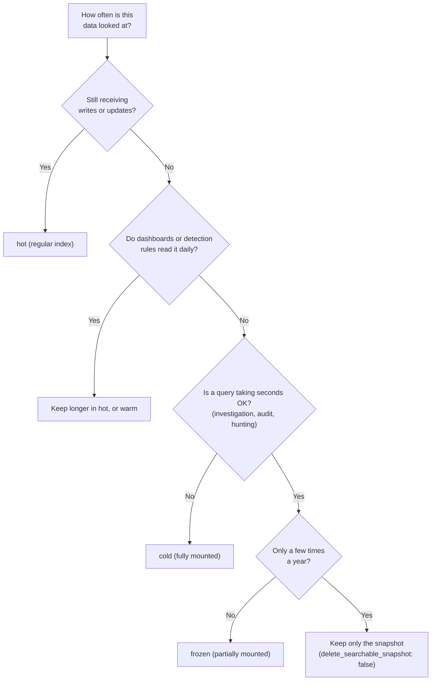

"We look at the last two weeks often, a year of data now and then, and three years only for audits." That is how most log retention requirements read.
Keeping everything on hot node NVMe with replicas costs too much. Keeping old data only as snapshots means every audit request starts with a restore.
Data tiers and searchable snapshots fill that gap. Handle frozen data carelessly, though, and dashboards and detection rules get slow or partly fail.

This article covers how to split data across tiers, how to query old data, and what to watch out for when you do.

:::note[Baseline]
- Elasticsearch 9.5.5. The official documentation was rechecked in November 2026.
- Searchable snapshots require an Enterprise license ([Searchable snapshots](https://www.elastic.co/docs/deploy-manage/tools/snapshot-and-restore/searchable-snapshots)). Moving to frozen with data stream lifecycle (`frozen_after`) is GA from Stack 9.5 and not available on Serverless. Serverless has no data tiers.
- Measurements ran on a local single-node Elasticsearch 9.5.5 (1 vCPU, 1GB JVM heap, 1GB shared cache) with a trial license. The snapshot repository is an `fs` repository on the same disk. Object storage such as S3 has much higher per-request latency, so read the frozen first-query latency below as a best case. Experiment code and results are in [`labs/data/tiers-and-retention/`](https://github.com/Munsik/engineering-notes/tree/main/labs/data/tiers-and-retention).
:::

## What each tier is for

| Tier | Data | Storage | Replicas | Writes |
| --- | --- | --- | --- | --- |
| hot | Recent data, writes and frequent search | Regular index on local disk | Usually one or more | Yes |
| warm | Occasional search, almost no writes | Regular index | Usually one or more | Yes |
| cold | Rare search | Fully mounted searchable snapshot, or a regular index with replicas | Searchable snapshots default to zero; the snapshot is the recovery source | No for searchable snapshots |
| frozen | Very rare search | Partially mounted searchable snapshot | Zero by default | No |

Summarized from the [Data tiers](https://www.elastic.co/docs/manage-data/lifecycle/data-tiers) and [Searchable snapshots](https://www.elastic.co/docs/deploy-manage/tools/snapshot-and-restore/searchable-snapshots) pages.

- A fully mounted index in cold keeps the whole shard locally. Search performance is usually similar to a regular index. Without replicas, a failed node recovers the data from the snapshot, so you need half the nodes and disk compared with keeping the same data as a regular index.
- A partially mounted index in frozen keeps only recently searched parts in the node's shared cache. Parts not in the cache are fetched from the repository at search time. The cache is cleared when the node restarts.
- On a dedicated frozen node, the shared cache defaults to the larger of "90% of the disk" and "the disk minus 100GB". A 4,000GB disk gives 3,900GB, a 400GB disk gives 360GB. On nodes that are not dedicated frozen nodes the default is 0, so `xpack.searchable.snapshot.shared_cache.size` must be set explicitly (same page).
- Data in the cold and frozen tiers must still be complete in the repository. Size object storage as the primary size for the whole retention period through frozen. Ways to shrink the data itself are covered in [03. Storage footprint](../03-storage-footprint/).

## Design decisions

### ILM phases and searchable snapshots

An example ILM policy that moves data from hot straight to frozen:

```console
PUT _ilm/policy/logs-1y
{
  "policy": {
    "phases": {
      "hot": {
        "actions": {
          "rollover": { "max_primary_shard_size": "50gb", "max_age": "1d" }
        }
      },
      "frozen": {
        "min_age": "14d",
        "actions": {
          "searchable_snapshot": { "snapshot_repository": "my-s3-repo" }
        }
      },
      "delete": {
        "min_age": "365d",
        "actions": { "delete": {} }
      }
    }
  }
}
```

Behavior of the ILM `searchable_snapshot` action worth knowing ([Searchable snapshot action](https://www.elastic.co/docs/reference/elasticsearch/index-lifecycle-actions/ilm-searchable-snapshot)):

- It can be used in the hot, cold and frozen phases. In frozen it creates a partially mounted index (`partial-` prefix); elsewhere a fully mounted index (`restored-` prefix).
- Do not put it in both hot and cold. The step that moves to cold can fail.
- It does not run on a data stream's write index. The hot phase needs a rollover.
- `force_merge_index` defaults to `true`. The force merge runs on the tier right before this action (hot or warm), so nodes in that tier need free disk (see [02](../02-merge-and-force-merge/#when-it-is-fine)).
- `force_merge_on_clone` (from 9.2.1, default `true`) runs the force merge on a clone with zero replicas.
- The `delete` action in the delete phase also deletes the snapshot by default. To keep it, set `delete_searchable_snapshot: false`.
- `replicate_for` mounts with one replica for the given period. It can only be used on the first searchable snapshot action.

### Moving to frozen with data stream lifecycle

From 9.5, data stream lifecycle alone can move data to frozen, without ILM ([Searchable snapshots for data streams](https://www.elastic.co/docs/manage-data/lifecycle/data-stream/dlm-searchable-snapshots)).

- The cluster needs a default snapshot repository.
- Set `frozen_after` in the lifecycle. For example, `frozen_after: 30d` with `data_retention: 365d` moves backing indices older than 30 days to frozen and deletes them after 365 days.
- The steps are: write block, a zero-replica clone if there are replicas, force merge to one segment, snapshot, mount as a partially mounted index, and swap it into the data stream. The mounted index is named `dlm-frozen-<original name>`.

## Measured

### Storage by mount type

One million log documents went into a logsdb data stream. After a rollover, the previous backing index was force merged and snapshotted. The same snapshot was then mounted both fully and partially.

| Index | Local `store.size` | `_tier_preference` | Mount time |
| --- | --- | --- | --- |
| Regular (original) | 110MB | `data_hot` | n/a |
| Fully mounted | 110MB | `data_cold,data_warm,data_hot` | 0.5s |
| Partially mounted | 0MB | `data_frozen` | 0.3s |

The snapshot took 3.2 seconds. Both mount and snapshot were fast because the `fs` repository was local.
The partially mounted index showed a `store.size` of 0. Its data lives in the node's shared cache and is not counted as the index's own storage. Disk usage on frozen nodes has to be read from the shared cache size, not from index sizes.

### First query and repeated queries

The same requests went to all three indices, measuring the first run and the median of the next 10 runs (ms). The second round was measured after restarting the node to clear the shared cache. The JVM had not warmed up right after the restart, so the first run on the regular index was slower as well. Each cell is "round 1 / round 2".

| Request | Regular first | Regular repeat | Fully mounted first | Fully mounted repeat | Partially mounted first | Partially mounted repeat |
| --- | --- | --- | --- | --- | --- | --- |
| `@timestamp` range + terms aggregation | 157 / 408 | 16 / 30 | 66 / 322 | 18 / 27 | 506 / 595 | 36 / 41 |
| `service.name` term count | 5 / 17 | 4 / 8 | 6 / 11 | 4 / 10 | 103 / 115 | 6 / 9 |
| Fetch 100 ERROR docs sorted by time | 241 / 341 | 102 / 113 | 135 / 156 | 117 / 119 | 1,885 / 1,869 | 104 / 100 |

Raw results are in [`results/latency.jsonl`](https://github.com/Munsik/engineering-notes/blob/main/labs/data/tiers-and-retention/results/latency.jsonl).

- **Fully mounted was on par with the regular index.** After the node restart it used its local data without fetching it again. The official documentation also says local data of a fully mounted index survives restarts.
- **Partially mounted was slow only on the first query.** Even with an `fs` repository on the same disk, the first fetch that read `_source` took 1.9 seconds. Repeated queries were close to the regular index.
- Shared cache stats (`GET _searchable_snapshots/cache/stats`) show these requests wrote 7 regions of 16MB, about 116MB, to the cache. That is almost the whole 110MB index, which happened only because the index in this experiment was small. Real frozen data is much larger than the cache, so wide searches keep evicting and fetching again.
- On object storage, first-query latency can be much higher than this (unverified: S3 was not measured in this experiment). The official documentation recommends async search for long-running frozen searches.

### How ILM moves an index to frozen

With the ILM poll interval set to 5 seconds and the policy shortened to "roll over at 100,000 documents, frozen after 20 seconds", 120,000 documents were indexed. `_ilm/explain` was read every 2 seconds to record when each step changed.

| Elapsed (s) | Index | phase / action / step |
| --- | --- | --- |
| 21 | `.ds-ilm-lab-...-000001` | hot / rollover / check-rollover-ready |
| 25 | `.ds-ilm-lab-...-000001` | hot / complete. New write index `000002` created |
| 51 | `.ds-ilm-lab-...-000001` | frozen / searchable_snapshot / wait-for-shard-history-leases |
| 55 | `.ds-ilm-lab-...-000001` | frozen / searchable_snapshot / check-ts-end-time-passed |
| 61 | `.ds-ilm-lab-...-000001` | frozen / searchable_snapshot / forcemerge |
| 66 | `.ds-ilm-lab-...-000001` | frozen / searchable_snapshot / segment-count |
| 72 | `.ds-ilm-lab-...-000001` | frozen / searchable_snapshot / wait-for-index-color |
| 74 | `partial-.ds-ilm-lab-...-000001` | frozen / complete |

Steps shorter than the 2-second polling interval do not appear in the table. This index had zero replicas, so no clone step showed up.
In the data stream's backing index list, the original was replaced by the `partial-` index, and the snapshot name had the form `<date>-<index name>-<policy name>-<random string>`. Raw results are in [`results/ilm.jsonl`](https://github.com/Munsik/engineering-notes/blob/main/labs/data/tiers-and-retention/results/ilm.jsonl).

### Turning it back into a regular index

When frozen data has to be modified, or the frozen tier removed, restore from the original snapshot into a new regular index. A mounted index cannot be converted in place ([Restore searchable snapshot data to a regular index](https://www.elastic.co/docs/deploy-manage/tools/snapshot-and-restore/restore-searchable-snapshot-to-regular-index)).

```console
GET partial-lab/_settings?filter_path=**.index.store.snapshot

POST _snapshot/lab-repo/snap-1/_restore?wait_for_completion=true
{
  "indices": ".ds-tier-lab-2026.11.26-000001",
  "rename_pattern": "(.+)",
  "rename_replacement": "rehydrated-lab",
  "include_aliases": false,
  "index_settings": {
    "index.number_of_replicas": 0,
    "index.routing.allocation.include._tier_preference": "data_hot"
  },
  "ignore_index_settings": ["index.lifecycle.name"]
}
```

For `indices`, use the value of `index.store.snapshot.index_name`, not the mounted index name. If ILM force merged on a clone, it holds an intermediate name such as `fm-clone-*`.
In the local measurement, restoring 110MB took 3.2 seconds. During and after the restore, the mounted index and the regular index hold the same data separately, so the target tier needs disk for the full size. Clean up the original snapshot only after checking the regular index and deleting the mounted one.

## Queries and rules that touch frozen data

### Excluding frozen with `_tier`

A search over a wide index pattern also hits frozen indices. The `_tier` metadata field can exclude frozen ([_tier field](https://www.elastic.co/docs/reference/elasticsearch/mapping-reference/mapping-tier-field)).

```console
GET .ds-tier-lab-*,full-lab,partial-lab/_search
{
  "size": 0,
  "query": {
    "bool": { "must_not": { "terms": { "_tier": ["data_frozen"] } } }
  },
  "aggs": { "by_index": { "terms": { "field": "_index" } } }
}
```

In the measurement, the response `_shards` showed total 3, skipped 1. The partially mounted index's shard was skipped before the search phase and did not read the cache.
ES|QL also left frozen indices out of the results when the same Query DSL was put in the `filter` of the request body (measured on local 9.5.5).

```console
POST _query
{
  "query": "FROM .ds-tier-lab-*,full-lab,partial-lab METADATA _index | STATS c = COUNT(*) BY _index",
  "filter": { "bool": { "must_not": { "terms": { "_tier": ["data_frozen"] } } } }
}
```

`_tier` is determined by the first value of the index's `_tier_preference`. A fully mounted index counts as `data_cold`.

### Detection rules

Elastic Security documents two ways to keep cold and frozen data out of rule execution ([Set rule data sources](https://www.elastic.co/docs/solutions/security/detect-and-alert/set-rule-data-sources)).

- Per space: add `data_frozen` (and `data_cold` if needed) to the Kibana advanced setting `securitySolution:excludedDataTiersForRuleExecution`. There is a separate `data_views:fields_excluded_data_tiers` for data view field lists. It does not apply to machine learning rules.
- Per rule: add the `_tier` `must_not` condition above to the rule's Query DSL filter. It cannot be used with ES|QL rules or ML rules.

Recommendations from the same page:

- Keep source data in hot or warm for at least 24 hours before moving it to cold or frozen. Moving it sooner can cause rule execution errors.
- Frozen indices have zero replicas by default, so losing one shard can make a rule partly fail. This also happens during upgrades. Once the shard is back, rerun that time range manually.
- Indicator match and event correlation rules can fail if cold or frozen shards matched by the index pattern are unavailable, even with the filter. In that case, point the index pattern at hot data only.

How a wide-pattern search and a tier-excluding search differ while a frozen node restarts could not be reproduced this time, because with a single node every search fails during the restart (unverified: to be reproduced on multiple nodes).

## Rules for running a snapshot repository

The only complete copy of a searchable snapshot index is the snapshot in the repository. The local cache is incomplete and cannot be used for recovery ([Searchable snapshots](https://www.elastic.co/docs/deploy-manage/tools/snapshot-and-restore/searchable-snapshots)).

| Rule | Source |
| --- | --- |
| Do not unregister a repository while indices are mounted from it | Searchable snapshots |
| Do not delete snapshots of mounted indices. Everything looks fine until the first cache miss, then data disappears when a shard moves or a node restarts | Same page |
| When several clusters share a repository, only one writes; register it as `readonly: true` on the rest | [Self-managed snapshot repositories](https://www.elastic.co/docs/deploy-manage/tools/snapshot-and-restore/self-managed) |
| If you mounted from a repository another cluster writes to, make sure that cluster does not delete the snapshot | Searchable snapshots |
| Keep every cluster that uses a repository on the same version | Self-managed snapshot repositories |
| When backing up repository contents at the storage level, block writes first: unregister it or re-register it as `readonly: true` | Same page |
| Keep the snapshot repository and the cluster in the same region | Searchable snapshots |
| Verify S3-compatible storage (MinIO and others) with the repository analysis API | Searchable snapshots |

When writes to the repository have to stop, for example during storage maintenance, this is the order I use:

1. Stop SLM with `POST _slm/stop`, and check with `GET _snapshot/_current` that running snapshots have finished.
2. Check with `GET */_ilm/explain` whether any index will reach a searchable snapshot action or the delete phase during the maintenance window. If so, also stop ILM with `POST _ilm/stop`. Data stream lifecycle `frozen_after` transitions use the same repository.
3. After maintenance, check the repository connection with `POST _snapshot/<repo>/_verify` and restart ILM and SLM.

During maintenance, mounted indices can still be searched for the parts already in the cache. Searches that need parts not in the cache, and shard recoveries, fail.

## Keeping data for less than frozen costs

Some data is almost never searched but has to be kept for years. Within the built-in features there are two options.

- Set `delete_searchable_snapshot: false` in the ILM delete phase. The index is deleted and the snapshot stays in the repository, to be mounted again when needed. From then on the snapshot is managed by people, not ILM.
- Keep only regular snapshots (SLM) and restore when needed. Searching means waiting for the restore.

The Elastic Search Labs article on Deepfreeze goes one step further: create a new repository periodically, unregister old repositories, and move their S3 paths to Glacier ([Reducing Elasticsearch frozen tier costs with Deepfreeze](https://www.elastic.co/search-labs/blog/s3-glacier-archiving-elasticsearch-deepfreeze)).
It is not built into Elasticsearch. It is a separate Python tool run from cron or similar, and at the time of writing it supports AWS only. To use data moved to Glacier, wait for the AWS restore and then mount it. Check the tool's support scope separately before using it in production (unverified).

## Decision guide



| Situation | Recommendation |
| --- | --- |
| General logs, one-year retention | 7 to 14 days in hot, the rest in frozen. A hot-frozen layout is simple and enough if the cache is sized well |
| Security logs | At least 24 hours in hot, and longer than the detection rules' lookback. Also configure rules to exclude frozen |
| Frozen node sizing | Read disk as shared cache size. Check whether the frequently queried period fits in the cache |
| Moving from hot to frozen | The force merge runs on hot nodes. Leave three times the largest shard free |
| Frozen data needs changes | Restore from the original snapshot into a new regular index. Make sure the target tier has disk for the full size |
| Running the repository | One writing cluster per repository, read-only everywhere else. Never delete mounted snapshots |

## References

- [Data tiers](https://www.elastic.co/docs/manage-data/lifecycle/data-tiers)
- [Searchable snapshots](https://www.elastic.co/docs/deploy-manage/tools/snapshot-and-restore/searchable-snapshots)
- [ILM searchable snapshot action](https://www.elastic.co/docs/reference/elasticsearch/index-lifecycle-actions/ilm-searchable-snapshot)
- [Searchable snapshots for data streams](https://www.elastic.co/docs/manage-data/lifecycle/data-stream/dlm-searchable-snapshots)
- [Restore searchable snapshot data to a regular index](https://www.elastic.co/docs/deploy-manage/tools/snapshot-and-restore/restore-searchable-snapshot-to-regular-index)
- [Self-managed snapshot repositories](https://www.elastic.co/docs/deploy-manage/tools/snapshot-and-restore/self-managed)
- [_tier field](https://www.elastic.co/docs/reference/elasticsearch/mapping-reference/mapping-tier-field)
- [Security: Set rule data sources](https://www.elastic.co/docs/solutions/security/detect-and-alert/set-rule-data-sources)
- Search Labs: [Reducing Elasticsearch frozen tier costs with Deepfreeze S3 Glacier archival](https://www.elastic.co/search-labs/blog/s3-glacier-archiving-elasticsearch-deepfreeze)
