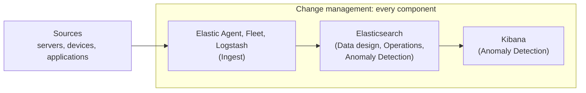

Elastic delivers Search, Observability and Security on top of a single engine, Elasticsearch ([Elastic](https://www.elastic.co/)). The use cases differ, but all of them collect, store and search data. That is why most operating problems overlap: shard design, ingest architecture, incident response, change management.
This area covers those operating problems, one business problem per collection. For what each feature does, the official documentation is the place to go. These pages cover the settings and procedures you have to decide yourself when you build and run the platform.

:::note[Baseline]
- Elastic Stack 9.x. The official documentation was rechecked in November 2026. Each collection and article states its own baseline version and GA status.
- Differences between deployment types (self-managed, Elastic Cloud Hosted and others) are noted in each article.
:::

## Components covered

The Elastic Stack is a set of products for collecting, storing, searching and visualizing data. Every deployment includes Elasticsearch and Kibana, and ingest products such as Elastic Agent and Logstash are added depending on the use case ([The Elastic Stack](https://www.elastic.co/docs/get-started/the-stack)).

| Component | What it does | Main collections |
| --- | --- | --- |
| Elasticsearch | Stores, searches and analyzes data. Runs as a cluster of nodes and stores each index split into shards | [Data design](../data/), [Operations](../operations/), [Anomaly Detection in Production](../ml/anomaly-detection/) |
| Kibana | UI, dashboards, alerts, Stack management | [Change management](../change/), [Anomaly Detection in Production](../ml/anomaly-detection/) |
| Elastic Agent and Fleet | Agent that collects logs, metrics and security data from hosts, and its central management | [Ingest](../ingest/), [Change management](../change/) |
| Logstash | Data transformation and forwarding | [Ingest](../ingest/) |

## Components and collections

The components are laid out in the order data flows through them, with the main collections in parentheses. Change management spans every component.

## Collections

| Collection | Problems covered |
| --- | --- |
| [Data design](../data/) | Inside a shard, storage footprint, shard count and bulk, data tiers and retention |
| [Ingest](../ingest/) | Choosing a collector, where to parse, ingest without gaps, UDP syslog, count reconciliation, sizing the ingest layer, running Fleet at scale |
| [Operations](../operations/) | Routine checks, RED and YELLOW, node failures, full disks, slowdowns, recoverability, diagnostics in air-gapped networks, the first 30 minutes of an incident |
| [Change management](../change/) | Making upgrades, configuration changes, templates and pipelines, and Kibana objects reversible and managed as code |
| [Anomaly Detection in Production](../ml/anomaly-detection/) | ML anomaly detection job design, reading results, handling noise, operations |

## Reading order

This is the order I recommend.

- If you are building a new cluster, read [Data design](../data/), [Ingest](../ingest/) and [Operations](../operations/) in that order. The shard and tier decisions from the first collection are the starting point for ingest sizing and operating criteria.
- If you have just taken over a running cluster, start with [routine checks](../operations/01-daily-checks/) and [the first 30 minutes of an incident](../operations/10-incident-runbook/) in Operations.
- If an upgrade or a large change is coming up, start with [01 in Change management](../change/01-change-map/).
- If you are introducing anomaly detection, read [Anomaly Detection in Production](../ml/anomaly-detection/) from the beginning.
