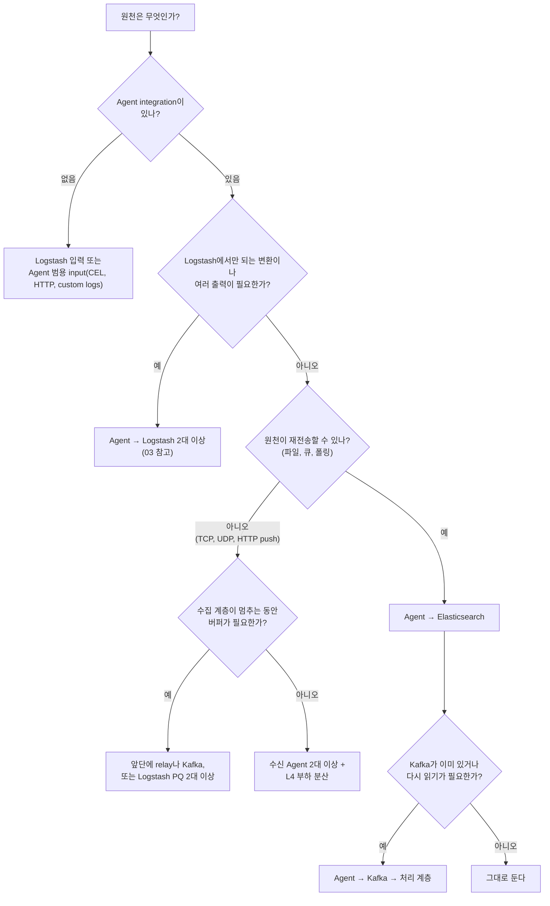

"Logstash를 꼭 써야 하나요"라는 질문은 거의 모든 프로젝트에서 나옵니다.
반대로 이미 Logstash를 한 대 끼워 넣은 구성도 자주 봅니다. 변환도 없는데 단일 노드로 들어가 있어서, 그 한 대가 멈추면 전체 수집이 멈춥니다.
수집기는 기능 목록보다 "무엇을 하지 못하는가"로 고르는 편이 실수가 적습니다. 이 글은 구성 요소마다 그 경계를 먼저 정리하고, 원천별 권장 경로와 decision tree로 묶습니다.

:::note[기준]
- Elastic Agent, Fleet, Logstash 9.x 기준입니다. 공식 문서는 2026년 11월에 다시 확인했습니다.
- Agent에 내장된 OpenTelemetry Collector는 Stack 9.5부터 Agent의 일부로 GA입니다. 그 전에는 EDOT Collector라는 별도 제품이었습니다([Elastic Agent: OpenTelemetry](https://www.elastic.co/docs/reference/edot-collector)).
- 이 글에는 실측이 없습니다. 판단 근거가 되는 동작은 03에서 07까지의 글로 연결했습니다.
:::

## 구성 요소별로 하는 일과 하지 못하는 일

| 구성 요소 | 하는 일 | 하지 못하는 일 |
| --- | --- | --- |
| Elastic Agent(Fleet 관리) | 호스트 로그, 메트릭, 보안 이벤트 수집. integration이 파싱, 매핑, 대시보드를 함께 설치. Fleet에서 정책으로 중앙 관리 | 사용자가 disk queue를 설정할 수 없음(memory queue만). Agent끼리 묶이는 clustering 없음 |
| Elastic Agent(standalone) | Fleet 없이 YAML로 같은 수집. 폐쇄망이나 Kubernetes에서 흔히 씀 | 중앙 관리, 원격 업그레이드가 없음. 나머지 제약은 위와 같음 |
| Logstash | 복잡한 변환, 여러 출력으로 나누기, 외부 조회로 enrich, persistent queue(PQ)로 디스크 버퍼링 | clustering 없음. PQ는 그 노드의 디스크에만 있음. 다른 노드가 이어받지 못함 |
| Kafka | 수신과 처리를 분리. 보존 기간 안에서 다시 읽기(replay). consumer group으로 처리 노드를 자유롭게 늘리고 줄임 | 그 자체가 운영해야 하는 클러스터. 파싱은 하지 않음 |
| syslog relay(rsyslog, syslog-ng) | 네트워크 장비 가까이에서 UDP를 받아 disk-assisted queue에 두고 TCP로 넘김 | 파싱, 매핑은 뒤 계층의 일. UDP 구간 자체의 유실은 막지 못함 |
| Agent 내장 OpenTelemetry Collector | OTLP 수신, OpenTelemetry receiver로 수집. Fleet 정책에 OpenTelemetry input package를 ECS integration과 함께 넣을 수 있음 | input package는 9.2 이후 Agent, 기본 모드에서만. otel 모드로 띄운 standalone Agent는 Fleet에 등록할 수 없음 |

표의 제약은 공식 문서로 확인했습니다.

- Agent는 Fleet 관리든 standalone이든 memory queue만 사용자가 설정할 수 있고, disk queue는 설정할 수 없습니다([Beats and Elastic Agent capabilities](https://www.elastic.co/docs/reference/fleet/beats-agent-comparison)).
- Logstash는 같은 pipeline을 여러 노드에서 돌려 수평 확장하고, 고가용성을 위해 최소 2노드를 권합니다. TCP, UDP 입력은 애플리케이션 수준의 ack가 없어서 연결 문제가 생기면 데이터를 잃을 수 있다고 적고 있습니다([Deploying and scaling Logstash](https://www.elastic.co/docs/reference/logstash/deploying-scaling-logstash)).
- PQ는 노드 디스크에 쌓이므로, 공식 문서는 디스크 이중화(온프레미스는 RAID)를 함께 권합니다(같은 문서).
- Agent는 9.2부터 OpenTelemetry Collector를 내장 runtime으로 씁니다. 기존 integration은 Beat receiver로 바뀌어 같은 ECS 데이터를 내고, OpenTelemetry receiver로 받은 데이터는 ingest pipeline을 거치지 않고 OpenTelemetry 전용 data stream에 저장됩니다([Elastic Agent as an OpenTelemetry Collector](https://www.elastic.co/docs/reference/fleet/elastic-agent-as-otel-collector)).
- Fleet에서 OpenTelemetry receiver를 관리하려면 OpenTelemetry input package를 씁니다. Stack 9.2부터 preview이고, 9.2 이후 Agent가 기본 모드로 돌 때만 동작합니다. otel 모드로 띄운 Agent에는 쓸 수 없습니다([Collect OpenTelemetry data with Elastic Agent integrations](https://www.elastic.co/docs/reference/fleet/otel-integrations)). otel 모드의 standalone Agent와 upstream Collector는 Fleet 중앙 관리가 아직 계획 단계입니다(같은 [비교 표](https://www.elastic.co/docs/reference/fleet/elastic-agent-as-otel-collector#collector-comparison)).

## 공식 reference architecture

Elastic이 공개한 수집 구성은 아래와 같습니다([Ingest reference architectures](https://www.elastic.co/docs/manage-data/ingest/ingest-reference-architectures)).

| 구성 | 고르는 조건 |
| --- | --- |
| Agent → Elasticsearch | 기본. integration이 있고 변환이 ingest pipeline으로 충분할 때 |
| Agent → Logstash → Elasticsearch | Logstash에서만 되는 변환, 여러 출력, PQ 버퍼가 필요할 때 |
| Agent → Logstash(PQ) → Elasticsearch | Elasticsearch가 잠시 멈춰도 원천 쪽에 압력을 주지 않고 버텨야 할 때 |
| Agent → Kafka → (Logstash 또는 Elasticsearch) | 이미 Kafka가 있거나, 수신과 처리를 분리하고 다시 읽기가 필요할 때 |
| Logstash가 직접 수신 → Elasticsearch | Agent integration이 없는 원천, 특수 프로토콜 |
| 폐쇄망 구성 | 인터넷 없이 package registry, artifact를 내부에서 제공해야 할 때 |

## 데이터 원천별 권장 경로

아래 표는 위 사실을 바탕으로 한 제 기준입니다(해석).

| 원천 | 1순위 | 이렇게 바꾸는 조건 |
| --- | --- | --- |
| 서버 파일 로그(Linux, Windows) | 호스트마다 Agent, integration | 변환이 무겁거나 출력이 여러 곳이면 Agent → Logstash 2대 이상 |
| Windows 이벤트 로그 | 호스트마다 Agent | 수집 대상이 수천 대면 08의 정책 분리 기준을 먼저 적용 |
| 네트워크 장비, 보안 장비 syslog | 장비 가까이 syslog relay 또는 수신 전용 Agent 2대 이상, TCP 우선 | UDP만 되는 장비는 04의 계측과 relay 구성 |
| 클라우드 서비스 로그(S3, Pub/Sub, Event Hub) | Agent integration이 큐나 버킷에서 당겨 옴 | 처리량이 크면 수집 Agent를 늘리되 같은 큐를 나눠 읽는지 확인 |
| API 폴링(SaaS 감사 로그 등) | Agent의 해당 integration 또는 CEL input | 같은 API를 여러 Agent가 동시에 폴링하지 않도록 전용 정책으로 분리 |
| 애플리케이션 trace, OpenTelemetry 계측 | Agent 내장 OpenTelemetry Collector | 이미 upstream OpenTelemetry Collector가 있으면 Agent를 gateway로 |
| 이미 운영 중인 Kafka 토픽 | Agent Kafka input 또는 Logstash Kafka input | 변환이 필요하면 Logstash, consumer group으로 노드 이중화 |

폴링형 원천은 Agent 여러 대에 같은 정책을 걸면 같은 데이터를 여러 번 가져옵니다. Agent끼리는 서로를 모르기 때문입니다. 폴링 정책은 전용 Agent 정책으로 분리하고, 그 정책에 들어가는 Agent 수를 제한합니다(해석).

## Decision tree

이 tree에서 가장 중요한 분기는 "원천이 재전송할 수 있는가"입니다. 파일, 클라우드 큐, API처럼 원천이 데이터를 들고 있으면 수집기가 잠시 멈춰도 다시 읽으면 됩니다. TCP, UDP, HTTP로 밀어 넣는 원천은 수집기가 멈춘 동안의 데이터를 다시 받을 방법이 없어서, 앞단에 버퍼를 두거나 수신기를 이중화해야 합니다(해석). 자세한 구성은 [03](../03-no-gap-ingest/)과 [04](../04-syslog-udp/)에서 다룹니다.

## 자주 보는 잘못된 조합

- **변환이 없는 Logstash 단일 노드.** 변환이 없으면 Logstash가 할 일이 없고, 단일 노드라 장애점만 하나 늘어납니다. Agent → Elasticsearch로 바꾸거나 2대 이상으로 늘립니다.
- **PQ를 켰으니 무중단이라는 생각.** PQ는 그 노드가 다시 살아나야 꺼낼 수 있습니다. 노드가 멈춘 동안 새로 들어오는 데이터는 다른 노드가 받아야 합니다.
- **폴링 정책을 여러 Agent에 복제.** 같은 데이터가 여러 번 들어옵니다.
- **UDP 수신기를 LB 뒤에 하나만.** LB가 이중화돼도 수신기가 하나면 재시작 동안 받을 곳이 없습니다.
- **Kafka를 버퍼로만 넣고 보존 기간을 짧게.** 처리 계층 장애가 보존 기간보다 길면 데이터가 사라집니다.

## 판단 기준

이 절은 위의 사실을 바탕으로 한 제 판단입니다(해석).

| 질문 | 기준 |
| --- | --- |
| Logstash를 넣을까 | Logstash에서만 되는 변환, 여러 출력, PQ 버퍼 중 하나라도 필요할 때만. 넣으면 처음부터 2대 이상 |
| Kafka를 넣을까 | 이미 운영 중이거나, 수신과 처리를 분리해 처리 계층을 자유롭게 재시작해야 하거나, 다시 읽기가 필요할 때 |
| syslog relay를 넣을까 | UDP만 보내는 장비가 많고, 수집 계층을 자주 바꿔야 할 때 |
| Fleet 관리와 standalone | 기본은 Fleet. 폐쇄망이나 GitOps로 설정을 관리하는 Kubernetes는 standalone도 검토 |

## 다음 글

- [02. 파싱은 어디서 할 것인가](../02-where-to-parse/)
- [03. 수집기가 멈춰도 로그가 끊기지 않게 하려면](../03-no-gap-ingest/)

## 참고 문서

- [Ingest reference architectures](https://www.elastic.co/docs/manage-data/ingest/ingest-reference-architectures)
- [Beats and Elastic Agent capabilities](https://www.elastic.co/docs/reference/fleet/beats-agent-comparison)
- [Deploying and scaling Logstash](https://www.elastic.co/docs/reference/logstash/deploying-scaling-logstash)
- [Elastic Agent: OpenTelemetry](https://www.elastic.co/docs/reference/edot-collector)
