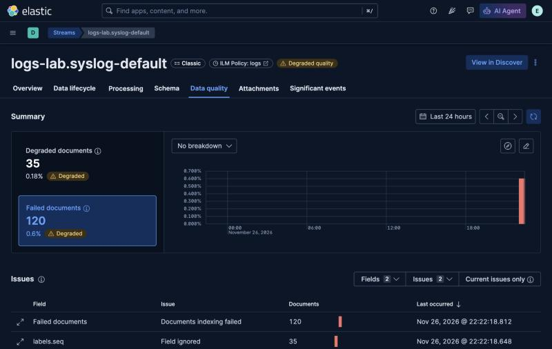

"로그는 들어오는데 필드가 비어 있다"는 문의는 대개 파싱 문제입니다.
더 곤란한 경우는 파싱이 실패한 문서가 조용히 사라지는 것입니다. 건수가 맞지 않는데 오류 화면에는 아무것도 없습니다.
이 글은 파싱을 어디서 할지 나누는 기준과, 실패한 문서가 어디로 가서 어떻게 보이는지를 정리합니다.

:::note[기준]
- Elasticsearch, Fleet, Logstash 9.x 기준입니다. 공식 문서는 2026년 11월에 다시 확인했습니다.
- failure store는 Stack 9.1부터 GA입니다. 9.2부터는 새로 만드는 `logs-*-*` data stream에 기본으로 켜져 있습니다([Failure store](https://www.elastic.co/docs/manage-data/data-store/data-streams/failure-store)).
- Streams는 Stack 9.1 preview, 9.2부터 GA입니다.
- 처리량 비교는 하지 않았습니다. 같은 패턴이라도 하드웨어와 데이터에 따라 결과가 크게 달라 공개 수치로서 의미가 약하기 때문입니다. 직접 재는 방법은 [07](../07-collector-sizing/)에 정리했습니다.
:::

## 세 가지 위치

| 위치 | 잘하는 것 | 비용과 제약 |
| --- | --- | --- |
| Agent integration의 ingest pipeline | 설치만 하면 파싱, ECS 매핑, 대시보드가 같이 옴. 업그레이드하면 파싱도 갱신 | Elasticsearch ingest 노드의 CPU를 씀. integration을 직접 고치면 업그레이드 때 덮어씀 |
| `@custom` ingest pipeline | integration 파싱을 업그레이드해도 남는 방식으로 보완 | 위와 같이 Elasticsearch CPU를 씀 |
| Logstash | 외부 조회로 enrich, 조건별로 여러 출력, 무거운 변환을 Elasticsearch 밖에서 | 별도 노드 운영. 이중화는 직접 구성([03](../03-no-gap-ingest/)) |

Logstash에서 integration의 ingest pipeline을 그대로 실행하는 `elastic_integration` filter도 있습니다([Using Logstash with Elastic integrations](https://www.elastic.co/docs/reference/logstash/using-logstash-with-elastic-integrations)). 이벤트의 data stream을 보고 Elasticsearch에서 pipeline 정의를 받아 와 Logstash 안에서 실행합니다. 처리한 이벤트는 Elasticsearch에서 같은 pipeline을 다시 돌리지 않습니다. 쓰기 전에 확인할 조건은 다음과 같습니다([Elastic Integration filter plugin](https://www.elastic.co/docs/reference/logstash/plugins/plugins-filters-elastic_integration)).

- Enterprise 구독이 필요합니다.
- Logstash 9.x는 Java 21 이상이 필요합니다(8.x는 Java 17).
- 연결 계정에 `monitor`, `read_pipeline`, `manage_index_templates` 권한이 필요합니다.
- plugin 버전이 Elasticsearch의 major.minor보다 낮으면 pipeline을 만들지 못할 수 있습니다. 예를 들어 9.2 미만 plugin은 Elasticsearch 9.2 이후의 pipeline 정의를 읽지 못합니다. 그래서 Stack을 올릴 때 Kibana보다 Logstash(또는 이 plugin)를 먼저 올리라고 안내합니다.
- 지원하는 processor는 일부입니다. `inference`처럼 목록에 없는 processor가 든 pipeline은 실행하지 못합니다. `geoip`는 Logstash 쪽에 GeoIP 데이터베이스가 있어야 합니다.
- 첫 번째 filter로 둡니다. 그 앞에서 이벤트를 바꿀수록 Elasticsearch에서 처리한 결과와 달라집니다.

## `@custom` pipeline으로 보완하기

Fleet이 설치하는 기본 ingest pipeline은 8.4부터 존재하지 않는 `@custom` pipeline을 호출합니다. 만들지 않으면 아무 일도 하지 않고, 만들면 그 안의 처리가 실행됩니다. 8.12부터는 범위별로 여러 단계가 있습니다([Elastic Agent data streams](https://www.elastic.co/docs/reference/fleet/data-streams)).

| 이름 | 적용 범위 |
| --- | --- |
| `global@custom` | 모든 이벤트 |
| `logs@custom` | 모든 logs 타입 이벤트 |
| `logs-nginx.integration@custom` | 한 integration의 모든 logs 이벤트 |
| `logs-nginx.access@custom` | 한 dataset |

```console
PUT _ingest/pipeline/logs-nginx.access@custom
{
  "processors": [
    {
      "set": {
        "field": "labels.site",
        "value": "dc1",
        "ignore_failure": true
      }
    }
  ]
}
```

integration의 pipeline 자체를 고치면 integration을 업그레이드할 때 덮어씁니다. 보완은 항상 `@custom`에 넣습니다.

## 실패한 문서는 어디로 가나

| 실패 지점 | 기본 동작 | 남기는 방법 |
| --- | --- | --- |
| ingest pipeline processor 오류 | failure store가 꺼져 있으면 문서 거부. Agent는 그 문서를 버리고, Logstash는 DLQ로 보내거나 버림 | processor의 `on_failure`, pipeline 수준 `on_failure`, failure store |
| mapping 충돌(예: 숫자 필드에 문자열) | 위와 같음 | failure store, `ignore_malformed`(logsdb는 기본 `true`) |
| 필드 일부를 버린 경우(`ignore_above`, `ignore_malformed`) | 문서는 저장, 해당 필드만 빠짐 | `_ignored` 필드에 기록. Data Set Quality(beta)의 degraded document |
| Logstash Elasticsearch output에서 400, 404 | DLQ가 켜져 있으면 DLQ, 아니면 경고 로그만 남기고 버림 | Logstash DLQ |
| Logstash Elasticsearch output에서 409 | 경고 로그를 남기고 버림 | 중복 제거 목적이면 의도한 동작([05](../05-count-reconciliation/)) |

근거는 다음과 같습니다.

- failure store가 켜지면, pipeline 예외나 mapping 충돌로 실패할 문서를 별도 index에 저장하고 클라이언트에는 성공 응답과 함께 redirect 표시를 돌려줍니다([Failure store](https://www.elastic.co/docs/manage-data/data-store/data-streams/failure-store)). 실패 문서는 `FROM <data stream>::failures`로 조회합니다.
- failure store는 backpressure(429 등), 보안 오류, version conflict(409)로 실패한 문서는 담지 않습니다. 이런 실패는 클라이언트가 대응해야 하므로 그대로 응답에 돌려줍니다(같은 문서).
- Agent(Beats)의 Elasticsearch output은 문서별 응답이 429를 뺀 4xx면 `non_indexable_policy`를 적용하고, 기본값은 버리는 것(`drop`)입니다. 거부된 문서를 다른 index에 남기던 `dead_letter_index`는 9.0에서 9.4까지 beta였고 9.5에서 deprecated됐습니다. 공식 문서는 대신 failure store를 쓰라고 안내합니다. 429는 버리지 않고 다시 보내며 `events.toomany`로 셉니다([Elasticsearch output](https://www.elastic.co/docs/reference/beats/filebeat/elasticsearch-output)). failure store가 없는 data stream에서 mapping 충돌이 나면 문서가 Agent 쪽에서 버려진다는 뜻입니다. 버린 건수는 출력 지표 `output.events.dropped`에, failure store로 간 건수는 `output.events.failure_store`에 쌓입니다(beats 소스 `libbeat/outputs/metrics.go` 기준).
- Logstash Elasticsearch output은 400, 404를 DLQ로 보내고, DLQ가 없으면 로그만 남기고 버립니다. 409는 경고 로그를 남기고 버립니다. bulk 요청 자체의 200이 아닌 응답은 무한히 다시 시도합니다(logstash-output-elasticsearch 문서의 Retry policy).
- Data Set Quality 페이지는 `_ignored`가 있는 문서를 degraded document로 세어 data set별 품질을 보여 줍니다. Stack과 Serverless 모두 beta입니다([Data set quality](https://www.elastic.co/docs/solutions/observability/data-set-quality-monitoring)).

Streams(9.2 GA)의 Data quality 탭은 failure store에 쌓인 실패 문서의 건수, 오류 종류, 예시를 보여 주고, Processing 탭에서 그 문서로 처리 규칙을 고쳐 볼 수 있습니다([Manage data quality with Streams](https://www.elastic.co/docs/solutions/observability/streams/manage-data-quality)).



위 화면은 lab(9.5.5)에서 `@timestamp`를 `26/11/2026 22:00:00`처럼 날짜 형식이 아닌 값으로 120건, `labels.seq`(long)에 문자열을 35건 보내 만든 것입니다. 앞의 120건은 mapping 오류로 failure store에 들어갔고, bulk 응답은 성공(201)이었습니다. 뒤의 35건은 logsdb의 `ignore_malformed` 기본값 때문에 저장되고 해당 필드만 `_ignored`에 남았습니다.

failure store 문서에는 원래 문서의 `data_stream.dataset`이 없습니다. 어느 data stream에서 실패했는지는 `document.index`로, 원인은 `error.type`과 `error.message`로 봅니다(lab 확인).

```sql
FROM logs-*::failures
| WHERE @timestamp >= NOW() - 1 day
| STATS failed = COUNT(*) BY document.index, error.type
| SORT failed DESC
```

## 자주 깨지는 지점

| 증상 | 원인 | 대응 |
| --- | --- | --- |
| syslog 시각이 1년 어긋남 | RFC 3164 timestamp에 연도가 없음. 연말연시에 수신 시각의 연도를 붙이면 틀어짐 | 수신 시각과 비교해 미래면 연도를 하나 빼는 처리, 가능하면 장비를 RFC 5424로 |
| 시각이 9시간 어긋남 | 장비가 timezone 없이 현지 시각을 보냄 | integration의 timezone 설정이나 `date` processor의 `timezone` |
| 다중 행 stack trace가 여러 문서로 쪼개짐 | 수집 단계에서 다중 행을 묶지 않음 | Agent filestream의 multiline 설정. 파싱 단계에서는 되돌릴 수 없음 |
| 숫자 필드가 비어 있음 | 일부 값이 숫자가 아니라 `ignore_malformed`로 버려짐 | `_ignored`로 찾고 원천 형식 확인 |
| 긴 값이 검색되지 않음 | `ignore_above`(logsdb 기본 8191자)를 넘은 keyword | 필드 길이를 보고 매핑 조정 |

Filebeat syslog input은 8.14에서 deprecated됐고, syslog processor로 바꾸라고 안내합니다([Filebeat syslog input](https://www.elastic.co/docs/reference/beats/filebeat/filebeat-input-syslog)).

## 운영

- integration을 업그레이드하기 전에, 바뀐 pipeline이 우리 데이터에서 같은 필드를 만드는지 `_simulate`로 확인합니다.
- failure store 건수와 `_ignored` 비율을 data stream별로 매일 봅니다. [06](../06-flow-dashboard/)의 대시보드에 패널로 넣습니다.
- Logstash를 쓰면 DLQ를 켜고, DLQ 크기와 증가 추세를 모니터링합니다.

## 판단 기준

| 상황 | 권장 |
| --- | --- |
| integration이 있는 원천 | integration 그대로, 보완은 `@custom` |
| integration이 없고 변환이 단순 | ingest pipeline(dissect 우선, 필요할 때만 grok) |
| 외부 조회 enrich, 여러 출력 | Logstash |
| 실패 문서를 잃으면 안 됨 | failure store 켜기(9.2 이후 `logs-*-*`는 기본). Logstash는 DLQ |

## 참고 문서

- [Ingest pipelines](https://www.elastic.co/docs/manage-data/ingest/transform-enrich/ingest-pipelines)
- [Elastic Agent data streams: @custom pipelines](https://www.elastic.co/docs/reference/fleet/data-streams)
- [Failure store](https://www.elastic.co/docs/manage-data/data-store/data-streams/failure-store)
- [Manage data quality with Streams](https://www.elastic.co/docs/solutions/observability/streams/manage-data-quality)
- [Data set quality](https://www.elastic.co/docs/solutions/observability/data-set-quality-monitoring)
- [Logstash dead letter queues](https://www.elastic.co/docs/reference/logstash/dead-letter-queues)
- [Using Logstash with Elastic integrations](https://www.elastic.co/docs/reference/logstash/using-logstash-with-elastic-integrations)
