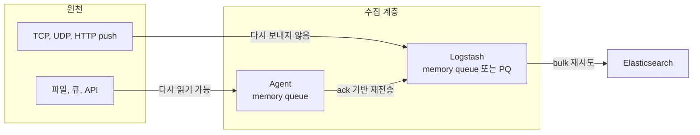
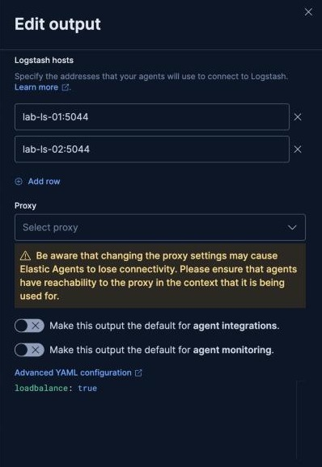
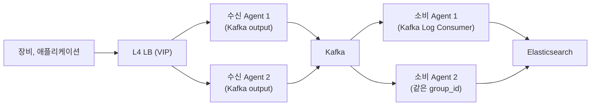

수집기를 업그레이드하거나 설정을 바꿀 때마다 몇 분씩 로그가 비는 환경이 많습니다.
보안 관제나 감사 요구사항은 "무중단"인데, Logstash도 Elastic Agent도 여러 대를 하나로 묶는 clustering 기능이 없습니다. "Logstash를 cluster로 묶어 달라"는 요구는 기능으로는 풀 수 없고, 구성으로 풀어야 합니다.
이 글은 끊김이 어디서 생기는지부터 나누고, 원천의 성격에 맞는 구성 패턴과 업그레이드 절차를 정리합니다.

:::note[기준]
- Elastic Agent, Fleet, Logstash 9.x 기준입니다. 공식 문서는 2026년 11월에 다시 확인했습니다.
- 설정 예시는 [`labs/ingest/no-gap/`](https://github.com/Munsik/engineering-notes/tree/main/labs/ingest/no-gap)에 있습니다. 장애 주입 결과 수치는 넣지 않았습니다. 유실과 중복은 환경마다 달라서, 각자 [05](../05-count-reconciliation/)의 방법으로 직접 재기를 권합니다.
:::

## 끊김은 어디서 생기나

수집기가 멈췄을 때 데이터가 어떻게 되는지는 수집기보다 원천이 결정합니다.

| 원천의 성격 | 예 | 수집기가 멈추면 |
| --- | --- | --- |
| 원천이 데이터를 들고 있음 | 파일, 클라우드 큐(S3+SQS 등), API 폴링, Kafka | 수집기가 다시 시작하면 마지막 위치부터 다시 읽음. 원천의 보존 기간 안이면 유실 없음 |
| 송신 측이 ack를 받고 다시 보냄 | Agent → Logstash, Agent → Elasticsearch | 송신 측이 ack를 못 받은 이벤트를 다시 보냄. 유실은 없고 중복이 생길 수 있음 |
| 원천이 밀어 넣고 끝 | TCP, UDP syslog, HTTP push | 수집기가 멈춘 동안 들어온 데이터는 받을 곳이 없음 |

여기에 수집기 내부에 쌓여 있던 이벤트가 있습니다. memory queue에 있던 이벤트는 프로세스가 죽으면 사라지고, 앞 단계가 다시 보내 주지 않으면 그대로 유실됩니다.

근거는 다음과 같습니다.

- Beats와 Agent는 ack를 지원하는 출력(Elasticsearch, Logstash, Kafka 등)에 at-least-once로 보냅니다. 출력이 이벤트를 받았지만 ack를 돌려주지 못하면 같은 이벤트를 다시 보내 중복이 생길 수 있습니다([Deduplicate data](https://www.elastic.co/docs/reference/beats/filebeat/filebeat-deduplication)).
- Logstash의 TCP, UDP, HTTP 입력은 애플리케이션 수준의 ack가 없어서 연결 문제가 생기면 데이터를 잃을 수 있습니다([Deploying and scaling Logstash](https://www.elastic.co/docs/reference/logstash/deploying-scaling-logstash)).
- Agent는 사용자가 disk queue를 설정할 수 없습니다([Beats and Elastic Agent capabilities](https://www.elastic.co/docs/reference/fleet/beats-agent-comparison)). Agent의 memory queue가 차면, 파일 입력은 읽기를 멈추고 기다리지만 UDP 입력은 받은 패킷을 둘 곳이 없습니다. 이 차이가 [04](../04-syslog-udp/)의 출발점입니다.



## 구성 패턴

| 패턴 | 맞는 원천 | 한 대가 멈추면 | 비용 |
| --- | --- | --- | --- |
| 1. 송신 측 부하 분산 | Agent → Logstash | Agent가 다른 Logstash로 다시 보냄. 중복 가능 | Logstash 2대 이상 |
| 2. L4 부하 분산 | TCP, HTTP push | LB가 health check로 빼고 새 연결을 다른 노드로. 끊긴 연결의 미전송분은 원천의 재연결 동작에 달림 | LB 이중화(VIP) |
| 3. Kafka로 분리 | push 원천, 처리 계층을 자주 바꾸는 환경 | 처리 계층은 자유롭게 재시작. 수신 계층은 패턴 2로 이중화 | Kafka 운영 |
| 4. 원천 보존 활용 | 파일, 큐 | 다시 시작하면 이어서 읽음 | 로그 회전, 큐 보존 기간을 수집기 정지 시간보다 길게 |

### 패턴 1: Agent에서 Logstash 여러 대로

Agent의 Logstash output에 host를 여러 개 넣습니다. `loadbalance`를 끄면 그중 하나를 무작위로 골라 보내고, 그 host에 닿지 못하면 다른 host를 무작위로 고릅니다([Logstash output](https://www.elastic.co/docs/reference/fleet/logstash-output)). `loadbalance`를 켜면 여러 host에 나눠 보냅니다.

Fleet의 Logstash output 설정 화면에서 host를 여러 개 넣고, 고급 YAML에 아래를 추가합니다.

```yaml
loadbalance: true
```

- Logstash 한 대가 멈추면 Agent는 ack를 받지 못한 batch를 다른 Logstash로 다시 보냅니다. 멈춘 Logstash가 이미 Elasticsearch에 넣은 이벤트였다면 중복이 됩니다. 중복을 막는 방법은 [05](../05-count-reconciliation/#중복-찾기와-막기)에서 다룹니다.
- 공식 문서는 Beats가 Logstash 그룹으로 부하를 분산하고, 고가용성을 위해 Logstash를 최소 2대 두라고 권합니다([Deploying and scaling Logstash](https://www.elastic.co/docs/reference/logstash/deploying-scaling-logstash)).



이 출력을 정책에 지정하지 않으면 Agent는 계속 기존 출력으로 보냅니다. 출력은 Agent 정책의 Output for integrations에서 고릅니다.

lab에서 이 구성으로 Logstash 한 대를 멈춰 봤습니다. 수신 Agent 2대(9.5.4), Logstash 2대(9.5.5), 송신기가 초당 2,000건의 UDP syslog를 25분 보내는 동안 8분째에 `lab-ls-01`을 `docker compose stop`으로 5분간 멈췄습니다(실측).

| 구간 | `lab-ls-01` 입력(초당) | `lab-ls-02` 입력(초당) | Elasticsearch 저장(분당) |
| --- | --- | --- | --- |
| 두 대 모두 동작 | 약 900 | 약 900 | 약 10만 5천 |
| `lab-ls-01` 정지 5분 | 0 | 약 1,850 | 약 10만 5천 |
| `lab-ls-01` 재시작 후 | 약 900 | 약 900 | 약 10만 5천 |

남은 한 대가 곧바로 두 배를 받아 저장량이 꺼지지 않았습니다. 순번으로 세어 본 중복은 0건이었습니다. `docker compose stop`은 Logstash에 종료 신호를 보내 처리 중인 batch를 마무리하게 하므로, 프로세스가 갑자기 죽는 경우보다 중복이 덜 생기는 조건입니다. 저장량이 송신량(분당 12만 건)보다 적은 것은 UDP 구간의 유실이고, [04](../04-syslog-udp/#lab에서-본-것)에서 다룹니다.

### 패턴 2: TCP, HTTP 원천 앞에 L4 부하 분산

원천이 밀어 넣는 경우, 원천에 수신기 주소를 여러 개 줄 수 없으면 앞에 부하 분산기를 둡니다. 공식 문서도 HAProxy 같은 부하 분산기로 Logstash 그룹에 나눠 보내라고 권합니다(같은 문서).

```text
frontend syslog_tcp
    mode tcp
    bind *:6514
    default_backend logstash_syslog

backend logstash_syslog
    mode tcp
    balance leastconn
    option tcp-check
    server ls1 10.0.0.11:6514 check inter 2s fall 2 rise 3
    server ls2 10.0.0.12:6514 check inter 2s fall 2 rise 3
```

부하 분산기를 넣을 때 알아 둘 것입니다.

- **연결 단위로 나뉩니다.** 방화벽처럼 TCP 연결 하나를 오래 유지하는 원천은 처음 붙은 노드에 계속 머뭅니다. 원천 수가 적으면 부하가 고르게 나뉘지 않습니다.
- **노드를 뺄 때는 연결을 먼저 비웁니다.** 부하 분산기에서 해당 노드를 drain 상태로 바꾸고, 원천이 다른 노드로 다시 붙은 것을 확인한 뒤 멈춥니다. 바로 멈추면 그 노드에 붙어 있던 연결의 송신 버퍼에 있던 데이터를 잃을 수 있습니다.
- **부하 분산기도 이중화합니다.** keepalived 같은 VIP 구성이 없으면 장애점이 Logstash에서 부하 분산기로 옮겨 갈 뿐입니다.

### 패턴 3: Kafka로 수신과 처리를 나누기

수신 계층과 Elasticsearch 사이에 Kafka를 두면, 뒤쪽 계층을 멈추거나 바꾸는 동안 Kafka가 데이터를 들고 있습니다. 수신 계층은 Kafka에 넣기만 하고, 소비 계층이 Kafka에서 읽어 Elasticsearch로 보냅니다.

앞단과 뒷단은 모두 Fleet이 관리하는 Elastic Agent로 구성합니다. 앞단 Agent는 Kafka output으로 쓰고([Kafka output settings](https://www.elastic.co/docs/reference/fleet/kafka-output-settings)), 뒷단 Agent는 Kafka Log Consumer integration으로 읽습니다([Kafka Log Consumer](https://www.elastic.co/docs/reference/integrations/kafka_log)). 두 계층의 설정 배포, 업그레이드, 상태 확인을 Fleet 정책 하나의 흐름으로 처리할 수 있습니다. Logstash로 구성하면 pipeline 파일과 배포 방법을 계층마다 따로 관리해야 합니다.

공식 reference architecture는 Kafka 앞뒤에 Logstash를 둔 구성으로 설명합니다([Elastic Agent to Elasticsearch with Kafka as middleware message queue](https://www.elastic.co/docs/manage-data/ingest/ingest-reference-architectures/agent-kafka-es)). Logstash가 꼭 필요한 경우는 이 절 끝에 따로 적었습니다.



#### 앞단: 수신 Agent

수신 integration(syslog, TCP, 장비별 integration)은 그대로 두고 출력만 Kafka로 바꿉니다. 출력은 Agent 정책에서 고르고, 구독 등급이 지원하면 integration마다 다른 출력을 지정할 수 있습니다([Fleet settings](https://www.elastic.co/docs/reference/fleet/fleet-settings)). 이벤트는 Agent가 Elasticsearch로 바로 보낼 때와 같은 구조의 JSON으로 Kafka에 들어가고, `data_stream.*` 필드도 함께 갑니다. 뒷단은 이 필드로 원래 data stream을 찾습니다.

Kafka output에서 유실과 관련된 설정은 세 가지입니다.

- ACK reliability는 기본값 Wait for local commit 대신 Wait for all replicas to commit으로 둡니다. 기본값은 leader가 기록하면 ack를 받으므로, replica에 복제되기 전에 leader가 죽으면 그 이벤트를 잃을 수 있습니다. Do not wait는 오류가 나도 조용히 잃습니다.
- Default topic은 처음에는 하나로 둡니다. 원천별로 보존 기간이나 처리량이 크게 다르면 `data_stream.dataset` 기준으로 나눕니다. 토픽을 나누면 뒷단 integration의 Topics 목록도 같이 늘려야 합니다.
- Kafka의 `log.message.timestamp.type`은 기본값 CreateTime 대신 LogAppendTime으로 둡니다. Agent는 Kafka 메시지 시각에 이벤트의 원래 시각을 넣습니다. 그래서 보존 기간보다 오래된 이벤트(예: 밀려 있던 파일 로그)는 Kafka에 들어오자마자 지워집니다. Kafka 3.6부터는 시각 차이가 크면 아예 거부될 수도 있습니다.

ACK reliability와 timestamp 동작은 [Kafka output settings](https://www.elastic.co/docs/reference/fleet/kafka-output-settings) 기준입니다. timestamp는 Agent 설정이 아니라 Kafka broker나 topic 설정이라 Kafka 운영 쪽과 같이 정합니다.

#### 뒷단: 소비 Agent

소비 Agent 여러 대에 Kafka Log Consumer integration을 같은 Group ID로 넣습니다. 같은 group 안에서는 partition 하나를 한 Agent만 읽으므로, Agent 한 대를 멈추면 남은 Agent가 그 partition을 이어받습니다. Agent끼리 clustering을 하는 것이 아니라 Kafka consumer group이 나눠 줍니다. partition 수가 소비 Agent 수보다 적으면 남는 Agent는 읽을 partition이 없습니다([Kafka Log Consumer](https://www.elastic.co/docs/reference/integrations/kafka_log)).

이 integration은 Kafka 메시지를 `message` 필드에 담아 `logs-kafka_log.generic` data stream에 씁니다. 그대로 두면 앞단 integration의 mapping과 ingest pipeline을 거치지 않습니다. 그래서 integration 설정의 Ingest Pipeline 항목에 아래 pipeline을 지정합니다. JSON을 풀어 원래 필드를 되살리고, `reroute`로 원래 data stream에 보냅니다.

```json
PUT _ingest/pipeline/kafka-agent-unwrap
{
  "description": "Kafka로 받은 Elastic Agent 이벤트를 풀어 원래 data stream으로 보냅니다",
  "processors": [
    {
      "json": {
        "field": "message",
        "add_to_root": true
      }
    },
    {
      "reroute": {
        "if": "ctx.data_stream?.type == 'logs' && ctx.data_stream?.dataset != null && ctx.data_stream.dataset != 'kafka_log.generic'"
      }
    }
  ],
  "on_failure": [
    {
      "set": {
        "field": "error.message",
        "value": "kafka-agent-unwrap: {{{_ingest.on_failure_message}}}"
      }
    }
  ]
}
```

- `json`의 `add_to_root`는 겹치는 최상위 필드를 원래 이벤트 값으로 덮어씁니다(기본 `replace`). `message`, `@timestamp`, `agent`, `host`도 앞단 Agent의 값으로 돌아갑니다. Kafka Log Consumer가 붙인 `kafka.topic`, `kafka.partition`, `kafka.offset`은 원래 이벤트에 없는 필드라 그대로 남아, 나중에 어느 offset에서 왔는지 추적할 때 씁니다([JSON processor](https://www.elastic.co/docs/reference/ingest-processor/json-processor)).
- `reroute`는 `dataset`, `namespace`를 지정하지 않으면 문서의 `data_stream.dataset`, `data_stream.namespace`를 씁니다. 옮겨 간 뒤에는 그 data stream의 ingest pipeline이 실행되므로, integration의 파싱과 `@custom` pipeline이 Elasticsearch로 바로 보낼 때와 같이 동작합니다([Reroute processor](https://www.elastic.co/docs/reference/ingest-processor/reroute-processor)).
- `reroute`는 data stream의 type을 바꾸지 못합니다. 이 경로에는 logs 계열만 태우고, metrics는 Elasticsearch output으로 바로 보내는 편이 단순합니다.
- 옮겨 갈 data stream에 쓸 권한이 있어야 합니다. Kafka Log Consumer는 1.3.0부터 `logs-*-*`로 reroute하는 권한을 갖도록 바뀌었습니다(integration changelog).
- JSON이 아닌 메시지나 `data_stream` 필드가 없는 메시지는 `logs-kafka_log.generic`에 `error.message`와 함께 남습니다. 이 data stream의 건수가 늘면 앞단 구성을 봅니다.

이 pipeline은 공식 문서의 processor 동작을 조합한 것이고, 공식 reference architecture에 있는 구성은 아닙니다. 적용 전에 `POST _ingest/pipeline/kafka-agent-unwrap/_simulate`에 실제 Kafka 메시지 하나를 넣어 원래 data stream 이름과 필드가 나오는지 확인합니다.

#### Logstash가 필요한 경우

아래 중 하나가 필요할 때만 소비 계층을 Logstash로 둡니다. 역할 구분은 [02](../02-where-to-parse/)에서 다룹니다.

- 외부 시스템을 조회해 enrich하는 것처럼 ingest pipeline으로 할 수 없는 변환
- Elasticsearch 말고 다른 곳에도 같은 데이터를 보내야 할 때

이때는 Logstash Kafka input과 `json` codec 양쪽에서 `ecs_compatibility`를 끕니다. Agent가 만든 문서 구조를 Logstash가 바꾸면 integration data stream이 기대하는 필드와 어긋납니다([Kafka output settings](https://www.elastic.co/docs/reference/fleet/kafka-output-settings)).

```ruby
input {
  kafka {
    bootstrap_servers => "kafka1:9092,kafka2:9092"
    topics => ["logs-ingest"]
    group_id => "logstash-consumer"
    ecs_compatibility => "disabled"
    codec => json { ecs_compatibility => "disabled" }
  }
}
```

공식 문서는 Kafka에서 읽는 Logstash에도 PQ를 켜라고 권합니다([Deploying and scaling Logstash](https://www.elastic.co/docs/reference/logstash/deploying-scaling-logstash)).

어느 구성이든 Kafka 보존 기간은 소비 계층이 멈출 수 있는 최대 시간보다 길게 잡습니다.

### 패턴 4: 원천의 보존을 버퍼로 쓰기

파일 로그는 수집기가 멈춰도 디스크에 남아 있고, Agent는 다시 시작하면 기록해 둔 위치부터 읽습니다. 이 경우 "무중단"의 조건은 수집기가 아니라 로그 회전 정책입니다. 수집기가 멈춰 있는 동안 회전으로 파일이 지워지면 그 부분은 잃습니다. 업그레이드나 장애로 수집기가 멈출 수 있는 최대 시간보다 로그 보존을 길게 둡니다.

## Logstash persistent queue

PQ는 Logstash의 입력과 filter 사이에 디스크 queue를 둡니다. 비정상 종료에도 queue에 있던 이벤트를 다시 시작하면 처리합니다([Persistent queues](https://www.elastic.co/docs/reference/logstash/persistent-queues)).

| 설정 | 기본값 | 의미 |
| --- | --- | --- |
| `queue.type` | `memory` | `persisted`로 바꿔야 PQ가 켜짐 |
| `queue.max_bytes` | 1024mb | pipeline마다 queue 크기. 모든 pipeline의 합이 디스크보다 작아야 함 |
| `queue.checkpoint.writes` | 1024 | 이 수만큼 쓴 뒤 checkpoint. 1이면 이벤트마다 checkpoint(최대 내구성, 디스크 쓰기 증가) |
| `queue.drain` | `false` | `true`면 queue를 다 비운 뒤 종료 |

```yaml
# logstash.yml
queue.type: persisted
queue.max_bytes: 50gb
queue.checkpoint.writes: 1
```

PQ를 쓸 때 알아 둘 것입니다.

- **PQ는 그 노드에만 있습니다.** 노드가 멈추면 그 안의 이벤트는 노드가 돌아올 때까지 처리되지 않습니다. 다른 노드가 이어받지 못합니다. 그래서 PQ는 이중화가 아니라 "그 노드가 잠시 멈췄다 다시 올 때 잃지 않게" 하는 장치입니다.
- **at-least-once를 원하면 `queue.checkpoint.writes: 1`을 씁니다.** 공식 문서가 권하는 값이고, 디스크 쓰기가 늘어납니다([Deploying and scaling Logstash](https://www.elastic.co/docs/reference/logstash/deploying-scaling-logstash)).
- **디스크를 이중화합니다.** 온프레미스는 RAID, 클라우드는 복제되는 볼륨을 권합니다(같은 문서).
- **PQ는 처리량을 낮추고 CPU를 더 씁니다.** 얼마나인지는 환경마다 달라서 직접 재야 합니다. 공식 Elastic 블로그는 병렬 pipeline으로 PQ 성능을 보완하는 방법을 소개합니다.
- **출력마다 pipeline을 나누면** 한 출력이 막혀도 다른 출력이 계속 갑니다. 공식 문서의 PQ 예시에 이 구성이 나옵니다([Persistent queues](https://www.elastic.co/docs/reference/logstash/persistent-queues)).

PQ 크기 산정은 [07](../07-collector-sizing/#persistent-queue-디스크)에서 다룹니다.

## 순차 업그레이드 절차

아래 순서는 제가 쓰는 방법입니다.

### Logstash N대

1. 업그레이드할 노드를 정하고, 앞단이 부하 분산기면 그 노드를 drain 상태로 바꿉니다. Agent의 송신 측 부하 분산만 쓰는 구성이면 이 단계는 건너뜁니다.
2. 그 노드의 pipeline 지표에서 입력이 멈췄는지 확인합니다(`GET _node/stats/pipelines`의 events `in`).
3. PQ를 쓰면 `queue.drain: true`로 두고 정상 종료하거나, PQ를 남긴 채 종료하고 새 버전에서 이어서 처리합니다. 버전을 내려야 할 수도 있다면 drain 후 종료합니다. PQ 압축을 켠 뒤에는 drain하지 않으면 이전 버전으로 내릴 수 없습니다([Persistent queues](https://www.elastic.co/docs/reference/logstash/persistent-queues)).
4. 업그레이드하고 시작한 뒤, 입력과 출력의 events가 다시 늘어나는지 확인합니다.
5. 부하 분산기에 다시 넣고 다음 노드로 넘어갑니다.

### Agent

- Fleet 업그레이드는 대상이 10대 이상이면 rollout 기간이 자동으로 붙어 나눠서 진행됩니다. 기간은 10분과 `대수 x 0.03`초 중 큰 값입니다. 유지 보수 시간 창을 직접 지정할 수도 있습니다([Upgrade Elastic Agents](https://www.elastic.co/docs/reference/fleet/upgrade-elastic-agent)).
- 업그레이드하는 동안 Agent는 다시 시작합니다. 파일 입력은 이어서 읽지만, 그 Agent가 받던 TCP, UDP 수신은 그동안 멈춥니다. 수신 전용 Agent는 두 대 이상을 두고 한 대씩 업그레이드합니다.
- 9.3부터는 Fleet 관리 Agent의 업그레이드를 되돌릴 수 있습니다(구독 등급 조건)(같은 문서).

### Fleet Server

Fleet Server는 여러 대를 부하 분산기 뒤에 두라고 권합니다. 부하 분산기 timeout은 Agent의 long-polling 연결에 맞춰 늘리고, health check에는 `GET /api/status`를 씁니다([Deploy on-premises and self-managed Fleet Server](https://www.elastic.co/docs/reference/fleet/add-fleet-server-on-prem)).
Fleet Server가 멈춰도 Agent의 데이터 전송은 계속됩니다. 정책 변경, 업그레이드 같은 관리 작업만 멈춥니다.

## 운영

- 수집 계층의 끊김은 대개 건수가 줄어드는 것으로 먼저 보입니다. 원천별 마지막 수신 시각과 단계별 처리량을 [06](../06-flow-dashboard/)의 대시보드로 봅니다.
- Agent 내장 알림 규칙의 "High pipeline queue"(queue 사용률 90% 초과)와 "Dropped events"(drop 비율 5% 이상)를 켭니다. 9.2부터 GA이고, 구독 등급에 따라 제공됩니다([Elastic Agent built-in alerts](https://www.elastic.co/docs/reference/fleet/alert-templates)).
- PQ 사용량(`queue_backpressure`, queue 크기)이 계속 늘면 출력 쪽, 대개 Elasticsearch가 받는 속도가 모자란 것입니다.

## 판단 기준

| 상황 | 권장 구성 |
| --- | --- |
| 파일 로그, Agent → Elasticsearch | 별도 이중화 불필요. 로그 보존을 수집기 최대 정지 시간보다 길게 |
| Agent → Logstash | Logstash 2대 이상 + Agent output에 여러 host. 중복을 받아들이고 05로 제거 |
| TCP syslog, HTTP push | L4 부하 분산(VIP) + 수신기 2대 이상. 노드는 drain 후 정지 |
| 처리 계층을 자유롭게 멈추고 바꿔야 하는 환경 | 수신 Agent → Kafka → 소비 Agent. 모두 Fleet으로 관리. Logstash는 ingest pipeline으로 안 되는 변환이 필요할 때만 |
| Elasticsearch 장애를 수집 계층에서 버텨야 함 | Logstash PQ. 크기는 버틸 시간 기준으로 |
| UDP만 되는 원천 | [04](../04-syslog-udp/)의 구성 |

## 참고 문서

- [Deploying and scaling Logstash](https://www.elastic.co/docs/reference/logstash/deploying-scaling-logstash)
- [Persistent queues](https://www.elastic.co/docs/reference/logstash/persistent-queues)
- [Logstash output for Elastic Agent](https://www.elastic.co/docs/reference/fleet/logstash-output)
- [Beats and Elastic Agent capabilities](https://www.elastic.co/docs/reference/fleet/beats-agent-comparison)
- [Kafka output settings](https://www.elastic.co/docs/reference/fleet/kafka-output-settings)
- [Kafka Log Consumer](https://www.elastic.co/docs/reference/integrations/kafka_log)
- [Elastic Agent to Elasticsearch with Kafka as middleware message queue](https://www.elastic.co/docs/manage-data/ingest/ingest-reference-architectures/agent-kafka-es)
- [Reroute processor](https://www.elastic.co/docs/reference/ingest-processor/reroute-processor)
- [JSON processor](https://www.elastic.co/docs/reference/ingest-processor/json-processor)
- [Deduplicate data](https://www.elastic.co/docs/reference/beats/filebeat/filebeat-deduplication)
- [Upgrade Elastic Agents](https://www.elastic.co/docs/reference/fleet/upgrade-elastic-agent)
- [Deploy on-premises and self-managed Fleet Server](https://www.elastic.co/docs/reference/fleet/add-fleet-server-on-prem)
- [Elastic Agent built-in alerts](https://www.elastic.co/docs/reference/fleet/alert-templates)
- [Reference architecture: Agent to Logstash PQ](https://www.elastic.co/docs/manage-data/ingest/ingest-reference-architectures/lspq)
