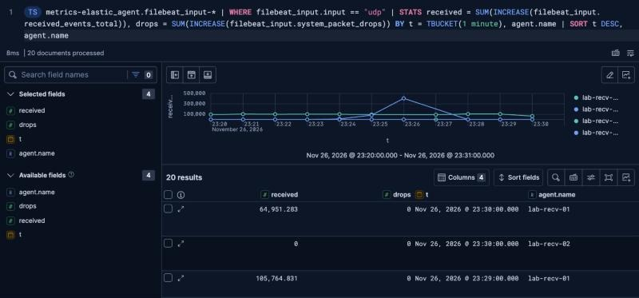

방화벽, 스위치, 보안 장비 가운데에는 UDP 514로만 보내는 장비가 아직 많습니다. 그런데 감사 요구사항은 "유실 없음"입니다.
UDP는 받았다는 확인을 돌려주지 않습니다. 그래서 수신 쪽이 잠깐 느려지거나 멈추면, 송신 장비는 아무것도 모른 채 계속 보내고 그 사이의 로그는 사라집니다.
피크 시간에만 건수가 줄어드는데 원인을 모르는 경우가 대부분 이 문제입니다. 유실이 생기는 지점과 측정 방법을 먼저 보고, 유실을 줄이는 구성을 다룹니다.

:::note[기준]
- Elastic Agent 9.x(Custom UDP Logs, syslog를 받는 integration), Linux 수신 서버 기준입니다. 공식 문서는 2026년 11월에 다시 확인했습니다.
- 설정 예시는 [`labs/ingest/syslog-udp/`](https://github.com/Munsik/engineering-notes/tree/main/labs/ingest/syslog-udp)에 있습니다. 송신 속도별 drop 비율 같은 실측 수치는 하드웨어와 네트워크에 따라 크게 달라 넣지 않았습니다. 같은 방법으로 직접 재는 절차를 적었습니다.
:::

## 먼저 받아들일 전제

UDP 구간이 남아 있는 한 유실 0을 보장할 수 없습니다. 할 수 있는 것은 세 가지입니다.

1. UDP 구간을 짧게 만든다. 장비 가장 가까운 곳에서 받아 그 뒤로는 TCP로 넘긴다.
2. 남은 UDP 구간에서 drop이 생기면 바로 알 수 있게 계측한다.
3. 수신기가 멈추는 시간을 줄인다.

## UDP 유실이 생기는 네 지점


| 지점 | 무엇이 넘치나 | 어떻게 보나 |
| --- | --- | --- |
| ① 네트워크 | 경로 위 장비의 버퍼, 링크 대역폭 | 네트워크 장비 통계. 수신 서버에서는 보이지 않음 |
| ② 커널 socket 수신 버퍼 | 애플리케이션이 읽기 전에 버퍼가 가득 참 | `/proc/net/snmp`의 `Udp: RcvbufErrors`, `netstat -su`의 receive buffer errors |
| ③ UDP input 읽기 | 입력이 버퍼를 비우는 속도가 들어오는 속도보다 느림 | Agent UDP input 지표 `receive_queue_length`, `system_packet_drops` |
| ④ 출력 지연 | Elasticsearch나 Logstash가 느려 memory queue가 가득 참. 입력이 버퍼를 비우지 못해 ②가 넘침 | Agent의 pipeline queue 사용률, output 오류 |

④가 가장 놓치기 쉽습니다. UDP에는 송신 측에 "천천히 보내라"고 알릴 방법이 없어서, 뒤쪽이 느려지면 그 압력이 결국 커널 수신 버퍼의 drop으로 나타납니다. ingest pipeline에 무거운 처리를 추가한 뒤 UDP drop이 늘었다면 이 경우입니다.

## 계측

### 커널 카운터

```bash
# 누적값. 몇 분 간격으로 두 번 보고 차이를 본다
grep -A1 '^Udp:' /proc/net/snmp
netstat -su | grep -i -E 'receive buffer errors|packet receive errors'
```

`RcvbufErrors`가 늘면 ②에서 버려지고 있습니다.

### Agent UDP input 지표

UDP input은 다음 지표를 냅니다([Filebeat UDP input](https://www.elastic.co/docs/reference/beats/filebeat/filebeat-input-udp)).

| 지표 | 의미 |
| --- | --- |
| `udp_read_buffer_length_gauge` | UDP socket 버퍼 크기(byte) |
| `receive_queue_length` | 시스템 수신 queue 크기 합(IPv4, IPv6). Linux 전용 |
| `system_packet_drops` | 시스템 패킷 drop 수 합(IPv4, IPv6). Linux 전용 |

Fleet 관리 Agent는 이 입력 지표를 `metrics-elastic_agent.filebeat_input-*` data stream으로 보냅니다. 필드 이름 앞에는 `filebeat_input.`이 붙습니다. 이 data stream은 time series(TSDS)이고, `filebeat_input.system_packet_drops`는 `counter`로 매핑됩니다(elastic/integrations의 `elastic_agent` 패키지 `filebeat_input_metrics` 정의와 lab 9.5.5의 field caps로 확인). 나머지 두 지표는 이름 규칙(`*_length`, `*_gauge`)에 따라 gauge로 매핑됩니다.

counter 필드에는 ES|QL의 `MAX`, `MIN`을 쓸 수 없습니다(lab에서 `verification_exception`). 증가분은 `TS` 명령과 `INCREASE`로 셉니다. 둘 다 Stack 9.4부터 GA입니다([TS](https://www.elastic.co/docs/reference/query-languages/esql/commands/ts), [INCREASE](https://www.elastic.co/docs/reference/query-languages/esql/functions-operators/time-series-aggregation-functions/increase)).

```sql
TS metrics-elastic_agent.filebeat_input-*
| WHERE @timestamp >= NOW() - 6 hours AND filebeat_input.input == "udp"
| STATS drops = SUM(INCREASE(filebeat_input.system_packet_drops)) BY t = TBUCKET(5 minutes), agent.name
| SORT t
```

Elastic Agent 패키지가 설치하는 `[Elastic Agent] UDP Input Metrics` 대시보드에서도 이 지표를 볼 수 있습니다. 여러 단계를 한 화면에서 비교하려면 [06](../06-flow-dashboard/)의 흐름 대시보드에 이 쿼리를 패널로 넣습니다.



위 화면은 아래 "lab에서 본 것"의 고속 송신 구간입니다. 이 지표가 0이라고 유실이 없었던 것은 아니었습니다.

### 같은 component를 쓰는 입력은 서로 영향을 준다

Agent 지표의 `component.id`는 입력 종류와 출력 이름으로 만들어집니다(`udp-default`, `tcp-default`처럼). 같은 정책에서 같은 종류의 입력을 여러 integration으로 받고 같은 출력으로 보내면, 지표상 하나의 component로 묶이고 queue 지표도 component 단위로 나옵니다([06](../06-flow-dashboard/)의 lab 관찰). 저는 이 입력들이 출력 쪽 queue를 함께 쓰는 것으로 봅니다(해석).

이 경우 한 장비의 로그가 처리에서 오래 걸리면 같은 component의 다른 장비 수집도 같이 밀릴 수 있습니다. 현장 진단 사례에서는 형식이 깨진 메시지를 보내는 방화벽 하나 때문에 처리 지연이 커졌고, 같은 component로 받던 다른 장비의 수집도 늦어졌습니다. 그 방화벽을 별도 Agent로 옮긴 뒤 나머지가 정상으로 돌아왔습니다.

대량이거나 형식이 불안정한 syslog 소스는 별도 정책의 Agent로 받습니다. 한 Agent는 정책 하나에만 속하므로, 분리는 Agent를 나누는 것으로 합니다([08](../08-fleet-at-scale/#정책-설계)).

## 수신 버퍼 조정

Custom UDP Logs integration은 고급 설정에서 `read_buffer_size`와 `max_message_size`(기본 10KiB)를 바꿀 수 있습니다(elastic/integrations의 `udp` 패키지 manifest 기준).
애플리케이션이 큰 버퍼를 요청해도 커널 한도를 넘을 수 없으므로 OS 설정도 같이 올립니다.

```bash
# /etc/sysctl.d/90-udp-syslog.conf
net.core.rmem_max = 33554432
net.core.rmem_default = 33554432
net.core.netdev_max_backlog = 50000
```

```yaml
# Custom UDP Logs 고급 설정
read_buffer_size: 32MiB
max_message_size: 64KiB
```

버퍼를 키우면 순간적인 피크를 흡수할 시간이 늘어날 뿐, 평균 수신 속도가 처리 속도보다 빠른 상황은 해결하지 못합니다. 그 경우는 수신기를 늘리거나 뒤쪽 처리를 가볍게 해야 합니다. 값은 예시입니다. 피크 초당 건수와 메시지 크기로 몇 초를 버틸지 계산해 정합니다.

## 구성 패턴

| 패턴 | 하는 일 | 남는 위험 |
| --- | --- | --- |
| A. syslog relay에서 TCP로 바꾸기 | 장비 가까이의 rsyslog가 UDP를 받아 disk-assisted queue에 두고 TCP로 Agent나 Logstash에 넘김 | relay 자체의 재시작, 장애 구간 |
| B. UDP 부하 분산 | VIP 뒤에 수신기 여러 대. 한 대를 멈춰도 나머지가 받음 | VIP 전환 순간의 유실, 부하 분산기 성능 |
| C. 이중 송신 | 장비가 수신기 두 곳으로 같은 로그를 보냄 | 저장 단계 중복 제거 필요, 장비 부하 |

### A. rsyslog relay

rsyslog 공식 tutorial의 신뢰성 있는 전달 구성은 action에 LinkedList queue와 `queue.filename`(disk assistance), `queue.saveOnShutdown`, `action.resumeRetryCount="-1"`을 주고 TCP로 보내는 것입니다([rsyslog: Reliable forwarding](https://docs.rsyslog.com/doc/tutorials/reliable_forwarding.html)).

```text
# /etc/rsyslog.d/10-relay.conf
global(workDirectory="/var/spool/rsyslog")
module(load="imudp")
input(type="imudp" port="514" rcvbufSize="32m")

action(type="omfwd" target="10.0.0.100" port="6514" protocol="tcp"
       action.resumeRetryCount="-1"
       queue.type="LinkedList"
       queue.filename="fwd_elastic"
       queue.maxDiskSpace="20g"
       queue.saveOnShutdown="on")
```

- 뒤쪽(Agent, Logstash)이 멈추면 relay가 메모리와 디스크에 쌓아 두었다가 다시 보냅니다. 업그레이드가 잦은 수집 계층을 장비에서 떼어 놓는 효과가 있습니다.
- 같은 tutorial은 disk-assisted queue가 프로세스 강제 종료, OOM, 시스템 장애, 전원 장애 뒤에는 순수 disk queue와 같은 보장을 하지 않고, `queue.saveOnShutdown`은 정상 종료에만 적용된다고 설명합니다.
- 같은 tutorial은 plain TCP syslog도 완전히 신뢰할 수 있는 전송은 아니며, 완전한 신뢰성이 필요하면 RELP를 쓰라고 안내합니다. 받는 쪽이 RELP를 지원하지 않으면 TCP가 현실적인 선택입니다.
- relay는 설정을 단순하게 두고 거의 바꾸지 않습니다. 파싱과 변환은 뒤 계층에서 합니다.
- `target`은 03의 L4 부하 분산 VIP로 두면 뒤쪽도 이중화됩니다.

### B. UDP 부하 분산

수신 Agent 여러 대를 VIP 뒤에 둡니다. nginx stream 모듈은 UDP 부하 분산을 지원합니다([nginx: TCP and UDP load balancing](https://docs.nginx.com/nginx/admin-guide/load-balancer/tcp-udp-load-balancer/)).

```text
stream {
    upstream syslog_udp {
        server 10.0.0.21:514;
        server 10.0.0.22:514;
    }
    server {
        listen 514 udp;
        proxy_pass syslog_udp;
        proxy_responses 0;
    }
}
```

- 오픈소스 nginx의 UDP health check는 passive 방식뿐입니다. upstream이 오류를 돌려주거나 응답 시간이 지나면 실패로 세고, `fail_timeout`(기본 10초) 동안 `max_fails`(기본 1)번 실패하면 그 시간만큼 뺍니다. 능동 health check는 NGINX Plus 기능입니다([UDP health checks](https://docs.nginx.com/nginx/admin-guide/load-balancer/udp-health-check/)).
- syslog는 응답을 돌려주지 않으므로 위 예처럼 `proxy_responses 0`으로 둡니다. 이러면 nginx가 기다릴 응답이 없어, 수신 Agent가 멈춰도 실패로 판단할 근거가 거의 없습니다. 오픈소스 nginx만으로는 죽은 수신기를 빼지 못한다고 보고, keepalived의 health check 스크립트로 수신기 프로세스나 Agent 상태를 보고 upstream을 바꾸는 식으로 보완합니다.
- LVS(keepalived)나 네트워크 장비의 부하 분산 기능도 선택지입니다. 커널에서 처리하므로 송신 IP를 보존하는 구성(DR 방식)을 고르기 쉽습니다.
- HAProxy 오픈소스 판은 범용 UDP 부하 분산을 하지 않습니다. 대신 syslog 전용 기능이 있습니다. 2.3부터 `log-forward` 섹션에서 `dgram-bind`로 UDP syslog를 받아 넘길 수 있고([Syslog forwarding](https://www.haproxy.com/documentation/haproxy-configuration-tutorials/syslog-forwarding/)), 2.9부터 `mode log` backend로 여러 수신기에 나눠 보낼 수 있습니다. 다만 UDP syslog 서버에는 health check를 걸 수 없습니다([Load balance syslog messages](https://www.haproxy.com/documentation/haproxy-configuration-tutorials/load-balancing/syslog/)). 범용 UDP 부하 분산은 HAProxy Enterprise의 UDP module(2.8r1 이후)이나 ALOHA가 맡습니다([UDP load balancing](https://www.haproxy.com/documentation/haproxy-enterprise/enterprise-modules/udp/)).
- 부하 분산기를 거치면 수신기가 보는 송신 IP가 바뀔 수 있습니다. `host.ip`나 `log.source.address`로 장비를 구분한다면 원래 주소를 보존하는 방식(DSR, transparent proxy)을 확인합니다.

### C. 이중 송신

장비가 syslog 대상을 두 개 지원하면 두 수신기로 같은 로그를 보냅니다. 한쪽이 멈춰도 다른 쪽이 받습니다. 대신 평소에는 모든 로그가 두 번 들어오므로 저장 전에 중복을 제거해야 합니다. 메시지 내용과 장비, 시각으로 fingerprint를 만들어 `_id`로 쓰는 방법은 [05](../05-count-reconciliation/#중복-찾기와-막기)에서 다룹니다. 같은 내용의 로그가 같은 초에 정당하게 여러 번 찍히는 장비라면 이 방법은 쓸 수 없습니다.

## 직접 측정하는 절차

1. 송신기에서 순번을 붙인 syslog를 정해진 속도로 보냅니다. [`labs/ingest/_sender/`](https://github.com/Munsik/engineering-notes/tree/main/labs/ingest/_sender)의 스크립트를 쓸 수 있습니다.
2. 보내기 전후의 `RcvbufErrors`, Agent의 `system_packet_drops`를 기록합니다.
3. Elasticsearch에서 순번을 집계해 빠진 구간을 찾습니다([05](../05-count-reconciliation/#순번으로-유실-구간-찾기)).
4. 속도를 단계적으로 올리며 drop이 시작되는 지점을 찾고, 버퍼와 수신기 수를 바꿔 다시 측정합니다.
5. 같은 속도에서 수신 Agent를 재시작해 직접 수신과 relay 경유의 차이를 봅니다.

송신기와 `check-drops.sh`가 의도대로 동작하는지는 Linux 한 대에서 먼저 확인할 수 있습니다. 수신 버퍼를 4KB로 줄이고 일부러 느리게 읽는 수신기를 띄운 뒤, 송신기로 초당 3,000건을 3초 보낸 결과입니다(Linux 컨테이너에서 실측, loopback 주소 사용).

| 항목 | 값 |
| --- | --- |
| 송신기가 보냈다고 기록한 건수(`sent`) | 9,000 |
| 송신 오류(`send_errors`) | 0 |
| 수신기가 읽은 건수 | 34 |
| 같은 시간의 `RcvbufErrors` 증가분 | 8,966 |

송신 쪽에서는 오류가 하나도 없었고, 버려진 8,966건은 수신 호스트의 `RcvbufErrors`에만 남았습니다. 보낸 건수에서 읽은 건수를 뺀 값과 정확히 같습니다. UDP는 송신 측 기록만으로는 유실을 알 수 없다는 점을 그대로 보여 줍니다.

## lab에서 본 것

수신 Agent 2대(9.5.4, Docker), Logstash 2대, 송신기 컨테이너를 Mac의 Rancher Desktop 위 같은 Docker network에 두고 측정한 결과입니다(실측). 송신 건수는 송신기 기록, 받은 건수는 Elasticsearch에서 순번으로 센 값입니다.

| 시험 | 송신 | 저장 | 유실 | Agent `system_packet_drops` 증가 |
| --- | --- | --- | --- | --- |
| 초당 2,000건, 25분(`cap-11`) | 3,000,000 | 2,608,967 | 391,033(13.0%) | 0 |
| 최대 속도(약 27,000건/초), 2분(`cap-12`) | 3,280,000 | 843,545 | 2,436,455(74.3%) | 0 |

- 송신기의 `send_errors`는 두 시험 모두 0이었습니다. 중복은 없었습니다.
- `cap-11`의 처음 2분은 Agent가 Elasticsearch로 바로 보내던 구간이고, 분당 유실이 0.4%에서 1.4%였습니다. Logstash 출력으로 바꾼 뒤에는 분당 9%에서 21%를 오갔습니다. 이때 Logstash worker 사용률은 15%에서 35%로 여유가 있었습니다.
- `cap-12` 구간에는 Logstash 두 대의 worker 사용률이 99%, `queue_backpressure`가 0.9 안팎까지 올랐습니다. 처리 계층이 따라가지 못한 구간입니다.
- 두 시험 내내 Agent UDP input의 `system_packet_drops`와 `receive_queue_length`는 0이었습니다.

여기서 얻은 판단입니다.

- Agent의 drop 지표는 그 socket에서 커널이 버린 것만 셉니다. 이 lab에서는 유실이 그 바깥(컨테이너 사이 가상 네트워크 구간으로 추정)에서 생겨 지표에 잡히지 않았습니다. 정확한 지점은 확인하지 못했습니다. 운영에서도 NIC, 스위치, 부하 분산기에서 생긴 유실은 이 지표에 나오지 않습니다.
- 그래서 drop 지표만 보고 "유실 없음"이라고 판단하지 않습니다. 도입 시험은 순번 송신으로 끝에서 세고, 운영에서는 수신 호스트의 `RcvbufErrors`, NIC drop 같은 커널 카운터를 같이 봅니다.
- 출력 경로가 바뀌자 유실률이 크게 달라졌습니다. UDP 수신 성능은 수신기 단독이 아니라 출력까지 포함한 전체 경로로 측정합니다. 처리 계층을 바꾸면 위 절차를 다시 돌립니다.

## 판단 기준

| 상황 | 권장 |
| --- | --- |
| 장비가 TCP를 지원 | TCP로 바꾸고 03의 L4 부하 분산 |
| UDP만 되고 수집 계층을 자주 바꿈 | 장비 가까이 rsyslog relay(disk-assisted queue) → TCP → 수집 계층 |
| UDP만 되고 relay를 둘 수 없음 | UDP 부하 분산 + 수신 Agent 2대 이상 + 버퍼 조정 |
| 감사 요구가 강함 | relay + 이중 송신 + 중복 제거, drop 지표 알림 |
| 피크 때만 건수가 줄어듦 | 커널 카운터와 Agent 지표로 ②, ③, ④ 중 어디인지 먼저 확인한다 |
| 한 장비 때문에 다른 장비 수집까지 늦어짐 | 그 장비를 별도 정책의 Agent로 분리 |

## 참고 문서

- [Filebeat UDP input](https://www.elastic.co/docs/reference/beats/filebeat/filebeat-input-udp)
- [Filebeat syslog processor](https://www.elastic.co/docs/reference/beats/filebeat/syslog)
- [Deploying and scaling Logstash: TCP, UDP, and HTTP protocols, Centralized syslog servers](https://www.elastic.co/docs/reference/logstash/deploying-scaling-logstash)
- [rsyslog: Reliable forwarding of syslog messages](https://docs.rsyslog.com/doc/tutorials/reliable_forwarding.html)
- [nginx: TCP and UDP load balancing](https://docs.nginx.com/nginx/admin-guide/load-balancer/tcp-udp-load-balancer/)
