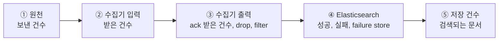

원천 시스템 담당자는 "보냈다"고 하고, 수집 담당자는 "안 왔다"고 하는 상황이 자주 생깁니다.
관제나 감사 계약에 "수집률 99.9% 이상" 같은 조건이 들어가는데, 저장된 건수만으로는 근거를 낼 수 없습니다. 어느 구간에서 빠졌는지 모르면 고칠 곳도 모릅니다.
이 글은 구간마다 카운터를 두고 같은 시간 창으로 대조하는 방법, 유실과 중복을 세는 방법, 저장되지 않은 문서를 세는 방법을 정리합니다.

:::note[기준]
- Elastic Agent, Fleet, Logstash, Elasticsearch 9.x 기준입니다. 공식 문서는 2026년 11월에 다시 확인했습니다.
- failure store는 Stack 9.1 GA, Data Set Quality는 beta입니다.
- ES|QL 예시와 대조 스크립트는 [`labs/ingest/reconciliation/`](https://github.com/Munsik/engineering-notes/tree/main/labs/ingest/reconciliation)에 있습니다.
:::

## 대조 구간



| 구간 | 카운터 | 어디서 보나 |
| --- | --- | --- |
| ① 원천 | 장비의 송신 통계, 파일 줄 수, 애플리케이션 순번, 큐의 메시지 수 | 원천 시스템 |
| ② 수집기 입력 | Agent 입력 지표, Logstash pipeline events `in` | Agent 모니터링 data stream, Logstash node stats API |
| ③ 수집기 출력 | Agent output events acked, dropped, failed. Logstash events `out`, `filtered`, DLQ | 위와 같음 |
| ④ Elasticsearch | bulk 실패, failure store로 redirect된 문서 | failure store, 수집기 로그 |
| ⑤ 저장 | data stream별 문서 수 | `_count`, ES\|QL |

두 구간 사이에서 건수가 어긋나면 그 사이가 원인 위치입니다.

- ①과 ② 사이: 네트워크, UDP drop([04](../04-syslog-udp/)), 수집기가 멈춘 구간([03](../03-no-gap-ingest/))
- ②와 ③ 사이: 수집기의 drop processor, 조건부 버림, Logstash filter의 `drop`, memory queue 유실
- ③과 ⑤ 사이: 파싱 실패, mapping 충돌, 400/404로 DLQ나 버림([02](../02-where-to-parse/#실패한-문서는-어디로-가나))
- ⑤가 ①보다 많음: 중복

수집기 카운터 위치는 다음과 같습니다.

- Agent는 내부 지표를 `metrics-elastic_agent.*` data stream으로 보냅니다. pipeline 이벤트는 `beat.stats.libbeat.pipeline.events.*`(`published`, `filtered`, `dropped`, `failed`, `total`), 출력 이벤트는 `beat.stats.libbeat.output.events.*`(`acked` 등)입니다(elastic/integrations `elastic_agent` 패키지 필드 정의 기준). 누적 카운터라 구간의 차이를 계산해 씁니다.
- Logstash는 `GET _node/stats/pipelines`가 pipeline과 plugin별 events `in`, `filtered`, `out`을 돌려줍니다([Logstash node stats API](https://www.elastic.co/docs/api/doc/logstash/operation/operation-nodestats)).

## 시간 기준과 대조 창

| 필드 | 의미 | 대조에 쓰는 곳 |
| --- | --- | --- |
| `@timestamp` | 이벤트가 생긴 시각(파싱 결과) | 원천 기준 건수와 비교 |
| `event.ingested` | Elasticsearch가 받은 시각 | 수집 지연, 늦게 도착한 데이터 판단 |

Fleet이 관리하는 data stream은 `.fleet_event_ingested_pipeline-1` final pipeline이 `event.ingested`를 넣습니다. 저장 효율을 위해 초 아래는 버립니다(Kibana 소스 `fleet_es_assets.ts` 기준). Fleet을 거치지 않는 경로는 ingest pipeline에서 직접 넣어야 합니다.

```console
PUT _ingest/pipeline/add-event-ingested
{
  "processors": [
    { "set": { "field": "event.ingested", "value": "{{{_ingest.timestamp}}}" } }
  ]
}
```

대조 창은 수집 지연보다 넉넉하게 잡습니다. 예를 들어 "어제 00시부터 24시까지의 `@timestamp`"를 오늘 아침에 세면, 늦게 도착한 데이터까지 포함됩니다. 직전 몇 분을 세면 아직 도착하지 않은 데이터 때문에 항상 모자라게 나옵니다(해석). 지연 분포는 [06](../06-flow-dashboard/)의 패널로 보고 창을 정합니다.

## 순번으로 유실 구간 찾기

원천이 순번이나 고유 ID를 넣어 준다면 가장 정확하게 셀 수 있습니다. 시험 송신기([`labs/ingest/_sender/`](https://github.com/Munsik/engineering-notes/tree/main/labs/ingest/_sender))는 `labels.seq`에 순번, `labels.run`에 시험 이름을 넣습니다.

유실과 중복을 한 번에 셉니다.

```sql
FROM logs-lab.syslog-*
| WHERE labels.run == "run-01"
| STATS copies = COUNT(*) BY labels.seq
| STATS received = COUNT(*), duplicated = SUM(CASE(copies > 1, 1, 0)), min_seq = MIN(labels.seq), max_seq = MAX(labels.seq)
| EVAL expected = max_seq - min_seq + 1, missing = expected - received
```

lab(9.5.5)에서 순번 1부터 20000까지 중 5001에서 5300을 빼고, 12001에서 12050은 두 번 넣어 확인했습니다. 결과는 `received` 19700, `duplicated` 50, `expected` 20000, `missing` 300입니다.

빠진 구간을 1,000건 단위로 찾습니다.

```sql
FROM logs-lab.syslog-*
| WHERE labels.run == "run-01"
| STATS BY labels.seq
| EVAL block = FLOOR((labels.seq - 1) / 1000)
| STATS present = COUNT(*), first_seq = MIN(labels.seq), last_seq = MAX(labels.seq) BY block
| WHERE present < 1000
| SORT block
```

순번이 1부터 시작하므로 `labels.seq - 1`로 묶어야 각 묶음이 1에서 1000, 1001에서 2000이 됩니다. `labels.seq / 1000`으로 묶으면 첫 묶음(1에서 999)과 마지막 순번 하나가 늘 빠진 것처럼 나옵니다(lab에서 확인). 송신 범위가 1000의 배수가 아니면 마지막 묶음은 원래 덜 찹니다. 같은 lab 데이터에서는 5번 묶음 하나만 나오고, 그 안의 첫 순번이 5301이라 5001에서 5300이 빠졌다는 것을 알 수 있습니다.

`COUNT_DISTINCT`는 근사값이라 값이 많으면 오차가 생깁니다. 그래서 위 쿼리는 순번별로 먼저 묶은 뒤 행 수(`COUNT(*)`)와 `SUM(CASE(...))`로 셉니다. 순번 단위로 묶는 쿼리는 시험 규모에서 쓰고, 운영 데이터에는 아래의 건수 대조를 씁니다(해석).

## 순번이 없을 때: 건수 대조

운영 데이터에는 대개 순번이 없습니다. 이때는 원천이 셀 수 있는 단위로 묶어 비교합니다.

```sql
FROM logs-*
| WHERE @timestamp >= "2026-11-25T00:00:00+09:00" AND @timestamp < "2026-11-26T00:00:00+09:00"
| STATS docs = COUNT(*) BY data_stream.dataset, host.name, hour = BUCKET(@timestamp, 1 hour)
| SORT data_stream.dataset, host.name, hour
```

- 원천 쪽 건수는 장비 통계, 파일 줄 수(`wc -l`), 원천 DB의 건수 등으로 같은 단위로 뽑습니다.
- 허용 오차를 미리 정합니다. 장비 통계는 대개 정확한 송신 건수가 아니라서 0.1% 같은 오차를 둡니다(해석).
- 시간대별로 보면 특정 시각에만 모자라는지, 특정 호스트만 모자라는지가 드러납니다. 특정 시각이면 수집기 재시작이나 피크, 특정 호스트면 그 원천의 설정을 의심합니다.

## 중복 찾기와 막기

at-least-once 구성에서는 중복이 생길 수 있습니다. Agent가 ack를 받지 못해 다시 보낸 이벤트, Logstash 한 대가 멈춘 뒤 다른 노드로 다시 보낸 batch, 이중 송신이 대표적입니다.

막는 방법은 이벤트마다 같은 `_id`를 정해 주는 것입니다. 같은 `_id`로 다시 들어오면 덮어쓰거나 거부되어 문서가 하나만 남습니다.

- Beats와 Agent는 `fingerprint` processor 결과를 `@metadata._id`에 넣으면 그 값을 문서 ID로 씁니다([Deduplicate data](https://www.elastic.co/docs/reference/beats/filebeat/filebeat-deduplication)).
- Logstash는 `fingerprint` filter로 만든 값을 Elasticsearch output의 `document_id`로 넘깁니다. data stream은 create만 허용하므로 같은 ID가 다시 오면 409가 나고, Logstash Elasticsearch output은 409를 경고 로그만 남기고 버립니다(logstash-output-elasticsearch 문서의 Retry policy). 중복 제거 목적이라면 이 동작이 맞습니다.

```yaml
# Agent integration의 processors(고급 설정)
- fingerprint:
    fields: ["message", "host.name", "@timestamp"]
    target_field: "@metadata._id"
    method: "sha256"
```

```ruby
filter {
  fingerprint {
    source => ["message", "[host][name]", "@timestamp"]
    concatenate_sources => true
    method => "SHA256"
    target => "[@metadata][_id]"
  }
}
output {
  elasticsearch {
    data_stream => "true"
    document_id => "%{[@metadata][_id]}"
  }
}
```

비용과 함정입니다.

- `_id`를 직접 정하면 Elasticsearch가 같은 ID가 이미 있는지 확인해야 해서 indexing이 느려집니다. 공식 문서도 가능하면 자동 생성 ID를 쓰라고 권합니다([Tune for indexing speed](https://www.elastic.co/docs/deploy-manage/production-guidance/optimize-performance/indexing-speed)).
- fingerprint 대상 필드가 같으면 정당한 다른 이벤트도 하나로 합쳐집니다. 같은 초에 같은 메시지가 여러 번 찍히는 로그는 원천의 순번, 파일 offset 같은 구분 값을 대상에 넣습니다(해석).
- 중복 검사는 같은 backing index 안에서만 됩니다. data stream은 새 문서를 write index에만 넣기 때문입니다([Data streams](https://www.elastic.co/docs/manage-data/data-store/data-streams)). lab에서 같은 `_id`로 `_create`를 두 번 보내면 두 번째는 409였지만, 그 사이에 rollover를 하면 두 번째도 성공해 backing index 두 곳에 같은 `_id` 문서가 하나씩 남았습니다. 재전송이 rollover 직후에 겹치면 중복이 남을 수 있습니다.

중복 비용이 크면 막지 않고 세기만 하는 선택지도 있습니다. 위의 순번 쿼리나 fingerprint 필드를 따로 저장해 `STATS COUNT(*) BY fp | WHERE count > 1`로 셉니다(해석).

## 저장되지 않은 문서 세기

| 종류 | 세는 방법 |
| --- | --- |
| failure store로 간 문서 | `FROM <data stream>::failures \| STATS COUNT(*) BY document.index, error.type` |
| 필드 일부가 버려진 문서 | `_ignored`가 있는 문서 수. Data Set Quality(beta) 페이지의 degraded document |
| Logstash DLQ | DLQ 디렉터리 크기와 이벤트 수. DLQ input으로 다시 읽어 셈 |
| 수집기에서 drop | Agent `beat.stats.libbeat.pipeline.events.dropped`, Logstash filter 단계의 차이(`in` - `out`) |

failure store는 9.2부터 새로 만드는 `logs-*-*` data stream에 기본으로 켜져 있고, 다른 data stream은 index template의 `data_stream_options`로 켭니다([Failure store](https://www.elastic.co/docs/manage-data/data-store/data-streams/failure-store)).

```sql
FROM logs-*::failures
| WHERE @timestamp >= NOW() - 1 day
| STATS failed = COUNT(*) BY document.index, error.type
| SORT failed DESC
```

failure store 문서에는 `data_stream.dataset`이 없어서, 실패한 data stream은 `document.index`로 묶습니다(lab 9.5.5 확인). 실패가 한 번도 없었던 환경에서는 `::failures` 대상이 비어 있어 이 쿼리가 `Unknown column` 오류를 냅니다. 알림 rule로 쓸 때는 이 점을 감안합니다.

## 자동 대조와 알림

아래 구성은 제가 쓰는 방법입니다(해석).

1. 매일 아침 전날 하루의 data stream, 호스트별 건수를 ES|QL로 뽑아 별도 index(`recon-daily`)에 기록합니다. Workflows나 외부 스케줄러를 씁니다.
2. 원천 쪽 건수를 같은 index에 넣습니다. 원천이 API를 제공하면 같은 작업에서, 아니면 원천 담당자가 파일로 올립니다.
3. 차이가 허용 오차를 넘거나 failure store 건수가 0이 아니면 알림을 보냅니다. ES|QL 기반 alerting rule을 씁니다.
4. 원천별 무수신은 실시간으로 봅니다. 기준 시간 이상 들어오지 않은 dataset, 호스트를 찾는 rule은 [06](../06-flow-dashboard/#끊김-알림)에 있습니다.

## 판단 기준

이 절은 위의 사실을 바탕으로 한 제 판단입니다(해석).

| 상황 | 권장 |
| --- | --- |
| 수집률을 증명해야 함 | 원천, 수집기, 저장 세 지점의 카운터를 매일 같은 창으로 대조해 기록 |
| 원천이 순번을 줄 수 있음 | 순번을 필드로 받아 유실, 중복을 정확히 셈 |
| 중복이 업무에 문제 | fingerprint `_id`. 구분 값이 있는 필드를 대상으로 |
| 실패 문서를 잃으면 안 됨 | failure store, Logstash DLQ. 건수를 매일 확인 |
| 수집 지연이 큼 | 대조 창을 지연의 p99보다 길게 |

## 참고 문서

- [Deduplicate data](https://www.elastic.co/docs/reference/beats/filebeat/filebeat-deduplication)
- [Failure store](https://www.elastic.co/docs/manage-data/data-store/data-streams/failure-store)
- [Data set quality](https://www.elastic.co/docs/solutions/observability/data-set-quality-monitoring)
- [Monitor Elastic Agents](https://www.elastic.co/docs/reference/fleet/monitor-elastic-agent)
- [Logstash node stats API](https://www.elastic.co/docs/api/doc/logstash/operation/operation-nodestats)
- [Logstash dead letter queues](https://www.elastic.co/docs/reference/logstash/dead-letter-queues)
- [Tune for indexing speed](https://www.elastic.co/docs/deploy-manage/production-guidance/optimize-performance/indexing-speed)
