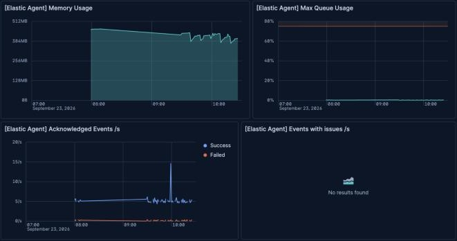
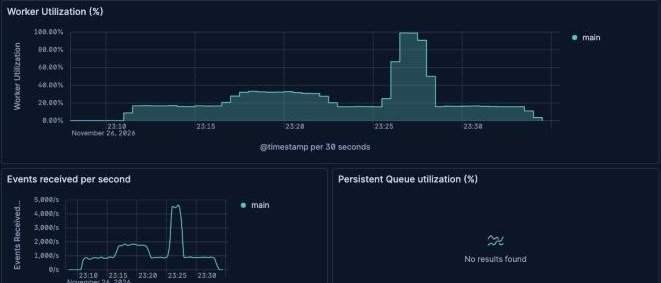
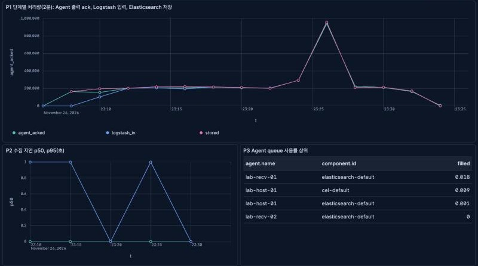

수집이 줄었을 때 처음 받는 질문은 "어디서 막혔나"입니다.
원천에서 덜 보냈는지, Agent가 못 읽었는지, Logstash가 밀렸는지, Elasticsearch가 거부했는지에 따라 할 일이 전혀 다릅니다. 그런데 각 단계의 지표가 서로 다른 화면에 흩어져 있어서 한눈에 비교하기 어렵습니다.
이 글은 기본 제공 화면으로 어디까지 되는지 먼저 정리하고, 단계별 지표를 한 화면에 모으는 흐름 대시보드를 만드는 방법과 끊김 알림을 다룹니다.

:::note[기준]
- Kibana, Fleet, Logstash 9.x 기준입니다. 공식 문서는 2026년 11월에 다시 확인했습니다.
- Streams는 Stack 9.2 GA입니다. Streams Map은 Serverless preview이고 Stack에서는 쓸 수 없습니다. Data Set Quality는 beta, Dashboards API(대시보드를 코드로 관리)는 Stack 9.5 GA입니다. 근거는 본문에 적었습니다.
- 화면과 쿼리 결과는 lab(Stack 9.5.5)에서 확인했습니다.
:::

## 단계별로 무엇을 재나

| 단계 | 처리량 | 적체, 실패 | 원천 |
| --- | --- | --- | --- |
| 원천 | 원천이 보낸 건수(가능한 경우) | | 원천 시스템 |
| Agent 입력 | 입력별 받은 이벤트(`filebeat_input.events_processed_total`) | UDP `filebeat_input.system_packet_drops`, `filebeat_input.receive_queue_length` | `metrics-elastic_agent.filebeat_input-*` |
| Agent 출력 | `beat.stats.libbeat.output.events.acked` | `pipeline.queue.filled.pct`(0에서 1 사이 비율), `pipeline.events.dropped`, `output.events.failed` | `metrics-elastic_agent.elastic_agent-*`(9.2 이후 Agent), `metrics-elastic_agent.filebeat-*`(이전 Agent) |
| Logstash | `logstash.pipeline.total.events.in`(counter), `logstash.pipeline.total.flow.input_throughput` | `total.flow.queue_backpressure`, `total.flow.worker_utilization`, DLQ | Logstash integration(`metrics-logstash.pipeline-*`) |
| Elasticsearch | data stream별 문서 증가, indexing rate | failure store 건수, `_ignored` 비율 | data stream 자체, Stack Monitoring |
| 지연 | `event.ingested` - `@timestamp` | | data stream 자체 |

Logstash integration의 pipeline data stream은 `logstash.pipeline.total.flow` 아래에 flow metrics(`input_throughput`, `worker_utilization`, `worker_concurrency`, `queue_backpressure`의 `current`, `last_1_minute`)를 수집합니다(elastic/integrations `logstash` 패키지 필드 정의 기준). flow metrics 자체는 Logstash node stats API가 제공합니다([Tuning and profiling Logstash performance](https://www.elastic.co/docs/reference/logstash/tuning-logstash)).

## 기본 제공 화면으로 되는 것

| 화면 | 보이는 것 | 한계 |
| --- | --- | --- |
| Fleet의 Agent 상세, `[Elastic Agent]` 대시보드 | Agent별 상태, CPU, 메모리, 입력과 출력 이벤트 | 수집 경로 전체가 아니라 Agent 단위 |
| Logstash integration 대시보드 | 노드, pipeline별 처리량, plugin별 시간, flow metrics | Agent로 수집한 지표는 Stack Monitoring UI와 같이 쓸 수 없음 |
| Stack Monitoring의 Logstash pipeline viewer | pipeline 구조와 plugin별 처리 시간 | Stack Monitoring 방식으로 수집할 때만 |
| Streams(9.2 GA) | data stream별 처리, 보존, Data quality 탭의 실패 문서와 오류 종류 | 수집기 단계는 보이지 않음 |
| Data Set Quality(beta) | data set별 degraded document 비율 | 실패해 저장되지 않은 문서는 failure store 쪽에서 봄 |

근거는 다음과 같습니다.

- Logstash integration 문서는 Agent로 수집하는 방식을 권하면서, 이 방식은 Kibana Stack Monitoring UI와 호환되지 않는다고 적고 있습니다(elastic/integrations `logstash` 패키지 README).
- Streams는 Stack 9.1 preview, 9.2 GA입니다([Streams](https://www.elastic.co/docs/solutions/observability/streams/streams)). Streams Map과 수집 전 처리, 라우팅 기능(sources, destinations)은 Serverless preview이고 Stack에서는 쓸 수 없습니다. 수집 전 처리는 private preview라 기본으로 켜져 있지 않습니다([Streams Map](https://www.elastic.co/docs/manage-data/ingest/streams/streams-map)).
- Data Set Quality는 Stack, Serverless 모두 beta입니다([Data set quality](https://www.elastic.co/docs/solutions/observability/data-set-quality-monitoring)).



위 화면은 lab의 Agent 한 대(9.5.3)로 본 `[Elastic Agent] Agent metrics` 대시보드입니다. Fleet의 Agent 상세에서 View more agent metrics로 열립니다. 대시보드 안내 문구대로 Agent 한 대를 골라서 봐야 의미가 있습니다. 같은 패키지에는 `[Elastic Agent] UDP Input Metrics`, `TCP Input Metrics`처럼 입력 종류별 대시보드도 들어 있습니다(lab의 설치된 대시보드 목록으로 확인).


위 화면은 `[Metrics Logstash] Pipelines Overview` 대시보드입니다. 23:16 무렵 Worker Utilization이 한 단계 오른 구간은 Logstash 한 대를 멈춰 남은 한 대가 두 배를 받은 때이고, 23:25 무렵의 봉우리는 고속 송신 구간입니다([03](../03-no-gap-ingest/#패턴-1-agent에서-logstash-여러-대로)). `worker_utilization`은 0에서 100 사이 백분율로 기록됩니다(lab 확인).

## 직접 만드는 흐름 대시보드

기본 화면으로는 "원천 → Agent → Logstash → Elasticsearch" 단계를 한 줄로 비교하기 어렵습니다. 그래서 단계별 지표를 같은 시간 축에 놓는 대시보드를 따로 만듭니다.

Lens의 차트 종류에는 흐름(sankey) 차트가 없습니다(Kibana 문서의 chart 목록 기준). 단계 비교는 같은 시간 축의 선 차트와 표로 구성합니다. 꼭 흐름 그림이 필요하면 Vega로 그릴 수 있지만, 유지 보수 비용이 커서 권하지 않습니다.

패널은 모두 ES|QL로 정의합니다. ES|QL 패널은 data view를 참조하지 않아서, 대시보드를 환경 사이로 옮길 때 깨지지 않습니다([Manage dashboards as code](https://www.elastic.co/docs/explore-analyze/dashboards/manage-dashboards-as-code), Stack 9.5 GA).

### 패널 구성

| 위치 | 패널 | 종류 | 무엇을 보나 |
| --- | --- | --- | --- |
| 1행 | 단계별 처리량 | 선 차트(같은 축) | Agent acked, Logstash input throughput, Elasticsearch 문서 증가. 선 사이 간격이 벌어지는 구간 |
| 1행 | 수집 지연 p50, p95 | 선 차트 | 지연이 늘기 시작한 시점 |
| 2행 | Agent queue 사용률 상위 | 표 | queue가 차 있는 Agent와 component |
| 2행 | Logstash backpressure | 선 차트 | 출력 쪽이 받는 속도가 모자란 시점 |
| 3행 | UDP drop | 선 차트 | UDP 수신기별 `system_packet_drops` 증가분 |
| 3행 | 실패 문서 | 표 | data stream, 오류 종류별 failure store 건수 |
| 4행 | 원천별 마지막 수신 | 표 | 기준 시간 이상 들어오지 않은 dataset, 호스트 |

### ES|QL 예시

아래 쿼리는 패널 정의의 출발점입니다. 필드 이름은 integrations 패키지 정의로 확인했고, 모든 쿼리를 lab(Stack 9.5.5, Agent 9.5.3과 9.5.4, Logstash 두 대의 compose 구성)에서 실행해 결과를 확인했습니다([`labs/ingest/compose/`](https://github.com/Munsik/engineering-notes/tree/main/labs/ingest/compose)).

쿼리를 쓰기 전에 알아 둘 점이 두 가지 있습니다(lab 확인).

- Agent 9.5.3의 self-monitoring 지표(`beat.stats.*`)는 `metrics-elastic_agent.elastic_agent-*`에 `component.id`별로 들어왔고, `metrics-elastic_agent.filebeat-*`는 만들어지지 않았습니다. 9.2부터 self-monitoring이 Agent 내장 OpenTelemetry Collector의 Beat receiver로 돌기 때문으로 봅니다(해석, [Elastic Agent as an OpenTelemetry Collector](https://www.elastic.co/docs/reference/fleet/elastic-agent-as-otel-collector)). 9.2 이전 Agent가 섞여 있으면 두 data stream을 같이 지정합니다.
- 이 data stream들은 time series(TSDS)이고 `acked` 같은 누적값은 `counter` 타입입니다. ES|QL은 counter 필드에 `MAX`, `MIN`을 허용하지 않습니다. 증가분은 `TS` 명령과 `INCREASE`로 셉니다(Stack 9.4부터 GA, [INCREASE](https://www.elastic.co/docs/reference/query-languages/esql/functions-operators/time-series-aggregation-functions/increase)). `INCREASE`는 시계열마다 계산하므로 Agent 재시작으로 카운터가 0부터 다시 시작해도 증가분이 틀어지지 않습니다.

수집 지연 분포입니다.

```sql
FROM logs-*
| WHERE @timestamp >= NOW() - 6 hours AND event.ingested IS NOT NULL
| EVAL lag_s = DATE_DIFF("seconds", @timestamp, event.ingested)
| STATS p50 = PERCENTILE(lag_s, 50), p95 = PERCENTILE(lag_s, 95) BY t = BUCKET(@timestamp, 5 minutes)
| SORT t
```

원천별 마지막 수신입니다.

```sql
FROM logs-*
| WHERE event.ingested >= NOW() - 1 day
| STATS last_ingested = MAX(event.ingested) BY data_stream.dataset, host.name
| EVAL silent_min = DATE_DIFF("minutes", last_ingested, NOW())
| WHERE silent_min >= 15
| SORT silent_min DESC
```

Agent 출력 처리량입니다. 5분마다 출력이 ack를 받은 이벤트 수를 셉니다.

```sql
TS metrics-elastic_agent.elastic_agent-*, metrics-elastic_agent.filebeat-*
| WHERE @timestamp >= NOW() - 6 hours
  AND NOT component.id LIKE "*monitoring*" AND NOT component.id LIKE "elasticsearch-*"
| STATS acked = SUM(INCREASE(beat.stats.libbeat.output.events.acked)) BY t = TBUCKET(5 minutes)
| SORT t
```

조건 두 개는 lab에서 숫자를 맞춰 보고 넣었습니다.

- `*monitoring*` component는 Agent 자체 지표와 로그를 보내는 몫이라 뺍니다.
- Elasticsearch 출력을 쓰는 Agent(9.5.4)는 같은 이벤트를 입력 component(`udp-default`)와 출력 component(`elasticsearch-default`) 양쪽에 같은 `acked` 값으로 보고했습니다. 둘 다 더하면 두 배가 됩니다. Logstash 출력으로 바꾸자 `elasticsearch-*` component는 나오지 않았습니다(lab 확인).

`INCREASE`는 구간 경계에 맞춰 값을 보정하므로 결과가 소수로 나옵니다. 초당 값이 필요하면 `RATE`를 씁니다. lab에서 같은 구간을 `TO_LONG`으로 바꿔 최댓값과 최솟값의 차이로 세 보면, 구간 사이에 걸친 증가분이 빠져 `INCREASE`보다 작게 나왔습니다.

Logstash 입력 건수입니다. `logstash.pipeline.total.events.in`은 counter이고, `in`이 ES|QL 예약어라 필드 이름을 backtick으로 감쌉니다. flow metrics는 `logstash.pipeline.total.flow` 아래에 있습니다(lab 9.5.5, `logstash` 패키지 2.11.3 확인).

```sql
TS metrics-logstash.pipeline-*
| WHERE @timestamp >= NOW() - 6 hours
| STATS logstash_in = SUM(INCREASE(`logstash.pipeline.total.events.in`)) BY t = TBUCKET(5 minutes)
| SORT t
```

Logstash 노드별 worker 사용률과 backpressure입니다. 두 값은 gauge라 `FROM`과 `AVG`로 봅니다.

```sql
FROM metrics-logstash.pipeline-*
| WHERE @timestamp >= NOW() - 6 hours
| STATS worker_util = AVG(logstash.pipeline.total.flow.worker_utilization.current),
        backpressure = AVG(logstash.pipeline.total.flow.queue_backpressure.current)
    BY t = BUCKET(@timestamp, 5 minutes), logstash.pipeline.host.name
| SORT t
```



위 화면은 lab의 30분입니다. 세 선이 거의 겹칩니다. Logstash 한 대를 멈춘 5분에도 남은 한 대가 받아 선이 벌어지지 않았습니다. 그런데 같은 시간 순번으로 세어 보면 송신량의 13%가 UDP 구간에서 사라졌습니다([04](../04-syslog-udp/#lab에서-본-것)). 이 대시보드는 Agent가 받은 뒤의 구간만 보여 줍니다. 원천에서 Agent까지의 유실은 원천 쪽 건수와 대조해야 보입니다([05](../05-count-reconciliation/)).

## 끊김 알림

| 알림 | 조건 | 만드는 방법 |
| --- | --- | --- |
| 원천 무수신 | dataset, 호스트별로 기준 시간 이상 새 문서 없음 | 위의 "원천별 마지막 수신" 쿼리로 ES\|QL rule |
| Agent queue 적체 | queue 사용률 90% 초과 | Agent 내장 규칙 "High pipeline queue" |
| Agent drop | drop 비율 5% 이상 | Agent 내장 규칙 "Dropped events" |
| Agent 출력 오류 | 분당 오류 6건 이상 | Agent 내장 규칙 "Output errors" |
| 실패 문서 | failure store 건수 증가 | `::failures` 쿼리로 ES\|QL rule |
| UDP drop | `system_packet_drops` 증가 | ES\|QL rule |

Agent 내장 규칙은 9.2부터 GA이고, Agent를 설치하거나 업그레이드할 때 자동으로 만들어집니다. 기본은 꺼져 있고, 구독 등급에 따라 제공됩니다. 라이선스가 먼저 있어야 규칙이 만들어집니다([Elastic Agent built-in alerts](https://www.elastic.co/docs/reference/fleet/alert-templates)).

원천 무수신 알림은 원천마다 정상 간격이 다릅니다. 몇 초마다 쏟아지는 방화벽과 하루에 몇 건 오는 배치 로그를 같은 기준으로 보면 알림이 쏟아지거나 놓칩니다. dataset별로 기준 시간을 따로 둡니다.

## 대시보드를 코드로 관리하기

Dashboards API는 Stack 9.5부터 GA입니다(9.4는 preview). 정의를 JSON으로 저장해 두고 환경마다 같은 요청을 보내면 됩니다. Terraform provider의 `elasticstack_kibana_dashboard` resource도 같은 API를 쓰지만 아직 technical preview입니다. ES|QL로 정의한 패널은 data view나 라이브러리 시각화를 참조하지 않아 환경 사이로 옮기기 쉽습니다([Manage dashboards as code](https://www.elastic.co/docs/explore-analyze/dashboards/manage-dashboards-as-code)).

이 글의 대시보드는 [`labs/ingest/flow-dashboard/dashboard.json`](https://github.com/Munsik/engineering-notes/tree/main/labs/ingest/flow-dashboard)에 있습니다. lab(9.5.5)에서 아래 요청으로 만들었습니다. `PUT`에 ID를 정해 주면 다시 보내도 같은 대시보드를 덮어씁니다.

```bash
curl -X PUT "$KIBANA_URL/api/dashboards/lab-ingest-flow" \
  -H "Authorization: ApiKey $KIBANA_API_KEY" \
  -H "kbn-xsrf: true" -H "Content-Type: application/json" \
  -d @dashboard.json
```

API로 만들 때 ES|QL 표 패널의 `type`은 `data_table`, 선 차트는 `xy`입니다. Logstash가 없는 환경에서는 P1-b, P4 패널이 `Unknown column` 오류를 표시합니다. 해당 data stream이 없으면 ES|QL이 필드를 찾지 못하기 때문입니다.

## 판단 기준

| 상황 | 권장 |
| --- | --- |
| 수집 경로 전체를 한 화면에서 | ES\|QL 패널로 흐름 대시보드를 직접 만든다 |
| Logstash 지표 | Logstash integration(Agent 수집). Stack Monitoring UI가 꼭 필요하면 Stack Monitoring 방식 |
| 실패 문서 확인과 수정 | Streams Data quality 탭(9.2 이후) |
| 끊김을 바로 알기 | 원천 무수신 rule + Agent 내장 규칙 |

## 참고 문서

- [Monitor Elastic Agents](https://www.elastic.co/docs/reference/fleet/monitor-elastic-agent)
- [Elastic Agent built-in alerts](https://www.elastic.co/docs/reference/fleet/alert-templates)
- [Monitoring Logstash](https://www.elastic.co/docs/reference/logstash/monitoring-logstash)
- [Tuning and profiling Logstash performance](https://www.elastic.co/docs/reference/logstash/tuning-logstash)
- [Streams](https://www.elastic.co/docs/solutions/observability/streams/streams), [Streams Map](https://www.elastic.co/docs/manage-data/ingest/streams/streams-map)
- [Data set quality](https://www.elastic.co/docs/solutions/observability/data-set-quality-monitoring)
- [Manage dashboards as code](https://www.elastic.co/docs/explore-analyze/dashboards/manage-dashboards-as-code)
