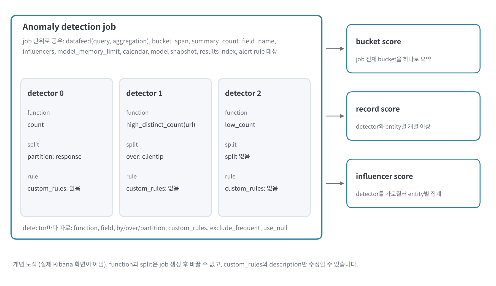
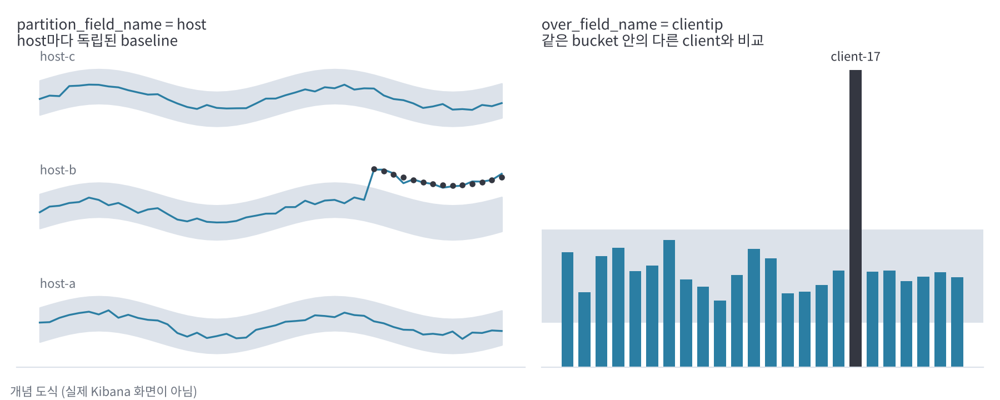

## 구성 요소

Anomaly detection은 시계열을 일정한 시간 단위(bucket)로 나눠 요약하고, 그 값이 과거 패턴에서 얼마나 벗어났는지 확률로 평가합니다.
사용자가 정하는 것은 무엇을 어떤 단위로 볼지입니다. 주기성 감지와 변화 적응은 알고리즘이 자동으로 합니다.

| 구성 요소 | 역할 | 실무 메모 |
| --- | --- | --- |
| datafeed | Elasticsearch에서 데이터를 읽어 job에 전달합니다. `query`, `frequency`, `query_delay`, `aggregations`를 가집니다. | job 하나에 datafeed는 하나입니다. 분석하지 않을 데이터를 query 단계에서 빼는 곳이기도 합니다. |
| bucket span | 데이터를 요약하고 모델링하는 시간 단위입니다. 기본값은 `5m`이고 보통 5분~1시간을 씁니다. | 하루를 정수 개로 나누는 값이어야 합니다. job을 만든 뒤에는 바꿀 수 없습니다. |
| detector | 어떤 function을 어떤 field에 적용하고 어떻게 나눌지(`by`, `over`, `partition`) 정합니다. | 한 job에 여러 개를 둘 수 있습니다. 만든 뒤에는 추가, 삭제, 변경할 수 없습니다. |
| influencer | 이상의 원인으로 의심되는 field입니다. 보통 `by`, `over`, `partition` field를 넣고, detector에 없는 field도 넣을 수 있습니다. | detector가 여러 개면 influencer를 쓰는 것이 권장됩니다. entity별로 결과를 모아 주기 때문입니다. |
| model | 과거 패턴을 담은 baseline입니다. job이 열려 있는 동안 메모리에 있고 계속 갱신됩니다. | `model_memory_limit`은 job 단위로 하나입니다. |

:::caution[만든 뒤에는 바꿀 수 없는 것]
job을 만든 뒤에는 `analysis_config`(`bucket_span`, `detectors`, `influencers`, categorization 설정 등)를 바꿀 수 없습니다.
운영 중에 바꿀 수 있는 것은 detector의 `custom_rules`와 설명, 보존 기간, model plot, 그룹 같은 부가 설정입니다.
설계를 바꾸려면 job을 clone해서 새로 학습시켜야 합니다.
:::

## Job 유형과 wizard

Kibana wizard는 job을 쉽게 만들게 도와주는 화면일 뿐, 결과는 모두 같은 분석 엔진의 job 설정입니다.
API로는 어떤 job이든 detector를 여러 개 둘 수 있습니다. wizard마다 다른 것은 detector를 여러 개 둘 수 있는지, split field를 어떻게 다루는지입니다.

| wizard | detector 수 | split field 적용 방식 | 쓰는 때 |
| --- | --- | --- | --- |
| Single metric | 1개 | split 없음 | 핵심 KPI 하나가 높아지거나 낮아지는 것. 처음 시작할 때 |
| Multi-metric | 1개 이상 | split field 하나를 모든 detector에 `partition_field_name`으로 일괄 적용 | 같은 entity 기준으로 여러 지표를 함께 볼 때 |
| Population | 1개 이상 | population field 하나를 모든 detector에 `over_field_name`으로 적용. detector마다 `by` field는 따로 지정 가능 | 많은 entity를 서로 비교할 때 |
| Advanced | 1개 이상 | detector마다 `by`, `over`, `partition`을 각각 지정. custom rule, `exclude_frequent` 등 전체 옵션 사용 | detector마다 나누는 방식이 달라야 할 때, 세부 옵션이 필요할 때 |
| Categorization | 1개 | message field를 category로 묶어 `mlcategory` 기준으로 count 또는 rare | 로그 메시지 패턴의 변화 |
| Rare, Geo | 1개 | rare 계열 또는 `lat_long` function 전용 | 드문 값, 평소와 다른 위치 |

multi-metric과 population wizard는 split 방식을 job 전체에 하나로 강제합니다.
그래서 "응답코드별 건수는 partition으로, client IP별 URL 다양성은 population으로"처럼 detector마다 다른 기준이 필요하면 advanced wizard나 API를 씁니다.
wizard로 만든 job도 Kibana의 Clone 메뉴에서 advanced 편집으로 열어 고칠 수 있습니다.

:::note[출처 구분]
공식 문서는 multi-metric job에서 field로 split하면 값마다 독립된 baseline이 만들어진다고 설명합니다. 이는 `partition_field_name`의 정의와 같습니다.
wizard별로 어떤 split 속성을 쓰는지까지는 공식 문서에 없고, Kibana 소스 코드([job_creator](https://github.com/elastic/kibana/tree/main/x-pack/platform/plugins/shared/ml/public/application/jobs/new_job/common/job_creator))를 기준으로 정리했습니다.
:::

## Detector를 1개 둘까, 여러 개 둘까

detector를 여러 개 둔 job은 개념적으로 독립된 single metric job 여러 개를 한 묶음으로 돌리는 것입니다.
detector마다 시계열 모델은 따로 만들어집니다. 하지만 데이터를 읽는 datafeed, bucket span, influencer, 메모리 한도, 결과 index, calendar는 job 단위로 공유합니다.
그래서 "무엇을 공유해도 되는가"가 판단 기준입니다.

### job 단위로 공유되는 것과 detector마다 따로인 것

| 구분 | 항목 | 실무 의미 |
| --- | --- | --- |
| job 단위 공유 | datafeed(indices, query, aggregation, runtime field) | detector마다 다른 index나 다른 query 조건을 쓸 수 없습니다. |
| job 단위 공유 | `bucket_span` | detector마다 다른 시간 해상도를 쓸 수 없습니다. |
| job 단위 공유 | `summary_count_field_name` | aggregation 입력 여부가 모든 detector에 같이 적용됩니다. `metric` function과 함께 쓸 수 없습니다. |
| job 단위 공유 | `influencers` | 모든 detector 결과에 같은 influencer가 붙습니다. |
| job 단위 공유 | `model_memory_limit`, 결과 index, model snapshot, calendar | 메모리 한도 하나를 detector가 나눠 씁니다. calendar event는 job의 모든 detector에 적용됩니다. |
| job 단위 공유 | forecast 가능 여부 | detector 중 하나라도 `over` field나 `rare`, `time_of_day` 같은 function을 쓰면 job 전체에서 forecast를 만들 수 없습니다. |
| detector마다 | `function`, `field_name`, `by`, `over`, `partition` | detector마다 다른 질문을 던질 수 있습니다. |
| detector마다 | `custom_rules`, `exclude_frequent`, `use_null` | 노이즈 처리를 detector별로 다르게 할 수 있습니다. |

### 두 방식 비교

| 관점 | detector 1개씩 여러 job | detector 여러 개 한 job |
| --- | --- | --- |
| 결과 해석 | job마다 따로 봅니다. 묶어 보려면 overall buckets API로 여러 job의 점수를 합칩니다([06](../06-operations/#job을-나눴을-때-묶어-보기)). | overall bucket score 하나로 "그 시각 시스템이 평소와 달랐다"를 봅니다. Anomaly Explorer에서 어느 detector가 잡았는지도 함께 보입니다. |
| 원인 추적 | influencer가 job 안에서만 집계됩니다. | top influencer가 모든 detector를 가로질러 최댓값과 합계로 집계됩니다. |
| 규모와 관리 | job 수가 늘어 관리 대상이 많아집니다. | 공식 문서는 multi-metric job이 독립 single metric job 여러 개보다 규모 면에서 낫다고 안내합니다. |
| 유연성 | job마다 bucket span, datafeed, aggregation, calendar, 알림 정책을 다르게 둘 수 있습니다. | 위 항목을 모두 공유해야 합니다. |
| 변경 | 한 job만 다시 만들면 됩니다. | detector 하나를 바꾸려 해도 job 전체를 clone해서 다시 학습시켜야 합니다. |
| 장애 영향 | 한 job이 멈춰도 다른 job은 영향이 없습니다. | job이 멈추거나 메모리 한도에 걸리면 모든 detector가 함께 영향을 받습니다. |

### 판단 기준

| 상황 | 권장 |
| --- | --- |
| 같은 서비스나 호스트의 증상 지표(지연, 처리량, 에러율, 건수)를 같은 bucket span으로 볼 때 | 한 job에 여러 detector. [APM 시나리오](../07-scenarios/#apm-서비스-핵심-지표-4종)가 대표 예입니다. |
| 지표마다 필요한 bucket span이 다를 때(예: rare는 짧게, 추세성 지표는 길게) | job 분리 |
| 한 detector만 aggregation datafeed로 읽고 싶을 때 | job 분리. `summary_count_field_name`은 job 전체에 적용됩니다. |
| forecast가 필요한 지표와 population 분석을 함께 하려 할 때 | job 분리. population detector가 하나라도 있으면 forecast를 만들 수 없습니다. |
| 데이터 소스(index)나 필터 조건이 다를 때 | job 분리. datafeed는 job당 하나입니다. |
| 알림을 받는 팀이나 심각도 정책이 다를 때 | job을 나누거나 job group으로 묶어 관리 |
| split field의 cardinality가 매우 클 때 | population 검토 또는 datafeed query로 job 분할 |

:::tip
같은 `function`, `field_name`, `by`, `over`, `partition` 조합의 detector를 한 job에 두 번 넣으면 job 생성이 거부됩니다.
detector에는 `detector_description`을 꼭 적어 두세요. 결과 화면과 알림에서 어떤 detector인지 구분하는 기준이 됩니다.
:::

## partition, by, over

field 값으로 데이터를 나누는 방법은 세 가지이고, 무엇을 기준으로 비교하는지가 다릅니다. 아래 정의는 9.x API reference의 설명입니다.

| 설정 | 비교 기준(API 정의) | 실무 예 | 주의 |
| --- | --- | --- | --- |
| `partition_field_name` | 분석을 분할합니다. 값마다 완전히 독립된 baseline을 가집니다. | 응답코드별 건수, host별 CPU iowait. 값마다 규모가 크게 다를 때 | cardinality에 비례해 메모리가 늘어납니다. |
| `by_field_name` | 값마다 자기 자신의 이력과 비교합니다. split 안에서 평소와 다른 값을 찾습니다. | host별 드문 process(`rare` by process, partition host), APM transaction type별 지연 | `rare`와 `freq_rare`는 `by` field가 필수입니다. `partition`과 함께 쓸 수 있습니다. |
| `over_field_name` | 모든 split의 이력과 비교합니다. population 전체에서 평소와 다른 값을 찾습니다. | 다른 client보다 URL을 유독 많이 훑는 IP, 다른 고객보다 구매액이 큰 고객 | forecast를 만들 수 없습니다. cardinality가 10 미만이면 적합하지 않을 수 있습니다. |

`by`와 `partition`은 둘 다 값마다 따로 모델링하지만 역할이 다릅니다.
`partition`은 분석 자체를 쪼개는 바깥 단위이고, `by`는 그 안에서 값마다 이력을 보는 단위입니다.
그래서 Elastic이 제공하는 job도 "host마다(`partition`) 그 host에서 드문 process(`by`)", "service마다(`partition`) transaction type별(`by`) 지연"처럼 둘을 함께 씁니다.

- population 분석은 entity가 수십만~수백만이어도 개별 시계열 분석보다 자원을 적게 씁니다. 반대로 entity마다 행동이 크게 다르면 효과가 떨어집니다. 이때는 datafeed query로 그룹을 나누거나 `partition`을 함께 씁니다.
- `by`나 `partition` 값이 없는 문서는 기본적으로 분석에서 빠집니다. `use_null: true`로 두면 값이 없는 문서를 별도 시계열로 분석합니다. Elastic이 제공하는 로그 job은 이 옵션으로 dataset 정보가 없는 로그까지 감시합니다.
- `by`, `count`, `over`라는 이름의 field는 split에 쓸 수 없습니다. Kibana wizard는 split field cardinality가 1,000을 넘으면 메모리 경고를 표시합니다.

## Influencer

- 공식 문서는 보통 3개 이하를 권장합니다. 많으면 결과가 복잡해지고 분석에 작은 오버헤드가 생깁니다.
- 다만 Elastic Security가 제공하는 job은 조사에 필요한 host, user, source IP, process 정보를 함께 남기려고 influencer를 7~8개 둡니다. 보안처럼 조사 맥락이 중요한 용도라면 개수를 늘리되, 메모리와 결과 양을 사전 검증 단계에서 확인합니다.
- influencer는 detector에 쓰지 않은 field여도 됩니다. datafeed query를 쓰면 detector field와 같은 문서에 있어야 하고, aggregation을 쓰면 aggregation 안에 포함돼야 분석에 반영됩니다. 필요하면 datafeed의 `runtime_mappings`로 influencer용 field를 만들 수 있습니다.
- influencer 결과는 특정 값을 가진 데이터를 빼고 다시 평가해 이상이 사라지는지 보는 방식으로 계산합니다. 그래서 통계적으로 유의한 influencer만 결과에 남습니다.

## 참고 문서

- [Job types](https://www.elastic.co/docs/explore-analyze/machine-learning/anomaly-detection/ml-anomaly-detection-job-types)
- [Working with anomaly detection at scale](https://www.elastic.co/docs/explore-analyze/machine-learning/anomaly-detection/anomaly-detection-scale)
- [Performing population analysis](https://www.elastic.co/docs/explore-analyze/machine-learning/anomaly-detection/ml-configuring-populations)
- [Create an anomaly detection job (API)](https://www.elastic.co/docs/api/doc/elasticsearch/operation/operation-ml-put-job)
- [View the results](https://www.elastic.co/docs/explore-analyze/machine-learning/anomaly-detection/ml-ad-view-results)
