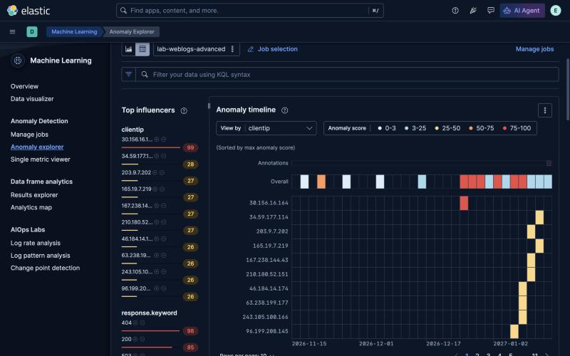
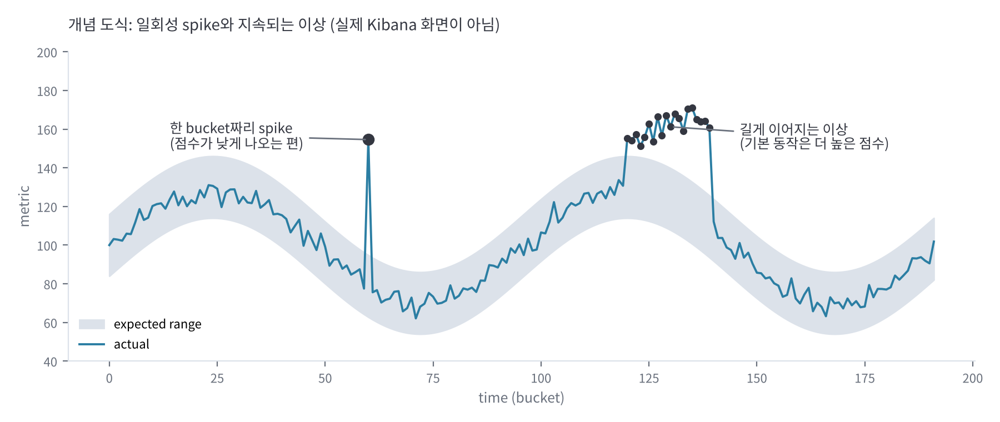
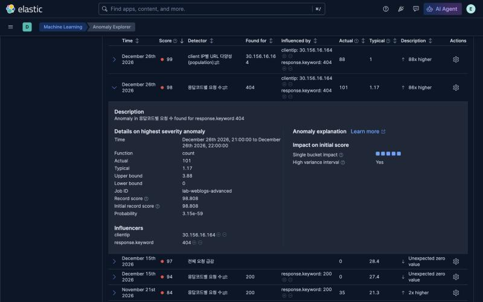
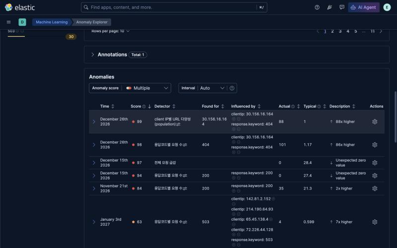
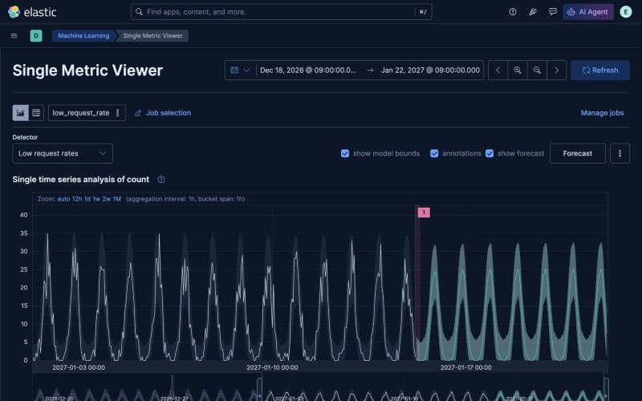

결과를 잘못 읽으면 두 가지 일이 생깁니다. 원인 entity를 엉뚱하게 고르거나, score가 내려간 것을 설정 문제로 오해해서 멀쩡한 job을 고칩니다.
alert 임계값도 결국 이 score를 기준으로 정합니다. 그래서 score가 어떻게 매겨지는지부터 알아야 합니다.

:::note[기준]
Elasticsearch, Kibana 9.x 기준입니다. 공식 문서는 2026년 11월에 다시 확인했습니다. 화면은 Elastic Cloud Hosted 9.5.5에서 [실습](../08-hands-on-lab/)을 돌려 얻은 것입니다.
:::

## 결과는 세 층으로 나온다

| 결과 | 뜻 | 주로 어디에 쓰나 |
| --- | --- | --- |
| bucket `anomaly_score` | 그 bucket 안의 record들이 얼마나 이상한지를 통계적으로 모아 정규화한 값입니다. detector가 여러 개면 전부 합쳐 하나로 요약합니다. | 전체 요약과 alert. "16:05에 시스템이 평소와 달랐다"를 알려 줍니다. |
| `record_score` | detector 하나, entity 하나가 얼마나 이상한지를 0~100으로 바꾼 값입니다. `detector_index`, `actual`, `typical`이 함께 남습니다. | 어떤 detector에서 무엇이 얼마나 벗어났는지 볼 때 |
| `influencer_score` | 그 entity가 이상에 얼마나 기여했는지입니다. 특정 detector에 묶이지 않습니다. | 원인 entity 찾기. detector가 여러 개일 때 특히 쓸모가 많습니다. |

Kibana Anomaly Explorer에서 timeline은 bucket score를, influencer swim lane과 Top influencers는 influencer score를, Anomalies 표는 record score를 씁니다.
그래서 같은 시점인데도 화면마다 숫자가 조금씩 다를 수 있습니다.

결과의 timestamp는 bucket이 시작하는 시각입니다. 15분 bucket 11:45~12:00의 결과는 11:45로 찍힙니다.



위 화면은 [실습](../08-hands-on-lab/)에서 만든 job입니다. 왼쪽 Top influencers에서 client IP 하나(99점)와 응답코드 404(98점)가 눈에 띄고, 오른쪽 swim lane에서는 그 IP가 딱 한 시간대에만 빨갛게 나옵니다.
"언제"는 Overall 줄이, "누가"는 influencer가 알려 주는 셈입니다.

:::tip[원인 entity를 고를 때]
bucket score는 그 시간대 전체를 요약한 값이라 "누가"에 대한 답은 주지 않습니다. 원인 후보를 고를 때는 그 bucket의 influencer 결과를 `influencer_score` 순으로 보세요.
여러 job에서 동시에 높게 나오는 entity는 근본 원인일 가능성이 크고, 한 job에만 나오는 entity는 영향을 받은 쪽인 경우가 많습니다.
[09장](../09-manufacturing-aiops/#같은-traceid가-여러-job에-나왔는지-확인)은 같은 `trace.id`가 로그 job과 APM job에 함께 나오는지로 이걸 확인합니다.
:::

## Score가 정해지는 방식

모델은 먼저 관측값이 나올 확률을 계산하고, 확률이 낮을수록 score를 높게 줍니다.
score는 절대값이 아닙니다. 그 job이 지금까지 본 이상들 사이에서의 상대적인 위치이고, 100에 가까울수록 지금까지 본 것 중 가장 큰 이상이라는 뜻입니다.

처음 매겨지는 score에는 세 가지가 영향을 줍니다.

| 요인 | 내용 |
| --- | --- |
| single bucket impact | 해당 bucket 값이 나올 확률입니다. 짧은 spike나 dip의 score는 대부분 이걸로 정해집니다. |
| multi-bucket impact | 현재 bucket과 직전 11개, 모두 12개 bucket을 같이 봅니다. 지금 값이 정상 범위 안이어도 직전 구간이 이상했다면 높게 나옵니다. Kibana에서는 점 대신 `+` 모양으로 표시됩니다. |
| anomaly characteristics impact | 이상이 얼마나 길고 큰지를 과거 평균과 비교합니다. 기본적으로 오래 이어지는 이상을 짧은 spike보다 높게 칩니다. 짧은 이상은 데이터 오류인 경우가 많기 때문입니다. |



score를 깎는 요인도 두 가지 있습니다.

- **high variance**: 원래 변동이 큰 시간대(매일 자정에 도는 배치 같은)는 model bounds가 넓어서 score가 낮아집니다.
- **incomplete bucket**: 평소보다 데이터가 덜 들어온 bucket은 믿기 어려워서 score가 낮아집니다. ingest 지연이 원인인 경우가 많습니다.

이 요인들은 record 결과의 `anomaly_score_explanation` field와, Kibana Anomalies 표에서 행을 펼치면 나오는 Anomaly explanation에서 볼 수 있습니다.

| field | 내용 |
| --- | --- |
| `anomaly_type` | `spike` 또는 `dip` |
| `anomaly_length` | 이상이 이어진 bucket 수 |
| `single_bucket_impact`, `multi_bucket_impact`, `anomaly_characteristics_impact` | 위 세 요인의 영향 |
| `high_variance_penalty`, `incomplete_bucket_penalty` | score를 깎는 요인이 적용됐는지 여부 |
| `typical_value`, `lower_confidence_bound`, `upper_confidence_bound` | typical 값과 95% 신뢰구간 |



위 예에서는 평소 한 시간에 1건 남짓이던 404가 101건 나와서 single bucket impact가 최대치로 찍혔습니다. 동시에 High variance interval이 Yes라서 score가 조금 깎였습니다.

## Renormalization

더 큰 이상이 나오면 예전 score가 내려갑니다. 이걸 renormalization이라고 부릅니다.
그래서 처음 매겨진 score(`initial_record_score`, `initial_anomaly_score`)와 지금 score(`record_score`, `anomaly_score`)가 따로 있습니다.

결과 index를 직접 조회해서 alert나 리포트를 만든다면 initial score를 기준으로 삼으세요. 그래야 나중에 score가 내려가서 기록이 빠지는 일이 없습니다.

"어제 90이던 score가 오늘 55가 됐다"는 질문은 대부분 renormalization 때문입니다. 설정을 의심하기 전에 두 score를 나란히 놓고 보세요.
얼마나 먼 과거까지 다시 계산할지는 `renormalization_window_days`로 정해집니다.

## Severity 구간

Kibana는 score에 따라 이상을 아래처럼 나눠 표시합니다. 구간 경계는 Kibana 소스 코드([`anomaly_threshold.ts`](https://github.com/elastic/kibana/blob/main/x-pack/platform/packages/shared/ml/anomaly_utils/anomaly_threshold.ts))에 정의된 값이고, Anomaly Explorer의 Anomaly score 범례(0-3, 3-25, 25-50, 50-75, 75-100)도 같습니다.

오른쪽 열은 제가 쓰는 방식입니다.

| score | 표기 | 운영에서 이렇게 쓸 수 있습니다 |
| --- | --- | --- |
| 75 이상 | critical | 바로 alert. alert rule의 기본 임계값이 75입니다. |
| 50~75 | major | 주간 리뷰나 우선순위 낮은 alert |
| 25~50 | minor | 추세를 보거나 튜닝할 거리를 모을 때 |
| 3~25 | warning | 평소 noise 수준 |
| 3 미만 | low | 볼 필요 없음 |

score가 낮은 이상도 여러 job에서 같은 시각에 함께 나오면 의미가 있습니다. job 하나의 높은 score만 보지 말고, [overall buckets](../06-operations/#job을-나눴을-때-묶어-보기)로 동시에 나타나는 이상도 같이 보세요.

## Detector가 여러 개인 job 읽기

overall swim lane은 job 전체의 bucket score이고, influencer swim lane은 influencer score입니다. 서로 다른 결과에서 나온 값이라 같은 시간대라도 색과 숫자가 다를 수 있습니다. influencer swim lane을 더한다고 overall 값이 되지는 않습니다.

Top influencers 목록은 influencer마다 bucket별 최고 score를 모든 detector에 걸쳐 모으고, 합계도 같이 보여 줍니다. 여러 증상에 한꺼번에 등장하는 entity가 위로 올라옵니다.

Anomalies 표는 기본적으로 detector와 entity별로 가장 높은 이상만 보여 줍니다. 전부 보고 싶다면 Interval을 Show all로 바꾸세요.



Detector 열에는 detector마다 적어 둔 `detector_description`("client IP별 URL 다양성", "응답코드별 요청 수", "전체 요청 급감")이 그대로 나옵니다. description이 없으면 이 자리에 function과 field 이름만 나와서, detector가 많을수록 알아보기 어렵습니다.

API로 볼 때는 record 결과의 `detector_index`로 detector를 구분합니다. `detector_index`는 `analysis_config`에 넣은 순서대로 0부터 매겨집니다.

## Kibana에서 보는 곳

| 화면 | 여기서 보는 것 |
| --- | --- |
| Machine Learning → Anomaly Detection → Anomaly Explorer | 여러 job의 전체 흐름. timeline swim lane, influencer swim lane, Top influencers, Anomalies 표, alert rule이 있다면 Alerts 패널 |
| Machine Learning → Anomaly Detection → Single Metric Viewer | 시계열 하나의 실제 값과 model bounds(95% 신뢰구간). 음영은 model plot을 켠 job에서만 보입니다. |
| Anomalies 표에서 행 펼치기 → Anomaly explanation | 이상 유형, 영향을 준 요인, score를 깎은 요인 |
| Anomalies 표 → Actions → Raw data | 그 구간의 원본 문서를 Discover에서 엽니다. |



## ES|QL로 결과 조회하기

`.ml-anomalies` reserved view로 bucket, record, influencer 결과를 ES|QL로 조회할 수 있습니다. Elastic Cloud Serverless는 GA이고, Elastic Stack(직접 구축, Elastic Cloud Hosted)은 9.6부터 GA입니다. 9.5 이하에서는 결과 API나 `.ml-anomalies-*` index 검색을 쓰세요. cross-cluster search로는 이 view를 조회할 수 없습니다.

```sql
FROM .ml-anomalies
| WHERE job_id == "response_code_rates"
| WHERE is_interim == false
| STATS max_score = MAX(score)
    WHERE result_type == "record"
    BY timestamp = BUCKET(timestamp, 600s)
| WHERE max_score > 0
| SORT max_score DESC NULLS LAST
```

## 참고 문서

- [View the results](https://www.elastic.co/docs/explore-analyze/machine-learning/anomaly-detection/ml-ad-view-results)
- [Anomaly score explanation](https://www.elastic.co/docs/explore-analyze/machine-learning/anomaly-detection/ml-ad-explain)
- [Get anomaly records (API)](https://www.elastic.co/docs/api/doc/elasticsearch/operation/operation-ml-get-records)
- [Tutorial: Getting started with anomaly detection](https://www.elastic.co/docs/explore-analyze/machine-learning/anomaly-detection/ml-getting-started)
