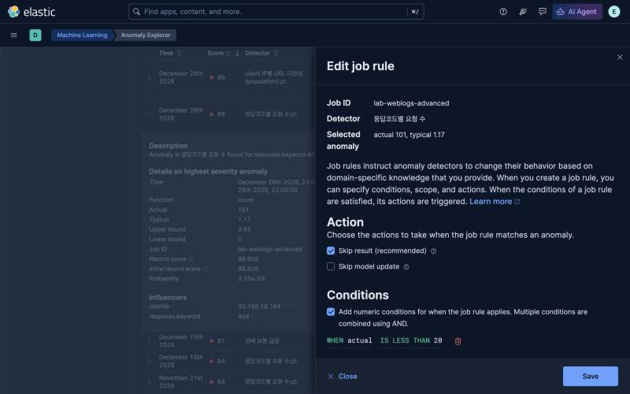
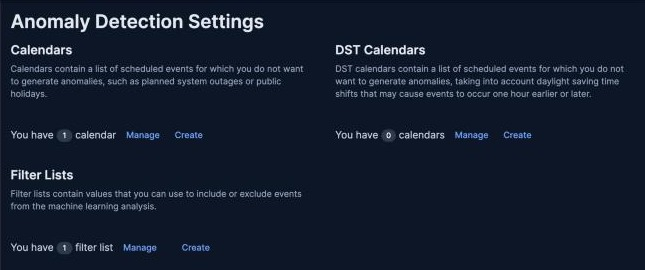

## Noise 유형별 대응

흔히 noise라고 뭉뚱그려 부르지만, 원인은 제각각입니다. 원인부터 나누면 쓸 방법이 정해집니다.
알고리즘 자체도 빠진 값이나 noise에 어느 정도 견디도록 만들어져 있고, 아래는 그 위에 운영자가 더하는 방법들입니다.

| 유형 | 먼저 해 볼 것 | 어디서 |
| --- | --- | --- |
| 애초에 분석할 필요가 없는 데이터(수집기 자신의 로그, health check 요청) | datafeed query에서 `must_not`으로 빼기 | datafeed |
| 한 번 튀고 마는 spike | 알고리즘이 원래 긴 이상을 더 높게 봅니다. alert는 임계값(기본 75)과 Alert delay로 N번 연속 맞을 때만 보내기 | alert rule |
| 한쪽 방향만 궁금한데 양쪽이 다 잡힘 | `high_*`, `low_*`처럼 방향을 정한 function | detector(만들 때) |
| 통계적으로는 의미가 있지만 업무상 별것 아닌 작은 변동 | custom rule condition으로 `actual`, `typical`, `diff_from_typical`에 하한 두기 | detector rule |
| 원래 그런 줄 아는 entity(배치 서버, crawler, 관리 도구) | filter list + custom rule scope | detector rule |
| 늘 자주 나오는 entity가 결과를 다 차지함 | `exclude_frequent`(`all`, `none`, `by`, `over`). rare 계열에는 쓰지 않습니다. | detector(만들 때) |
| 계속 이상한 값이 모델을 망가뜨림 | `skip_model_update` action. API 문서에 이 용도가 그대로 나와 있습니다. | detector rule |
| 성격이 다른 entity가 한 population에 섞여 있음 | datafeed query로 job을 나누거나 `partition`을 같이 쓰기 | job 설계 |
| 미리 알고 있는 이벤트(점검, 행사) | calendar에 scheduled event 등록 | calendar |
| alert가 켜졌다 꺼졌다를 반복함, 확정 전 결과로 오탐이 남 | Flapping Detection, Include interim results 끄기 | alert rule |

:::caution["보기 싫은 것"과 "배우면 안 되는 것"은 다릅니다]
noise는 결과 화면뿐 아니라 모델 학습에도 영향을 줍니다.
`skip_result`는 결과만 지우고 그 값은 계속 모델에 반영합니다. 반대로 `skip_model_update`는 결과는 남기되 모델에서는 뺍니다.
어느 쪽이 필요한지부터 정하세요.
:::

## Custom rule

custom rule(Kibana에서는 job rule)은 조건이 맞으면 detector가 평소대로 하지 않고 지정한 action을 하게 만듭니다.
rule은 detector마다 따로 붙습니다. 그리고 운영 중에 update API나 Kibana에서 바꿀 수 있는 몇 안 되는 detector 설정이기도 합니다.

| 구성 | 내용(9.x API 기준) |
| --- | --- |
| `actions` | `skip_result`(기본값)는 결과를 만들지 않습니다. `skip_model_update`를 같이 주지 않으면 모델은 평소처럼 그 값으로 갱신됩니다.<br/>`skip_model_update`는 그 값을 모델 갱신에 쓰지 않습니다. `skip_result`를 같이 주지 않으면 결과는 평소처럼 나옵니다. 늘 이상한 값이 모델을 흐트러뜨려 다른 결과까지 나빠질 때 씁니다.<br/>둘 다 주면 둘 다 적용됩니다. |
| `scope` | rule을 적용할 시계열을 filter list로 고릅니다. `filter_type`은 `include`(기본) 또는 `exclude`입니다. scope에 쓸 수 있는 field는 그 detector의 `by`, `over`, `partition` field뿐입니다. |
| `conditions` | `applies_to`(`actual`, `typical`, `diff_from_typical`, `time`)를 `gt`, `gte`, `lt`, `lte`로 비교합니다. condition이 여러 개면 AND로 묶입니다. rule에는 scope나 condition이 적어도 하나는 있어야 합니다. |
| function별 제약 | API 문서는 `lat_long`, `metric`, `rare`, `freq_rare` detector에는 `time` condition만 쓸 수 있다고 하고, rare function 문서는 condition rule을 아예 넣을 수 없다고 합니다. 두 문서의 말이 달라서, rare 계열은 scope rule로만 다루는 게 안전합니다. |

Kibana에서는 Anomalies 표 행의 Actions → Configure job rules에서 rule을 만들거나 고칠 수 있습니다. 선택한 이상의 actual과 typical 값이 같이 보여서 임계값을 정하기 편합니다.



### 상황별 rule 예

| 상황 | rule |
| --- | --- |
| CPU iowait가 아주 낮은 수준에서 오르내림 | condition `actual lt 0.25`, `skip_result` (Elastic 제공 job의 기본값) |
| DNS 질의의 정보량이 낮은 결과 | condition `actual lt 350`, `skip_result` (Elastic 제공 job의 기본값) |
| 하우스키핑 process가 가끔 실행됨 | process 이름 filter list를 scope에 연결, `skip_result` (Elastic Security 문서의 예) |
| 건수가 적은 응답코드가 조금 흔들림 | condition `actual lt N`, `skip_result` |
| 부하 테스트 서버가 늘 이상하게 보여 다른 결과까지 흐려짐 | 해당 host filter list를 scope에 연결, `skip_result`와 `skip_model_update` |

```json
POST _ml/anomaly_detectors/<job_id>/_update
{
  "detectors": [
    {
      "detector_index": 0,
      "custom_rules": [
        {
          "actions": ["skip_result"],
          "conditions": [ { "applies_to": "actual", "operator": "lt", "value": 20 } ]
        }
      ]
    }
  ]
}
```

rule은 앞으로 나올 결과에만 적용됩니다. 이미 만들어진 anomaly는 그대로 남습니다. 과거 결과까지 정리하고 싶다면 job을 clone해서 다시 돌리세요.

언제부터 반영되는지는 문서에 나와 있지 않습니다. 9.x update API 문서에서 job을 닫았다 다시 열어야 반영된다고 적힌 건 `background_persist_interval`뿐이고, `custom_rules`는 따로 언급이 없습니다. 그래서 datafeed를 멈추고 job을 닫은 다음 고치는 쪽을 권합니다(확인 필요).

`time` condition은 조심해서 쓰세요. API에 값으로는 나와 있지만 단위와 의미에 대한 설명이 없습니다(확인 필요). 특정 시간대를 빼고 싶다면 calendar를 쓰는 게 더 분명합니다.

## Calendar와 scheduled event

점검, 행사, 공휴일처럼 미리 아는 이벤트 구간은 calendar에 scheduled event로 넣습니다.
calendar는 job이나 job group에 연결하고, event는 연결된 job의 모든 detector에 걸립니다.

event에는 시작 시각, 끝 시각, 설명이 필요합니다. 보통 몇 시간에서 하루 정도의 드문 이벤트에 씁니다.

event 구간에도 bucket 결과는 만들어지지만 anomaly score는 0입니다.
event마다 `skip_result`, `skip_model_update`, `force_time_shift`(초 단위)를 줄 수 있고, `skip_result`와 `skip_model_update`는 둘 다 기본값이 true입니다. 즉 따로 지정하지 않으면 그 구간은 결과도 안 만들고 모델도 갱신하지 않습니다.

calendar는 소급되지 않습니다. job이 그 구간을 분석하기 전에 등록해 둬야 합니다.

매주 하는 정기 점검처럼 반복되는 패턴은 알고리즘이 이미 배우기 때문에 event로 넣을 필요가 없습니다. 길거나 잦은 event를 많이 넣으면 오히려 학습이 늦어집니다.

iCalendar(`.ics`) 파일을 가져오면 반복 이벤트는 첫 번째 것만 들어옵니다. 그리고 calendar와 filter list는 Kibana의 모든 space에서 보입니다.

```json
PUT _ml/calendars/planned-maintenance
{ "description": "계획된 점검", "job_ids": ["web-jobs"] }

POST _ml/calendars/planned-maintenance/events
{
  "events": [
    { "description": "DB 점검", "start_time": "2026-12-01T01:00:00Z", "end_time": "2026-12-01T03:00:00Z" }
  ]
}
```

Kibana에서는 Machine Learning → Anomaly Detection → Settings에서 Calendars, DST Calendars, Filter Lists를 관리합니다.



## DST

시계가 한 시간 앞뒤로 바뀌면 모델이 적응하는 데 며칠이 걸리고, 그동안 오탐이 몰릴 수 있습니다.
DST calendar는 데이터가 만들어진 지역의 시간대를 고르면, 그 시간대의 전환 일정에 맞춘 `force_time_shift` event를 알아서 만들어 줍니다. Elasticsearch 8.16부터 들어간 기능입니다.

여기서 고르는 시간대는 내가 있는 곳이 아니라 **데이터가 만들어진 곳**의 시간대입니다.
미국이나 호주처럼 한 나라 안에 시간대와 규칙이 여럿이면, 시간대별로 job을 나누고 datafeed query로 데이터를 갈라 보내야 합니다.

한국은 DST가 없어서 국내 데이터만 본다면 신경 쓸 일이 없습니다. 해외 법인 데이터를 같이 보거나, [평소와 다른 시각의 로그인](../07-scenarios/#평소와-다른-시각의-로그인)처럼 시각 자체를 분석하는 경우에 검토하면 됩니다.

## 모델 복구와 재실행

| 방법 | 언제 쓰나 | 소급 여부와 주의할 점 |
| --- | --- | --- |
| custom rule | 특정 조건의 결과나 모델 갱신 건너뛰기 | 앞으로 나올 결과에만 적용. 과거 anomaly는 남음 |
| calendar event | 미리 아는 이벤트 구간 빼기 | 분석 전에 등록해야 함 |
| model snapshot revert | 한 번의 사건으로 망가진 모델을 예전 시점으로 되돌리기 | job을 닫고 실행. snapshot은 기본 10일 보관(하루가 지나면 그날 첫 snapshot만 남음). 필요하면 retain |
| job reset | 설정은 그대로 두고 처음부터 다시 학습 | 결과와 모델 상태가 지워짐. 실습 데이터를 다시 돌릴 때 편함 |
| clone 후 재실행 | 설정을 바꿔서 새로 학습(detector 추가, bucket span 변경 포함) | 학습 기간이 다시 필요함. rule을 다 정한 다음에 돌리기 |

## 참고 문서

- [Customizing detectors with custom rules](https://www.elastic.co/docs/explore-analyze/machine-learning/anomaly-detection/ml-configuring-detector-custom-rules)
- [Update an anomaly detection job (API)](https://www.elastic.co/docs/api/doc/elasticsearch/operation/operation-ml-update-job)
- [Add scheduled events to the calendar (API)](https://www.elastic.co/docs/api/doc/elasticsearch/operation/operation-ml-post-calendar-events)
- [Optimizing anomaly results (Elastic Security)](https://www.elastic.co/docs/solutions/security/advanced-entity-analytics/optimizing-anomaly-results)
- [Daylight saving time calendars](https://www.elastic.co/docs/explore-analyze/machine-learning/anomaly-detection/ml-ad-dst-calendars)
- [Manage seasonal time changes smoothly in Elasticsearch (Elastic Blog)](https://www.elastic.co/blog/daylight-saving-time-calendar-elasticsearch)
- [Anomaly detection limitations](https://www.elastic.co/docs/explore-analyze/machine-learning/anomaly-detection/ml-limitations)
