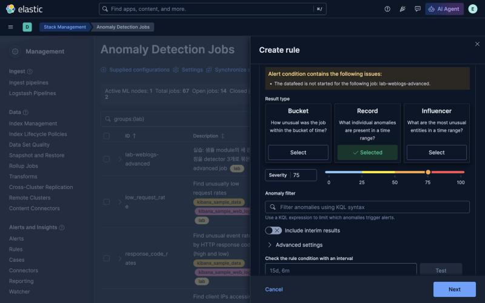

## Alert 설계

Kibana의 Stack Management → Rules에서 **Anomaly detection** rule과 **Anomaly detection jobs health** rule을 같이 만드세요.
alert rule 하나만 있으면 datafeed가 멈추거나 메모리 한도에 걸려도, 결과가 안 나오니 "이상 없음"처럼 조용해 보입니다.

### Anomaly detection rule

| 항목 | 권장 |
| --- | --- |
| Result type | 전체 요약 alert는 Bucket. 원인까지 담고 싶다면 Record나 Influencer를 씁니다. |
| Anomaly filter(KQL) | Record와 Influencer에서 특정 partition 값이나 `actual` / `typical` 조건으로 범위를 좁힙니다. 예: `partition_field_value: "404"`. Elastic Stack 9.3부터 GA입니다. |
| Severity | 기본 75. 학습이 끝난 뒤 alert 건수를 보면서 조정합니다. |
| Check interval | job의 bucket span과 비슷하게 둡니다. |
| Lookback interval | 기본값은 bucket span과 datafeed query delay로 계산됩니다. 기본값보다 줄이면 이상을 놓칠 수 있습니다. |
| Alert delay | N번 연속 조건이 맞아야 alert를 보냅니다. 한 번 튀고 마는 spike를 거르는 데 씁니다. |
| Flapping Detection | 상태가 자주 바뀌는 alert를 줄여 줍니다. |
| Include interim results | 빨리 알아야 한다면 켭니다. datafeed `frequency`가 bucket span보다 짧으면 마지막 bucket의 interim 결과가 먼저 나오고, 나중에 확정 결과로 바뀝니다. 확정된 결과로만 alert를 받고 싶다면 끄세요. |
| 메시지 변수 | `context.topInfluencers`, `context.topRecords`, `context.anomalyExplorerUrl`을 넣어 두면 받는 사람이 바로 조사를 시작할 수 있습니다. |



위 화면 맨 위에 "The datafeed is not started"라는 경고가 보입니다. rule을 만들 때 대상 job의 datafeed가 멈춰 있으면 Kibana가 이렇게 알려 줍니다. 실습처럼 과거 데이터만 분석하고 멈춘 job이라면 무시해도 되지만, 실시간 job에서 이 경고가 보인다면 rule보다 datafeed부터 살펴보세요.

:::note[같은 결과로 alert가 반복되지 않게]
최근 버전의 rule은 결과에 `event.ingested`(결과가 기록된 시각)가 있으면, 지난 실행 이후 새로 기록된 결과만 평가합니다.
그래서 check interval이 bucket span보다 짧아도 같은 결과로 alert가 여러 번 가지 않습니다. 이 field가 없는 예전 결과에는 여전히 lookback interval이 쓰입니다.
:::

rule을 저장하기 전에 Test 버튼을 누르면, 고른 기간 동안 alert가 몇 건 났을지 미리 볼 수 있습니다.

### Anomaly detection jobs health rule

| 점검 | 이럴 때 알려 줍니다 |
| --- | --- |
| Datafeed is not started | job은 열려 있는데 datafeed가 시작되지 않았을 때 |
| Model memory limit reached | 메모리 상태가 `soft_limit`(한도의 60% 초과)나 `hard_limit`(한도 초과)이 됐을 때 |
| Data delay has occurred | 빠진 문서 수가 정해 둔 임계값을 넘었을 때 |
| Errors in job messages | job 메시지에 에러가 찍혔을 때. rule을 만든 뒤에 생긴 에러만 봅니다. |

대상은 job group이나 `*`로 지정할 수 있습니다. group으로 지정하면 나중에 그 group에 들어온 job도 자동으로 포함됩니다.

## Job을 나눴을 때 묶어 보기

job을 여러 개로 나눴더라도 overall buckets API로 묶어 볼 수 있습니다.
job ID 목록이나 job group을 주면, 시간 구간마다 job별 최고 bucket score 중 상위 `top_n`개를 평균 내서 `overall_score`로 돌려줍니다.

`top_n`을 1로 두면 job 하나만 크게 튀어도 score가 높게 나옵니다. job 수와 같게 두면 모든 job이 동시에 이상할 때만 높게 나옵니다.
[실습](../08-hands-on-lab/#lab-3-결과-조회와-비교)에서 샘플 job 3개로 해 보면, `overall_score` 50 이상인 구간이 `top_n` 1일 때 3개, 2일 때 2개, 3일 때 1개로 줄어듭니다.

```json
GET _ml/anomaly_detectors/web-jobs/results/overall_buckets
{ "top_n": 2, "overall_score": 50, "exclude_interim": true }
```

job에는 `groups`를 붙여 두세요. calendar 연결, health rule 대상, overall buckets 조회를 group 단위로 할 수 있습니다.

job과 detector의 `description`에는 무엇을 왜 보는지 자세히 적어 두세요. Elastic도 제공 job에 description, groups, `custom_settings`(누가 만들었는지, 설정 개정 번호)를 꼭 넣어 둡니다.

## Datafeed 운영

| 설정 | 내용 |
| --- | --- |
| `query_delay` | 기본 60~120초 사이 임의 값. 같은 node의 job들이 한꺼번에 조회하지 않게 흩어 놓은 것입니다. ingest 지연이 길면 늘립니다. |
| `frequency` | 실시간으로 조회하는 주기. 기본은 bucket span(짧을 때)이나 그 일부입니다. aggregation을 쓰면 interval로 나누어떨어져야 합니다. |
| `delayed_data_check_config` | 늦게 들어온 데이터 검사. 기본 `check_window`는 2시간과 bucket span 8배 중 큰 값입니다. |
| `max_empty_searches` | 데이터를 한 번도 못 본 실시간 datafeed를 빈 조회 N번 뒤 자동으로 멈춥니다. Elastic Security 제공 job은 10입니다. |
| `chunking_config` | 긴 기간을 나눠서 조회합니다. aggregation이 없으면 `auto`, 있으면 `manual`이 권장값입니다. |
| `runtime_mappings` | datafeed 안에서만 쓰는 계산 field. influencer용 field를 만들 때 편합니다. |
| 권한 | datafeed는 만들거나 마지막으로 고친 사용자의 role을 저장해 두고 그 권한으로 조회합니다. role 이름이 바뀌어도 계속 돌지만, role의 권한이 바뀌면 영향을 받습니다. API key로 만들었다면 그 key의 권한을 따릅니다. |

## 설정을 바꾸는 순서

메모리 한도나 datafeed 설정을 바꿀 때는 아래 순서를 따르는 게 안전합니다. 열린 job에는 바로 적용되지 않거나 거부되는 설정이 있기 때문입니다.

```json
POST _ml/datafeeds/datafeed-<job_id>/_stop
POST _ml/anomaly_detectors/<job_id>/_close

POST _ml/anomaly_detectors/<job_id>/_update
{ "analysis_limits": { "model_memory_limit": "2gb" } }

POST _ml/datafeeds/datafeed-<job_id>/_preview   // 바꾼 datafeed가 원하는 데이터를 읽는지 먼저 확인

POST _ml/anomaly_detectors/<job_id>/_open
POST _ml/datafeeds/datafeed-<job_id>/_start
```

## 장애와 복구

메모리부터 보세요. `memory_status`가 `hard_limit`이면 그 뒤에 보이는 증상(datafeed 정지, 데이터 누락 경고)은 대부분 그 결과입니다. 한도를 올리거나 cardinality를 줄인 다음에 `query_delay` 같은 설정을 봅니다. 자세한 건 [메모리와 규모](../03-memory-and-scale/#메모리-상태-읽기)에 있습니다.

job이 failed 상태가 되면 datafeed를 force 옵션으로 멈추고, job도 force close한 뒤 다시 시작합니다.
다시 시작하자마자 또 실패한다면 일시적인 문제가 아닙니다. job stats에서 job이 올라간 node를 확인하고, 그 node 로그에서 job ID가 들어간 예외를 찾아보세요. job 메시지는 `.ml-notifications-*` index에서도 볼 수 있습니다.

모델이 망가졌다면 snapshot을 되돌리거나(revert) job을 reset합니다. [모델 복구와 재실행](../05-noise-and-exceptions/#모델-복구와-재실행)을 참고하세요.

탐지가 얼마나 정확한지는 실제 장애 이력과 anomaly 결과가 얼마나 겹치는지로 봅니다. record 결과의 score, 95% 신뢰구간, actual 값을 집계해서 숫자로 따져 볼 수도 있습니다.

## 알아 둘 제약사항

| 구분 | 내용 |
| --- | --- |
| split field 이름 | `by`, `count`, `over`라는 이름의 field는 split에 쓸 수 없습니다. |
| 배열 field | 분석할 때 정렬하고 중복을 뺀 뒤 쉼표로 이은 문자열 하나로 바뀝니다. |
| 시간 field | runtime field면 성능이 크게 떨어집니다. 색인된 field를 쓰세요. |
| forecast | job당 동시에 3개까지. population 전용 job은 에러가 납니다. `lat_long`, `rare`, `freq_rare`, `time_of_day`, `time_of_week`도 forecast를 만들 수 없습니다. population detector가 섞인 job은 [01장](../01-job-design/#판단-기준) 참고. |
| Kibana 차트 | `freq_rare`, `time_of_day`, `time_of_week`, `lat_long` 등은 Single Metric Viewer와 Anomaly Explorer에 차트가 안 나옵니다. 목록과 표로 봅니다. |
| frozen tier, rollup | frozen tier 데이터로는 Kibana wizard에서 job을 만들 수 없어 API를 써야 합니다. rollup index는 지원하지 않습니다. |
| categorization | 기본 tokenizer(`ml_standard`)와 사전은 영어 로그를 기준으로 만들어졌습니다. 한국어 로그라면 `categorization_analyzer`를 따로 정의하고 결과를 확인해 보세요. |
| `multivariate_by_fields` | API 문서에 내부용으로 적혀 있습니다. 공식 지원 대상이 아니니 쓰지 않습니다. |

## 도입 단계별 확인 항목

| 단계 | 확인할 것 |
| --- | --- |
| 1. 데이터 | 시간 field가 색인돼 있는지, ingest 지연 분포, split field cardinality, 학습에 쓸 기간, datafeed에서 뺄 데이터 |
| 2. Job 설계 | job과 detector를 나누는 기준([01](../01-job-design/#판단-기준)), function과 split, bucket span, influencer, estimate API로 메모리 가늠 |
| 3. 학습 | 최소 데이터 양, 주기성이 있으면 3주 이상, 학습 중에는 alert 끄기 |
| 4. 결과 검토 | 임계값을 넘는 이상 건수, 상위 이상과 실제 장애 대조, 최대 메모리 사용량, noise 유형 분류 |
| 5. 튜닝 | datafeed query, filter list, custom rule, calendar, 방향을 정한 function, `exclude_frequent` 적용 후 다시 평가. detector를 바꿔야 하면 clone |
| 6. Alert | severity, Alert delay, check interval, job health rule을 함께 설정 |
| 7. 운영 | 메모리 상태 점검, 결과와 snapshot retention, 이벤트와 DST calendar 갱신, 설정 변경 이력 관리 |

:::note
Elastic Cloud Serverless에서는 Elastic Agent Builder와 대화하면서 anomaly detection job을 만드는 기능이 experimental로 나와 있습니다. Elastic Stack은 planned로 표시돼 있습니다.
:::

## 참고 문서

- [Generating alerts for anomaly detection jobs](https://www.elastic.co/docs/explore-analyze/machine-learning/anomaly-detection/ml-configuring-alerts)
- [Get overall bucket results (API)](https://www.elastic.co/docs/api/doc/elasticsearch/operation/operation-ml-get-overall-buckets)
- [Create an anomaly detection job (API)](https://www.elastic.co/docs/api/doc/elasticsearch/operation/operation-ml-put-job)
- [Predict future behavior of a time series (forecast API)](https://www.elastic.co/docs/api/doc/elasticsearch/operation/operation-ml-forecast)
- [Troubleshooting and FAQ](https://www.elastic.co/docs/explore-analyze/machine-learning/anomaly-detection/ml-ad-troubleshooting)
- [Anomaly detection limitations](https://www.elastic.co/docs/explore-analyze/machine-learning/anomaly-detection/ml-limitations)
