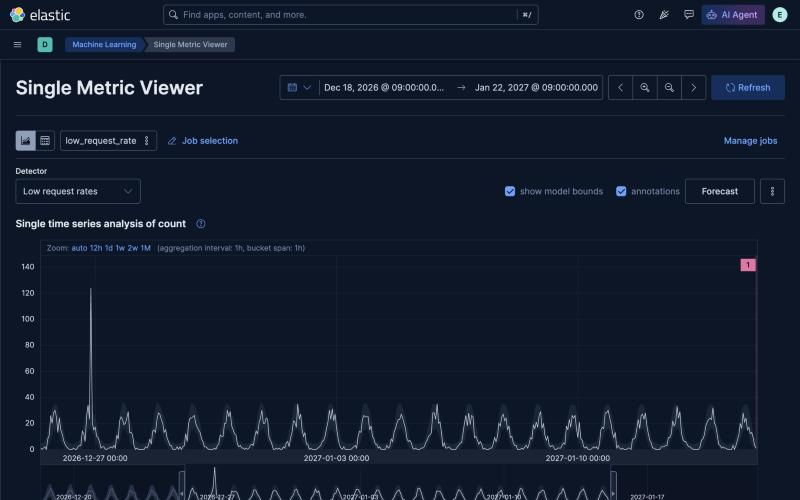

Elastic은 Kibana에 꽤 많은 anomaly detection job을 미리 만들어 넣어 두었습니다(supplied configuration). 데이터가 맞으면 버튼 한 번으로 만들 수 있는 job들입니다.
아래는 그 설정을 GitHub에서 하나씩 열어 보고 정리했습니다. 무엇을 보려는 job인지, detector와 split을 왜 그렇게 골랐는지, noise는 어떻게 처리하는지를 같이 적었습니다.
field 이름과 숫자는 각자 환경에 맞게 바꿔서 쓰세요.
여기 나온 job들을 한 업무 환경에 맞게 골라 조합하고, alert 이후의 대응까지 이은 예는 [09장 공장 생산망 AIOps](../09-manufacturing-aiops/)에 있습니다.

:::note[기준]
Elasticsearch, Kibana 9.x 기준입니다. 제공 job 설정은 GitHub [elastic/kibana](https://github.com/elastic/kibana/tree/main/x-pack/platform/plugins/shared/ml/server/models/data_recognizer/modules) main 브랜치를 2026년 11월에 봤습니다. 화면은 Elastic Cloud Hosted 9.5.5에서 [실습](../08-hands-on-lab/)을 돌려 얻은 것입니다.
:::

| # | 시나리오 | 구성 |
| --- | --- | --- |
| 1 | [서비스 전체 요청 급감](#서비스-전체-요청-급감) | detector 1개, split 없음, `low_count` |
| 2 | [응답코드별 이상](#응답코드별-이상) | `count`, `partition` |
| 3 | [APM 서비스 핵심 지표 4종](#apm-서비스-핵심-지표-4종) | detector 4개, `by`와 `partition` 같이, aggregation |
| 4 | [URL을 훑는 스캐닝 IP](#url을-훑는-스캐닝-ip) | population(`over`), `high_distinct_count` |
| 5 | [수집 중단 감시](#수집-중단-감시) | `low_count`, `partition`, `use_null` |
| 6 | [호스트 자원 지표와 기본 noise rule](#호스트-자원-지표와-기본-noise-rule) | `high_mean`, `partition`, custom rule |
| 7 | [호스트별 드문 process](#호스트별-드문-process) | `rare`, `by`와 `partition` 같이 |
| 8 | [평소와 다른 시각의 로그인](#평소와-다른-시각의-로그인) | `time_of_day`, `by`와 `over` 같이 |
| 9 | [DNS tunneling 의심](#dns-tunneling-의심) | `high_info_content`, population, custom rule |
| 10 | [로그 메시지 패턴 급증](#로그-메시지-패턴-급증) | categorization, per-partition categorization |
| 11 | [용량 추세 예측](#용량-추세-예측) | forecast |
| 12 | [같은 목적, job 3개 vs advanced job 1개](#같은-목적-job-3개-vs-advanced-job-1개) | detector 구성을 고르는 예 |

## 서비스 전체 요청 급감

웹 서비스 전체 요청이 평소보다 확 줄었다면 장애나 배포 실패, 앞단 네트워크 문제일 가능성이 큽니다. 보통 가장 먼저 만드는 KPI job입니다.

| 항목 | 내용 |
| --- | --- |
| 보려는 것 | 전체 요청 수가 평소 패턴보다 낮아지는 순간 |
| detector | `low_count` 1개, split 없음 |
| bucket span 등 | Kibana 샘플 job은 1h, Nginx 제공 job은 15m. 둘 다 `summary_count_field_name`을 `doc_count`로 둔 aggregation 입력 |
| 왜 이렇게 | 늘어나는 건 관심 밖이고 줄어드는 것만 문제라서 낮은 쪽만 보는 `low_count`를 씁니다. 시계열이 하나뿐이라 메모리도 적게 들고(제공 job은 10mb) 결과를 읽기도 쉽습니다. |
| noise와 주의 | ingest 지연이 일정하게 생기면 `low_count`가 오탐을 냅니다. `query_delay`와 delayed data check부터 확인하세요. 계획된 점검은 calendar로 등록합니다. |
| 참고한 제공 job | `low_request_rate`(Kibana 샘플 웹 로그), `low_request_rate_ecs`(Nginx, Apache) |

```json
{ "function": "low_count" }
// analysis_config.summary_count_field_name: "doc_count"
```



실습 데이터로 돌려 보면 방향을 정한 function이 어떻게 동작하는지 바로 보입니다. 12월 26일에 스캐닝 때문에 요청이 평소의 몇 배로 튀었는데도, 이 job은 아무것도 표시하지 않습니다. `low_count`는 줄어드는 쪽만 보기 때문입니다. 같은 시각을 양쪽 다 보는 `count` detector는 높은 score로 잡아냈습니다([04장](../04-reading-results/#detector가-여러-개인-job-읽기) 표 참고).

## 응답코드별 이상

200, 404, 500 같은 응답코드는 평소 건수부터 차이가 큽니다. 하나로 합쳐서 보면 작은 코드가 급증해도 묻혀 버립니다.

| 항목 | 내용 |
| --- | --- |
| 보려는 것 | 응답코드별로 평소와 다른 증가나 감소, 그리고 그 원인 client |
| detector | `count` 1개, `partition_field_name`: 응답코드 |
| influencer | client IP, 응답코드 |
| bucket span 등 | 샘플 job 1h(memory 10mb), Nginx 제공 job 15m(memory 100mb) |
| 왜 이렇게 | 코드마다 규모가 다르니 `partition`으로 완전히 따로 baseline을 둡니다. `count`는 양쪽을 다 보기 때문에 200이 줄어드는 것과 404가 늘어나는 것을 모두 잡습니다. |
| noise와 주의 | 건수가 아주 적은 코드는 조금만 흔들려도 score가 납니다. `actual`이 N보다 작으면 `skip_result`하는 condition rule을 두세요. 늘어나는 쪽만 보고 싶다면 `high_count`를 씁니다. |
| 조사하는 흐름 | 404가 급증한 구간을 누르면 influencer에 특정 client IP가 보여서, 스캐닝인지 바로 판단할 수 있습니다(Kibana 튜토리얼의 예). |
| 참고한 제공 job | `response_code_rates`(샘플), `status_code_rate_ecs`(Nginx, Apache) |

```json
{ "function": "count", "partition_field_name": "response.keyword" }
```

## APM 서비스 핵심 지표 4종

한 서비스의 지연, 처리량, 실패율, 트랜잭션 수는 같은 장애가 서로 다른 모습으로 드러난 것입니다. Elastic APM이 제공하는 job은 이 네 지표를 detector 4개로 한 job에 묶어 둡니다.

| 항목 | 내용 |
| --- | --- |
| 보려는 것 | 서비스와 transaction type별로 네 가지 증상을 한 번에 보고, 같은 시각의 증상을 overall score 하나로 요약 |
| detector | `high_mean`(지연), `mean`(처리량), `high_mean`(실패율), `low_count`(트랜잭션 수). 모두 `by: transaction.type`, `partition: service.name` |
| influencer | `transaction.type`, `service.name` |
| datafeed | composite aggregation(60초 date_histogram + `transaction.type`, `service.name` terms)으로 요약해서 읽음. `summary_count_field_name: doc_count`, chunking off |
| bucket span 등 | 15m, memory 32mb, model plot 켬, 결과 index `custom-apm` |
| 왜 이렇게 | 네 지표가 entity 키도, bucket span도, aggregation 입력도 같아서 한 job에 두는 게 자연스럽습니다. 처리량은 급증도 급감도 의미가 있어 양쪽을 보는 `mean`을 쓰고, 지연과 실패율은 높아지는 쪽만 봅니다. |
| noise와 주의 | 서비스가 늘면 partition 수만큼 메모리가 늘어납니다. detector를 하나 더 넣고 싶어도 기존 job에는 못 넣어서 새 job을 만들어야 합니다. |
| 참고한 제공 job | `apm_tx_metrics`(apm_transaction module). `low_count` detector는 Elastic Stack 9.6부터 새로 만든 APM job에 들어갑니다. 그 전에 만든 job에는 detector가 3개이고, 넣으려면 job을 지우고 다시 만들어야 합니다. |

```json
"detectors": [
  { "function": "high_mean", "field_name": "transaction_latency",
    "by_field_name": "transaction.type", "partition_field_name": "service.name" },
  { "function": "mean", "field_name": "transaction_throughput",
    "by_field_name": "transaction.type", "partition_field_name": "service.name" },
  { "function": "high_mean", "field_name": "failed_transaction_rate",
    "by_field_name": "transaction.type", "partition_field_name": "service.name" },
  { "function": "low_count",
    "by_field_name": "transaction.type", "partition_field_name": "service.name" }
]
```

## URL을 훑는 스캐닝 IP

외부 IP는 수도 많고 대부분 잠깐 왔다 가기 때문에 IP마다 baseline을 만들기 어렵습니다. 같은 시간대의 다른 IP들과 비교하는 편이 낫습니다.

| 항목 | 내용 |
| --- | --- |
| 보려는 것 | 다른 client보다 서로 다른 URL을 유독 많이 요청하는 IP |
| detector | `high_distinct_count(url)`, `over_field_name`: client IP |
| influencer | client IP |
| bucket span 등 | 1h |
| 왜 이렇게 | population 분석은 entity가 많아도 하나씩 분석하는 것보다 자원을 덜 쓰고, 처음 보는 IP도 같은 시간대의 다른 IP와 비교할 수 있습니다. |
| noise와 주의 | 검색 엔진 crawler나 사내 모니터링 봇은 원래 URL을 많이 훑습니다. datafeed query로 빼거나, filter list를 `over` field(client IP) scope에 연결하세요. population 전용 job이라 forecast는 에러가 납니다. |
| 참고한 제공 job | `url_scanning`(샘플), `source_ip_url_count_ecs`(Nginx, Apache) |

```json
{ "function": "high_distinct_count", "field_name": "url.keyword", "over_field_name": "clientip" }
```

## 수집 중단 감시

로그나 메트릭 수집이 소리 없이 멈추면 다른 감시가 전부 무력해집니다. dataset별로 건수가 평소보다 줄었는지 봅니다.

| 항목 | 내용 |
| --- | --- |
| 보려는 것 | 데이터 소스(dataset)별 수집량 감소 |
| detector | Metricbeat job은 `low_count` partition `event.dataset`. 로그 job은 `count` partition `event.dataset`에 `use_null: true` |
| bucket span 등 | Metricbeat job 10m(memory 15mb). 로그 job 15m, `results_retention_days` 120 |
| 왜 이렇게 | dataset마다 수집 주기와 양이 달라서 따로 baseline이 필요합니다. `use_null`을 켜면 dataset 값이 빠진 문서도 따로 지켜봅니다. |
| noise와 주의 | Agent 업그레이드나 점검 시간은 calendar로 등록합니다. ingest 지연이 잦다면 `query_delay`를 늘리세요. |
| 참고한 제공 job | `metricbeat_outages_ecs`, `log-entry-rate`(logs_ui_analysis) |

```json
{ "function": "count", "partition_field_name": "event.dataset", "use_null": true }
```

## 호스트 자원 지표와 기본 noise rule

CPU iowait처럼 값이 원래 아주 작은 지표는, 통계적으로는 크게 변했어도 실제로는 아무 영향이 없는 경우가 많습니다. Elastic이 제공하는 job은 이런 noise를 custom rule로 미리 막아 둡니다.

| 항목 | 내용 |
| --- | --- |
| 보려는 것 | 호스트별 iowait가 평소보다 높아지는 구간 |
| detector | `high_mean(system.cpu.iowait.pct)`, partition `host.name` |
| custom rule | `actual`이 0.25보다 작으면 `skip_result` |
| bucket span 등 | 10m, memory 25mb, influencer `host.name` |
| 왜 이렇게 | 호스트마다 부하 수준이 달라서 `partition`을 씁니다. rule은 의미 있는 수준 아래의 결과만 지우고, 모델 학습에는 그대로 반영합니다(`skip_result`만 줬기 때문). |
| noise와 주의 | 0.25라는 기준은 각자 환경의 운영 기준에 맞게 다시 정하세요. |
| 참고한 제공 job | `high_mean_cpu_iowait_ecs`(metricbeat_system_ecs) |

```json
{
  "function": "high_mean",
  "field_name": "system.cpu.iowait.pct",
  "partition_field_name": "host.name",
  "custom_rules": [
    { "actions": ["skip_result"],
      "conditions": [ { "applies_to": "actual", "operator": "lt", "value": 0.25 } ] }
  ]
}
```

## 호스트별 드문 process

서버마다 평소에 도는 process 목록이 다릅니다. 다른 서버에서는 흔한 process라도 이 서버에서 처음 보는 거라면 들여다볼 만합니다.

| 항목 | 내용 |
| --- | --- |
| 보려는 것 | 호스트마다 드물게 실행된 process |
| detector | `rare` by `process.name`, partition `host.name` |
| influencer | `host.name`, `host.id`, `process.name`, `user.name`, `event.module`, `process.executable`, `process.args` (7개) |
| bucket span 등 | 45m, memory 256mb |
| 왜 이렇게 | `partition`으로 호스트마다 분석을 따로 하고, 그 안에서 `by`로 process별 출현 이력을 봅니다. 조사할 때 필요한 실행 경로와 인자는 influencer로 같이 남깁니다. |
| rare 계열 제약 | `exclude_frequent`와 같이 쓰지 않습니다. condition rule 대신 scope rule을 씁니다. forecast는 안 됩니다. 학습에 bucket 20개 이상이 필요하고, bucket span은 짧게 잡는 게 좋습니다. |
| noise와 주의 | 배포나 패치 시간은 calendar로 등록합니다. 승인된 관리 도구는 filter list를 `by` field(`process.name`) scope에 연결하세요. |
| 참고한 제공 job | `v3_rare_process_by_host_linux_ea`, `v3_rare_process_by_host_windows_ea` |

```json
{ "function": "rare", "by_field_name": "process.name", "partition_field_name": "host.name" }
```

## 평소와 다른 시각의 로그인

탈취된 계정은 실제 주인과 다른 시간대에 쓰이는 경우가 많습니다. 사용자마다 평소 로그인하는 시각과 다른 로그인을 찾습니다.

| 항목 | 내용 |
| --- | --- |
| 보려는 것 | 사용자별로 평소와 다른 시각에 성공한 로그인 |
| detector | `time_of_day` by `user.name`, over `source.geo.region_iso_code` |
| influencer | `source.ip`, `source.geo.region_iso_code`, `host.name`, `user.name`, `user.id`, `host.id`, `event.module` |
| bucket span 등 | 15m, memory 128mb |
| 주의 | `time_of_day`는 forecast가 안 되고 Kibana 차트에도 안 나옵니다(목록과 표로 확인). 시각 자체를 보는 분석이라 DST 전환에 직접 영향을 받을 수 있습니다. 해외 데이터가 섞인다면 DST calendar를 검토하세요. |
| noise와 주의 | 교대 근무자나 출장자는 filter list를 `by` field(`user.name`) scope에 연결합니다. |
| 참고한 제공 job | `auth_rare_hour_for_a_user_ea`(security_auth) |

```json
{ "function": "time_of_day", "by_field_name": "user.name", "over_field_name": "source.geo.region_iso_code" }
```

## DNS tunneling 의심

DNS 질의 이름에 데이터를 실어서 빼돌리면, 질의 문자열의 정보량(무작위성)이 평소보다 커집니다.

| 항목 | 내용 |
| --- | --- |
| 보려는 것 | 다른 도메인(eTLD)보다 정보량이 높은 DNS 질의 |
| detector | `high_info_content(dns.question.name)`, over `dns_question_etld` |
| custom rule | `actual`이 350보다 작으면 `skip_result` |
| influencer | `destination.ip`, `host.name`, `host.id`, `dns_question_etld`, `dns.question.type`, `dns.question.name`, `source.ip` |
| bucket span 등 | 15m, memory 256mb |
| 왜 이렇게 | population 분석으로 도메인끼리 비교하고, 정보량이 일정 수준이 안 되는 결과는 rule로 지웁니다. Elastic Security 문서도 결과를 줄이는 방법으로 DNS tunneling job에 `actual` 조건 rule을 거는 예를 듭니다(문서의 예는 이전 이름인 `packetbeat_dns_tunneling` job 기준). |
| 참고한 제공 job | `dns_tunneling_ea`(security_network) |

## 로그 메시지 패턴 급증

같은 에러라도 메시지 문자열은 ID나 시각, 숫자 때문에 매번 조금씩 다릅니다. categorization은 메시지에서 변하지 않는 부분을 기준으로 category를 만들고, category별 건수를 분석합니다.

| 항목 | 내용 |
| --- | --- |
| 보려는 것 | dataset별로 특정 메시지 유형이 평소보다 많이 나오는 구간 |
| 설정 | `categorization_field_name: message`. detector는 `count` by `mlcategory`, partition `event.dataset`, `use_null: true` |
| per-partition categorization | `enabled: true`, `stop_on_warn: true`. `mlcategory`를 쓰는 detector는 모두 같은 partition field를 써야 합니다. |
| bucket span 등 | 15m, memory 100mb, `results_retention_days` 120, influencer `event.dataset`, `mlcategory` |
| 왜 이렇게 | dataset마다 메시지 종류가 달라서 category도 dataset별로 따로 만듭니다. `stop_on_warn`을 켜 두면 categorization이 잘 안 되는 dataset만 분석을 멈춰서, 거기에 계속 자원을 쓰지 않습니다. |
| 한국어 로그 | 기본 tokenizer(`ml_standard`)는 영어 로그를 기준으로 만들어졌습니다. 한국어 메시지라면 `categorization_analyzer`를 따로 정의하고 결과를 확인해 보세요. |
| 참고한 제공 job | `log-entry-categories-count`(logs_ui_categories) |

```json
"categorization_field_name": "message",
"per_partition_categorization": { "enabled": true, "stop_on_warn": true },
"detectors": [
  { "function": "count", "by_field_name": "mlcategory",
    "partition_field_name": "event.dataset", "use_null": true }
]
```

## 용량 추세 예측

디스크 사용률이나 트래픽처럼 꾸준히 늘어나는 지표는 이상 탐지와 함께 앞으로의 추세도 궁금해집니다. forecast는 학습된 모델로 앞으로의 값과 범위를 계산해 줍니다.

| 항목 | 내용 |
| --- | --- |
| 보려는 것 | 호스트나 서비스별 지표의 앞으로 1~4주 추세 |
| 구성 | forecast가 되는 function(`count`, `mean`, `max` 등)에 `partition` 또는 `by` split. population, `rare`, `freq_rare`, `lat_long`, `time_of_day`, `time_of_week`는 forecast가 안 됩니다. |
| 실행 | 열려 있는 job에 forecast API 호출. `duration` 기본 1d, 결과 보관 `expires_in` 기본 14d, `max_model_memory` 기본 20mb(최대 500mb) |
| 주의 | job당 동시에 3개까지 돌릴 수 있습니다. 메모리 상태가 정상일 때만 돌고, 학습 초반의 forecast는 잘 맞지 않습니다. 예측하려는 기간만큼의 과거 데이터가 있어야 합니다. |
| 설계할 때 | forecast가 필요한 지표는 population detector와 다른 job에 두는 편이 깔끔합니다([01장](../01-job-design/#판단-기준)). |

```json
POST _ml/anomaly_detectors/<job_id>/_forecast
{ "duration": "14d", "expires_in": "30d" }
```

## 같은 목적, job 3개 vs advanced job 1개

Kibana 샘플 웹 로그 module은 세 가지 관점을 job 3개로 나눠서 만듭니다. 같은 detector 3개를 advanced job 하나에 넣을 수도 있습니다([실습 Lab 2](../08-hands-on-lab/#lab-2-advanced-job-하나에-detector-3개)).
어느 쪽이 맞는지는 무엇을 같이 써도 되느냐에 달려 있습니다.

| 관점 | job 3개 (Kibana 샘플 module) | advanced job 1개 (detector 3개) |
| --- | --- | --- |
| 구성 | `low_request_rate`(`low_count`), `response_code_rates`(`count` partition 응답코드), `url_scanning`(`high_distinct_count` over client IP). 모두 1h | 같은 detector 3개를 한 job에. bucket span 1h 공유 |
| 결과 보기 | job마다 swim lane이 따로 나옵니다. | overall score 하나와, detector를 가로지르는 top influencer(client IP, 응답코드)를 봅니다. |
| aggregation | `low_request_rate`만 aggregation 입력(`summary_count_field_name: doc_count`)을 씁니다. | `summary_count_field_name`은 모든 detector에 걸려서 그대로 옮길 수 없습니다. 원본 문서를 읽습니다. |
| forecast | `low_request_rate`와 `response_code_rates`는 forecast가 됩니다. `url_scanning`은 에러가 납니다. | 9.5.5에서 해 보면 에러 없이 끝나고, population detector를 뺀 나머지 두 detector의 forecast만 만들어집니다. |
| model plot | job마다 켜고 끌 수 있습니다. | job 단위로 한 번에 정합니다. |
| alert | rule 3개, 또는 job group 하나로 관리합니다. | rule 하나로 전체를 봅니다. detector마다 다르게 보내고 싶다면 record 결과와 KQL filter를 씁니다. |
| 변경 | 바꿀 job 하나만 다시 만들면 됩니다. | detector 하나만 바꿔도 job 전체를 다시 만들고 학습시켜야 합니다. |

같은 화면에서 증상을 같이 보는 게 목적이라면 detector를 묶으세요. forecast, aggregation, bucket span, alert 정책 중 하나라도 따로 가져가야 한다면 job을 나누는 게 낫습니다.
Elastic이 샘플 module을 job 3개로 나눈 것도, job마다 맞는 입력 방식(aggregation)과 forecast를 살리려는 선택으로 보입니다.

## 참고 문서

- [Kibana anomaly detection job wizards (제공 구성 목록)](https://www.elastic.co/docs/reference/machine-learning/supplied-anomaly-detection-configurations)
- [Kibana 제공 job 설정 (data_recognizer modules)](https://github.com/elastic/kibana/tree/main/x-pack/platform/plugins/shared/ml/server/models/data_recognizer/modules)
- [Tutorial: Getting started with anomaly detection](https://www.elastic.co/docs/explore-analyze/machine-learning/anomaly-detection/ml-getting-started)
- [Optimizing anomaly results (Elastic Security)](https://www.elastic.co/docs/solutions/security/advanced-entity-analytics/optimizing-anomaly-results)
- [Predict future behavior of a time series (forecast API)](https://www.elastic.co/docs/api/doc/elasticsearch/operation/operation-ml-forecast)
