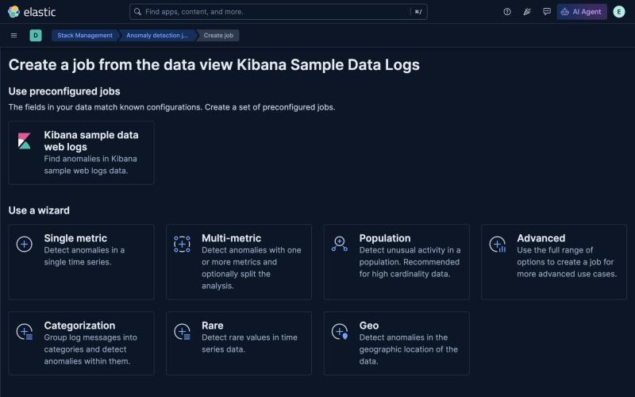
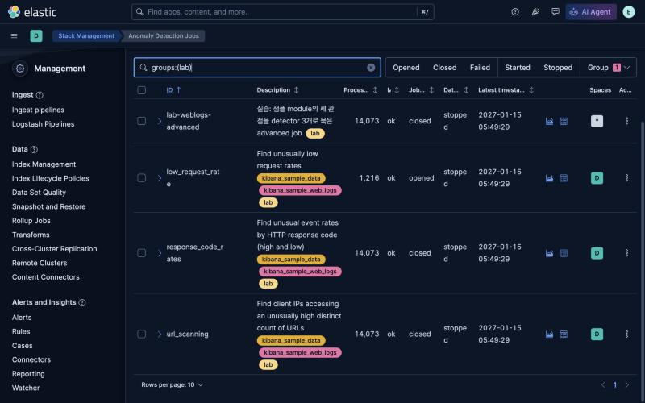
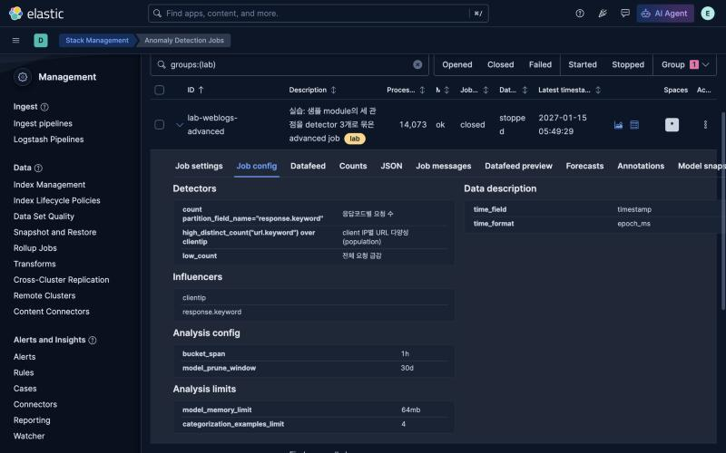
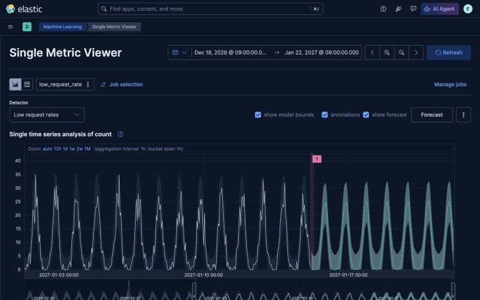

설정을 읽기만 해서는 score가 왜 그렇게 나오는지, rule과 calendar가 결과를 어떻게 바꾸는지 감이 잘 오지 않습니다. 앞 장의 내용을 Kibana 샘플 데이터로 직접 실행해 확인합니다.

:::note[기준]
Elasticsearch, Kibana 9.x 기준입니다. 공식 문서는 2026년 11월에 다시 확인했습니다. 결과와 화면은 Elastic Cloud Hosted 9.5.5에서 이 순서대로 실행해 얻은 것입니다. 샘플 데이터는 추가한 날짜를 기준으로 시각이 정해지기 때문에, 직접 해 보면 날짜는 다르게 나옵니다.
:::

## 준비

- Kibana Dev Tools Console에서 실행합니다. Machine Learning 권한(`machine_learning_admin` 등)이 필요합니다.
- 데이터는 Kibana 샘플 Web logs(`kibana_sample_data_logs`)입니다. Kibana 홈의 샘플 데이터 화면에서 추가하세요. 아래에서 쓰는 field 이름(`timestamp`, `clientip`, `url.keyword`, `response.keyword`, `event.dataset`)은 Kibana가 제공하는 샘플 job 설정과 같습니다.
- 샘플 데이터에는 앞으로의 시각도 들어 있습니다. datafeed를 시작할 때 실시간(No end time)으로 두지 말고 `end`를 꼭 지정하세요.
- 순서는 Kibana 샘플 job 3개를 만들고(Lab 1), 같은 관점을 advanced job 하나로 만든 다음(Lab 2), 둘을 비교하는 흐름입니다(Lab 3).
- 이 페이지의 Dev Tools 요청은 저장소의 [`labs/anomaly-detection/hands-on-lab.console`](https://github.com/Munsik/engineering-notes/blob/main/labs/anomaly-detection/hands-on-lab.console)에 순서대로 모아 두었습니다. Console에 한 번에 붙여 넣고 위에서부터 실행하면 됩니다.

:::note[Elastic Cloud Serverless, Elastic Stack 9.6 이상]
Lab 3의 결과 조회 API 대신 [ES|QL `.ml-anomalies` view](../04-reading-results/#esql로-결과-조회하기)를 쓸 수 있습니다.
:::

## Lab 0. 데이터 확인

```json
GET kibana_sample_data_logs/_search
{
  "size": 0,
  "aggs": {
    "min_t": { "min": { "field": "timestamp" } },
    "max_t": { "max": { "field": "timestamp" } },
    "codes": { "cardinality": { "field": "response.keyword" } },
    "ips":   { "cardinality": { "field": "clientip" } },
    "urls":  { "cardinality": { "field": "url.keyword" } }
  }
}
```

`min_t`와 `max_t`가 분석할 시간 범위입니다. cardinality 값은 Lab 2에서 메모리를 가늠할 때 씁니다.
제가 돌렸을 때는 문서 14,074건, 두 달 정도 기간에 응답코드 3개, client IP 1,001개, URL 448개가 나왔습니다.

## Lab 1. Kibana 샘플 job 3개 만들기

1. Machine Learning → Anomaly Detection → Jobs에서 Create job을 누르고, data view로 Kibana Sample Data Logs를 고릅니다.
2. 맨 위 Use preconfigured jobs에 "Kibana sample data web logs"가 보입니다. 이걸 누르고 기본값 그대로 Create Jobs를 누르면 job 3개와 datafeed 3개가 만들어집니다.
   - `low_request_rate`: `low_count`
   - `response_code_rates`: `count`, partition `response.keyword`
   - `url_scanning`: `high_distinct_count` over `clientip`
   - 셋 다 bucket span 1h입니다.
3. Jobs 목록에서 세 job을 펼쳐 JSON 탭을 열고, detector와 datafeed 설정을 확인하세요. `low_request_rate`만 aggregation 입력(`summary_count_field_name: doc_count`)을 쓰는 게 보입니다.



## Lab 2. Advanced job 하나에 detector 3개

샘플 job 3개가 보는 관점을 detector 3개로 한 job에 넣어 봅니다.
detector마다 split 방식이 다르기 때문에(`partition`, `over`, 없음) multi-metric wizard로는 만들 수 없는 구성입니다.

먼저 메모리를 가늠합니다. `<codes>`, `<ips>`는 Lab 0 결과로 바꾸세요.
`max_bucket_cardinality`는 bucket 하나 안에서의 최대 개수인데, 모르면 전체 값을 넣어서 넉넉하게 보면 됩니다.

```json
POST _ml/anomaly_detectors/_estimate_model_memory
{
  "analysis_config": {
    "bucket_span": "1h",
    "detectors": [
      { "function": "count", "partition_field_name": "response.keyword" },
      { "function": "high_distinct_count", "field_name": "url.keyword", "over_field_name": "clientip" },
      { "function": "low_count" }
    ],
    "influencers": ["clientip", "response.keyword"]
  },
  "overall_cardinality":    { "response.keyword": <codes>, "clientip": <ips> },
  "max_bucket_cardinality": { "response.keyword": <codes>, "clientip": <ips> }
}
```

이제 job과 datafeed를 만듭니다. `model_memory_limit`은 추정값보다 여유 있게 잡습니다.

```json
PUT _ml/anomaly_detectors/lab-weblogs-advanced
{
  "description": "실습: 샘플 module의 세 관점을 detector 3개로 묶은 advanced job",
  "groups": ["lab"],
  "analysis_config": {
    "bucket_span": "1h",
    "detectors": [
      { "detector_description": "응답코드별 요청 수",
        "function": "count", "partition_field_name": "response.keyword" },
      { "detector_description": "client IP별 URL 다양성 (population)",
        "function": "high_distinct_count", "field_name": "url.keyword", "over_field_name": "clientip" },
      { "detector_description": "전체 요청 급감",
        "function": "low_count" }
    ],
    "influencers": ["clientip", "response.keyword"]
  },
  "analysis_limits": { "model_memory_limit": "64mb" },
  "data_description": { "time_field": "timestamp" },
  "model_plot_config": { "enabled": false },
  "results_index_name": "lab-weblogs-advanced"
}

PUT _ml/datafeeds/datafeed-lab-weblogs-advanced
{
  "job_id": "lab-weblogs-advanced",
  "indices": ["kibana_sample_data_logs"],
  "query": { "bool": { "filter": [ { "term": { "event.dataset": "sample_web_logs" } } ] } }
}

POST _ml/anomaly_detectors/lab-weblogs-advanced/_open

POST _ml/datafeeds/datafeed-lab-weblogs-advanced/_start
{ "start": "<Lab 0의 min_t>", "end": "<Lab 0의 max_t>" }
```

`end`까지 분석이 끝나면 datafeed가 멈추고 job도 닫힙니다. Kibana 샘플 job과 데이터도 bucket span도 같아서 결과를 그대로 비교할 수 있습니다.

:::tip[추정값과 실제 사용량]
제 환경에서 estimate API는 16mb를 돌려줬는데, 분석을 마친 뒤 `peak_model_bytes`는 약 26MB였습니다. 추정값은 출발점일 뿐이니 여유를 두고 잡으세요.
:::

Jobs 목록에서 `groups:(lab)`으로 검색하면 실습용 job 4개만 볼 수 있습니다.



`lab-weblogs-advanced`를 펼쳐 Job config 탭을 열면 detector 3개와 각각의 split 설정을 볼 수 있습니다.



## Lab 3. 결과 조회와 비교

```json
# job 상태와 model memory
GET _ml/anomaly_detectors/lab-weblogs-advanced/_stats

# record: detector_index로 어느 detector가 잡았는지 구분 (0, 1, 2)
GET _ml/anomaly_detectors/lab-weblogs-advanced/results/records
{ "record_score": 50, "exclude_interim": true, "sort": "record_score", "desc": true, "page": { "size": 10 } }

# influencer: detector를 가로질러 모은 원인 entity
GET _ml/anomaly_detectors/lab-weblogs-advanced/results/influencers
{ "influencer_score": 50, "sort": "influencer_score", "desc": true, "page": { "size": 10 } }

# 비교 1: advanced job 하나의 bucket score
GET _ml/anomaly_detectors/lab-weblogs-advanced/results/buckets
{ "anomaly_score": 50, "exclude_interim": true, "sort": "anomaly_score", "desc": true, "page": { "size": 5 } }

# 비교 2: 샘플 job 3개를 overall buckets로 묶어 보기
GET _ml/anomaly_detectors/low_request_rate,response_code_rates,url_scanning/results/overall_buckets
{ "top_n": 1, "overall_score": 50, "exclude_interim": true }
```

먼저 `_stats`에서 `model_size_stats.memory_status`가 `ok`인지, `data_counts.processed_record_count`가 예상과 맞는지 보세요.

제 결과에서 가장 눈에 띈 건 한 시간 동안 일어난 일입니다. 같은 bucket에서 두 detector가 동시에 높은 score를 냈습니다.

| detector | entity | actual | typical | record score |
| --- | --- | --- | --- | --- |
| 1 (client IP별 URL 다양성) | client IP 하나 | URL 88개 | 1개 | 99 |
| 0 (응답코드별 요청 수) | 404 | 101건 | 약 1.2건 | 98 |

influencer 결과도 같은 IP(100점)와 404(99점)가 맨 위에 나옵니다. IP 하나가 짧은 시간에 URL을 잔뜩 훑으면서 404가 쏟아진, 흔히 보는 스캐닝 모습입니다.
그리고 이 시각에 전체 요청도 크게 늘었지만, 감소만 보는 detector 2(`low_count`)는 아무것도 잡지 않았습니다.

overall buckets에서 `top_n`을 1, 2, 3으로 바꿔 보면, `overall_score` 50 이상인 구간이 3개, 2개, 1개로 줄어듭니다. "여러 job이 같이 이상할 때만" 높게 나오게 하는 효과를 숫자로 확인할 수 있습니다.

Kibana Anomaly Explorer에서 `lab-weblogs-advanced`를 열어 보면 같은 내용이 화면으로 보입니다([04장](../04-reading-results/)에 캡처를 넣어 두었습니다).

## Lab 4. Noise 대응: filter와 custom rule

```json
# 원래 그런 줄 아는 client를 filter list로 등록
PUT _ml/filters/lab-trusted-clients
{ "description": "알려진 정상 client", "items": ["<정상 IP 1>", "<정상 IP 2>"] }

# datafeed를 멈추고 job을 닫은 뒤 고칩니다
POST _ml/datafeeds/datafeed-lab-weblogs-advanced/_stop
POST _ml/anomaly_detectors/lab-weblogs-advanced/_close

# detector 0(응답코드별 count): 20건 미만이면 결과 생략
# detector 1(population): 정상 client는 결과 생략 (over field scope)
POST _ml/anomaly_detectors/lab-weblogs-advanced/_update
{
  "detectors": [
    { "detector_index": 0,
      "custom_rules": [ { "actions": ["skip_result"],
        "conditions": [ { "applies_to": "actual", "operator": "lt", "value": 20 } ] } ] },
    { "detector_index": 1,
      "custom_rules": [ { "actions": ["skip_result"],
        "scope": { "clientip": { "filter_id": "lab-trusted-clients", "filter_type": "include" } } } ] }
  ]
}

POST _ml/anomaly_detectors/lab-weblogs-advanced/_open
```

rule이 detector마다 따로 붙는 걸 확인하세요. Kibana에서 Anomalies 표 행의 Actions → Configure job rules를 누르면 방금 넣은 rule이 보입니다([05장](../05-noise-and-exceptions/#custom-rule) 캡처).
rule은 앞으로 나올 결과에만 적용됩니다. 효과를 비교해 보려면 job을 reset하고 다시 돌리세요(Lab 8).

## Lab 5. Calendar

```json
PUT _ml/calendars/lab-maintenance
{ "description": "실습: 계획된 점검", "job_ids": ["lab"] }

POST _ml/calendars/lab-maintenance/events
{
  "events": [
    { "description": "planned maintenance",
      "start_time": "2026-12-01T01:00:00Z", "end_time": "2026-12-01T03:00:00Z" }
  ]
}

GET _ml/calendars/lab-maintenance/events
```

`job_ids`에 job group(`lab`)을 넣으면 그 group의 모든 job에 적용됩니다.
응답을 보면 지정하지 않은 `skip_result`와 `skip_model_update`가 둘 다 `true`로 들어가 있습니다. 둘 다 기본값이 true라서 그렇습니다.
event는 분석 전에 등록해야 하니, 실제 운영에서는 일정이 정해지는 대로 넣어 두세요.

## Lab 6. Alert rule (Kibana UI)

1. Jobs 목록에서 `lab-weblogs-advanced` 행의 메뉴 → Create alert rule을 누르거나, Stack Management → Rules → Create rule에서 Anomaly detection을 고릅니다. Result type은 Bucket, Severity는 75로 시작합니다.
2. check interval은 bucket span과 같은 1시간, Alert delay는 2로 두고, Flapping Detection을 켭니다. Test를 눌러 고른 기간 동안 alert가 몇 건 났을지 미리 봅니다.
3. Result type을 Record로 바꾼 rule을 하나 더 만들고, Anomaly filter(KQL)에 `partition_field_value: "404"`를 넣어 특정 응답코드만 alert가 가게 해 봅니다.
4. Anomaly detection jobs health rule도 만들고, 대상을 job group `lab`으로 지정합니다. action은 Index connector처럼 부담 없는 것으로 시작하세요.

실습 job은 과거 데이터만 돌고 멈춘 상태라, rule 화면 위에 "The datafeed is not started" 경고가 뜹니다. 실습에서는 신경 쓰지 않아도 됩니다([06장](../06-operations/#anomaly-detection-rule) 캡처).

## Lab 7. Forecast 확인

```json
# 샘플 job: forecast가 만들어짐
POST _ml/anomaly_detectors/low_request_rate/_open
POST _ml/anomaly_detectors/low_request_rate/_forecast
{ "duration": "7d" }

# population 전용 job: 에러
POST _ml/anomaly_detectors/url_scanning/_open
POST _ml/anomaly_detectors/url_scanning/_forecast
{ "duration": "7d" }

# population detector가 섞인 job
POST _ml/anomaly_detectors/lab-weblogs-advanced/_open
POST _ml/anomaly_detectors/lab-weblogs-advanced/_forecast
{ "duration": "7d" }
```

9.5.5에서 해 본 결과는 이렇습니다.

| job | 결과 |
| --- | --- |
| `low_request_rate` | 정상. 7일 × 24시간 = 168개 forecast |
| `url_scanning` | `Forecast is not supported for population analysis` 에러 |
| `lab-weblogs-advanced` | 에러 없이 끝남. forecast 672개 = detector 0(응답코드 3개 × 168) + detector 2(168). population detector 1만 빠짐 |

API 문서는 `over_field_name`이 있으면 에러가 난다고 설명하지만, 실제로는 population detector만 있는 job에서만 에러가 났습니다. 섞인 job은 해당 detector만 빼고 만들어집니다.
forecast 결과는 Single Metric Viewer에서 Forecast 버튼을 눌러 봅니다.



## Lab 8. Snapshot 복구와 reset

```json
GET _ml/anomaly_detectors/lab-weblogs-advanced/model_snapshots

POST _ml/datafeeds/datafeed-lab-weblogs-advanced/_stop
POST _ml/anomaly_detectors/lab-weblogs-advanced/_close

POST _ml/anomaly_detectors/lab-weblogs-advanced/model_snapshots/<snapshot_id>/_revert
{ "delete_intervening_results": true }

# 설정은 그대로 두고 결과와 모델만 지운 뒤 처음부터 다시 학습
POST _ml/anomaly_detectors/lab-weblogs-advanced/_reset
```

## Lab 9. 정리

```json
POST _ml/datafeeds/datafeed-lab-weblogs-advanced/_stop
POST _ml/anomaly_detectors/lab-weblogs-advanced/_close
DELETE _ml/datafeeds/datafeed-lab-weblogs-advanced
DELETE _ml/anomaly_detectors/lab-weblogs-advanced
DELETE _ml/calendars/lab-maintenance
DELETE _ml/filters/lab-trusted-clients
```

샘플 job 3개는 Jobs 목록에서 지우면 됩니다. filter는 job이 쓰고 있으면 안 지워질 수 있으니 job부터 지우세요.
만든 rule도 Stack Management → Rules에서 지웁니다.
