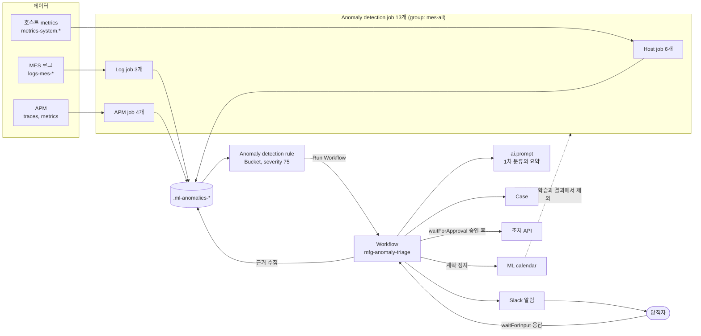
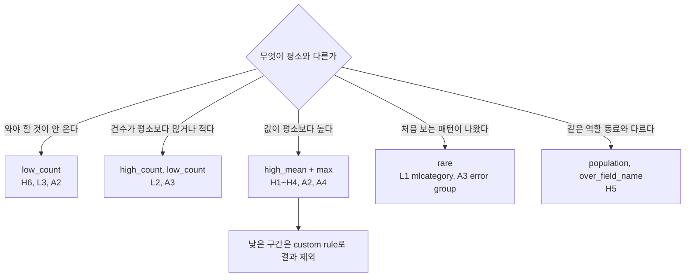
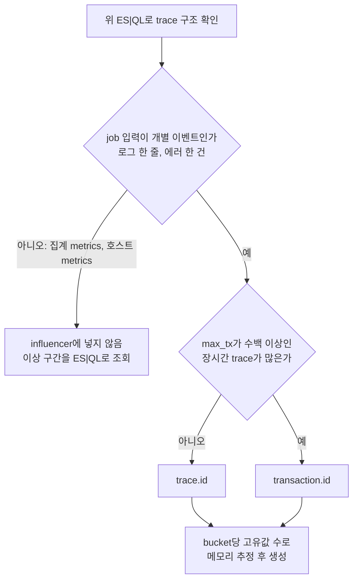
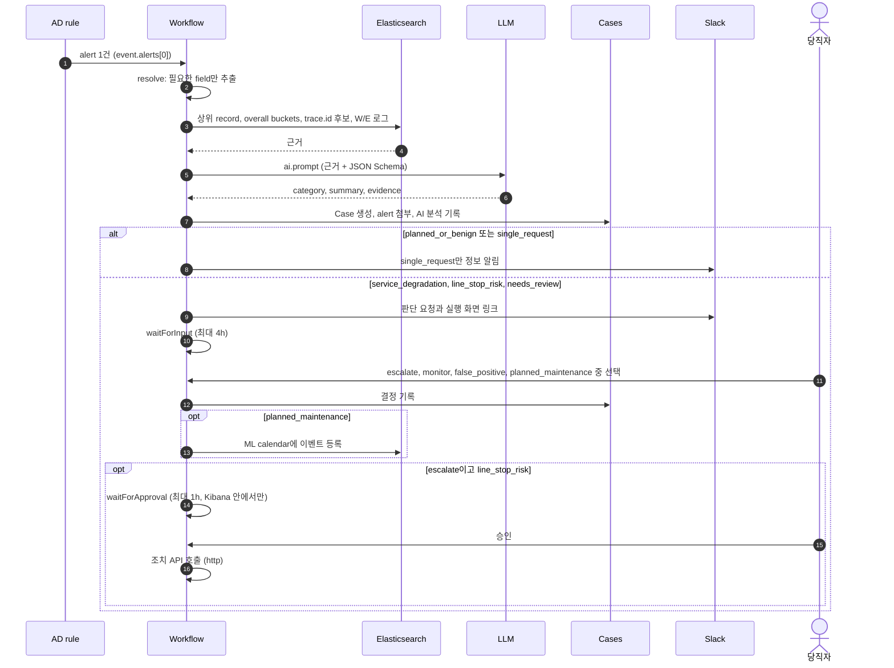
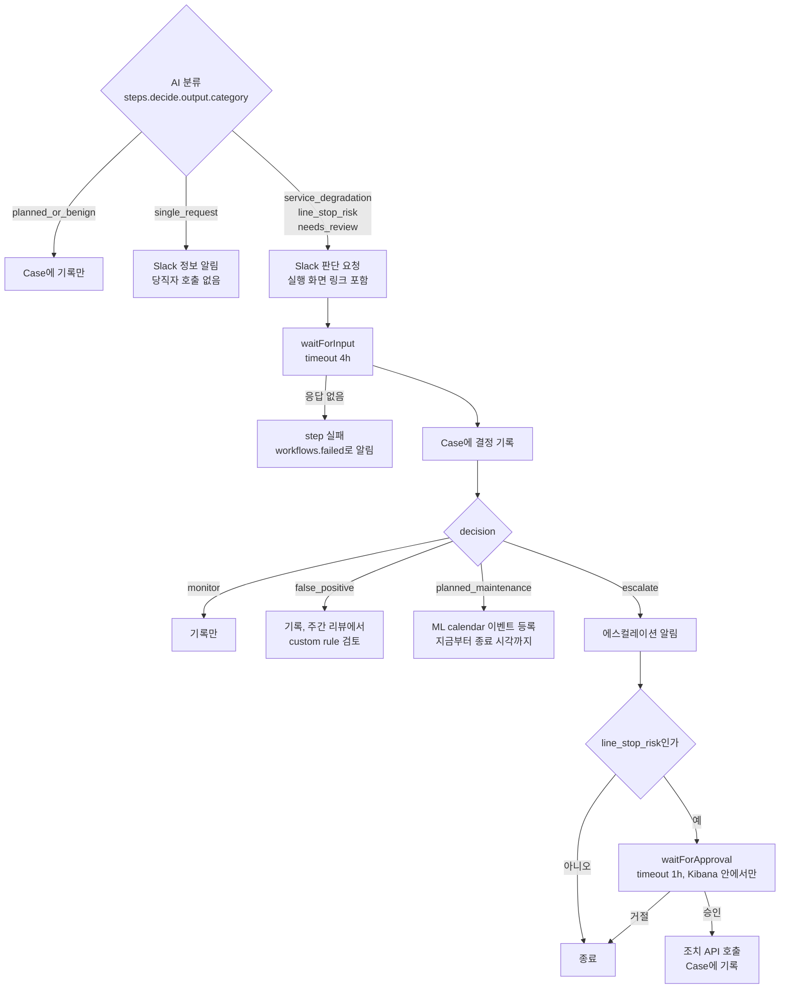
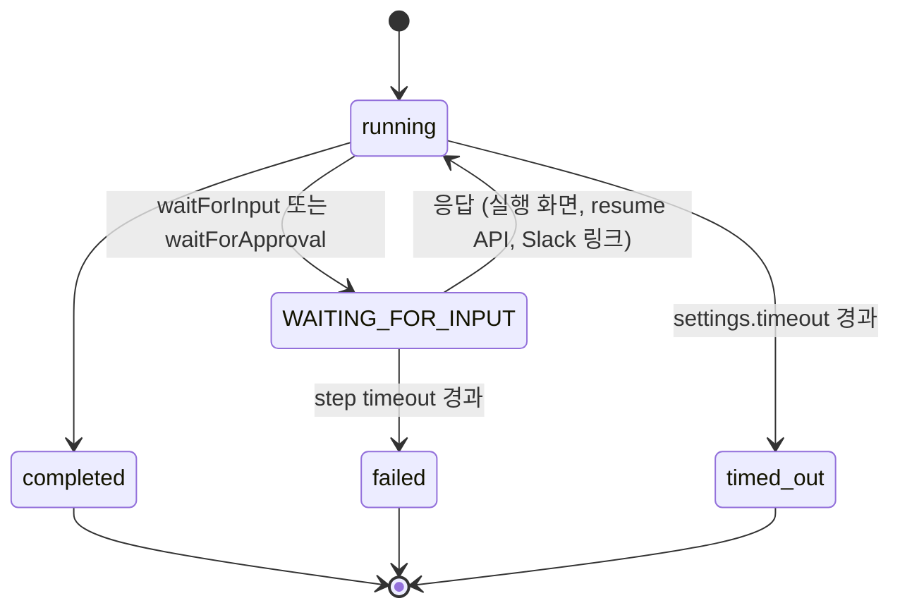
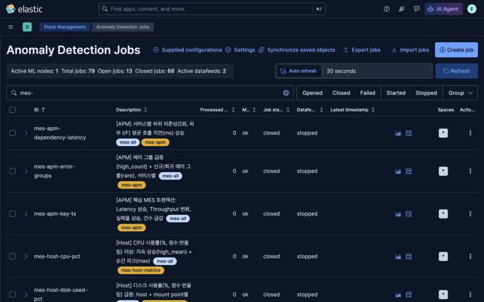
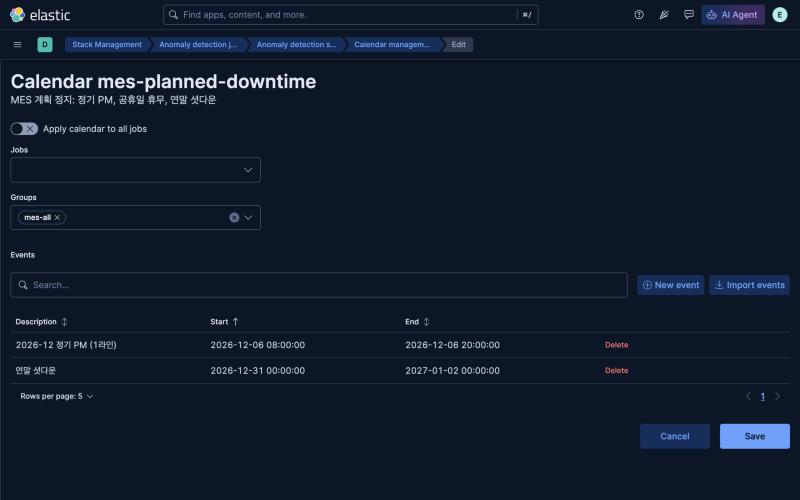

:::note[기준]
- Elasticsearch, Kibana 9.x 기준입니다. Workflow 예시는 9.5 이상을 기준으로 썼고, 9.4와 다른 부분은 [기능별 상태](#기능별-상태)에 정리했습니다.
- 공식 문서와 API reference는 2026년 11월에 다시 확인했습니다. Kibana 제공 job과 alert 문서 구조는 [elastic/kibana](https://github.com/elastic/kibana) main 브랜치를, workflow 작성 관례는 [elastic/workflows](https://github.com/elastic/workflows) 예제를 참고했습니다.
- 이 글의 job과 workflow는 여러 제조 현장에서 반복해서 나오는 요구를 업종 수준으로 일반화한 설계입니다. 인덱스, field 이름, 임계값은 예시이고, 측정 결과가 아니라 설계 기준입니다.
- 제 해석이 들어간 부분에는 "해석"이라고 표시했습니다.
- Workflow 전체 YAML은 저장소 [`labs/anomaly-detection/manufacturing/`](https://github.com/Munsik/engineering-notes/tree/main/labs/anomaly-detection/manufacturing)에 있습니다.
:::

## 이 글이 답하는 질문

- 공장 생산망(MES, 설비 인터페이스, DB)에서 anomaly detection으로 무엇부터 잡아야 효과가 큰가
- 로그, APM, 호스트 metrics에 각각 어떤 job을 어떤 기준으로 만드는가
- 로그와 트레이스를 이어 주는 `trace.id`를 influencer로 넣어야 하는가, `transaction.id`와는 무엇이 다른가
- 이상이 탐지된 뒤, 사람이 대시보드를 열기 전에 무엇을 자동으로 준비해 둘 수 있는가
- AI 분석 결과를 그대로 실행하지 않고, 사람이 판단한 뒤 조치하려면 무엇을 정해야 하는가
- 이 흐름을 운영에 올렸을 때 무엇이 잘못될 수 있고, 어떻게 알아채는가

## 문제 정의

공장 생산망은 멈추면 바로 손실이 나는 환경입니다. 그런데 실제 장애는 고정 임계값 알림(예: CPU 90% 초과)에 걸리지 않는 모습으로 시작되는 경우가 많습니다.

- 에러 로그 하나 없이 설비 인터페이스가 **조용히 멈추는** 경우
- 평소 40%로 운영하던 서버가 75%까지 올라왔지만 **임계값에는 닿지 않는** 경우
- 배포 직후 **처음 보는 예외**가 몇 건씩 나타나기 시작하는 경우
- DB 지연이 생산 트랜잭션 지연으로 **번져 나가는** 경우

Anomaly detection은 이런 "평소와 다름"을 잡는 도구입니다. 하지만 탐지만으로는 일이 끝나지 않습니다. alert를 받은 담당자는 여전히 Anomaly Explorer, Discover, APM을 오가며 무엇이 같이 이상한지, 원인 요청이 무엇인지, 조치가 필요한지를 직접 확인해야 합니다.

이 글은 **탐지 → alert → Workflow → AI 1차 분석 → 사람의 판단 → 후속 조치**를 하나의 흐름으로 만들고, 그 과정에서 내려야 하는 결정을 기록합니다.



## 대표 시나리오

| # | 상황 | 기존 방식의 한계 | 잡는 job | 자동화 이후 |
| --- | --- | --- | --- | --- |
| 1 | 금요일 22시, 2라인 설비 I/F의 수신 스레드가 멈춤. 프로세스, CPU, 메모리 정상, ERROR 로그 없음. 다음 날 아침에야 Track-out 9시간 0건을 발견 | 에러와 임계값 알림은 "무언가 생긴 것"만 봅니다. "와야 할 것이 안 오는 것"은 못 봅니다. | L3, A2(건수 급감), H6 | AI가 "라인 정지 위험"으로 분류하고 당직자에게 판단을 요청합니다. |
| 2 | 배포 직후 특정 Lot의 Track-in 요청 하나가 DB 락 재시도를 반복. 15분 동안 같은 WARN 수천 건, APM에 처음 보는 `LockTimeoutException` | 로그량 알림은 울리지만, 전체 장애인지 요청 하나의 문제인지 가리려면 로그를 직접 뒤져야 합니다. | L1, A3 | 두 job의 `trace.id` influencer에 같은 값이 나타나고, AI가 "단일 요청 문제"로 분류해 당직자를 깨우지 않습니다. |
| 3 | 오전 10시 DB 스토리지 응답 저하. 10분 뒤 Track-in 평균 응답이 0.3초에서 2초로, DB 서버 iowait 상승 | 알림이 화면마다 따로 울려 원인 판단이 늦습니다. | A4, A2, H3 | overall score로 "여러 영역 동시 이상"을 확인하고, AI가 증상 순서(의존성 → 트랜잭션 → 호스트)를 정리합니다. |
| 4 | AP 서버 12대 중 1대의 메모리가 매일 2%씩 상승, 2주 뒤 OOM | 고정 임계값에 닿기 전까지 신호가 없습니다. | H1, H5 | 개별 baseline과 동료 비교가 둘 다 잡습니다. |

## 결정 기록

이 글에서 내린 결정을 먼저 모아 둡니다. 각 결정의 근거는 링크한 절에 있습니다. "다시 볼 조건"에 해당하는 상황이 오면 그 결정을 다시 검토하세요.

| # | 결정할 것 | 선택지 | 이 글의 선택 | 이유 | 다시 볼 조건 |
| --- | --- | --- | --- | --- | --- |
| 1 | 무엇부터 탐지할까 | 리소스 급증 / 에러 급증 / 건수 급감 | 건수 급감(`low_count`)부터 | 공장에서는 "조용히 멈추는" 장애가 가장 비쌉니다. 다른 탐지는 데이터가 들어와야 동작합니다. | 수집이 이미 별도로 감시되고 있을 때 |
| 2 | 사용률을 어떻게 넘길까 | 원본 비율 / runtime field로 % 정수 / ingest pipeline | runtime field로 % 정수 | 원본 인덱스를 건드리지 않고 바로 적용됩니다. [사용률 변환](#사용률-변환) | 같은 % field를 대시보드와 알림에서도 쓸 때는 ingest pipeline |
| 3 | job을 어떤 단위로 나눌까 | 하나로 크게 / 영역별 / 역할별 | 영역과 서버 역할별로 나누고 group으로 묶음 | job마다 bucket span, datafeed, 메모리 한도를 다르게 가져갈 수 있고, group으로 calendar와 rule을 한 번에 겁니다. [01장](../01-job-design/#판단-기준) | 한 job의 메모리가 한도에 닿을 때 더 나눔 |
| 4 | bucket span | 5m / 15m / 1h | 15m | 탐지 지연과 noise의 균형. Elastic APM 제공 job도 15m입니다. [02장](../02-bucket-span-and-data/#bucket-span) | 라인 정지를 5분 안에 알아야 하는 job(L3 등)은 5m 검토 |
| 5 | 로그와 트레이스를 잇는 키 | 없음 / `trace.id` / `transaction.id` | 개별 이벤트 job(L1, A3)에만 `trace.id` | 서비스 경계를 넘는 원인을 값 하나로 묶습니다. 집계 입력 job에는 field 자체가 없습니다. [Influencer와 상관 분석](#influencer와-상관-분석) | trace 하나가 몇 시간씩 이어지는 구조라면 `transaction.id` |
| 6 | Alert의 result type | Bucket / Record / Influencer | Bucket | anomaly detection rule은 실행 한 번에 alert를 하나만 만들고 상위 record와 influencer를 담습니다. 원인 entity는 workflow가 결과 index에서 다시 찾습니다. [1단계](#1단계-anomaly-detection-rule) | entity별로 따로 alert를 받아야 할 때는 별도 방식 필요 |
| 7 | Workflow에 넘길 alert 범위 | 묶어서 / alert마다 | alert마다, 상태는 new | 한 실행이 한 이상만 다루면 분석, Case, 승인이 1:1로 맞습니다. step 출력 크기 한도에도 덜 걸립니다. [실행 단위와 크기](#실행-단위와-크기) | 동시에 많은 job이 이상해져 실행 수가 부담될 때 |
| 8 | AI를 어디까지 쓸까 | 안 씀 / 분류와 요약(`ai.prompt`) / agent 조사(`ai.agent`) / 자동 조치 | `ai.prompt`로 분류와 요약까지 | 근거를 workflow가 직접 모아서 넘기므로 결과가 재현 가능하고 비용과 시간이 예측됩니다. [4단계](#4단계-ai-1차-분석) | 분류가 안정된 뒤, 더 깊은 조사가 필요하면 `ai.agent` |
| 9 | AI가 실패하면 | workflow 실패 / 계속 진행 | 계속 진행하고 `needs_review`로 사람에게 | AI 장애 때문에 탐지 자체가 묻히면 안 됩니다. [4단계](#4단계-ai-1차-분석) | 없음 |
| 10 | 누구를 언제 부를까 | 항상 / AI 분류 기준 / 안 부름 | AI 분류가 `service_degradation`, `line_stop_risk`, `needs_review`일 때만 | 알림 피로를 줄이되 애매하면 사람에게 넘깁니다. [6~9단계](#69단계-분기-사람의-판단-후속-조치) | AI 분류와 사람 결정의 불일치가 많을 때는 항상 부름 |
| 11 | 판단을 받는 방식 | `waitForInput` / `waitForApproval` | 판단은 `waitForInput`, 영향 큰 조치만 `waitForApproval` | 선택지가 넷이고 메모와 종료 시각이 필요합니다. 예/아니오만 필요한 조치에는 approval이 단순합니다. | 9.4에서는 approval도 `waitForInput`으로 |
| 12 | 승인 링크를 밖으로 보낼까 | Slack 링크 / Kibana 안에서만 | 판단 요청 알림은 Slack, 승인 응답은 Kibana 안에서만 | 외부 응답 링크는 로그인 없이 누를 수 있어서, 공식 문서도 영향이 큰 조치에는 쓰지 말라고 안내합니다. | 알림만 필요한 단계 |
| 13 | 응답이 없으면 | 무한 대기 / timeout 후 실패 | 판단 4h, 승인 1h, 전체 8h | 대기 중인 실행이 쌓이지 않게 합니다. 실패는 별도 workflow로 알립니다. [응답이 없을 때](#응답이-없을-때) | 교대 근무 주기에 맞춰 조정 |
| 14 | 누구 권한으로 돌까 | 개인 계정 / 운영용 계정 | 운영용 계정으로 rule을 저장 | alert workflow는 rule을 마지막으로 저장한 사용자 권한으로 돕니다. [권한](#권한) | 담당자 교체, 권한 변경 시 rule을 다시 저장 |
| 15 | 동시 실행 제한 | 없음 / per job / 전체 | 걸지 않음 | 사람 응답을 기다리는 workflow에 동시 실행 제한을 걸면, 대기 중인 실행이 어떻게 계산되는지에 따라 다음 alert가 밀리거나 버려질 수 있습니다. [동시 실행](#동시-실행) | 같은 job에서 alert가 짧은 간격으로 반복될 때 |
| 16 | 사람의 결정을 ML에 반영할까 | 안 함 / calendar 자동 등록 / rule 자동 수정 | calendar만 자동, rule은 사람이 주간 리뷰로 | calendar는 기간이 정해진 예외라 되돌리기 쉽고, custom rule은 탐지 범위를 영구히 바꾸기 때문입니다(해석). | 없음 |

## 전체 구성

| 영역 | Job ID | 탐지 대상 | 시나리오 |
| --- | --- | --- | --- |
| Host | `mes-host-memory-pct` | 호스트별 메모리 지속 상승, 순간 피크 | 4 |
| Host | `mes-host-cpu-pct` | 호스트별 CPU 지속 상승, 순간 피크 | |
| Host | `mes-host-iowait-pct` | 디스크 I/O 병목 | 3 |
| Host | `mes-host-disk-used-pct` | 마운트 포인트별 디스크 사용률 급증 | |
| Host | `mes-host-peer-outlier` | 같은 역할 서버 중 혼자 다른 장비 | 4 |
| Host | `mes-host-telemetry-gap` | 수집 단절(Agent, 호스트, 네트워크) | 1 |
| Log | `mes-log-we-patterns` | W/E 로그 패턴 급증, 처음 보는 패턴 | 2 |
| Log | `mes-log-rate-by-level` | 서비스별, 레벨별 로그량 급증과 급감 | |
| Log | `mes-log-heartbeat-drop` | 핵심 INFO 메시지 끊김 | 1 |
| APM | APM 기본 job(UI에서 생성) | 서비스 전체 Latency, Throughput, 실패율 | |
| APM | `mes-apm-key-tx` | 핵심 트랜잭션 Latency, 실패율, 건수 급감 | 1, 3 |
| APM | `mes-apm-error-groups` | 에러 그룹 급증, 처음 보는 에러 | 2 |
| APM | `mes-apm-dependency-latency` | DB, 외부 I/F 호출 지연 | 3 |

모든 job은 영역별 group(`mes-host-metrics`, `mes-logs`, `mes-apm`)과 공통 group `mes-all`에 속합니다. calendar 연결, overall buckets, alert rule 대상을 group 단위로 지정하기 위해서입니다([06장](../06-operations/#job을-나눴을-때-묶어-보기)).

어떤 신호에 어떤 function을 쓸지는 아래 기준으로 골랐습니다. function별 동작은 [07장](../07-scenarios/)에 있습니다.



### 환경에 맞게 바꿀 값

JSON 본문에는 주석이 없어서 Kibana Dev Tools에 그대로 붙여 넣을 수 있습니다. 아래 값만 각자 환경에 맞게 바꾸세요.

| 항목 | 이 글의 예시 값 |
| --- | --- |
| 호스트 metrics 인덱스 | `metrics-system.memory-*`, `metrics-system.cpu-*`, `metrics-system.filesystem-*`(Elastic Agent System integration) |
| MES 로그 인덱스 | `logs-mes-*` |
| 로그 레벨 field / 값 | `log.level` / `W`, `E`, `I` |
| MES 모듈 구분 field | `event.dataset` |
| 서버 역할 구분 | `host.name` 접두어 `mesap` |
| 설비 ID field | `labels.eqp_id` |
| APM 환경 | `service.environment: production` |
| 핵심 트랜잭션 | `TrackIn`, `TrackOut`, `LotStart` |
| 핵심 INFO 메시지 | `TRACK_OUT COMPLETED`, `HEARTBEAT RECEIVED` |

## 설계 원칙

### 사용률 변환

CPU, 메모리, 디스크 사용률은 원본에 `0.8123`처럼 0~1 비율로 저장됩니다. 현장에서는 결과 화면과 알림에 `81`처럼 정수 %로 보이길 원하는 경우가 많아서, datafeed의 runtime field로 **0~100 정수로 바꿔 분석**합니다. 소수점 첫째 자리에서 반올림하므로 `0.8123`은 `81`, `0.8150`은 `82`가 됩니다. 원본 인덱스는 바뀌지 않습니다([runtime fields in datafeeds](https://www.elastic.co/docs/explore-analyze/machine-learning/anomaly-detection/ml-configuring-transform)).

```java
if (!doc.containsKey('SOURCE_FIELD') || doc['SOURCE_FIELD'].size() == 0) { return; }
double v = doc['SOURCE_FIELD'].value;
emit(Math.round(v * 100.0));
```

- 메모리는 page cache를 뺀 `system.memory.actual.used.pct`를 씁니다. Kibana Infrastructure UI의 Memory Usage(%)와 같은 기준입니다([Host metrics](https://www.elastic.co/docs/reference/observability/observability-host-metrics)).
- System integration의 사용률 field는 `scaled_float`이고([field 정의](https://github.com/elastic/integrations/tree/main/packages/system/data_stream)), Fleet의 기본 `scaling_factor`는 1000입니다([mappings.ts](https://github.com/elastic/kibana/blob/main/x-pack/platform/plugins/shared/fleet/server/services/epm/elasticsearch/template/mappings.ts)). scaled_float은 값에 scaling factor를 곱해 가장 가까운 정수로 저장합니다([numeric field types](https://www.elastic.co/docs/reference/elasticsearch/mapping-reference/number)). 그래서 원본이 소수 넷째 자리까지 있으면 경계값에서 반올림이 두 번 일어납니다. `0.8149`는 `0.815`로 저장된 뒤 `82`가 됩니다.

```
GET metrics-system.memory-*/_mapping/field/system.memory.actual.used.pct
```

- 정수로 바꾸면 1%p 미만의 변화는 값에 드러나지 않습니다. 사용률 이상 탐지에는 충분한 해상도이고, 낮은 구간의 작은 흔들림은 [결과 필터](#결과-필터)로 거릅니다(해석).
- metric function은 double로 바꿀 수 없는 값만 무시하므로, `long` runtime field도 그대로 분석됩니다([metric functions](https://www.elastic.co/docs/reference/machine-learning/ml-metric-functions)).

### Influencer와 상관 분석

influencer는 "이상이 어느 대상 때문인지"를 알려 주는 field입니다([01장](../01-job-design/#influencer)). 이상에 기여한 influencer 값은 record 결과의 `influencers` 배열에 함께 저장됩니다([get records API](https://www.elastic.co/docs/api/elasticsearch/operation/operation-ml-get-records)). 그래서 그 값으로 Anomaly Explorer에서 필터를 걸고, custom URL에 넣어 Discover나 APM으로 바로 넘길 수 있습니다([custom URLs](https://www.elastic.co/docs/explore-analyze/machine-learning/anomaly-detection/ml-configuring-url)).

APM agent의 log correlation을 켜면 로그와 트레이스에 `trace.id`와 `transaction.id`가 같이 남습니다. 둘 중 무엇을 influencer로 쓸지가 첫 결정입니다.

| 구분 | `trace.id` | `transaction.id` |
| --- | --- | --- |
| 범위 | 요청 하나가 여러 서비스를 거치는 전체 흐름([Traces](https://www.elastic.co/docs/solutions/observability/apm/traces)) | 한 서비스 안의 최상위 작업 단위. 요청 처리, 배치, 백그라운드 작업([Transactions](https://www.elastic.co/docs/solutions/observability/apm/transactions)) |
| 서비스 간 연결 | MES AP, DB 연동 서비스, 설비 I/F 서비스로 이어지는 로그와 에러를 값 하나로 묶습니다. | 서비스마다 값이 달라서 같은 요청이라도 서비스별로 나뉩니다. |
| 한 서비스 안에서 | 대부분 transaction.id와 1:1입니다. | 대부분 trace.id와 1:1입니다. |
| 조사 화면 | APM에서 전체 호출 흐름(waterfall)을 바로 봅니다. | 해당 서비스의 트랜잭션 하나를 봅니다. |

이 글은 `trace.id`를 씁니다. 시나리오 2처럼 상위 서비스가 재시도를 반복하면 하위 서비스의 에러도 같은 trace.id로 쌓여서, 로그 job(L1)과 에러 job(A3)에 같은 값이 원인으로 나타납니다. transaction.id로는 이 연결이 서비스마다 끊깁니다. 한 서비스 안에서는 두 값의 정보가 거의 같으므로 둘 다 넣으면 메모리만 두 배가 듭니다.

다만 스케줄러나 메시지 기반 처리에서 trace 하나가 몇 시간 동안 많은 트랜잭션을 포함한다면 trace.id가 너무 넓은 범위를 가리킵니다. trace context를 전달하지 않는 미들웨어 구간에서는 trace가 끊기고 새로 시작되므로([Traces](https://www.elastic.co/docs/solutions/observability/apm/traces)) 두 값이 사실상 같아집니다. 실제 구조는 아래 쿼리로 확인하고 정하세요.

```sql
FROM logs-mes-*, traces-apm*
| WHERE @timestamp >= NOW() - 1 day AND trace.id IS NOT NULL
| STATS tx = COUNT_DISTINCT(transaction.id), svc = COUNT_DISTINCT(service.name) BY trace.id
| STATS traces = COUNT(*), avg_tx = AVG(tx), max_tx = MAX(tx), avg_svc = AVG(svc), max_svc = MAX(svc)
```



| 구분 | 대상 job | 처리 | 이유 |
| --- | --- | --- | --- |
| influencer로 포함 | L1 W/E 로그 패턴, A3 APM 에러 그룹 | `trace.id` 지정 | 로그 한 줄, 에러 한 건 단위로 분석합니다. W/E 로그와 에러만 대상이라 볼륨이 작아 비용을 통제할 수 있습니다. |
| 조회로 연결 | Host 전체, L2, L3, A2, A4 | 이상 구간에서 trace.id를 따로 조회([ES\|QL](#이상-구간의-traceid-찾기)) | A2, A4는 1분 단위로 미리 집계된 APM metrics를 쓰는데 여기에는 trace.id가 없습니다([APM metrics](https://www.elastic.co/docs/solutions/observability/apm/metrics)). aggregation 입력 job은 집계 결과에 없는 influencer를 분석할 수 없습니다([aggregations](https://www.elastic.co/docs/explore-analyze/machine-learning/anomaly-detection/ml-configuring-aggregation)). |

trace.id influencer의 동작도 알아 두세요.

- influencer score는 특정 값을 가진 데이터를 빼고도 bucket이 여전히 이상한지를 따져서 정해지고, 통계적으로 의미 있는 값만 결과에 남습니다([View the results](https://www.elastic.co/docs/explore-analyze/machine-learning/anomaly-detection/ml-ad-view-results), [04장](../04-reading-results/)). 요청 하나가 이상의 대부분을 만든 경우에는 그 trace.id가 나타나고, 여러 요청에 고르게 퍼진 장애에서는 비어 있을 수 있습니다. 그래서 custom URL은 항상 동작하는 링크와 trace.id 링크를 함께 둡니다.
- bucket 안의 influencer 값 종류가 많을수록 메모리가 늘어납니다([anomaly detection at scale](https://www.elastic.co/docs/explore-analyze/machine-learning/anomaly-detection/anomaly-detection-scale)). 만들기 전에 [메모리를 추정](#메모리-추정)하세요.
- influencer는 보통 3개면 충분하다고 안내되어 있는데([Run a job](https://www.elastic.co/docs/explore-analyze/machine-learning/anomaly-detection/ml-ad-run-jobs)), L1과 A3는 4개가 됩니다. 이 두 job에만 예외로 둡니다.

| Job | influencers |
| --- | --- |
| H1~H6 Host | `host.name` |
| L1 W/E 로그 패턴 | `mlcategory`, `service.name`, `host.name`, `trace.id` |
| L2 로그량 | `service.name`, `log.level` |
| L3 Heartbeat | `labels.eqp_id`, `host.name`, `service.name` |
| A2 핵심 트랜잭션 | `service.name`, `transaction.name` |
| A3 APM 에러 | `service.name`, `error.grouping_key`, `host.name`, `trace.id` |
| A4 의존성 지연 | `service.name`, `span.destination.service.resource` |

`host.name`과 `service.name`은 모든 job에서 같은 field 이름을 씁니다. 여러 job을 함께 볼 때 같은 서버, 같은 서비스의 이상이 한 줄로 모이게 하기 위해서입니다. MES 로그의 `service.name` 값이 APM의 값과 같아야 이어지므로 먼저 확인하세요. A2에 `host.name`을 넣지 않은 건, composite aggregation source에 host.name을 더하면 throughput이 "서비스 전체"가 아니라 "호스트별" 값으로 바뀌기 때문입니다(해석).

### 분할 방식과 bucket span

| 원칙 | 내용 |
| --- | --- |
| 대상별 독립 baseline | `partition_field_name` 값마다 완전히 따로 baseline을 만듭니다([create job API](https://www.elastic.co/docs/api/elasticsearch/operation/operation-ml-put-job)). |
| 집단 비교 | `over_field_name`(population)은 집단의 전형적인 모습과 다른 개체를 찾고, 개체별 분석보다 메모리 효율이 좋습니다. 개체가 10개 미만이면 맞지 않습니다([at scale](https://www.elastic.co/docs/explore-analyze/machine-learning/anomaly-detection/anomaly-detection-scale), [Run a job](https://www.elastic.co/docs/explore-analyze/machine-learning/anomaly-detection/ml-ad-run-jobs)). |
| bucket span | 대부분 15분입니다. 고르는 기준은 [02장](../02-bucket-span-and-data/#bucket-span)을 보세요. |
| 역할별 분리 | 서버 역할이나 데이터 성격이 다르면 datafeed query로 job을 나눕니다([at scale](https://www.elastic.co/docs/explore-analyze/machine-learning/anomaly-detection/anomaly-detection-scale)). |

### 결과 필터

통계적으로는 이상이지만 운영에서 의미 없는 결과는 custom rule로 거릅니다. 평소 5%이던 CPU가 15%가 되면 통계적으로는 이상이지만 조치할 일은 아닙니다. Elastic이 제공하는 job도 같은 방식으로 iowait 0.25 미만, 디스크 0.75 미만을 결과에서 뺍니다([metricbeat_system_ecs](https://github.com/elastic/kibana/tree/main/x-pack/platform/plugins/shared/ml/server/models/data_recognizer/modules/metricbeat_system_ecs/ml)). 이 글의 임계값은 예시입니다. rule 종류와 동작은 [05장](../05-noise-and-exceptions/#custom-rule)에 있습니다.

### 학습 기간과 계획 정지

- APM 기본 job도 최근 4주 데이터로 학습을 시작합니다([APM과 ML](https://www.elastic.co/docs/solutions/observability/apm/machine-learning)). 이 글도 4~8주 전부터 학습을 시작하고, alert 임계 score는 학습 결과를 본 뒤 정합니다. 학습 기간 기준은 [02장](../02-bucket-span-and-data/#학습에-필요한-데이터-양)을 보세요.
- 정기 PM, 휴무, 셧다운처럼 미리 아는 정지는 calendar에 등록합니다([05장](../05-noise-and-exceptions/#calendar와-scheduled-event)). 뒤의 workflow는 담당자가 "계획 정지"라고 답하면 이 calendar에 이벤트를 자동으로 넣습니다.

## Host metrics job

### H1. 메모리 사용률 `mes-host-memory-pct`

**Why**(시나리오 4): 메모리 누수, 배치 폭주, 캐시 설정 오류는 서비스 지연과 OOM으로 이어집니다. 서버마다 평소 사용률이 달라서 고정 임계값으로는 일찍 잡기 어렵습니다.

**What**: `high_mean`으로 15분 평균이 평소보다 높게 유지되는 경우를, `max`로 15분 안의 순간 피크를 봅니다. 두 function을 한 job에 두는 예는 공식 문서에도 있습니다([metric functions](https://www.elastic.co/docs/reference/machine-learning/ml-metric-functions)). `max`는 낮은 값도 이상으로 보므로 결과 필터로 낮은 구간을 뺍니다.

```json
PUT _ml/anomaly_detectors/mes-host-memory-pct
{
  "description": "[Host] 메모리 사용률(%, 정수 반올림) 이상: 지속 상승(high_mean) + 순간 피크(max)",
  "groups": ["mes-host-metrics", "mes-all"],
  "analysis_config": {
    "bucket_span": "15m",
    "detectors": [
      {
        "detector_description": "지속 상승: high_mean(memory_used_pct) partition host.name",
        "function": "high_mean",
        "field_name": "memory_used_pct",
        "partition_field_name": "host.name",
        "custom_rules": [
          { "actions": ["skip_result"], "conditions": [{ "applies_to": "actual", "operator": "lt", "value": 70 }] }
        ]
      },
      {
        "detector_description": "순간 피크: max(memory_used_pct) partition host.name",
        "function": "max",
        "field_name": "memory_used_pct",
        "partition_field_name": "host.name",
        "custom_rules": [
          { "actions": ["skip_result"], "conditions": [{ "applies_to": "actual", "operator": "lt", "value": 80 }] }
        ]
      }
    ],
    "influencers": ["host.name"]
  },
  "analysis_limits": { "model_memory_limit": "128mb" },
  "data_description": { "time_field": "@timestamp" },
  "model_plot_config": { "enabled": true, "annotations_enabled": true },
  "results_retention_days": 60,
  "custom_settings": { "unit": "percent 0-100, rounded to integer" },
  "datafeed_config": {
    "datafeed_id": "datafeed-mes-host-memory-pct",
    "indices": ["metrics-system.memory-*"],
    "query": { "bool": { "filter": [{ "exists": { "field": "system.memory.actual.used.pct" } }] } },
    "runtime_mappings": {
      "memory_used_pct": {
        "type": "long",
        "script": {
          "source": "if (!doc.containsKey('system.memory.actual.used.pct') || doc['system.memory.actual.used.pct'].size() == 0) { return; } double v = doc['system.memory.actual.used.pct'].value; emit(Math.round(v * 100.0));"
        }
      }
    },
    "query_delay": "120s",
    "delayed_data_check_config": { "enabled": true }
  }
}
```

- API로 만들면 model plot은 기본으로 꺼져 있습니다([create job API](https://www.elastic.co/docs/api/elasticsearch/operation/operation-ml-put-job)). 이 job은 켜 두었지만, 호스트가 많다면 끄세요. model plot은 대상마다 결과 문서를 추가로 만듭니다([at scale](https://www.elastic.co/docs/explore-analyze/machine-learning/anomaly-detection/anomaly-detection-scale)).
- `query_delay` 기본값은 60~120초입니다. 늦게 들어오는 데이터는 [02장](../02-bucket-span-and-data/#늦게-들어오는-데이터)을 보세요.

### H2. CPU 사용률 `mes-host-cpu-pct`

**Why**: Lot 처리, 스케줄러, 리포트 배치는 시간대별 패턴이 뚜렷합니다. "평소 이 시간대보다 높다"를 기준으로 봐야 오탐이 줄어듭니다.

**What**: `system.cpu.total.norm.pct`는 Idle과 IOWait를 뺀 CPU 사용 비율을 코어 수로 정규화한 값입니다([Host metrics](https://www.elastic.co/docs/reference/observability/observability-host-metrics)).

```json
PUT _ml/anomaly_detectors/mes-host-cpu-pct
{
  "description": "[Host] CPU 사용률(%, 정수 반올림) 이상: 지속 상승(high_mean) + 순간 피크(max)",
  "groups": ["mes-host-metrics", "mes-all"],
  "analysis_config": {
    "bucket_span": "15m",
    "detectors": [
      {
        "detector_description": "지속 상승: high_mean(cpu_used_pct) partition host.name",
        "function": "high_mean",
        "field_name": "cpu_used_pct",
        "partition_field_name": "host.name",
        "custom_rules": [
          { "actions": ["skip_result"], "conditions": [{ "applies_to": "actual", "operator": "lt", "value": 50 }] }
        ]
      },
      {
        "detector_description": "순간 피크: max(cpu_used_pct) partition host.name",
        "function": "max",
        "field_name": "cpu_used_pct",
        "partition_field_name": "host.name",
        "custom_rules": [
          { "actions": ["skip_result"], "conditions": [{ "applies_to": "actual", "operator": "lt", "value": 80 }] }
        ]
      }
    ],
    "influencers": ["host.name"]
  },
  "analysis_limits": { "model_memory_limit": "128mb" },
  "data_description": { "time_field": "@timestamp" },
  "model_plot_config": { "enabled": true, "annotations_enabled": true },
  "results_retention_days": 60,
  "custom_settings": { "unit": "percent 0-100, rounded to integer" },
  "datafeed_config": {
    "datafeed_id": "datafeed-mes-host-cpu-pct",
    "indices": ["metrics-system.cpu-*"],
    "query": { "bool": { "filter": [{ "exists": { "field": "system.cpu.total.norm.pct" } }] } },
    "runtime_mappings": {
      "cpu_used_pct": {
        "type": "long",
        "script": {
          "source": "if (!doc.containsKey('system.cpu.total.norm.pct') || doc['system.cpu.total.norm.pct'].size() == 0) { return; } double v = doc['system.cpu.total.norm.pct'].value; emit(Math.round(v * 100.0));"
        }
      }
    },
    "query_delay": "120s",
    "delayed_data_check_config": { "enabled": true }
  }
}
```

### H3. CPU iowait `mes-host-iowait-pct`

**Why**(시나리오 3): MES DB나 파일 기반 I/F 서버는 CPU 사용률보다 iowait가 먼저 오릅니다.

**What**: Elastic 제공 job `high_mean_cpu_iowait_ecs`와 같은 구조입니다([Metricbeat 제공 job](https://www.elastic.co/docs/reference/machine-learning/ootb-ml-jobs-metricbeat)). % 표시를 위해 코어 수로 정규화된 `system.cpu.iowait.norm.pct`를 씁니다.

```json
PUT _ml/anomaly_detectors/mes-host-iowait-pct
{
  "description": "[Host] CPU iowait(%, 정수 반올림) 이상 상승: 디스크 I/O 병목",
  "groups": ["mes-host-metrics", "mes-all"],
  "analysis_config": {
    "bucket_span": "10m",
    "detectors": [
      {
        "detector_description": "high_mean(iowait_pct) partition host.name",
        "function": "high_mean",
        "field_name": "iowait_pct",
        "partition_field_name": "host.name",
        "custom_rules": [
          { "actions": ["skip_result"], "conditions": [{ "applies_to": "actual", "operator": "lt", "value": 10 }] }
        ]
      }
    ],
    "influencers": ["host.name"]
  },
  "analysis_limits": { "model_memory_limit": "64mb" },
  "data_description": { "time_field": "@timestamp" },
  "model_plot_config": { "enabled": true, "annotations_enabled": true },
  "results_retention_days": 60,
  "datafeed_config": {
    "datafeed_id": "datafeed-mes-host-iowait-pct",
    "indices": ["metrics-system.cpu-*"],
    "query": { "bool": { "filter": [{ "exists": { "field": "system.cpu.iowait.norm.pct" } }] } },
    "runtime_mappings": {
      "iowait_pct": {
        "type": "long",
        "script": {
          "source": "if (!doc.containsKey('system.cpu.iowait.norm.pct') || doc['system.cpu.iowait.norm.pct'].size() == 0) { return; } double v = doc['system.cpu.iowait.norm.pct'].value; emit(Math.round(v * 100.0));"
        }
      }
    },
    "query_delay": "120s"
  }
}
```

`system.cpu.iowait.norm.pct`가 수집되지 않는다면 아래 script로 바꾸고, query의 `exists` 대상을 `system.cpu.iowait.pct`로 바꿉니다. Kibana도 iowait %를 `iowait.pct ÷ 코어 수`로 계산합니다([Host metrics](https://www.elastic.co/docs/reference/observability/observability-host-metrics)).

```java
if (!doc.containsKey('system.cpu.iowait.pct') || doc['system.cpu.iowait.pct'].size() == 0 || doc['system.cpu.cores'].size() == 0) { return; }
double v = doc['system.cpu.iowait.pct'].value / doc['system.cpu.cores'].value;
emit(Math.round(v * 100.0));
```

### H4. 디스크 사용률 `mes-host-disk-used-pct`

**Why**: 로그 폭주, 덤프 파일, 아카이브 실패로 디스크가 짧은 시간에 차는 상황을 잡습니다.

**What**: Elastic 제공 job `max_disk_utilization_ecs`와 같은 구조에 마운트 포인트 분할을 더했습니다. 서서히 차오르는 추세는 모델이 새로운 정상으로 학습할 수 있으므로, 용량 관리는 고정 임계값 알림이나 forecast와 같이 운영하세요([07장 용량 추세 예측](../07-scenarios/#용량-추세-예측)).

```json
PUT _ml/anomaly_detectors/mes-host-disk-used-pct
{
  "description": "[Host] 디스크 사용률(%, 정수 반올림) 급증: host + mount point별",
  "groups": ["mes-host-metrics", "mes-all"],
  "analysis_config": {
    "bucket_span": "15m",
    "detectors": [
      {
        "detector_description": "max(fs_used_pct) by mount_point partition host.name",
        "function": "max",
        "field_name": "fs_used_pct",
        "by_field_name": "system.filesystem.mount_point",
        "partition_field_name": "host.name",
        "custom_rules": [
          { "actions": ["skip_result"], "conditions": [{ "applies_to": "actual", "operator": "lt", "value": 75 }] }
        ]
      }
    ],
    "influencers": ["host.name", "system.filesystem.mount_point"]
  },
  "analysis_limits": { "model_memory_limit": "128mb" },
  "data_description": { "time_field": "@timestamp" },
  "model_plot_config": { "enabled": false },
  "results_retention_days": 60,
  "datafeed_config": {
    "datafeed_id": "datafeed-mes-host-disk-used-pct",
    "indices": ["metrics-system.filesystem-*"],
    "query": {
      "bool": {
        "filter": [{ "exists": { "field": "system.filesystem.used.pct" } }],
        "must_not": [{ "terms": { "system.filesystem.type": ["tmpfs", "devtmpfs", "overlay", "squashfs"] } }]
      }
    },
    "runtime_mappings": {
      "fs_used_pct": {
        "type": "long",
        "script": {
          "source": "if (!doc.containsKey('system.filesystem.used.pct') || doc['system.filesystem.used.pct'].size() == 0) { return; } double v = doc['system.filesystem.used.pct'].value; emit(Math.round(v * 100.0));"
        }
      }
    },
    "query_delay": "120s"
  }
}
```

### H5. 같은 역할 서버 중 다른 장비 `mes-host-peer-outlier`

**Why**(시나리오 4): 로드밸런싱된 AP 서버나 같은 사양의 라인 PC 중 한 대만 다르면 설정 차이, 세션 쏠림, 특정 설비 I/F 문제일 가능성이 큽니다. 개별 baseline은 "원래 높은 장비"를 정상으로 학습하는데, 이 job이 그 빈틈을 메웁니다.

**What**: population 분석으로 같은 역할 서버들의 전형적인 모습과 비교합니다. 역할당 장비가 10대 이상일 때 씁니다([01장](../01-job-design/#partition-by-over)).

```json
PUT _ml/anomaly_detectors/mes-host-peer-outlier
{
  "description": "[Host] 같은 역할 서버 집단 대비 CPU/메모리 이상 장비 (population)",
  "groups": ["mes-host-metrics", "mes-all"],
  "analysis_config": {
    "bucket_span": "15m",
    "detectors": [
      {
        "detector_description": "high_mean(cpu_used_pct) over host.name",
        "function": "high_mean",
        "field_name": "cpu_used_pct",
        "over_field_name": "host.name",
        "custom_rules": [
          { "actions": ["skip_result"], "conditions": [{ "applies_to": "actual", "operator": "lt", "value": 50 }] }
        ]
      },
      {
        "detector_description": "high_mean(memory_used_pct) over host.name",
        "function": "high_mean",
        "field_name": "memory_used_pct",
        "over_field_name": "host.name",
        "custom_rules": [
          { "actions": ["skip_result"], "conditions": [{ "applies_to": "actual", "operator": "lt", "value": 70 }] }
        ]
      }
    ],
    "influencers": ["host.name"]
  },
  "analysis_limits": { "model_memory_limit": "64mb" },
  "data_description": { "time_field": "@timestamp" },
  "model_plot_config": { "enabled": false },
  "results_retention_days": 60,
  "datafeed_config": {
    "datafeed_id": "datafeed-mes-host-peer-outlier",
    "indices": ["metrics-system.cpu-*", "metrics-system.memory-*"],
    "query": { "bool": { "filter": [{ "prefix": { "host.name": "mesap" } }] } },
    "runtime_mappings": {
      "cpu_used_pct": {
        "type": "long",
        "script": {
          "source": "if (!doc.containsKey('system.cpu.total.norm.pct') || doc['system.cpu.total.norm.pct'].size() == 0) { return; } double v = doc['system.cpu.total.norm.pct'].value; emit(Math.round(v * 100.0));"
        }
      },
      "memory_used_pct": {
        "type": "long",
        "script": {
          "source": "if (!doc.containsKey('system.memory.actual.used.pct') || doc['system.memory.actual.used.pct'].size() == 0) { return; } double v = doc['system.memory.actual.used.pct'].value; emit(Math.round(v * 100.0));"
        }
      }
    },
    "query_delay": "120s"
  }
}
```

### H6. 수집 단절 `mes-host-telemetry-gap`

**Why**(시나리오 1): 공장에서는 "데이터가 안 들어오는 것" 자체가 가장 중요한 신호인 경우가 많습니다. 데이터가 없으면 다른 host job은 아무것도 탐지하지 못합니다.

**What**: 호스트별 metrics 문서 수의 급감을 `low_count`로 봅니다([count functions](https://www.elastic.co/docs/reference/machine-learning/ml-count-functions)). 폐기한 호스트는 model prune window(기본 30일) 동안 계속 이상으로 나올 수 있어서([create job API](https://www.elastic.co/docs/api/elasticsearch/operation/operation-ml-put-job)), filter list로 뺍니다.

```json
PUT _ml/filters/mes_retired_hosts
{
  "description": "폐기 또는 장기 정지 호스트 (수집 단절 알림 제외)",
  "items": ["placeholder-host-01"]
}
```

```json
PUT _ml/anomaly_detectors/mes-host-telemetry-gap
{
  "description": "[Host] 수집 단절: host별 metrics 문서 수 급감",
  "groups": ["mes-host-metrics", "mes-all"],
  "analysis_config": {
    "bucket_span": "10m",
    "detectors": [
      {
        "detector_description": "low_count partition host.name",
        "function": "low_count",
        "partition_field_name": "host.name",
        "custom_rules": [
          { "actions": ["skip_result"], "scope": { "host.name": { "filter_id": "mes_retired_hosts", "filter_type": "include" } } }
        ]
      }
    ],
    "influencers": ["host.name"]
  },
  "analysis_limits": { "model_memory_limit": "64mb" },
  "data_description": { "time_field": "@timestamp" },
  "model_plot_config": { "enabled": false },
  "results_retention_days": 60,
  "datafeed_config": {
    "datafeed_id": "datafeed-mes-host-telemetry-gap",
    "indices": ["metrics-system.cpu-*"],
    "query": { "match_all": {} },
    "query_delay": "120s"
  }
}
```

호스트를 폐기하면 filter에 추가합니다.

```json
POST _ml/filters/mes_retired_hosts/_update
{ "add_items": ["retired-host-02"] }
```

## MES 로그 job

### L1. W/E 로그 패턴 `mes-log-we-patterns`

**Why**(시나리오 2): MES 로그는 시스템이 만든 반복 메시지가 대부분입니다. "같은 오류 패턴이 평소보다 많다"와 "처음 보는 오류 패턴이 나타났다"는 장애 초기 신호로 가장 쓸모 있습니다.

**What**
- 비슷한 메시지를 묶은 category(`mlcategory`)별로 `high_count`(급증)와 `rare`(처음 보거나 드문 패턴)를 봅니다([categorization](https://www.elastic.co/docs/explore-analyze/machine-learning/anomaly-detection/ml-configuring-categories)).
- Kibana Logs 제공 job처럼 모듈(`event.dataset`)별로 category를 따로 만들고, 분류가 잘 안 되는 모듈은 `stop_on_warn`으로 뺍니다([logs_ui_categories](https://github.com/elastic/kibana/tree/main/x-pack/platform/plugins/shared/ml/server/models/data_recognizer/modules/logs_ui_categories/ml), [07장](../07-scenarios/#로그-메시지-패턴-급증)).
- Lot ID처럼 매번 바뀌는 값은 `categorization_filters`로 지워야 category가 쓸데없이 늘지 않습니다. 정규식은 예시입니다.
- 기본 tokenizer는 영어 로그 기준입니다. 한국어가 섞인 로그라면 `categorization_analyzer`를 따로 정의하고 결과를 확인하세요([06장 제약사항](../06-operations/#알아-둘-제약사항)).
- `rare`는 최소 20 bucket의 학습 기간이 필요합니다([rare functions](https://www.elastic.co/docs/reference/machine-learning/ml-rare-functions)).

```json
PUT _ml/anomaly_detectors/mes-log-we-patterns
{
  "description": "[Log] MES W/E 로그 패턴 급증(high_count) + 신규/희귀 패턴(rare), 모듈별 categorization",
  "groups": ["mes-logs", "mes-all"],
  "analysis_config": {
    "bucket_span": "15m",
    "categorization_field_name": "message",
    "categorization_filters": [
      "\\b[A-Z]{2,4}\\d{6,}\\b",
      "\\b\\d{4}-\\d{2}-\\d{2}[ T]\\d{2}:\\d{2}:\\d{2}(\\.\\d+)?\\b"
    ],
    "per_partition_categorization": { "enabled": true, "stop_on_warn": true },
    "detectors": [
      {
        "detector_description": "패턴 급증: high_count by mlcategory partition event.dataset",
        "function": "high_count",
        "by_field_name": "mlcategory",
        "partition_field_name": "event.dataset",
        "use_null": true,
        "custom_rules": [
          { "actions": ["skip_result"], "conditions": [{ "applies_to": "actual", "operator": "lt", "value": 5 }] }
        ]
      },
      {
        "detector_description": "신규/희귀 패턴: rare by mlcategory partition event.dataset",
        "function": "rare",
        "by_field_name": "mlcategory",
        "partition_field_name": "event.dataset",
        "use_null": true
      }
    ],
    "influencers": ["mlcategory", "service.name", "host.name", "trace.id"]
  },
  "analysis_limits": { "model_memory_limit": "256mb", "categorization_examples_limit": 4 },
  "data_description": { "time_field": "@timestamp" },
  "model_plot_config": { "enabled": false },
  "results_index_name": "mes-log-we-patterns",
  "results_retention_days": 60,
  "datafeed_config": {
    "datafeed_id": "datafeed-mes-log-we-patterns",
    "indices": ["logs-mes-*"],
    "query": { "bool": { "filter": [{ "terms": { "log.level": ["W", "E"] } }] } },
    "query_delay": "120s",
    "delayed_data_check_config": { "enabled": true }
  }
}
```

### L2. 서비스별, 레벨별 로그량 `mes-log-rate-by-level`

**Why**: 로그 양 자체가 상태를 알려 줍니다. INFO 급감은 처리 정지, 특정 서비스의 로그 0건은 프로세스 다운, ERROR 비중 증가는 품질 저하의 신호입니다.

**What**: 건수만 필요하므로 composite aggregation으로 미리 집계해 읽습니다([aggregations](https://www.elastic.co/docs/explore-analyze/machine-learning/anomaly-detection/ml-configuring-aggregation), [02장](../02-bucket-span-and-data/#sparse-데이터와-aggregation-입력)). W/E 레벨의 급감은 좋은 신호이므로 급감 탐지에서 뺍니다. aggregation 입력 datafeed의 `frequency`는 date_histogram 간격으로 나누어떨어져야 합니다([create job API](https://www.elastic.co/docs/api/elasticsearch/operation/operation-ml-put-job)).

```json
PUT _ml/filters/mes_warn_error_levels
{
  "description": "W/E 레벨: 로그량 급감 알림에서 제외",
  "items": ["W", "E"]
}
```

```json
PUT _ml/anomaly_detectors/mes-log-rate-by-level
{
  "description": "[Log] 서비스별, 레벨별 로그량 급증(high_count) / 급감(low_count)",
  "groups": ["mes-logs", "mes-all"],
  "analysis_config": {
    "bucket_span": "15m",
    "summary_count_field_name": "doc_count",
    "detectors": [
      {
        "detector_description": "급증: high_count by log.level partition service.name",
        "function": "high_count",
        "by_field_name": "log.level",
        "partition_field_name": "service.name"
      },
      {
        "detector_description": "급감: low_count by log.level partition service.name (W/E 제외)",
        "function": "low_count",
        "by_field_name": "log.level",
        "partition_field_name": "service.name",
        "custom_rules": [
          { "actions": ["skip_result"], "scope": { "log.level": { "filter_id": "mes_warn_error_levels", "filter_type": "include" } } }
        ]
      }
    ],
    "influencers": ["service.name", "log.level"]
  },
  "analysis_limits": { "model_memory_limit": "64mb" },
  "data_description": { "time_field": "@timestamp" },
  "model_plot_config": { "enabled": false },
  "results_retention_days": 60,
  "datafeed_config": {
    "datafeed_id": "datafeed-mes-log-rate-by-level",
    "indices": ["logs-mes-*"],
    "query": { "match_all": {} },
    "aggregations": {
      "buckets": {
        "composite": {
          "size": 1000,
          "sources": [
            { "time_bucket": { "date_histogram": { "field": "@timestamp", "fixed_interval": "15m", "time_zone": "UTC" } } },
            { "service.name": { "terms": { "field": "service.name" } } },
            { "log.level": { "terms": { "field": "log.level" } } }
          ]
        },
        "aggregations": {
          "@timestamp": { "max": { "field": "@timestamp" } }
        }
      }
    },
    "frequency": "15m",
    "chunking_config": { "mode": "manual", "time_span": "1d" },
    "query_delay": "120s"
  }
}
```

### L3. 핵심 INFO 메시지 끊김 `mes-log-heartbeat-drop`

**Why**(시나리오 1): "Track-out 완료", "Heartbeat 수신"처럼 정상일 때 꾸준히 찍히는 메시지가 끊기면 라인이나 설비 I/F가 멈춘 것입니다. 에러 없이 조용히 멈추는 장애를 잡는 가장 확실한 방법입니다.

**What**: 대상 메시지만 골라 설비별 `low_count`를 겁니다. 교대 휴무와 PM은 calendar로 등록합니다.

```json
PUT _ml/anomaly_detectors/mes-log-heartbeat-drop
{
  "description": "[Log] 핵심 INFO 메시지(Track-out 완료 등) 설비별 급감/끊김",
  "groups": ["mes-logs", "mes-all"],
  "analysis_config": {
    "bucket_span": "15m",
    "detectors": [
      { "detector_description": "low_count partition labels.eqp_id", "function": "low_count", "partition_field_name": "labels.eqp_id" }
    ],
    "influencers": ["labels.eqp_id", "host.name", "service.name"]
  },
  "analysis_limits": { "model_memory_limit": "64mb" },
  "data_description": { "time_field": "@timestamp" },
  "model_plot_config": { "enabled": false },
  "results_retention_days": 60,
  "datafeed_config": {
    "datafeed_id": "datafeed-mes-log-heartbeat-drop",
    "indices": ["logs-mes-*"],
    "query": {
      "bool": {
        "filter": [{ "term": { "log.level": "I" } }],
        "should": [
          { "match_phrase": { "message": "TRACK_OUT COMPLETED" } },
          { "match_phrase": { "message": "HEARTBEAT RECEIVED" } }
        ],
        "minimum_should_match": 1
      }
    },
    "query_delay": "120s"
  }
}
```

## APM job

### A1. APM 기본 job

- Kibana **Applications**에서 **Anomaly detection** → **Create Job** → 환경 선택 순서로 만듭니다. job은 환경 단위로 생기고 최근 4주 데이터로 학습을 시작합니다([APM과 ML](https://www.elastic.co/docs/solutions/observability/apm/machine-learning)).
- 서비스 상태 표시는 트랜잭션 유형이 `request`나 `page-load`일 때만 나옵니다.
- 트랜잭션 건수 급감(low count) detector는 Elastic Stack 9.6부터(GA) 새로 만든 APM job에 들어갑니다. 그 전에 만든 job에는 없고, 넣으려면 환경의 APM job을 지우고 다시 만들어야 합니다(기존 결과와 모델은 사라집니다). 9.5 이하이거나 job을 다시 만들기 어렵다면 A2로 보완합니다([Detect low transaction counts](https://www.elastic.co/docs/solutions/observability/apm/machine-learning#apm-ml-low-transaction-count)).

### A2. 핵심 MES 트랜잭션 `mes-apm-key-tx`

**Why**(시나리오 1, 3): Track-in, Track-out, Lot Start처럼 생산과 직결된 트랜잭션은 서비스 평균에 묻히면 안 됩니다.

**What**: Elastic APM 제공 job의 detector 4종(Latency, Throughput, 실패율, 건수 급감)을 트랜잭션 이름 단위로 적용했습니다([apm_transaction](https://github.com/elastic/kibana/tree/main/x-pack/platform/plugins/shared/ml/server/models/data_recognizer/modules/apm_transaction/ml), [07장](../07-scenarios/#apm-서비스-핵심-지표-4종)). 원본은 1분 단위로 미리 집계된 APM transaction metrics이고, Latency 단위는 마이크로초입니다. 트랜잭션 종류가 APM Server 한도를 넘으면 초과분이 `_other`로 묶이므로([APM metrics](https://www.elastic.co/docs/solutions/observability/apm/metrics)), 핵심 트랜잭션 이름이 그대로 남아 있는지 먼저 확인하세요.

```json
PUT _ml/anomaly_detectors/mes-apm-key-tx
{
  "description": "[APM] 핵심 MES 트랜잭션: Latency 상승, Throughput 변화, 실패율 상승, 건수 급감",
  "groups": ["mes-apm", "mes-all"],
  "analysis_config": {
    "bucket_span": "15m",
    "summary_count_field_name": "doc_count",
    "detectors": [
      {
        "detector_description": "Latency 상승 (us): high_mean by transaction.name partition service.name",
        "function": "high_mean",
        "field_name": "transaction_latency",
        "by_field_name": "transaction.name",
        "partition_field_name": "service.name"
      },
      {
        "detector_description": "Throughput 변화 (tpm): mean by transaction.name partition service.name",
        "function": "mean",
        "field_name": "transaction_throughput",
        "by_field_name": "transaction.name",
        "partition_field_name": "service.name"
      },
      {
        "detector_description": "실패율 상승 (%): high_mean by transaction.name partition service.name",
        "function": "high_mean",
        "field_name": "failed_transaction_rate",
        "by_field_name": "transaction.name",
        "partition_field_name": "service.name"
      },
      {
        "detector_description": "건수 급감: low_count by transaction.name partition service.name",
        "function": "low_count",
        "by_field_name": "transaction.name",
        "partition_field_name": "service.name"
      }
    ],
    "influencers": ["service.name", "transaction.name"]
  },
  "analysis_limits": { "model_memory_limit": "64mb" },
  "data_description": { "time_field": "@timestamp" },
  "model_plot_config": { "enabled": true, "annotations_enabled": true },
  "results_retention_days": 60,
  "datafeed_config": {
    "datafeed_id": "datafeed-mes-apm-key-tx",
    "indices": ["metrics-apm.transaction.1m-*"],
    "query": {
      "bool": {
        "filter": [
          { "term": { "processor.event": "metric" } },
          { "term": { "metricset.name": "transaction" } },
          { "term": { "service.environment": "production" } },
          { "terms": { "transaction.name": ["TrackIn", "TrackOut", "LotStart"] } }
        ]
      }
    },
    "chunking_config": { "mode": "off" },
    "frequency": "5m",
    "query_delay": "120s",
    "aggregations": {
      "buckets": {
        "composite": {
          "size": 5000,
          "sources": [
            { "date": { "date_histogram": { "field": "@timestamp", "fixed_interval": "60s" } } },
            { "service.name": { "terms": { "field": "service.name" } } },
            { "transaction.name": { "terms": { "field": "transaction.name" } } }
          ]
        },
        "aggs": {
          "@timestamp": { "max": { "field": "@timestamp" } },
          "transaction_throughput": { "rate": { "unit": "minute" } },
          "transaction_latency": { "avg": { "field": "transaction.duration.histogram" } },
          "error_count": {
            "filter": { "term": { "event.outcome": "failure" } },
            "aggs": { "actual_error_count": { "value_count": { "field": "event.outcome" } } }
          },
          "success_count": { "filter": { "term": { "event.outcome": "success" } } },
          "failed_transaction_rate": {
            "bucket_script": {
              "buckets_path": { "failure_count": "error_count>_count", "success_count": "success_count>_count" },
              "script": "if ((params.failure_count + params.success_count)==0){return 0;}else{return 100 * (params.failure_count/(params.failure_count + params.success_count));}"
            }
          }
        }
      }
    },
    "indices_options": { "ignore_unavailable": true }
  }
}
```

### A3. APM 에러 그룹 `mes-apm-error-groups`

**Why**(시나리오 2): 배포나 설비 I/F 변경 직후 나타나는 처음 보는 예외는 장애 직전 신호인 경우가 많습니다.

**What**: APM 에러는 같은 유형끼리 `error.grouping_key`로 묶입니다([APM errors](https://www.elastic.co/docs/solutions/observability/apm/errors)). `high_count`로 급증을, `rare`로 처음 보는 에러 그룹을 봅니다. `trace.id`를 influencer로 두어, 같은 trace.id가 L1에도 나오면 로그와 에러가 같은 요청에서 나왔다는 걸 알 수 있습니다.

```json
PUT _ml/anomaly_detectors/mes-apm-error-groups
{
  "description": "[APM] 에러 그룹 급증(high_count) + 신규/희귀 에러 그룹(rare), 서비스별",
  "groups": ["mes-apm", "mes-all"],
  "analysis_config": {
    "bucket_span": "15m",
    "detectors": [
      {
        "detector_description": "에러 그룹 급증: high_count by error.grouping_key partition service.name",
        "function": "high_count",
        "by_field_name": "error.grouping_key",
        "partition_field_name": "service.name",
        "custom_rules": [
          { "actions": ["skip_result"], "conditions": [{ "applies_to": "actual", "operator": "lt", "value": 5 }] }
        ]
      },
      {
        "detector_description": "신규 에러 그룹: rare by error.grouping_key partition service.name",
        "function": "rare",
        "by_field_name": "error.grouping_key",
        "partition_field_name": "service.name"
      }
    ],
    "influencers": ["service.name", "error.grouping_key", "host.name", "trace.id"]
  },
  "analysis_limits": { "model_memory_limit": "128mb" },
  "data_description": { "time_field": "@timestamp" },
  "model_plot_config": { "enabled": false },
  "results_retention_days": 60,
  "datafeed_config": {
    "datafeed_id": "datafeed-mes-apm-error-groups",
    "indices": ["logs-apm.error-*"],
    "query": {
      "bool": {
        "filter": [
          { "term": { "processor.event": "error" } },
          { "term": { "service.environment": "production" } }
        ]
      }
    },
    "query_delay": "120s",
    "indices_options": { "ignore_unavailable": true }
  }
}
```

### A4. DB, 외부 I/F 호출 지연 `mes-apm-dependency-latency`

**Why**(시나리오 3): MES 지연은 애플리케이션보다 DB나 설비 I/F 같은 하위 의존성에서 시작되는 경우가 많습니다(해석).

**What**: APM은 서비스가 호출하는 대상별 호출 수와 총 응답 시간을 1분 단위로 집계합니다([APM metrics](https://www.elastic.co/docs/solutions/observability/apm/metrics)). 이걸로 평균 호출 지연(ms)을 계산해 분석합니다.

```json
PUT _ml/anomaly_detectors/mes-apm-dependency-latency
{
  "description": "[APM] 서비스별 하위 의존성(DB, 외부 I/F) 평균 호출 지연(ms) 상승",
  "groups": ["mes-apm", "mes-all"],
  "analysis_config": {
    "bucket_span": "15m",
    "summary_count_field_name": "doc_count",
    "detectors": [
      {
        "detector_description": "high_mean(dependency_latency_ms) by destination resource partition service.name",
        "function": "high_mean",
        "field_name": "dependency_latency_ms",
        "by_field_name": "span.destination.service.resource",
        "partition_field_name": "service.name"
      }
    ],
    "influencers": ["service.name", "span.destination.service.resource"]
  },
  "analysis_limits": { "model_memory_limit": "64mb" },
  "data_description": { "time_field": "@timestamp" },
  "model_plot_config": { "enabled": true, "annotations_enabled": true },
  "results_retention_days": 60,
  "datafeed_config": {
    "datafeed_id": "datafeed-mes-apm-dependency-latency",
    "indices": ["metrics-apm.service_destination.1m-*"],
    "query": {
      "bool": {
        "filter": [
          { "term": { "metricset.name": "service_destination" } },
          { "term": { "service.environment": "production" } }
        ]
      }
    },
    "chunking_config": { "mode": "off" },
    "frequency": "5m",
    "query_delay": "120s",
    "aggregations": {
      "buckets": {
        "composite": {
          "size": 5000,
          "sources": [
            { "date": { "date_histogram": { "field": "@timestamp", "fixed_interval": "60s" } } },
            { "service.name": { "terms": { "field": "service.name" } } },
            { "span.destination.service.resource": { "terms": { "field": "span.destination.service.resource" } } }
          ]
        },
        "aggs": {
          "@timestamp": { "max": { "field": "@timestamp" } },
          "dest_sum_us": { "sum": { "field": "span.destination.service.response_time.sum.us" } },
          "dest_count": { "sum": { "field": "span.destination.service.response_time.count" } },
          "dependency_latency_ms": {
            "bucket_script": {
              "buckets_path": { "s": "dest_sum_us", "c": "dest_count" },
              "script": "if (params.c == 0) { return 0; } return params.s / params.c / 1000.0;"
            }
          }
        }
      }
    },
    "indices_options": { "ignore_unavailable": true }
  }
}
```

## 상관 분석과 원인 추적

### 여러 영역의 동시 이상: overall score

overall buckets API는 job별 최고 bucket score 중 상위 `top_n`개를 평균 냅니다. `top_n: 2`로 두면 두 개 이상 영역이 동시에 이상할 때만 score가 높아집니다([overall buckets API](https://www.elastic.co/docs/api/elasticsearch/operation/operation-ml-get-overall-buckets), [06장](../06-operations/#job을-나눴을-때-묶어-보기)). 뒤의 workflow도 이 값을 AI 분석 근거로 씁니다.

```json
POST _ml/anomaly_detectors/mes-all/results/overall_buckets
{
  "top_n": 2,
  "bucket_span": "15m",
  "overall_score": 50,
  "exclude_interim": true,
  "start": "2026-11-17T00:00:00+09:00"
}
```

### 이상에서 원본 로그와 트랜잭션으로 이동

이상 목록 항목마다 custom URL을 붙일 수 있습니다. URL에는 이상 시간대(`$earliest$`, `$latest$`), 분석 대상 값, influencer 값, 로그 category(`$mlcategoryterms$`)를 넣을 수 있습니다. 유의미한 influencer가 없는 이상에서는 influencer 값을 쓴 URL이 동작하지 않으므로([custom URLs](https://www.elastic.co/docs/explore-analyze/machine-learning/anomaly-detection/ml-configuring-url)), 항상 동작하는 링크(①)와 trace.id 링크(②)를 함께 둡니다. `<LOG_DATA_VIEW_ID>`, `<APM_ERROR_DATA_VIEW_ID>`는 실제 data view ID로 바꾸고, Kibana의 job 편집 화면에서 Test 버튼으로 확인하세요.

```json
POST _ml/anomaly_detectors/mes-log-we-patterns/_update
{
  "custom_settings": {
    "custom_urls": [
      {
        "url_name": "① 해당 패턴 원본 로그 (항상 동작)",
        "time_range": "auto",
        "url_value": "discover#/?_g=(time:(from:'$earliest$',mode:absolute,to:'$latest$'))&_a=(index:'<LOG_DATA_VIEW_ID>',query:(language:lucene,query:'$mlcategoryterms$'))"
      },
      {
        "url_name": "② 원인 trace의 전체 로그 (trace.id influencer가 있을 때)",
        "time_range": "auto",
        "url_value": "discover#/?_g=(time:(from:'$earliest$',mode:absolute,to:'$latest$'))&_a=(index:'<LOG_DATA_VIEW_ID>',query:(language:kuery,query:'trace.id:\"$trace.id$\"'))"
      }
    ]
  }
}
```

```json
POST _ml/anomaly_detectors/mes-apm-error-groups/_update
{
  "custom_settings": {
    "custom_urls": [
      {
        "url_name": "① APM 에러 그룹 상세 (항상 동작)",
        "time_range": "auto",
        "url_value": "apm/services/$service.name$/errors/$error.grouping_key$?rangeFrom=$earliest$&rangeTo=$latest$"
      },
      {
        "url_name": "② 원인 trace의 에러 문서 (trace.id influencer가 있을 때)",
        "time_range": "auto",
        "url_value": "discover#/?_g=(time:(from:'$earliest$',mode:absolute,to:'$latest$'))&_a=(index:'<APM_ERROR_DATA_VIEW_ID>',query:(language:kuery,query:'trace.id:\"$trace.id$\"'))"
      }
    ]
  }
}
```

### 이상 구간의 trace.id 찾기

trace.id를 influencer로 쓰지 않는 job도 이상 시간대가 정해지면 원본에서 trace.id를 바로 찾을 수 있습니다. Discover의 ES|QL 모드에서 실행합니다. A2에서 Latency 이상이 나면 해당 구간의 가장 느린 요청을 찾습니다.

```sql
FROM traces-apm*
| WHERE @timestamp >= "2026-11-24T10:00:00+09:00" AND @timestamp < "2026-11-24T10:15:00+09:00"
| WHERE service.name == "mes-core" AND transaction.name == "TrackOut"
| SORT transaction.duration.us DESC
| KEEP @timestamp, trace.id, transaction.id, transaction.duration.us, event.outcome, host.name
| LIMIT 20
```

L2에서 로그량 이상이 나면 로그를 가장 많이 만든 trace를 찾습니다. 상위 한두 개에 몰려 있으면 특정 요청의 문제이고, 고르게 퍼져 있으면 범위가 넓은 장애로 볼 수 있습니다(해석).

```sql
FROM logs-mes-*
| WHERE @timestamp >= "2026-11-24T10:00:00+09:00" AND @timestamp < "2026-11-24T10:15:00+09:00"
| WHERE service.name == "mes-core" AND log.level IN ("W", "E")
| STATS events = COUNT(*) BY trace.id
| SORT events DESC
| LIMIT 20
```

### 같은 trace.id가 여러 job에 나왔는지 확인

influencer 결과는 결과 index에 field 이름과 값으로 저장됩니다. 특정 trace.id가 여러 job에서 동시에 원인으로 지목됐는지 한 번에 확인할 수 있습니다. `.ml-anomalies-*`는 시스템 index이므로 조회 권한을 확인하세요.

```json
GET .ml-anomalies-*/_search
{
  "size": 50,
  "sort": [{ "influencer_score": "desc" }],
  "query": {
    "bool": {
      "filter": [
        { "term": { "result_type": "influencer" } },
        { "term": { "influencer_field_name": "trace.id" } },
        { "range": { "influencer_score": { "gte": 50 } } },
        { "range": { "timestamp": { "gte": "now-24h" } } }
      ]
    }
  },
  "_source": ["job_id", "timestamp", "influencer_field_value", "influencer_score"]
}
```

## Alert에서 Workflow로: AI 분석과 사람의 판단

새벽 3시에 alert를 받은 사람이 가장 먼저 알고 싶은 건 세 가지입니다. 지금 라인에 영향이 있는가, 원인 후보는 무엇인가, 내가 지금 무엇을 결정해야 하는가. Elastic Workflows는 이 세 가지를 alert가 사람에게 닿기 전에 준비해 줍니다. Kibana 안에서 YAML로 정의하고, alert rule의 action으로 호출합니다([Workflows](https://www.elastic.co/docs/explore-analyze/workflows)).

### 전체 흐름



| 단계 | 하는 일 | 사용하는 것 |
| --- | --- | --- |
| 1. 감지 | anomaly detection rule이 `mes-all` group의 이상을 평가하고 alert를 만듭니다. | Anomaly detection rule |
| 2. 호출 | rule action으로 workflow를 실행합니다. alert 문서가 `event.alerts`로 넘어갑니다. | Run Workflow action, `type: alert` trigger |
| 3. 근거 수집 | 필요한 field만 꺼내고, 같은 시간대의 상위 record, overall score, trace.id 후보, 서비스별 W/E 로그 건수를 모읍니다. | `data.set`, `elasticsearch.search`, `elasticsearch.request`, `elasticsearch.esql.query` |
| 4. AI 1차 분석 | 근거만으로 영향 범위를 분류하고, 요약, 근거, 권장 조치를 JSON으로 만듭니다. 실패하면 `needs_review`로 내립니다. | `ai.prompt`, `data.set` |
| 5. 기록 | Case를 열고 alert와 AI 분석을 붙입니다. | `cases.createCase`, `cases.addAlerts`, `cases.addComment` |
| 6. 분기 | AI 분류에 따라 사람을 부를지 정합니다. | `switch`, `slack` |
| 7. 사람의 판단 | 당직자가 넷 중 하나를 고르고 메모를 남길 때까지 기다립니다. | `waitForInput` |
| 8. 후속 조치 | 에스컬레이션, ML calendar 등록, 승인 후 조치를 실행합니다. | `if`, `elasticsearch.request`, `waitForApproval`, `http` |
| 9. 감사 기록 | 누가 무엇을 결정했는지, AI 분류와 같았는지 Case에 남깁니다. | `cases.addComment` |

이 흐름에서 지키는 원칙이 있습니다.

- **AI는 판단을 돕고, 결정은 사람이 합니다.** HITL(human-in-the-loop)을 쓸 상황으로 공식 문서가 꼽는 것도 영향이 있는 조치, AI 분류가 애매한 경우, 에스컬레이션 지점입니다([Human-in-the-loop](https://www.elastic.co/docs/explore-analyze/workflows/authoring-techniques/human-in-the-loop)).
- **AI에는 workflow가 모은 근거만 넘깁니다.** 근거가 없으면 "근거 없음"이라고 쓰게 합니다.
- **사람의 결정이 ML로 다시 돌아가게 합니다.** "계획 정지"라는 답은 calendar 이벤트가 되어, 그 기간을 모델이 학습하지도 결과로 만들지도 않게 합니다([calendar events API](https://www.elastic.co/docs/api/elasticsearch/operation/operation-ml-post-calendar-events)).

### 기능별 상태

| 기능 | Elastic Stack | Elastic Cloud Serverless | 출처 |
| --- | --- | --- | --- |
| Workflows, alert trigger, workflow settings | 9.3 preview, 9.4부터 GA | GA | [Workflows](https://www.elastic.co/docs/explore-analyze/workflows), [Alert triggers](https://www.elastic.co/docs/explore-analyze/workflows/triggers/alert-triggers) |
| `ai.prompt`, `ai.agent` | 9.3 preview, 9.4부터 GA | GA | [AI steps](https://www.elastic.co/docs/explore-analyze/workflows/steps/ai-steps) |
| `ai.classify`, `ai.summarize` | 9.4부터 GA | GA | [AI steps](https://www.elastic.co/docs/explore-analyze/workflows/steps/ai-steps) |
| `waitForInput` | 9.4부터 GA. step의 `timeout`, `channels`는 9.5부터 preview | GA(`timeout`, `channels`는 preview) | [waitForInput](https://www.elastic.co/docs/explore-analyze/workflows/steps/wait-for-input) |
| `waitForApproval` | 9.5부터 preview | preview | [waitForApproval](https://www.elastic.co/docs/explore-analyze/workflows/steps/wait-for-approval) |
| HITL 외부 채널(Slack 응답 링크) | 9.5부터 preview | preview | [Human-in-the-loop](https://www.elastic.co/docs/explore-analyze/workflows/authoring-techniques/human-in-the-loop) |
| 동시 실행 `queue` 전략 | 9.5부터 GA | GA | [Workflow settings](https://www.elastic.co/docs/explore-analyze/workflows/authoring-techniques/settings) |
| `workflows.failed` trigger | 9.4 preview, 9.5부터 GA | GA | [Event-driven triggers](https://www.elastic.co/docs/explore-analyze/workflows/triggers/event-driven-triggers) |

| 항목 | 9.4 | 9.5 이상 |
| --- | --- | --- |
| wait step 기본 timeout | `waitForInput`은 기본 timeout이 없고 `settings.timeout`으로 제한합니다. | `waitForInput` 72시간, `waitForApproval` 24시간. 응답이 없으면 step이 실패합니다. |
| `waitForInput` 응답 경로 | `steps.review.output.decision` | `steps.review.output.response.decision`, 응답자는 `output.respondedBy` |
| AI step의 top-level field(`connector-id` 등)에 Liquid | 평가되지 않으므로 값을 직접 씁니다. | 평가됩니다. |
| `connector-id`를 생략했을 때 모델 | 기본 AI connector | Feature Settings에서 step별로 지정한 모델, 없으면 기본 AI connector |

9.4에서는 `waitForInput` 응답 경로에서 `.response`를 빼고, `waitForApproval`을 `waitForInput`(승인 boolean 하나)으로 바꾸세요.
9.5부터 Generative AI connector는 deprecated로 표시돼 있습니다. 다만 `ai.prompt`, `ai.classify`, `ai.summarize`는 여전히 `connector-id`만 받습니다. inference endpoint(`inference-id`)를 받는 건 `ai.agent`뿐입니다([AI steps](https://www.elastic.co/docs/explore-analyze/workflows/steps/ai-steps)). Workflows와 ML 기능은 구독 등급에 따라 쓸 수 있는 범위가 다릅니다([Elastic subscriptions](https://www.elastic.co/subscriptions)).

### 1단계: Anomaly detection rule

rule 설정 항목 자체는 [06장 Alert 설계](../06-operations/#alert-설계)에 정리했습니다. 이 흐름에서 정할 값만 적습니다.

| 항목 | 값 | 이유 |
| --- | --- | --- |
| 대상 job | group `mes-all` | 영역에 상관없이 workflow 하나로 받아 분류합니다. 영역마다 다르게 처리하려면 group별로 rule을 나눕니다. |
| Result type | Bucket | "이 시간대가 이상한가"를 요약한 값이라 alert 기준으로 맞습니다. |
| Severity | 75로 시작 | 4주 이상 학습한 뒤 실제로 의미 있었던 이상의 score를 보고 조정합니다. |
| Check interval | bucket span(15m)과 비슷하게 | [06장](../06-operations/#anomaly-detection-rule) 권장과 같습니다. |
| Action | Workflows → `mfg-anomaly-triage` | `type: alert` trigger만 선언해서는 실행되지 않습니다. rule의 Actions에서 Workflows를 골라 붙여야 합니다([Alert triggers](https://www.elastic.co/docs/explore-analyze/workflows/triggers/alert-triggers)). enabled 상태인 workflow만 고를 수 있습니다. |
| Action frequency, 상태 | alert마다 실행, new만 | 같은 이상이 계속되는 동안 workflow가 반복 실행되지 않게 합니다. recovered 상태에 별도 workflow를 붙이면 복구 알림을 보낼 수 있습니다. |

anomaly detection rule이 만드는 alert 문서에는 다음 field가 들어갑니다([register_anomaly_detection_alert_type.ts](https://github.com/elastic/kibana/blob/main/x-pack/platform/plugins/shared/ml/server/lib/alerts/register_anomaly_detection_alert_type.ts), [alerts.ts](https://github.com/elastic/kibana/blob/main/x-pack/platform/plugins/shared/ml/common/constants/alerts.ts)).

| field | 내용 |
| --- | --- |
| `kibana.alert.job_id` | 이상이 난 job |
| `kibana.alert.anomaly_score` | score 이력(배열) |
| `kibana.alert.anomaly_timestamp` | 이상 bucket 시각 |
| `kibana.alert.is_interim` | interim 결과 여부 |
| `kibana.alert.top_records` | 상위 record. `partition_field_value`, `by_field_value`, `function`, `actual`, `typical`, `record_score` 등 |
| `kibana.alert.top_influencers` | 상위 influencer. `influencer_field_name`, `influencer_field_value`, `influencer_score` |
| `kibana.alert.reason`, `kibana.alert.url` | 사람이 읽는 설명, Anomaly Explorer 링크 |

workflow에서는 이 값을 `event.alerts[0].kibana.alert.job_id`처럼 점으로 이어 읽습니다. Elastic의 observability 예제도 같은 방식입니다([RCA 예제](https://www.elastic.co/docs/explore-analyze/workflows/use-cases/observability/root-cause-analysis), [elastic/workflows](https://github.com/elastic/workflows)). workflow 편집기에서 alert trigger를 열면 실제 payload를 보고 field 경로를 복사할 수 있으니, 처음 붙일 때 경로를 거기서 가져오세요.

소스 코드를 보면 이 rule은 실행 한 번에 alert를 하나만 보고하고, 그 안에 상위 record와 influencer 목록을 담습니다. 그래서 "호스트마다 alert 하나"처럼 entity 단위로 따로 받으려는 설계와는 맞지 않습니다. 이 글의 workflow는 alert 하나를 출발점으로 삼고, 관련 이상은 결과 index에서 다시 찾는 구조로 짰습니다(해석).

### 2단계: Workflow 기본 설정

전체 YAML은 [`labs/anomaly-detection/manufacturing/mfg-anomaly-triage.yaml`](https://github.com/Munsik/engineering-notes/tree/main/labs/anomaly-detection/manufacturing)에 있습니다.

```yaml
name: mfg-anomaly-triage
description: >-
  생산망 anomaly detection alert를 받아 같은 시간대의 관련 이상을 모으고,
  AI로 영향 범위를 1차 분류한 뒤, 담당자 판단을 받아 후속 조치까지 이어 갑니다.
enabled: true
tags: ["anomaly-detection", "aiops", "manufacturing", "hitl"]

consts:
  results_index: ".ml-anomalies-*"
  job_group: "mes-all"
  calendar_id: "mes-planned-downtime"
  log_index: "logs-mes-*"

settings:
  # waitForInput(4h)과 waitForApproval(1h) 대기 시간까지 포함한 전체 상한입니다.
  timeout: "8h"

triggers:
  - type: alert

steps:
```

- `settings.timeout`은 workflow 전체의 상한이고, `waitForInput` 대기 시간도 포함합니다([Workflow settings](https://www.elastic.co/docs/explore-analyze/workflows/authoring-techniques/settings)). 판단 4h와 승인 1h를 더한 값보다 넉넉하게 8h로 두었습니다.
- AI step의 `connector-id`에는 9.4까지 Liquid가 평가되지 않습니다([AI steps](https://www.elastic.co/docs/explore-analyze/workflows/steps/ai-steps)). 그래서 connector ID는 `consts`가 아니라 각 step에 직접 씁니다.

#### 권한

| 확인할 것 | 내용 |
| --- | --- |
| 누구 권한으로 도는가 | alert로 실행된 workflow는 **rule을 마지막으로 저장한 사용자**의 권한으로 돕니다([Workflow authorization](https://www.elastic.co/docs/explore-analyze/workflows/authorization)). |
| 필요한 권한 | `.ml-anomalies-*`, `logs-mes-*` 읽기, ML calendar 수정(`manage_ml`), Cases(Observability), Workflows, 사용하는 connector |
| API key | `elasticsearch.*`와 `kibana.*` step은 저장된 API key 하나를 같이 씁니다. connector step은 connector에 저장된 자격 증명으로 외부 시스템에 접속합니다. |
| 권한이 바뀌었을 때 | 사용자를 비활성화하거나 role을 바꿔도 저장된 key는 자동으로 바뀌지 않습니다. rule이나 workflow를 다시 저장하거나, Enabled를 껐다 켜서 key를 갱신합니다. |

그래서 rule과 workflow는 개인 계정이 아니라 **운영용 계정**으로 저장하는 걸 권합니다. 담당자가 바뀌어도 자동화가 조용히 깨지지 않습니다(해석).

#### 실행 단위와 크기

- rule action은 alert마다 실행하도록 둡니다. 실행 하나가 이상 하나를 다루면 AI 분석, Case, 승인이 1:1로 맞습니다.
- alert 문서에는 rule 파라미터 같은 `kibana.*` 메타데이터가 많이 들어 있어서 생각보다 큽니다. workflow는 step 출력마다 크기 한도(`max-step-size`)를 두고, 넘으면 그 step이 실패합니다([Workflow settings](https://www.elastic.co/docs/explore-analyze/workflows/authoring-techniques/settings)). 그래서 첫 step(`resolve`)에서 필요한 field만 꺼내고, 이후 step과 AI 프롬프트는 alert 전체가 아니라 이 값만 씁니다. 실행 기록 문서도 작아집니다.

#### 동시 실행

`settings.concurrency`로 같은 key의 동시 실행 수를 제한하고, 넘치면 `queue`(9.5부터), `drop`, `cancel-in-progress` 중 하나로 처리할 수 있습니다([Workflow settings](https://www.elastic.co/docs/explore-analyze/workflows/authoring-techniques/settings)). 이 workflow에는 걸지 않았습니다. 사람 응답을 기다리는 실행이 동시 실행 수에 어떻게 계산되는지 공식 문서에 명시되어 있지 않아서, 걸어 두면 대기 중인 판단 때문에 다음 alert가 밀리거나 버려질 수 있기 때문입니다. 중복 실행은 rule의 action 상태(new만)로 막습니다. 같은 job에서 alert가 짧은 간격으로 반복된다면, 사람의 판단이 없는 짧은 workflow를 따로 두고 거기에만 동시 실행 제한을 거는 구성을 검토하세요(해석).

#### Kibana Task Manager

Workflow는 Kibana Task Manager에서 돕니다. 직접 구축한 환경에서 alert rule과 다른 task가 많아 Task Manager가 바쁘면, workflow가 시작되기까지 지연이 생길 수 있습니다. 실행 화면의 step 시간은 정상인데 시작이 늦다면 [Task Manager health API](https://www.elastic.co/docs/deploy-manage/monitor/kibana-task-manager-health-monitoring)(`GET api/task_manager/_health`)부터 확인하세요.

### 3단계: alert에서 필요한 값만 꺼내고 근거 수집

```yaml
  # -------------------------------------------------------------------------
  # 3단계: alert에서 필요한 값만 꺼내고 근거 수집
  # -------------------------------------------------------------------------
  - name: resolve
    type: data.set
    with:
      job_id: "{{ event.alerts[0].kibana.alert.job_id | default: 'unknown' }}"
      anomaly_time: "{{ event.alerts[0].kibana.alert.anomaly_timestamp | default: event.alerts[0].kibana.alert.start }}"
      reason: "{{ event.alerts[0].kibana.alert.reason | default: '' }}"
      explorer_url: "{{ event.alerts[0].kibana.alert.url | default: '' }}"
      top_records: "${{ event.alerts[0].kibana.alert.top_records }}"
      top_influencers: "${{ event.alerts[0].kibana.alert.top_influencers }}"
      window_start: "{{ 'now' | date: '%s' | minus: 7200 | date: '%Y-%m-%dT%H:%M:%S' }}.000Z"
      execution_url: "{{ kibanaUrl }}/app/workflows/{{ workflow.id }}?executionId={{ execution.id }}&tab=executions"

  - name: related_records
    type: elasticsearch.search
    with:
      index: "{{ consts.results_index }}"
      size: 20
      sort:
        - record_score: desc
      _source:
        - job_id
        - timestamp
        - record_score
        - function
        - field_name
        - partition_field_value
        - by_field_value
        - over_field_value
        - actual
        - typical
      query:
        bool:
          filter:
            - term:
                result_type: record
            - range:
                record_score:
                  gte: 25
            - range:
                timestamp:
                  gte: "now-2h"

  - name: cross_domain
    type: elasticsearch.request
    with:
      method: POST
      path: "/_ml/anomaly_detectors/{{ consts.job_group }}/results/overall_buckets"
      body:
        top_n: 2
        bucket_span: "15m"
        overall_score: 50
        exclude_interim: true
        start: "{{ steps.resolve.output.window_start }}"

  - name: trace_candidates
    type: elasticsearch.search
    with:
      index: "{{ consts.results_index }}"
      size: 10
      sort:
        - influencer_score: desc
      _source:
        - job_id
        - timestamp
        - influencer_field_value
        - influencer_score
      query:
        bool:
          filter:
            - term:
                result_type: influencer
            - term:
                influencer_field_name: trace.id
            - range:
                influencer_score:
                  gte: 50
            - range:
                timestamp:
                  gte: "now-2h"

  - name: log_evidence
    type: elasticsearch.esql.query
    on-failure:
      continue: true
    with:
      format: json
      query: |
        FROM {{ consts.log_index }}
        | WHERE @timestamp >= NOW() - 30 minutes AND log.level IN ("W", "E")
        | STATS events = COUNT(*) BY service.name, log.level
        | SORT events DESC
        | LIMIT 20
```

- `top_records`, `top_influencers`는 `${{ }}`로 읽어서 배열 그대로 넘깁니다. `{{ }}`는 항상 문자열을 만들고, `${{ }}`는 배열, 객체, 숫자를 그대로 둡니다([Templating](https://www.elastic.co/docs/explore-analyze/workflows/templating)).
- 결과 index 검색의 시간 범위는 Elasticsearch date math(`now-2h`)로 줍니다. overall buckets API의 `start`에는 ISO 8601 문자열을 Liquid로 만들어 넘깁니다. 이 형식은 Elastic의 workflow 예제에 쓰인 방식입니다([run rules on demand 예제](https://www.elastic.co/docs/explore-analyze/workflows/use-cases/security/manage-detection-rules/run-rules-on-demand)).
- `execution_url`은 지금 실행 중인 workflow의 실행 화면 링크입니다. `waitForInput`은 그 자체로 알림을 보내지 않으므로, Slack 메시지에 이 링크를 넣어 응답할 곳을 알려 줍니다. 링크 형식은 공식 예제를 따랐습니다([AI-driven alert triage](https://www.elastic.co/docs/explore-analyze/workflows/use-cases/security/automate-security-operations/ai-driven-alert-triage)). 기본 space가 아니라면 `{{ kibanaUrl }}/s/{{ workflow.spaceId }}/app/...`처럼 space 경로를 붙이세요.
- 로그 근거 step에는 `on-failure: continue`를 둡니다. 로그 인덱스가 없거나 field가 매핑되지 않았다고 분석 전체가 멈추면 안 되기 때문입니다([cheat sheet](https://www.elastic.co/docs/explore-analyze/workflows/reference/cheat-sheet)).

### 4단계: AI 1차 분석

```yaml
  # -------------------------------------------------------------------------
  # 4단계: AI 1차 분석 (structured output). 실패해도 흐름은 계속됩니다.
  # -------------------------------------------------------------------------
  - name: triage
    type: ai.prompt
    connector-id: mfg-llm
    timeout: "2m"
    on-failure:
      retry:
        max-attempts: 2
        delay: "10s"
      continue: true
    with:
      temperature: 0.1
      systemPrompt: |
        당신은 제조 생산망(MES, 설비 인터페이스, DB)의 운영을 돕는 SRE 분석가입니다.
        아래에 주어진 근거만 사용하세요. 근거에 없는 내용은 추측하지 말고 "근거 없음"이라고 쓰세요.
        결정은 사람이 합니다. 당신은 결정에 필요한 근거와 선택지를 정리합니다.
      prompt: |
        ## 발생한 alert
        사유: {{ steps.resolve.output.reason }}
        job: {{ steps.resolve.output.job_id }}
        이상 시각: {{ steps.resolve.output.anomaly_time }}
        상위 record: {{ steps.resolve.output.top_records | json }}
        상위 influencer: {{ steps.resolve.output.top_influencers | json }}

        ## 최근 2시간 상위 anomaly record (record_score 25 이상)
        {{ steps.related_records.output.hits.hits | json }}

        ## 영역 교차 점수 (overall buckets, top_n=2, 50 이상)
        {{ steps.cross_domain.output | json }}

        ## 원인 trace 후보 (trace.id influencer, 50 이상)
        {{ steps.trace_candidates.output.hits.hits | json }}

        ## 최근 30분 서비스별 W/E 로그 건수
        {{ steps.log_evidence.output | json }}

        위 근거로 다음을 판단하세요.
        - category: 영향 범위
          - planned_or_benign: 계획 작업이나 운영상 의미 없는 변화
          - single_request: 특정 요청(trace) 하나에 몰린 문제
          - service_degradation: 서비스나 의존성 수준의 성능 저하
          - line_stop_risk: 생산 트랜잭션 급감, 설비 메시지 끊김 등 라인 정지 위험
          - needs_review: 근거가 부족하거나 엇갈림
        - summary: 한두 문장 요약
        - suspected_cause: 가장 유력한 원인 후보
        - evidence: 판단에 쓴 근거 (job, entity, 시각, 수치를 포함)
        - affected_entities: 영향을 받은 서비스, 호스트, 설비, trace.id
        - recommended_actions: 사람이 고를 수 있는 다음 조치
        - confidence: low, medium, high
      schema:
        type: object
        properties:
          category:
            type: string
            enum: ["planned_or_benign", "single_request", "service_degradation", "line_stop_risk", "needs_review"]
          summary:
            type: string
          suspected_cause:
            type: string
          evidence:
            type: array
            items:
              type: string
          affected_entities:
            type: array
            items:
              type: string
          recommended_actions:
            type: array
            items:
              type: string
          confidence:
            type: string
            enum: ["low", "medium", "high"]
        required: ["category", "summary", "evidence", "confidence"]

  # AI 단계가 실패했으면 needs_review로 내려서 사람이 보게 합니다.
  - name: decide
    type: data.set
    with:
      category: "{{ steps.triage.output.content.category | default: 'needs_review' }}"
      confidence: "{{ steps.triage.output.content.confidence | default: 'low' }}"
      summary: "{{ steps.triage.output.content.summary | default: steps.resolve.output.reason }}"
      suspected_cause: "{{ steps.triage.output.content.suspected_cause | default: '근거 없음' }}"
      ai_failed: "truefalse"
```

- `ai.prompt`에 JSON Schema를 주면 결과가 `steps.triage.output.content.<field>`로 나옵니다([AI steps](https://www.elastic.co/docs/explore-analyze/workflows/steps/ai-steps)). 뒤의 `switch`가 `category`로 분기할 수 있는 이유입니다.
- `category`를 enum으로 묶고 `needs_review`를 두는 건, 모델이 애매할 때 갈 곳을 만들어 두기 위해서입니다. 분류만 필요하다면 `ai.classify`에 `fallbackCategory`를 주는 방법도 있고, 공식 문서는 운영 환경에서 `fallbackCategory`를 꼭 두라고 권합니다.
- AI step에는 `timeout`과 재시도를 두고, 그래도 실패하면 `continue: true`로 넘깁니다. 바로 다음 `decide` step이 `steps.triage.error`를 보고 분류를 `needs_review`로 내리므로, AI 장애가 나도 Case는 만들어지고 사람에게 넘어갑니다([cheat sheet](https://www.elastic.co/docs/explore-analyze/workflows/reference/cheat-sheet)).
- 프롬프트에 들어가는 데이터는 연결한 LLM으로 전송됩니다. 조직에서 승인한 모델과 connector를 쓰고, 로그에 개인정보나 영업 정보가 있다면 workflow에서 넘기는 field를 더 줄이세요(해석).

| AI 사용 방식 | 장점 | 단점 | 이 글에서 |
| --- | --- | --- | --- |
| `ai.classify` | 분류만 빠르고 단순하게. `fallbackCategory`로 항상 쓸 수 있는 결과 | 요약과 근거 정리는 따로 필요 | 분류만 필요하면 대안 |
| `ai.prompt` + schema | 분류, 요약, 근거, 권장 조치를 한 번에 정해진 형식으로 | 근거 수집은 workflow가 직접 해야 함 | 선택 |
| `ai.agent` | agent가 도구로 데이터를 더 조회하며 깊게 조사 | 실행마다 경로가 달라 시간과 비용이 덜 예측됨 | 분류가 안정된 뒤 확장([RCA 예제](https://www.elastic.co/docs/explore-analyze/workflows/use-cases/observability/root-cause-analysis)) |

### 5단계: Case 기록

```yaml
  # -------------------------------------------------------------------------
  # 5단계: Case 기록
  # -------------------------------------------------------------------------
  - name: create_case
    type: cases.createCase
    with:
      title: "[생산망 이상] {{ steps.decide.output.summary | truncate: 80 }}"
      description: |
        {{ steps.resolve.output.reason }}

        - AI 분류: {{ steps.decide.output.category }} (신뢰도 {{ steps.decide.output.confidence }})
        - 원인 후보: {{ steps.decide.output.suspected_cause }}
        - Anomaly Explorer: {{ steps.resolve.output.explorer_url }}
        - Workflow 실행: {{ steps.resolve.output.execution_url }}
      owner: observability
      severity: "criticalhighmedium"
      tags: ["anomaly-detection", "ai-triage", "{{ steps.decide.output.category }}"]

  - name: attach_alert
    type: cases.addAlerts
    with:
      case_id: "{{ steps.create_case.output.case.id }}"
      alerts:
        - alertId: "{{ event.alerts[0]._id }}"
          index: "{{ event.alerts[0]._index }}"
          rule:
            id: "{{ event.rule.id }}"
            name: "{{ event.rule.name }}"

  - name: add_analysis
    type: cases.addComment
    with:
      case_id: "{{ steps.create_case.output.case.id }}"
      comment: |
        
        ## AI 1차 분석 실패
        AI 단계가 실패해서 needs_review로 분류했습니다. 근거는 Anomaly Explorer에서 직접 확인해 주세요.
        
        ## AI 1차 분석 ({{ steps.decide.output.category }}, 신뢰도 {{ steps.decide.output.confidence }})

        {{ steps.decide.output.summary }}

        **근거**
        
        - {{ e }}
        

        **영향 대상**
        
        - {{ a }}
        

        **권장 조치**
        
        - {{ r }}
        
        

        _AI 분석은 근거 정리용입니다. 조치는 담당자 결정 후 실행합니다._
```

- `cases.*` step의 파라미터는 `case_id`처럼 snake_case입니다([cheat sheet](https://www.elastic.co/docs/explore-analyze/workflows/reference/cheat-sheet)). observability Case는 `owner: observability`로 엽니다([RCA 예제](https://www.elastic.co/docs/explore-analyze/workflows/use-cases/observability/root-cause-analysis)).
- Case 태그에 AI 분류를 넣어 두면, 나중에 사람의 결정과 비교해 AI 분류를 얼마나 믿어도 되는지 집계할 수 있습니다.

### 6~9단계: 분기, 사람의 판단, 후속 조치



```yaml
  # -------------------------------------------------------------------------
  # 6~9단계: 분기, 사람의 판단, 후속 조치
  # -------------------------------------------------------------------------
  - name: route
    type: switch
    expression: "{{ steps.decide.output.category }}"
    cases:
      - match: planned_or_benign
        steps:
          - name: note_benign
            type: cases.addComment
            with:
              case_id: "{{ steps.create_case.output.case.id }}"
              comment: "계획 작업 또는 운영상 의미 없는 변화로 분류되어 당직자 호출 없이 기록만 남겼습니다."
      - match: single_request
        steps:
          - name: notify_single_request
            type: slack
            connector-id: mfg-ops-slack
            with:
              message: |
                [정보] 특정 요청에 몰린 이상입니다. 라인 전체 대응은 필요하지 않은 것으로 보입니다.
                {{ steps.decide.output.summary }}
                Case: {{ kibanaUrl }}/app/observability/cases/{{ steps.create_case.output.case.id }}
    default:
      - name: notify_oncall
        type: slack
        connector-id: mfg-ops-slack
        with:
          message: |
            [판단 필요] 생산망 이상: {{ steps.decide.output.category }} (신뢰도 {{ steps.decide.output.confidence }})
            {{ steps.decide.output.summary }}
            원인 후보: {{ steps.decide.output.suspected_cause }}
            Case: {{ kibanaUrl }}/app/observability/cases/{{ steps.create_case.output.case.id }}
            대응 결정(4시간 안에): {{ steps.resolve.output.execution_url }}

      - name: review
        type: waitForInput
        timeout: 4h
        with:
          message: |
            ## 대응을 결정해 주세요

            **AI 분류:** {{ steps.decide.output.category }} (신뢰도 {{ steps.decide.output.confidence }})

            **요약:** {{ steps.decide.output.summary }}

            **원인 후보:** {{ steps.decide.output.suspected_cause }}

            **근거**
            
            - {{ e }}
            

            **권장 조치**
            
            - {{ r }}
            
          schema:
            type: object
            properties:
              decision:
                type: string
                title: "대응 결정"
                enum: ["escalate", "monitor", "false_positive", "planned_maintenance"]
              maintenance_until:
                type: string
                title: "계획 정지 종료 시각 (planned_maintenance일 때, 예: 2026-12-06T20:00:00+09:00)"
              notes:
                type: string
                title: "메모"
            required: ["decision"]

      - name: record_decision
        type: cases.addComment
        with:
          case_id: "{{ steps.create_case.output.case.id }}"
          comment: |
            **담당자 결정:** {{ steps.review.output.response.decision }}
            **메모:** {{ steps.review.output.response.notes | default: '-' }}
            **응답자:** {{ steps.review.output.respondedBy }}
            **AI 분류와 비교:** {{ steps.decide.output.category }} → {{ steps.review.output.response.decision }}

      - name: on_escalate
        type: if
        condition: 'steps.review.output.response.decision : "escalate"'
        steps:
          - name: notify_escalation
            type: slack
            connector-id: mfg-ops-slack
            with:
              message: |
                [에스컬레이션] {{ steps.decide.output.summary }}
                결정: {{ steps.review.output.respondedBy }}
                Case: {{ kibanaUrl }}/app/observability/cases/{{ steps.create_case.output.case.id }}

          # 라인 정지 위험일 때만, 영향이 큰 조치를 한 번 더 승인받습니다.
          # 승인 링크를 외부로 보내지 않도록 channels는 두지 않습니다.
          - name: approve_restart
            type: waitForApproval
            if: 'steps.decide.output.category : "line_stop_risk"'
            timeout: 1h
            with:
              message: |
                ## 설비 I/F 어댑터 재시작을 실행할까요?

                {{ steps.decide.output.summary }}

                영향 대상: {{ steps.triage.output.content.affected_entities | join: ", " }}
              approveLabel: "재시작 실행"
              rejectLabel: "실행 안 함"

          - name: restart_adapter
            type: http
            if: "steps.approve_restart.output.response.approved : true"
            connector-id: mfg-ops-api
            with:
              method: POST
              url: "https://ops-api.example.internal/eqp-adapter/restart"
              body:
                case_id: "{{ steps.create_case.output.case.id }}"
                requested_by: "{{ steps.approve_restart.output.respondedBy }}"

          - name: record_restart
            type: cases.addComment
            if: "steps.approve_restart.output.response.approved : true"
            with:
              case_id: "{{ steps.create_case.output.case.id }}"
              comment: "설비 I/F 어댑터 재시작을 요청했습니다. 승인: {{ steps.approve_restart.output.respondedBy }}"

      - name: on_planned_maintenance
        type: if
        condition: 'steps.review.output.response.decision : "planned_maintenance"'
        steps:
          - name: register_calendar_event
            type: elasticsearch.request
            with:
              method: POST
              path: "/_ml/calendars/{{ consts.calendar_id }}/events"
              body:
                events:
                  - description: "workflow {{ execution.id }}: {{ steps.review.output.response.notes | default: '계획 정지' }}"
                    start_time: "{{ now | date_to_xmlschema }}"
                    end_time: "{{ steps.review.output.response.maintenance_until }}"

          - name: record_calendar
            type: cases.addComment
            with:
              case_id: "{{ steps.create_case.output.case.id }}"
              comment: "계획 정지로 판단되어 ML calendar `{{ consts.calendar_id }}`에 {{ steps.review.output.response.maintenance_until }}까지 이벤트를 등록했습니다."
```

- **알리는 기준을 AI 분류로 나눕니다.** `planned_or_benign`과 `single_request`는 Case에 기록만 하고 당직자를 깨우지 않습니다. 나머지만 Slack으로 알리고 판단을 기다립니다. `switch.cases`는 map이 아니라 배열입니다([cheat sheet](https://www.elastic.co/docs/explore-analyze/workflows/reference/cheat-sheet)).
- **판단은 `waitForInput`으로 받습니다.** 선택지가 넷이고 메모와 종료 시각까지 받아야 해서 JSON Schema 폼이 맞습니다([waitForInput](https://www.elastic.co/docs/explore-analyze/workflows/steps/wait-for-input)). 메시지 첫 줄에 결정할 내용을 쓰고, 근거를 메시지 안에 넣고, field는 적게 두라는 공식 가이드를 따랐습니다([Human-in-the-loop](https://www.elastic.co/docs/explore-analyze/workflows/authoring-techniques/human-in-the-loop)).
- **응답 경로를 정해 둡니다.** Kibana의 workflow 실행 화면, resume API(`POST /api/workflows/executions/{executionId}/resume`), 9.5부터는 Slack 응답 링크(preview)로 받을 수 있습니다. 응답 토큰은 한 번만 쓸 수 있어서, 공유 채널에서 여러 명이 눌러도 첫 응답만 반영됩니다([Human-in-the-loop](https://www.elastic.co/docs/explore-analyze/workflows/authoring-techniques/human-in-the-loop)). 이 글은 판단 요청은 일반 `slack` step으로 알리고, 응답은 실행 화면에서 받습니다.
- **영향이 큰 조치는 한 번 더 승인받습니다.** `line_stop_risk`이고 당직자가 에스컬레이션을 고르면, 설비 I/F 어댑터 재시작을 `waitForApproval`로 다시 묻습니다. 거절해도 step은 성공으로 끝나므로, 실행 step에는 반드시 `if` 조건을 겁니다([waitForApproval](https://www.elastic.co/docs/explore-analyze/workflows/steps/wait-for-approval)).
- **승인 링크는 밖으로 보내지 않습니다.** 외부 채널은 로그인 없이 누를 수 있는 짧은 수명의 링크를 보내는데, 공식 문서는 영향이 크거나 되돌리기 어려운 조치에는 쓰지 말라고 안내합니다. 그래서 재시작 승인에는 `channels`를 두지 않았습니다. 외부 응답 링크를 아예 끄려면 `kibana.yml`에서 `workflowsManagement.hitlExternalResume.enabled`와 `workflowsExecutionEngine.hitlExternalResume.enabled`를 `false`로 둡니다.
- **calendar 이벤트는 앞으로 올 bucket에만 적용됩니다.** 이미 분석된 결과는 소급해서 바뀌지 않으므로([05장](../05-noise-and-exceptions/#calendar와-scheduled-event)), 시작 시각은 지금(`{{ now | date_to_xmlschema }}`, ISO 8601)으로 넣습니다. calendar events API는 epoch millisecond나 ISO 8601 문자열을 받습니다([calendar events API](https://www.elastic.co/docs/api/elasticsearch/operation/operation-ml-post-calendar-events)).

#### 응답이 없을 때

wait step이 응답 없이 실행 중인 상태는 아래처럼 바뀝니다. 9.5부터는 step별 기본 timeout이 있고, 지나면 step이 실패합니다([Human-in-the-loop](https://www.elastic.co/docs/explore-analyze/workflows/authoring-techniques/human-in-the-loop), [Workflow settings](https://www.elastic.co/docs/explore-analyze/workflows/authoring-techniques/settings)).



실패한 실행을 놓치지 않으려면 `workflows.failed` trigger를 쓰는 짧은 workflow를 하나 더 두고, 당직 채널로 알리게 합니다. 이 trigger는 실행이 `failed` 상태로 끝났을 때 발화하고, 실패한 workflow와 같은 권한으로 돕니다([Event-driven triggers](https://www.elastic.co/docs/explore-analyze/workflows/triggers/event-driven-triggers)). `settings.timeout`을 넘긴 실행은 `failed`가 아니라 `timed_out`으로 끝나므로 이 trigger로는 잡히지 않습니다. 그래서 전체 timeout은 step timeout들의 합보다 넉넉하게 두어, 응답이 없으면 step timeout으로 먼저 `failed`가 되게 했습니다([Anatomy of a workflow](https://www.elastic.co/docs/explore-analyze/workflows/authoring-techniques/anatomy)). 권한 기준은 [Workflow authorization](https://www.elastic.co/docs/explore-analyze/workflows/authorization)에 정리되어 있습니다.

```yaml
# mfg-anomaly-triage가 failed 상태로 끝나면 당직 채널로 알립니다.
# 기준: workflows.failed trigger는 Elastic Stack 9.5부터 GA (9.4 preview)
name: mfg-workflow-failure-alert
description: 생산망 이상 분석 workflow가 실패하면 당직 채널로 알립니다.
enabled: true
tags: ["anomaly-detection", "aiops", "manufacturing", "error-handler"]

triggers:
  - type: workflows.failed
    on:
      condition: "event.workflow.name : 'mfg-anomaly-triage'"

steps:
  - name: notify_failure
    type: slack
    connector-id: mfg-ops-slack
    with:
      message: |
        [workflow 실패] {{ event.workflow.name }}
        실패 step: {{ event.error.stepName }}
        오류: {{ event.error.message }}
        실행 화면: {{ kibanaUrl }}/app/workflows/{{ event.workflow.id }}?executionId={{ event.execution.id }}&tab=executions
```

### 확장하는 방법

| 확장 | 방법 |
| --- | --- |
| 더 깊은 원인 분석 | `ai.prompt` 대신 `ai.agent`로 Elastic Agent Builder agent를 부릅니다. `create-conversation: true`로 대화를 남기고 Case에 링크를 붙이는 예가 공식 문서에 있습니다([RCA 예제](https://www.elastic.co/docs/explore-analyze/workflows/use-cases/observability/root-cause-analysis)). 9.5부터 `ai.agent`의 `connector-id`는 deprecated이므로 `inference-id`를 쓰세요. |
| 담당 분리 | job이나 influencer 값으로 `switch`를 걸어 DB, 설비 I/F, AP 담당 채널을 나눕니다. |
| 오탐 학습 | 오탐으로 답한 건을 별도 index에 쌓고, 주간 리뷰에서 custom rule이나 filter list로 반영합니다. |
| 복구 알림 | rule action을 recovered 상태로 하나 더 두고, Case에 복구 시각을 남기는 짧은 workflow를 붙입니다. |

## 운영 API

### 생성 직후 확인

job을 모두 만들면 Anomaly Detection Jobs 화면에서 group 배지로 영역별 구성을 한눈에 확인할 수 있습니다. 아직 open하지 않았으므로 상태는 closed, datafeed는 stopped입니다.



```
GET _ml/datafeeds/datafeed-mes-host-memory-pct/_preview
```

datafeed가 job에 넘기는 데이터를 미리 봅니다([runtime fields in datafeeds](https://www.elastic.co/docs/explore-analyze/machine-learning/anomaly-detection/ml-configuring-transform)). 사용률이 정수로 나오는지, aggregation 입력 job의 결과에 분할 field와 influencer field가 모두 있는지 확인합니다.

### 메모리 추정

분할 field의 전체 종류 수(`overall_cardinality`)와 influencer의 bucket당 최대 종류 수(`max_bucket_cardinality`)를 넣어야 정확한 값이 나옵니다([estimate model memory API](https://www.elastic.co/docs/api/elasticsearch/operation/operation-ml-estimate-model-memory), [03장](../03-memory-and-scale/#메모리-추정)).

```json
POST _ml/anomaly_detectors/_estimate_model_memory
{
  "analysis_config": {
    "bucket_span": "15m",
    "detectors": [
      { "function": "high_mean", "field_name": "memory_used_pct", "partition_field_name": "host.name" },
      { "function": "max", "field_name": "memory_used_pct", "partition_field_name": "host.name" }
    ],
    "influencers": ["host.name"]
  },
  "overall_cardinality": { "host.name": 200 },
  "max_bucket_cardinality": { "host.name": 200 }
}
```

trace.id를 influencer로 쓰는 L1, A3는 bucket(15분)당 trace.id 종류 수를 먼저 봅니다.

```json
GET logs-mes-*/_search
{
  "size": 0,
  "query": { "bool": { "filter": [{ "terms": { "log.level": ["W", "E"] } }, { "range": { "@timestamp": { "gte": "now-7d" } } }] } },
  "aggs": {
    "per_bucket": {
      "date_histogram": { "field": "@timestamp", "fixed_interval": "15m" },
      "aggs": { "trace_ids": { "cardinality": { "field": "trace.id" } } }
    },
    "max_trace_ids": { "max_bucket": { "buckets_path": "per_bucket>trace_ids" } }
  }
}
```

위 결과의 `max_trace_ids`를 넣어 추정합니다. 추정값이 `model_memory_limit`보다 크면 한도를 올리고, ML node 여유가 부족하면 trace.id influencer를 A3에만 남깁니다.

```json
POST _ml/anomaly_detectors/_estimate_model_memory
{
  "analysis_config": {
    "bucket_span": "15m",
    "categorization_field_name": "message",
    "per_partition_categorization": { "enabled": true, "stop_on_warn": true },
    "detectors": [
      { "function": "high_count", "by_field_name": "mlcategory", "partition_field_name": "event.dataset" },
      { "function": "rare", "by_field_name": "mlcategory", "partition_field_name": "event.dataset" }
    ],
    "influencers": ["mlcategory", "service.name", "host.name", "trace.id"]
  },
  "overall_cardinality": { "event.dataset": 20, "mlcategory": 500 },
  "max_bucket_cardinality": { "mlcategory": 100, "service.name": 30, "host.name": 50, "trace.id": 3000 }
}
```

9.5.5 lab cluster에서 위 두 요청을 그대로 실행하면 H1은 `29mb`, L1은 `491mb`가 나왔습니다. H1은 설정한 128mb 안에 여유 있게 들어가지만, L1은 bucket당 trace.id 3,000개를 가정하면 설정값 256mb를 넘습니다. trace.id 종류 수는 추정값을 가장 크게 움직이는 입력이므로, 실제 `max_trace_ids`로 다시 추정한 뒤 한도를 정합니다.

### Job 시작

Open API는 job을 하나씩 받습니다([open job API](https://www.elastic.co/docs/api/elasticsearch/operation/operation-ml-open-job)). `start`는 시간대를 포함한 ISO 8601이나 epoch ms로 주고, `end`를 생략하면 과거 데이터를 학습한 뒤 실시간으로 계속 분석합니다([start datafeed API](https://www.elastic.co/docs/api/elasticsearch/operation/operation-ml-start-datafeed)).

```
POST _ml/anomaly_detectors/mes-host-memory-pct/_open
```

```json
POST _ml/datafeeds/datafeed-mes-host-memory-pct/_start
{ "start": "2026-10-27T00:00:00+09:00" }
```

### 계획 정지 calendar

calendar에는 group 이름으로 여러 job을 한 번에 연결할 수 있습니다([calendar job API](https://www.elastic.co/docs/api/elasticsearch/operation/operation-ml-put-calendar-job)). workflow가 이벤트를 넣는 대상도 이 calendar입니다.

```json
PUT _ml/calendars/mes-planned-downtime
{ "description": "MES 계획 정지: 정기 PM, 공휴일 휴무, 연말 셧다운" }
```

```
PUT _ml/calendars/mes-planned-downtime/jobs/mes-all
```

```json
POST _ml/calendars/mes-planned-downtime/events
{
  "events": [
    { "description": "2026-12 정기 PM (1라인)", "start_time": "2026-12-06T08:00:00+09:00", "end_time": "2026-12-06T20:00:00+09:00" },
    { "description": "연말 셧다운", "start_time": "2026-12-31T00:00:00+09:00", "end_time": "2027-01-02T00:00:00+09:00" }
  ]
}
```



Groups에 `mes-all` 하나만 걸어 두면 group에 속한 13개 job 모두에 이벤트가 적용됩니다. 화면의 시각은 브라우저 시간대(KST)로 표시됩니다.

### 운영 중 결과 필터 조정

```json
POST _ml/anomaly_detectors/mes-host-cpu-pct/_update
{
  "detectors": [
    {
      "detector_index": 0,
      "custom_rules": [
        { "actions": ["skip_result"], "conditions": [{ "applies_to": "actual", "operator": "lt", "value": 60 }] }
      ]
    }
  ]
}
```

custom rule, group, custom URL, model plot, 결과 보관 기간은 운영 중에 바꿀 수 있습니다. detector, 분할 field, bucket span은 바꿀 수 없어서 job을 다시 만들어야 합니다([01장](../01-job-design/#구성-요소)).

## 무엇이 잘못될 수 있는가

| 증상 | 원인 | 확인과 대응 |
| --- | --- | --- |
| alert는 생기는데 workflow가 안 돈다 | rule의 Actions에 workflow가 붙어 있지 않거나, workflow가 disabled | rule 편집 화면의 Actions에서 Workflows 확인. `type: alert`만으로는 실행되지 않습니다. |
| step이 권한 오류로 실패한다 | rule을 마지막으로 저장한 사용자에게 권한이 없음 | 실행 화면의 실패 step에서 오류 확인. 권한 있는 운영용 계정으로 rule을 다시 저장 |
| `elasticsearch` step이 API key 오류로 실패한다 | 저장된 API key가 무효(의존하던 role 삭제 등). 목록 화면에는 따로 표시되지 않음 | workflow를 다시 저장하거나 Enabled를 껐다 켜서 key 갱신([Workflow authorization](https://www.elastic.co/docs/explore-analyze/workflows/authorization)) |
| 실행 시작이 몇 분씩 늦다 | Kibana Task Manager 포화(직접 구축 환경에서 rule과 task가 많을 때) | Task Manager health API, [Task Manager 문제 해결](https://www.elastic.co/docs/troubleshoot/kibana/task-manager) |
| 첫 step이 출력 크기 한도로 실패한다 | 많은 alert를 한 번에 받았거나 alert 문서를 통째로 복사 | action을 alert마다 실행으로, 첫 step에서 필요한 field만 추출. 필요하면 `settings.max-step-size` 조정 |
| AI 분류가 항상 `needs_review` | AI connector 오류나 timeout, 모델 미지정 | 실행 화면에서 `triage` step의 오류 확인. connector ID와 Feature Settings의 모델 확인 |
| 당직자가 판단 요청을 못 봤다 | `waitForInput`은 스스로 알림을 보내지 않음 | Slack 메시지에 실행 화면 링크가 있는지, Slack connector가 동작하는지 확인 |
| 응답 없이 workflow가 실패한다 | wait step timeout 경과 | 의도된 동작입니다. `workflows.failed` workflow로 알림을 받고, timeout을 교대 주기에 맞춤 |
| calendar 등록이 실패한다 | `manage_ml` 권한 없음, 종료 시각 형식 오류 | 실행 화면에서 응답 값 확인. 종료 시각은 `2026-12-06T20:00:00+09:00`처럼 시간대를 포함한 ISO 8601 |
| 같은 이상으로 workflow가 여러 번 돈다 | action 상태에 ongoing이 켜져 있음 | Action frequency의 상태를 new만 남김 |
| 승인 없이 조치가 실행됐다 | 조치 step에 `if` 조건 누락. 거절도 step 성공으로 끝남 | 조치 step마다 `if: "steps.<승인 step>.output.response.approved : true"` 확인 |

## 검증과 적용 순서

### 검증 방법

1. **job**: `_preview`로 datafeed 출력을 보고, 4주 학습 뒤 상위 이상을 실제 장애 이력과 대조합니다([06장](../06-operations/#도입-단계별-확인-항목)).
2. **workflow 단독**: workflow 편집기의 Test 실행이나 Test workflow API로 각 step의 입력과 출력을 확인합니다. Slack connector는 테스트 채널을 가리키게 합니다.
3. **rule과 연결**: 테스트 space에서 같은 job group을 대상으로 severity를 낮춘 rule을 만들어 실제 alert로 workflow를 돌려 봅니다. 실행 화면에서 `resolve` step의 출력이 비어 있지 않은지부터 봅니다.
4. **사람의 판단**: 당직자가 실제로 링크를 받아 응답하는 데 걸리는 시간을 재고, timeout을 정합니다.
5. **AI 분류 신뢰도**: 몇 주 동안 Case에 남은 "AI 분류와 비교" 기록을 모아 일치율을 봅니다. 일치율이 낮은 분류는 알림 기준에서 빼지 않습니다(해석).

### 적용 순서

| 단계 | 적용 | 이유 |
| --- | --- | --- |
| 1 | H6, A1, H1, H2, A3 | 설정이 단순하고 효과가 바로 보입니다. |
| 2 | L2, L1, A4 | 로그 field 정합성을 확인한 뒤 적용합니다. |
| 3 | L3, A2, H3, H4, H5, custom URL | 핵심 메시지, 트랜잭션, 서버 역할 같은 업무 정보가 필요합니다. |
| 4 | rule과 workflow(기록과 분류까지) | Slack 알림 없이 AI 분류를 Case에만 쌓으며 사람의 판단과 비교합니다. |
| 5 | Slack 알림, `waitForInput`, calendar 연동, `workflows.failed` 알림 | 분류가 믿을 만해진 뒤 사람을 부르는 단계를 켭니다. |
| 6 | `waitForApproval`을 건 조치 | 마지막에 켭니다. 조치 대상 API의 멱등성과 롤백 방법을 먼저 정합니다. |

## 정리

- 공장 생산망에서 효과가 큰 이상은 "무언가 생긴 것"보다 "와야 할 것이 오지 않는 것"인 경우가 많습니다. `low_count` 계열 job(H6, L3, A2)을 먼저 두세요.
- 로그와 트레이스를 잇는 influencer는 서비스 경계를 넘는 `trace.id`가 기본입니다. 개별 이벤트 job(L1, A3)에만 넣고, 집계 입력 job은 ES|QL 조회로 잇습니다.
- 모든 job을 같은 group과 같은 field 이름으로 묶어 두면, overall score와 workflow가 영역을 가로질러 볼 수 있습니다.
- Workflow는 사람이 할 상관 분석을 alert 직후에 대신 모으고, AI는 그 근거를 정리합니다. 결정은 `waitForInput`으로 사람이 하고, 영향이 큰 조치는 `waitForApproval`로 한 번 더 확인합니다.
- 운영에 올리기 전에 권한(누구로 저장했는가), 실행 단위와 크기, 응답이 없을 때의 처리, Task Manager 여유를 먼저 정하세요.
- 사람의 결정이 calendar 같은 ML 설정으로 돌아가야 시간이 갈수록 noise가 줄어듭니다.

## 참고 문서

- [Workflows](https://www.elastic.co/docs/explore-analyze/workflows)
- [Alert triggers](https://www.elastic.co/docs/explore-analyze/workflows/triggers/alert-triggers)
- [Workflow settings](https://www.elastic.co/docs/explore-analyze/workflows/authoring-techniques/settings)
- [Workflow authorization](https://www.elastic.co/docs/explore-analyze/workflows/authorization)
- [AI steps](https://www.elastic.co/docs/explore-analyze/workflows/steps/ai-steps)
- [Human-in-the-loop workflows](https://www.elastic.co/docs/explore-analyze/workflows/authoring-techniques/human-in-the-loop)
- [waitForInput](https://www.elastic.co/docs/explore-analyze/workflows/steps/wait-for-input) / [waitForApproval](https://www.elastic.co/docs/explore-analyze/workflows/steps/wait-for-approval)
- [Elasticsearch action steps](https://www.elastic.co/docs/explore-analyze/workflows/steps/elasticsearch)
- [Templating](https://www.elastic.co/docs/explore-analyze/workflows/templating)
- [Workflows cheat sheet](https://www.elastic.co/docs/explore-analyze/workflows/reference/cheat-sheet)
- [Automate root cause analysis for an observability alert](https://www.elastic.co/docs/explore-analyze/workflows/use-cases/observability/root-cause-analysis)
- [Kibana Task Manager health monitoring](https://www.elastic.co/docs/deploy-manage/monitor/kibana-task-manager-health-monitoring)
- [Adding custom URLs to machine learning results](https://www.elastic.co/docs/explore-analyze/machine-learning/anomaly-detection/ml-configuring-url)
- [Detecting anomalous categories of data](https://www.elastic.co/docs/explore-analyze/machine-learning/anomaly-detection/ml-configuring-categories)
- [Aggregating data for faster performance](https://www.elastic.co/docs/explore-analyze/machine-learning/anomaly-detection/ml-configuring-aggregation)
- [Integrate Elastic APM with machine learning](https://www.elastic.co/docs/solutions/observability/apm/machine-learning)
- [Metrics in Elastic APM](https://www.elastic.co/docs/solutions/observability/apm/metrics)
- [Traces](https://www.elastic.co/docs/solutions/observability/apm/traces) / [Transactions](https://www.elastic.co/docs/solutions/observability/apm/transactions) / [Errors](https://www.elastic.co/docs/solutions/observability/apm/errors)
- [Get overall bucket results (API)](https://www.elastic.co/docs/api/elasticsearch/operation/operation-ml-get-overall-buckets)
- [Add scheduled events to calendar (API)](https://www.elastic.co/docs/api/elasticsearch/operation/operation-ml-post-calendar-events)
- [elastic/workflows 예제 라이브러리](https://github.com/elastic/workflows)
