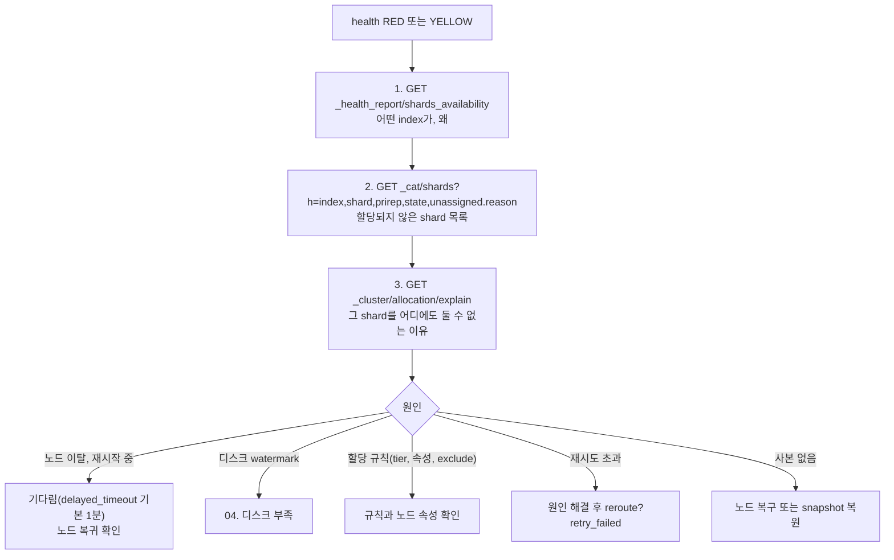

health가 RED로 바뀌면 대개 급하게 노드를 재시작하거나 설정을 바꾸고 싶어집니다. 그런데 원인을 모른 채 손을 대면 사본이 남아 있던 shard까지 잃을 수 있습니다.
RED와 YELLOW는 결과일 뿐이고, 원인은 shard마다 Elasticsearch가 이미 설명해 주고 있습니다. 이 글은 그 설명을 읽는 순서를 정리합니다.

:::note[기준]
- Elasticsearch 9.x 기준입니다. 공식 문서는 2026년 11월에 다시 확인했습니다.
:::

## RED와 YELLOW

| 상태 | 뜻 | 영향 |
| --- | --- | --- |
| YELLOW | 모든 primary는 할당됐고, 일부 replica가 할당되지 않음 | 검색과 쓰기는 됨. 노드 하나를 더 잃으면 데이터를 잃을 수 있음 |
| RED | 일부 primary가 할당되지 않음 | 그 shard의 데이터는 검색되지 않고, 그 shard로 가는 쓰기는 실패 |

근거: [Red or yellow cluster health status](https://www.elastic.co/docs/troubleshoot/elasticsearch/red-yellow-cluster-status).

## 읽는 순서



```console
GET _health_report/shards_availability
GET _cat/shards?v&h=index,shard,prirep,state,node,unassigned.reason&s=state
GET _cluster/allocation/explain
{
  "index": "logs-app-default",
  "shard": 0,
  "primary": true
}
```

allocation explain을 index 없이 부르면 할당되지 않은 shard 하나를 골라 설명합니다. 출력이 길면 노드별 결정만 봅니다([Diagnose unassigned shards](https://www.elastic.co/docs/troubleshoot/elasticsearch/diagnose-unassigned-shards)).

```console
GET _cluster/allocation/explain?filter_path=index,shard,primary,current_state,unassigned_info,can_allocate,allocate_explanation,node_allocation_decisions.node_name,node_allocation_decisions.deciders.*
```

## 원인별 조치

| allocation explain에 보이는 것 | 원인 | 조치 |
| --- | --- | --- |
| `NODE_LEFT`, 노드가 목록에 없음 | 노드가 빠짐 | 노드를 살림. 재시작 중이면 `index.unassigned.node_left.delayed_timeout`(기본 1분) 동안 replica 재할당을 미룸 |
| `disk_threshold` decider | 디스크 low watermark(85%) 초과 노드에는 할당하지 않음 | [04](../04-disk-full/) |
| `filter` decider, `data_tier` | tier 선호나 노드 속성 조건에 맞는 노드가 없음 | index의 `_tier_preference`, `index.routing.allocation.*`와 노드 속성 비교 |
| `same_shard` | primary와 replica를 같은 노드에 둘 수 없음 | replica 수가 노드 수 이상. replica를 줄이거나 노드 추가 |
| `max_retry` | 할당이 5번 실패해 재시도를 멈춤 | 원인을 고친 뒤 `POST _cluster/reroute?retry_failed=true` |
| `shards_limit` | `total_shards_per_node` 한도 | 한도 조정 또는 노드 추가 |
| `cluster.routing.allocation.enable`가 `none`이나 `primaries` | 작업 중 할당을 끄고 되돌리지 않음 | `null`로 되돌림 |
| `throttling` | 동시 recovery 수 제한으로 순서를 기다리는 중 | 문제 아님. `GET _cat/recovery?active_only=true`로 진행 확인 |

`max_retry`의 기준인 `index.allocation.max_retries` 기본값 5와 `node_left.delayed_timeout` 기본값 1분은 로컬 9.5.5에서도 확인했습니다. 근거: [Diagnose unassigned shards](https://www.elastic.co/docs/troubleshoot/elasticsearch/diagnose-unassigned-shards), [Cluster allocation API examples](https://www.elastic.co/docs/troubleshoot/elasticsearch/cluster-allocation-api-examples), [Full cluster restart and rolling restart procedures](https://www.elastic.co/docs/deploy-manage/maintenance/start-stop-services/full-cluster-restart-rolling-restart-procedures).

rolling restart 뒤에 `cluster.routing.allocation.enable`을 되돌리지 않아 YELLOW가 계속되는 경우가 흔합니다. 작업 뒤에는 항상 `GET _cluster/settings`로 확인합니다(해석).

## 사본이 없을 때

primary를 가진 노드를 잃고 replica도 없으면 선택지는 아래 순서입니다(공식 문서 기준).

1. **노드를 되살린다.** 데이터 디렉터리가 남아 있으면 노드가 돌아오는 순간 shard가 다시 할당됩니다. 가장 먼저 시도합니다.
2. **snapshot에서 그 index를 복원한다.** 마지막 snapshot 이후에 들어온 데이터는 잃습니다([Restore from snapshot](https://www.elastic.co/docs/troubleshoot/elasticsearch/restore-from-snapshot)).
3. **빈 primary를 할당한다(`allocate_empty_primary`).** 그 shard의 데이터를 모두 버리는 조치입니다. 다시 수집할 수 있는 데이터일 때만 씁니다.

`allocate_stale_primary`는 오래된 사본을 primary로 올려 그 뒤의 변경을 잃습니다. 두 명령 모두 `accept_data_loss: true`를 요구할 만큼 위험합니다([Cluster reroute API](https://www.elastic.co/docs/api/elasticsearch/operation/operation-cluster-reroute)). 노드를 되살릴 가능성이 남아 있으면 쓰지 않습니다(해석).

## 판단 기준

이 절은 위의 사실을 바탕으로 한 제 판단입니다(해석).

| 상황 | 권장 |
| --- | --- |
| RED, 원인 모름 | 재시작하기 전에 health report와 allocation explain 결과를 저장 |
| 노드 재시작 중 YELLOW | 1분 기다리고, 노드 복귀 뒤에도 계속되면 allocation explain |
| 작업 뒤 YELLOW가 안 풀림 | `cluster.routing.allocation.enable` 확인 |
| replica 0 index가 RED | 노드 복구 → snapshot 복원 → 재수집 순서 |

## 참고 문서

- [Red or yellow cluster health status](https://www.elastic.co/docs/troubleshoot/elasticsearch/red-yellow-cluster-status)
- [Diagnose unassigned shards](https://www.elastic.co/docs/troubleshoot/elasticsearch/diagnose-unassigned-shards)
- [Cluster allocation API examples](https://www.elastic.co/docs/troubleshoot/elasticsearch/cluster-allocation-api-examples)
- [Full cluster restart and rolling restart procedures](https://www.elastic.co/docs/deploy-manage/maintenance/start-stop-services/full-cluster-restart-rolling-restart-procedures)
- [Restore from snapshot](https://www.elastic.co/docs/troubleshoot/elasticsearch/restore-from-snapshot)
- [Cluster reroute API](https://www.elastic.co/docs/api/elasticsearch/operation/operation-cluster-reroute)
