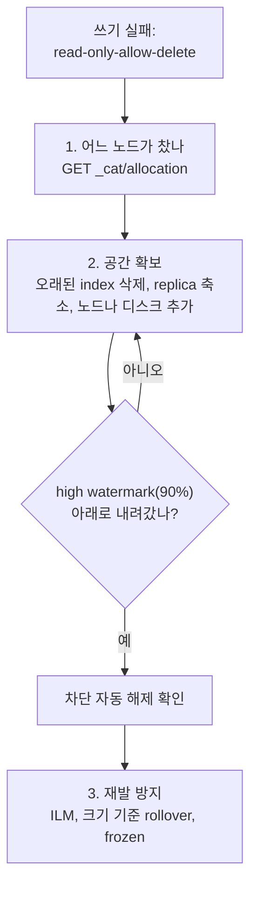

어느 날 갑자기 모든 적재가 `index has read-only-allow-delete block` 오류로 실패합니다. 디스크가 95%를 넘어 Elasticsearch가 노드의 index를 읽기 전용으로 바꾼 것입니다.
디스크 문제는 가장 흔하고, 미리 막기도 가장 쉬운 장애입니다. 이 글은 단계별 동작과 푸는 순서, 디스크가 이유 없이 늘 때 볼 것을 정리합니다.

:::note[기준]
- Elasticsearch 9.x 기준입니다. 공식 문서와 known issues는 2026년 11월에 다시 확인했습니다.
:::

## watermark 단계

| 단계 | 기본값 | 동작 |
| --- | --- | --- |
| low | 85% | 그 노드에 replica를 새로 할당하지 않음(새 index의 primary는 예외) |
| high | 90% | 그 노드에서 shard를 다른 노드로 옮김 |
| flood-stage | 95% | 그 노드에 shard가 있는 모든 index에 쓰기 차단(read-only-allow-delete) |

근거: [Watermark errors](https://www.elastic.co/docs/troubleshoot/elasticsearch/fix-watermark-errors). 같은 문서에 따르면 쓰기 차단은 디스크 사용률이 high watermark 아래로 내려가면 자동으로 풀립니다. Elastic Cloud 콘솔의 75% 빨간 표시는 시각 표시일 뿐 Elasticsearch 동작과는 관계없습니다.

flood-stage는 그 노드에 shard가 하나라도 있는 index 전체를 막습니다. 노드 하나의 디스크가 차면 여러 index의 쓰기가 한꺼번에 멈추는 이유입니다(해석).

## read-only 풀기



```console
GET _cat/allocation?v&s=disk.percent:desc
GET _cat/indices?v&h=index,pri,rep,store.size,creation.date.string&s=store.size:desc&bytes=gb
GET _health_report/disk
```

공간을 만드는 방법입니다([Fix data node out of disk](https://www.elastic.co/docs/troubleshoot/elasticsearch/fix-data-node-out-of-disk), [Decrease disk usage](https://www.elastic.co/docs/troubleshoot/elasticsearch/decrease-disk-usage-data-node)).

| 방법 | 효과 | 주의 |
| --- | --- | --- |
| 오래된 index, data stream backing index 삭제 | 즉시 | 보관 정책 확인. data stream의 write index는 지울 수 없음 |
| replica 줄이기 | 즉시, 해당 index 크기만큼 | 그 index는 노드 하나만 잃어도 데이터를 잃음. 임시 조치 |
| 노드 추가, 디스크 증설 | 근본 해결 | 시간이 걸림 |
| 일시적으로 watermark 상향 | 시간 확보 | 디스크가 정말 가득 차면 노드가 멈춤. 공간 확보 뒤 반드시 되돌림 |

```console
PUT logs-app-2026.10.*/_settings
{ "index.number_of_replicas": 0 }

PUT _cluster/settings
{
  "persistent": {
    "cluster.routing.allocation.disk.watermark.high": "93%",
    "cluster.routing.allocation.disk.watermark.flood_stage": "97%"
  }
}
```

watermark를 올린 뒤에는 공간을 확보하고 `null`로 되돌립니다. 잊고 두면 다음에는 디스크가 완전히 찰 때까지 아무 경고도 없습니다(해석).
master 전용 노드나 기타 노드의 디스크가 차는 경우는 [Fix master node out of disk](https://www.elastic.co/docs/troubleshoot/elasticsearch/fix-master-node-out-of-disk), [Fix other node out of disk](https://www.elastic.co/docs/troubleshoot/elasticsearch/fix-other-node-out-of-disk)를 따릅니다.

## 디스크가 이유 없이 늘 때

`_cat/allocation`의 `disk.indices`(shard 데이터)보다 `disk.used`(디스크 전체 사용)가 훨씬 크면, shard 데이터가 아닌 무엇인가가 디스크를 쓰고 있습니다.

| 원인 | 확인 |
| --- | --- |
| 같은 디스크의 로그, heap dump, 다른 프로그램 | `du -sh` 로 data 디렉터리 밖 확인. heap dump는 9.1부터 기본 logs 디렉터리 |
| translog가 정리되지 않음 | `GET _stats/translog?level=shards`의 `uncommitted_size_in_bytes` |
| 진행 중이거나 실패한 recovery의 임시 파일 | `GET _cat/recovery?active_only=true` |
| force merge 중 임시 증가 | [데이터 설계 02](../../data/02-merge-and-force-merge/) |

9.5.0에서 9.5.2를 쓰고 있다면 known issue를 먼저 확인합니다. primary를 가진 노드가 indexing pressure 한도를 넘는 순간 처리 중이던 bulk의 일부가 replica로 복제되지 않아 primary와 replica 내용이 어긋날 수 있습니다. 이 상태에서는 translog가 정리되지 않아 디스크를 과도하게 쓰고, recovery가 매우 오래 걸릴 수 있습니다. 9.5.3에서 수정됐고, 9.5 계열 사용자는 9.5.3 이상으로 빨리 올리라고 권합니다([Elasticsearch known issues](https://www.elastic.co/docs/release-notes/elasticsearch/known-issues), [elastic/elasticsearch#158212](https://github.com/elastic/elasticsearch/issues/158212)). 영향 여부를 판단하는 방법과 우회 방법은 issue에 있습니다.

## 재발 방지

| 방법 | 내용 |
| --- | --- |
| 보관 기간 자동화 | ILM이나 data stream lifecycle의 삭제 단계 |
| 크기 기준 rollover | `max_primary_shard_size: 50gb`. 기간만으로 rollover하면 shard가 커져 노드 하나의 디스크를 한꺼번에 씀 |
| 오래된 데이터 이동 | frozen tier([데이터 설계 05](../../data/05-tiers-and-retention/)) |
| 저장 크기 축소 | logsdb([데이터 설계 03](../../data/03-storage-footprint/)) |
| 추세 감시 | 01의 매월 점검. 85%에 닿기 전에 증설 |
| ILM 오류 감시 | `GET */_ilm/explain?only_errors=true`. ILM이 멈추면 삭제도 rollover도 멈춤 |

sizing 단계에서 디스크를 85%까지 쓸 수 있다고 보지 않습니다. 노드 하나를 잃었을 때 나머지 노드가 그 shard를 받아야 하므로, 평소 사용률은 그만큼 낮아야 합니다(해석).

## 판단 기준

이 절은 위의 사실을 바탕으로 한 제 판단입니다(해석).

| 상황 | 권장 |
| --- | --- |
| read-only 오류 | 공간 확보로 90% 아래로. 차단은 자동 해제 |
| 시간이 급함 | replica 임시 축소, watermark 임시 상향. 공간 확보 뒤 되돌림 |
| `disk.used`가 `disk.indices`보다 큼 | data 디렉터리 밖, translog, recovery 확인. 9.5.0에서 9.5.2면 known issue 먼저 |
| 반복됨 | 크기 기준 rollover, 보관 자동화, 증설 시점 계산 |
