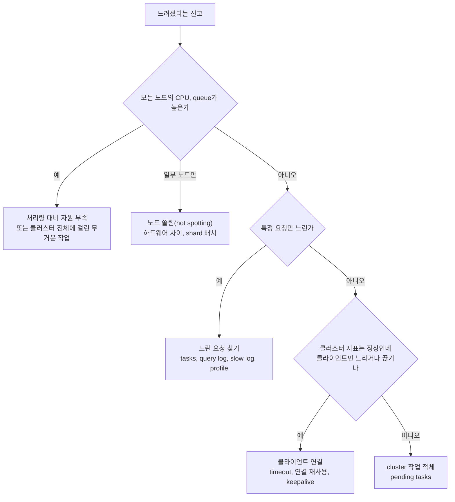

"어제부터 대시보드가 느리다"는 문의에는 원인이 여러 겹으로 섞여 있습니다. CPU가 모자랄 수도 있고, 노드 하나에 쓰기가 몰렸을 수도 있고, 사용자 한 명의 query가 thread를 다 잡고 있을 수도 있습니다. 클러스터는 멀쩡한데 클라이언트가 끊긴 연결을 붙잡고 있는 경우도 있습니다.
범위를 구분하지 않고 설정부터 바꾸면 원인을 덮어 버립니다. 그래서 먼저 범위를 나누고, 범위마다 확인할 곳을 봅니다.

:::note[기준]
- Elasticsearch 9.x 기준입니다. 공식 문서와 Elasticsearch 소스는 2026년 11월에 다시 확인했습니다. 기능마다 GA 버전이 다른 경우는 본문에 적었습니다.
- 명령 모음은 [`labs/operations/slow-cluster.console`](https://github.com/Munsik/engineering-notes/blob/main/labs/operations/slow-cluster.console)에 있습니다.
:::

## 범위부터 구분한다

아래 순서는 제가 쓰는 방법입니다. 앞 단계에서 범위가 좁혀지면 그 범위의 절로 바로 갑니다.



첫 판단에 쓰는 명령입니다.

```console
GET _cat/nodes?v&s=cpu:desc&h=name,node.role,master,cpu,load_1m,load_5m,heap.percent,available_processors
GET _cat/thread_pool/search,write?v&s=n,nn&h=n,nn,a,q,r,c
GET _cat/pending_tasks?v
```

- `available_processors` 열은 Stack 9.3부터 GA입니다([High CPU usage](https://www.elastic.co/docs/troubleshoot/elasticsearch/high-cpu-usage)). 같은 tier인데 이 값이 다른 노드가 있으면 하드웨어부터 맞춥니다.
- `cat nodes`의 `cpu`는 순간값이고, thread pool의 `rejected`와 `completed`는 노드가 시작된 뒤의 누적값입니다. 한 번만 보지 말고 몇 분 간격으로 두 번 이상 봅니다([Task queue backlog](https://www.elastic.co/docs/troubleshoot/elasticsearch/task-queue-backlog)).
- 공식 문서는 CPU가 오래 95%를 넘으면 조사하라고 권합니다. load average를 processor 수로 나눈 값은 그 자체로는 부족하고 응답 시간과 같이 봐야 한다고 설명합니다(같은 High CPU usage 문서).

## CPU가 높을 때: hot threads

`GET _nodes/hot_threads`는 일정 시간(기본 500ms) 동안 CPU를 많이 쓴 Java thread의 stack trace를 보여 줍니다. 특정 task와 바로 이어지지는 않지만, 노드가 무엇에 시간을 쓰는지 알려 줍니다.

```console
GET _nodes/hot_threads?threads=5
GET _nodes/<node_name>/hot_threads?threads=10&interval=1s
```

stack trace에서 아래 이름이 보이면 무엇이 돌고 있는지 짐작할 수 있습니다([High CPU usage](https://www.elastic.co/docs/troubleshoot/elasticsearch/high-cpu-usage)).

| stack trace에 보이는 것 | 의미 |
| --- | --- |
| `org.elasticsearch.action.search`, `org.elasticsearch.search` | 검색 |
| `org.elasticsearch.xpack.esql` | ES\|QL |
| `org.elasticsearch.index.fielddata.ordinals.GlobalOrdinalsBuilder.build` | global ordinals 생성(keyword 집계 첫 실행, refresh 직후) |
| `org.elasticsearch.ingest.Pipeline`, `org.elasticsearch.grok` | ingest pipeline, grok |
| `org.elasticsearch.cluster.metadata.Metadata.findAliases` | alias 해석(alias, index가 아주 많을 때) |
| `org.elasticsearch.common.regex` | 정규식 |

thread 이름도 단서입니다. `[search]`면 검색, `[write]`면 적재, `[management]`면 통계 수집 같은 관리 작업입니다. 몇 분 간격으로 다시 떠서 같은 stack trace가 계속 나오면 그 작업이 진행되지 않고 있다는 뜻입니다(같은 문서).

CPU가 GC 때문에 높은 경우도 많습니다. hot threads에서 `other` CPU가 크거나 GC 로그에 긴 GC가 이어지면 [03의 heap 압박](../03-node-failure-triage/#heap-압박의-원인-좁히기)으로 갑니다.

## thread pool과 거부

요청은 thread pool에서 실행됩니다. thread가 모두 바쁘면 queue에서 기다리고, queue가 차면 429 `es_rejected_execution_exception`으로 거부됩니다([Rejected requests](https://www.elastic.co/docs/troubleshoot/elasticsearch/rejected-requests)).

9.x의 기본 크기입니다. `P`는 노드에 할당된 processor 수입니다.

| pool | 크기 | queue | 비고 |
| --- | --- | --- | --- |
| `search` | `P × 3 / 2 + 1` | 크기 × 1000 | 8.x까지는 queue가 1000으로 고정 |
| `write` | `P` | `max(10000, P × 750)` | 9.1까지는 10000 고정. 9.0까지는 bulk도 이 pool에서 처리 |
| `write_coordination` | `P` | 10000 | 9.1부터. bulk 요청 조정 |
| `management` | 최대 5(scaling) | - | 통계 수집, 상태 조회 같은 관리 작업 |

근거: [Thread pool settings](https://www.elastic.co/docs/reference/elasticsearch/configuration-reference/thread-pool-settings). 9.0과 9.5 소스(`DefaultBuiltInExecutorBuilders.java`)에서도 같은 값을 확인했습니다.

queue가 커졌다고 거부가 사라지지는 않습니다. 기다리는 요청이 많아질 뿐이라 응답은 더 느려지고 heap도 더 씁니다. 공식 문서도 thread pool 크기 조정은 부하 시험을 한 뒤에만 하라고 설명합니다([Task queue backlog](https://www.elastic.co/docs/troubleshoot/elasticsearch/task-queue-backlog)).

`queue`가 계속 높으면 오래 걸리는 작업이나 CPU를 많이 쓰는 작업이 있다는 뜻이고, 잠깐씩 튀면 요청이 한꺼번에 몰리는 것입니다. 앞의 경우는 아래의 task 확인으로, 뒤의 경우는 요청을 나눠 보내는 쪽으로 풉니다(같은 문서).

## 오래 걸리는 task 찾기

```console
GET _tasks?detailed=true&human=true&group_by=none&actions=indices:data/read/search*,indices:data/read/esql*
GET _tasks?detailed=true&human=true&actions=indices:*write*
```

- `running_time_in_nanos`가 큰 task를 봅니다. CPU 시간이 아니라 경과 시간입니다.
- `description`에 검색 대상 index와 query 본문이 들어 있습니다. ES|QL은 query 문자열이 그대로 보입니다.
- `indices:*search*`는 Query DSL과 async search만 잡고 ES|QL, EQL, SQL은 잡지 않습니다. 위처럼 action을 따로 지정합니다([Find and cancel long-running queries](https://www.elastic.co/docs/reference/query-languages/query-task-management)).
- 요청을 보낸 쪽이 `X-Opaque-Id` header를 넣었다면 `headers`에서 출처를 알 수 있습니다. Kibana는 이 header에 화면 정보를 넣습니다.

취소하는 방법과 실행 중인 query를 막는 설정은 [06](../06-expensive-queries/)에서 다룹니다.

## cluster 작업이 쌓일 때

`GET _cat/pending_tasks`는 master가 아직 처리하지 못한 cluster state 변경입니다. 클러스터가 불안정할 때는 쌓일 수 있지만, 평소에 계속 쌓이면 설정이나 요청 패턴에 문제가 있다는 뜻입니다([Task queue backlog](https://www.elastic.co/docs/troubleshoot/elasticsearch/task-queue-backlog)).

| 쌓이는 task | 흔한 원인 |
| --- | --- |
| `ilm-` | ILM은 기본 10분마다 돕니다(`indices.lifecycle.poll_interval`). 계속 보이면 이 값을 줄여 두었거나, master heap에 비해 index가 많음 |
| `put-mapping` | dynamic mapping으로 새 필드가 계속 생김. [07의 mapping explosion](../07-unstable-cluster/#cluster-state가-클-때) |
| `shard-started` | recovery가 진행 중. `cluster.routing.allocation.*`를 바꿔 두었으면 확인 |

## 일부 노드만 느릴 때: 쏠림

같은 tier의 노드 가운데 몇 대만 CPU, heap, 디스크가 계속 높으면 쏠림(hot spotting)입니다. 공식 문서는 30초 넘게 계속되거나 반복되면 문제로 보라고 설명합니다([Hot spotting](https://www.elastic.co/docs/troubleshoot/elasticsearch/hotspotting)).

| 원인 | 확인 |
| --- | --- |
| 하드웨어가 다름(CPU, 디스크, 네트워크, 같은 호스트의 다른 프로세스) | `GET _cat/nodes?v&s=name&h=name,node.role,disk.total,heap.max,available_processors` |
| shard 수나 크기가 고르지 않음 | `GET _cat/allocation?v&s=node&h=node,shards,disk.percent,disk.indices,disk.used` |
| 쓰기가 많은 index의 shard가 몇 노드에 몰림 | `GET _cat/thread_pool/write,search?v&s=n,nn&h=n,nn,q,a,r,c` |
| 재시작한 노드가 rollover 뒤 새 shard를 많이 받음 | `cat allocation`의 shard 수, `cat recovery` |

쓰기 쏠림에는 공식 문서가 두 가지를 권합니다. 쓰기가 많은 index의 primary와 replica 수를 indexing 노드 수에 맞추고, `index.routing.allocation.total_shards_per_node`로 한 노드에 들어가는 shard 수를 제한하는 것입니다(같은 문서). 실측과 진단 순서는 [데이터 설계 04](../../data/04-shards-and-bulk/#한-shard나-노드에-쓰기가-몰릴-때)에 있습니다.

`total_shards_per_node`를 너무 빠듯하게 잡으면 노드 하나가 빠졌을 때 shard를 둘 곳이 없어 YELLOW나 RED가 됩니다. 남는 노드 수로 계산해서 정합니다.

## 느린 요청을 기록해 두기

장애 시간에 사람이 없었다면 나중에 볼 기록이 필요합니다. 도구가 버전마다 다릅니다.

| 도구 | 상태 | 남기는 것 |
| --- | --- | --- |
| search slow log | GA | shard 단위 query, fetch 단계 시간. index마다 설정. 기본은 꺼짐(`-1`) |
| indexing slow log | GA | 문서 단위 indexing 시간. 적재 쪽은 이것뿐 |
| query logging | Stack 9.4부터 preview | Query DSL, ES\|QL, EQL, SQL 요청 전체 시간. coordinating node의 `*_querylog.json` |
| search task watchdog | Stack 9.4부터 GA | 오래 걸리는 검색이 실행 중일 때 hot threads를 로그에 남김. 기본은 꺼짐 |
| Query activity(Kibana) | Stack 9.4부터 preview | 지금 실행 중인 query 목록과 취소 |

근거: [Slow log settings](https://www.elastic.co/docs/reference/elasticsearch/index-settings/slow-log), [Query logging](https://www.elastic.co/docs/deploy-manage/monitor/logging-configuration/query-logs), [Search task watchdog settings](https://www.elastic.co/docs/reference/elasticsearch/configuration-reference/search-settings#search-task-watchdog-settings), [Query activity](https://www.elastic.co/docs/deploy-manage/monitor/query-activity). watchdog과 query logging의 설정 이름과 기본값은 9.5 소스(`SearchTaskWatchdog.java`, `QueryLogging.java`)에서도 확인했습니다.

slow log는 shard에서 걸린 시간만 남깁니다. 요청이 coordinating node에서 기다린 시간이나 여러 shard를 모으는 시간은 빠집니다. 공식 문서도 검색은 query logging으로 옮기라고 권합니다. 9.4 이전이거나 preview 기능을 운영에 쓰기 어려우면 slow log를 씁니다.

```console
PUT logs-app-*/_settings
{
  "index.search.slowlog.threshold.query.warn": "5s",
  "index.search.slowlog.threshold.query.info": "2s",
  "index.search.slowlog.threshold.fetch.warn": "1s",
  "index.search.slowlog.include.user": true
}

PUT _cluster/settings
{
  "persistent": {
    "elasticsearch.querylog.enabled": true,
    "elasticsearch.querylog.threshold": "2s"
  }
}

PUT _cluster/settings
{
  "persistent": {
    "search.task_watchdog.enabled": true
  }
}
```

- data stream에 `_settings`로 준 slow log 설정은 지금 있는 backing index에만 들어갑니다. rollover 뒤에도 남기려면 index template의 settings에도 넣습니다.
- query logging의 `threshold` 기본값은 0이라 모든 query를 남깁니다. 켤 때는 값을 꼭 줍니다. 처리량을 넘는 기록은 버려질 수 있습니다(Query logging 문서).
- watchdog은 coordinating node와 data node 모두 기본 3초 기준입니다(`search.task_watchdog.coordinator_threshold`, `data_node_threshold`). 로그의 hot threads는 gzip으로 압축하고 base64로 인코딩한 값이라 `base64 --decode | gzip --decompress`로 풉니다.
- 찾은 query 하나를 자세히 보려면 `"profile": true`를 붙여 다시 실행하거나 Kibana의 Search Profiler를 씁니다. profile은 그 요청만 느려지므로 운영 시간에는 범위를 줄여서 돌립니다.

## 클러스터는 정상인데 클라이언트만 느릴 때

클러스터 지표가 정상인데 애플리케이션에서만 timeout이나 연결 오류가 나면 클라이언트와 그 사이 네트워크를 봅니다.

**timeout 뒤에도 검색은 계속 돈다.** 클라이언트 timeout은 클라이언트가 기다리기를 멈출 뿐입니다. Elasticsearch는 HTTP 연결이 닫혀야 검색을 자동으로 취소합니다. 공식 문서는 요청을 중단하거나 timeout이 나면 HTTP 연결을 닫도록 클라이언트를 설정하라고 권합니다([Search cancellation](https://www.elastic.co/docs/solutions/search/the-search-api#global-search-cancellation)). 연결을 닫지 않고 같은 요청을 다시 보내는 재시도는 클러스터에 같은 검색을 쌓습니다.

**search API의 `timeout`은 shard 단위다.** 요청 본문의 `timeout`은 shard마다 query 단계에 적용되고, 넘으면 그 shard까지의 부분 결과와 `"timed_out": true`를 돌려줍니다. 전체 요청 시간을 막는 장치가 아닙니다([Search timeout](https://www.elastic.co/docs/solutions/search/the-search-api#search-timeout)).

**한가한 시간대에만 연결 오류가 난다.** 낮에는 괜찮다가 새벽이나 주말에 첫 요청이 실패하면, 중간 장비(방화벽, NAT, 부하 분산기)의 idle timeout을 의심합니다. 연결 pool에 남은 연결을 장비가 먼저 끊었는데 클라이언트는 모르고 그 연결로 요청을 보내 RST나 timeout을 받는 경우입니다.

| 확인 | 내용 |
| --- | --- |
| 중간 장비 idle timeout | 장비 담당자에게 값을 확인 |
| OS keepalive 시작 시간 | `sysctl net.ipv4.tcp_keepalive_time`. Linux 기본값은 7200초라 대부분의 장비 idle timeout보다 깁니다 |
| Elasticsearch HTTP keepalive | `http.tcp.keep_idle`, `http.tcp.keep_interval`. 기본은 OS 값을 따르고, 300초를 넘게 줄 수 없음. 정적 설정이라 재시작 필요 |
| 클라이언트 연결 pool | idle 연결을 장비 timeout보다 먼저 닫는 옵션, 실패 시 다른 노드로 재시도 |

근거: [Networking settings](https://www.elastic.co/docs/reference/elasticsearch/configuration-reference/networking-settings). keepalive 값을 장비 idle timeout보다 짧게 두면 연결이 살아 있는 동안 장비가 끊지 않습니다. 노드 사이 transport 연결도 같은 이유로 끊기면 클러스터가 불안정해집니다. 그 경우는 [07](../07-unstable-cluster/#연결이-밖에서-끊길-때)에서 다룹니다.

## 판단 기준

| 상황 | 먼저 할 것 |
| --- | --- |
| 모든 노드 CPU가 높음 | hot threads로 무엇인지 확인. 무거운 작업이 아니면 처리량에 비해 노드가 모자람 |
| 몇 노드만 높음 | 하드웨어, shard 배치, 쓰기 index의 shard 수 |
| `search` queue가 계속 높음 | 오래 걸리는 검색 task를 찾아 취소하고 [06](../06-expensive-queries/)의 보호 설정 |
| `write` 거부 | bulk 크기와 동시성, 쏠림. queue 크기를 키우는 것은 마지막 |
| pending tasks가 계속 쌓임 | `put-mapping`이면 필드 증가, `ilm-`이면 poll 주기와 index 수 |
| 클러스터는 정상, 클라이언트만 오류 | 클라이언트 timeout 처리, 연결 pool, 중간 장비 idle timeout |
| 원인을 못 찾고 지나감 | 다음을 위해 query logging이나 slow log, watchdog을 켜 둠 |

## 참고 문서

- [High CPU usage](https://www.elastic.co/docs/troubleshoot/elasticsearch/high-cpu-usage)
- [Task queue backlog](https://www.elastic.co/docs/troubleshoot/elasticsearch/task-queue-backlog)
- [Rejected requests](https://www.elastic.co/docs/troubleshoot/elasticsearch/rejected-requests)
- [Thread pool settings](https://www.elastic.co/docs/reference/elasticsearch/configuration-reference/thread-pool-settings)
- [Find and cancel long-running queries](https://www.elastic.co/docs/reference/query-languages/query-task-management)
- [Hot spotting](https://www.elastic.co/docs/troubleshoot/elasticsearch/hotspotting)
- [Slow log settings](https://www.elastic.co/docs/reference/elasticsearch/index-settings/slow-log)
- [Query logging](https://www.elastic.co/docs/deploy-manage/monitor/logging-configuration/query-logs)
- [Search task watchdog settings](https://www.elastic.co/docs/reference/elasticsearch/configuration-reference/search-settings)
- [Query activity](https://www.elastic.co/docs/deploy-manage/monitor/query-activity)
- [Search cancellation](https://www.elastic.co/docs/solutions/search/the-search-api)
- [Networking settings](https://www.elastic.co/docs/reference/elasticsearch/configuration-reference/networking-settings)
