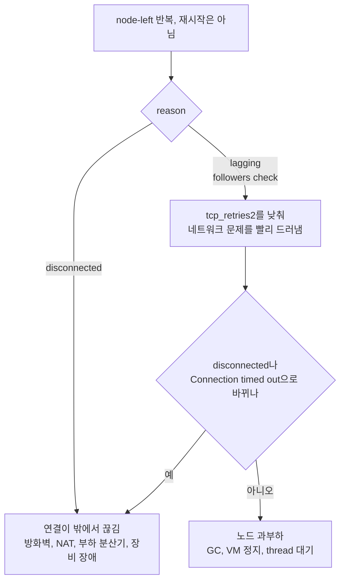

노드가 빠졌다 들어오기를 반복하면 다른 문제는 풀 수 없습니다. shard가 빠질 때마다 replica를 다시 만들고, 노드가 돌아오면 또 옮기고, 그사이 검색과 적재가 실패합니다. 상태가 YELLOW와 RED를 오가니 원인을 찾으려고 보는 지표도 계속 흔들립니다.
공식 문서도 master가 안정되고 노드 구성이 고정되기 전에는 다른 문제를 풀 수 없다고 적고 있습니다([Troubleshoot an unstable cluster](https://www.elastic.co/docs/troubleshoot/elasticsearch/troubleshooting-unstable-cluster)). 이 글은 그 순서를 따라갑니다.

:::note[기준]
- Elasticsearch 9.x, Linux, self-managed 기준입니다. 공식 문서는 2026년 11월에 다시 확인했습니다.
- Elastic Cloud Hosted, ECE, ECK도 discovery와 master 선출 동작은 같습니다. 설정을 직접 바꾸지 못할 뿐입니다.
- 명령 모음은 [`labs/operations/unstable-cluster.console`](https://github.com/Munsik/engineering-notes/blob/main/labs/operations/unstable-cluster.console)에 있습니다.
:::

## 통계보다 로그를 본다

불안정한 클러스터에서는 통계 API가 거의 도움이 되지 않습니다. 한 시점의 모습만 보여 주는데, 문제는 시간에 따라 반복되는 패턴이기 때문입니다. 공식 문서는 elected master의 로그를 보라고 권합니다(같은 문서).

노드가 빠지면 elected master에 이런 로그가 남습니다.

```text
[INFO ][o.e.c.c.NodeLeftExecutor] [master-1]
    node-left: [{data-4}{...}{10.0.0.14}{10.0.0.14:9300}{hds}]
    with reason [disconnected]
```

다시 들어오면 이렇게 남습니다.

```text
[INFO ][o.e.c.c.NodeJoinExecutor] [master-1]
    node-join: [{data-4}{...}{10.0.0.14}{10.0.0.14:9300}{hds}]
    with reason [joining after restart, removed [24s] ago with reason [disconnected]]
```

- `NodeLeftExecutor`와 `NodeJoinExecutor` 로그는 elected master에만 남습니다. 다른 노드의 `removed {...}` 로그에는 이유가 없습니다.
- join 로그에 `joining after restart`가 있으면 그 노드는 재시작한 것입니다. 왜 내려갔는지는 그 노드의 로그와 [03](../03-node-failure-triage/)으로 봅니다.
- 재시작하지 않고 다시 들어왔다면 빠진 이유를 따라갑니다.

```console
GET _cat/master?v
GET _cat/nodes?v&h=name,node.role,master,uptime,heap.percent,cpu,load_1m&s=name
GET _health_report/master_is_stable
```

`master_is_stable` indicator는 최근 master가 자주 바뀌었는지, master가 없는지를 알려 줍니다. 빠진 노드에서 부르면 그 노드가 본 상황을 알려 줍니다.

## 빠진 이유 세 가지

| reason | 의미 | 기본 기준 |
| --- | --- | --- |
| `disconnected` | master에서 그 노드로 가는 연결이 닫힘 | 즉시 |
| `lagging` | master가 보낸 cluster state를 정해진 시간 안에 적용하지 못함 | `cluster.publish.timeout` 30초 + `cluster.follower_lag.timeout` 90초 |
| `followers check retry count exceeded` | master가 1초마다 보내는 health check가 연속으로 실패하거나 timeout | check 하나당 10초, 연속 3번 |

근거: [Troubleshoot an unstable cluster](https://www.elastic.co/docs/troubleshoot/elasticsearch/troubleshooting-unstable-cluster), [Discovery and cluster formation settings](https://www.elastic.co/docs/reference/elasticsearch/configuration-reference/discovery-cluster-formation-settings). 이 값들은 공식 문서가 바꾸지 말라고 경고하는 설정입니다. timeout을 늘리면 노드가 덜 빠지는 것처럼 보이지만, 응답 없는 노드를 더 오래 붙잡게 됩니다(해석).

`lagging`과 `followers check retry count exceeded`는 네트워크 지연 때문일 수도, 노드 과부하 때문일 수도 있습니다. reason만으로는 둘을 가를 수 없습니다.

## 네트워크인지 노드인지 가르기



Linux의 `net.ipv4.tcp_retries2`는 기본 15인 배포판이 많습니다. 이 값이면 잃어버린 패킷을 몇 분 동안 재전송하며 기다리고, 그동안 Elasticsearch는 `lagging`이나 check 실패만 봅니다. 공식 문서는 5로 낮추라고 권합니다. 그러면 망가진 경로가 수십 초 안에 연결 timeout이나 `disconnected`로 드러납니다([Decrease the TCP retransmission timeout](https://www.elastic.co/docs/deploy-manage/deploy/self-managed/system-config-tcpretries)).

```bash
sysctl -w net.ipv4.tcp_retries2=5
# 영구 적용은 /etc/sysctl.d/ 아래 파일로. 적용 순서는 03의 OS 설정 점검 참고
```

이 값을 낮춘 뒤 증상이 `disconnected`나 `Connection timed out`으로 바뀌면 네트워크를 계속 봅니다. 그대로 `lagging`이나 check 실패가 나오면 네트워크 가능성은 낮고 노드 성능을 봅니다. 공식 문서도 이 값은 고장 난 네트워크나 과부하를 고치지 않고, 문제가 드러나는 시간만 바꾼다고 적고 있습니다. 적용 순서는 [03의 OS 설정 점검](../03-node-failure-triage/#os-설정-점검)을 따릅니다.

## 연결이 밖에서 끊길 때

Elasticsearch는 노드 사이에 여러 TCP 연결을 열고 영원히 유지한다고 가정합니다. elected master는 노드가 클러스터를 떠나지 않는 한 그 노드로 가는 연결을 스스로 닫지 않습니다. 그러니 재시작 없이 `disconnected`가 났다면 Elasticsearch 밖의 무언가가 연결을 끊은 것입니다([Networking settings: long-lived connections](https://www.elastic.co/docs/reference/elasticsearch/configuration-reference/networking-settings#long-lived-connections)).

끊긴 노드 쪽 로그에는 이런 줄이 남습니다.

```text
[WARN ][o.e.c.NodeConnectionsService] [data-1] reopened transport connection to node [{data-4}...]
    which disconnected exceptionally [500ms] ago but did not restart, so the disconnection is unexpected
```

| 흔한 원인 | 확인 |
| --- | --- |
| 방화벽, NAT의 idle timeout이나 세션 수명 제한 | 노드 사이 경로의 장비 정책. 오래된 연결을 끊는 장비는 쓰면 안 된다고 공식 문서가 적고 있음 |
| TCP keepalive가 장비 timeout보다 늦음 | `sysctl net.ipv4.tcp_keepalive_time`, `transport.tcp.keep_idle` |
| zero-window 상태를 오래 두지 않는 장비 | 바쁜 노드는 TCP window를 0으로 알려 잠시 받기를 멈춤. 이 상태를 끊는 정책이 있는지 |
| 패킷 손실, 장비 고장, 혼잡 | 양쪽 노드에서 동시에 packet capture |

- `*.tcp.keep_alive`는 끄지 않습니다. transport의 `keep_idle`과 `keep_interval`은 300초를 넘을 수 없고, OS 값이 300보다 크면 자동으로 300으로 낮춥니다(같은 문서). 그래서 장비 idle timeout이 300초보다 짧은 곳에서는 `transport.tcp.keep_idle`을 그보다 짧게 직접 줍니다(해석).
- 로그의 `Connection timed out`은 데이터나 keepalive가 여러 번 재전송해도 응답을 받지 못했다는 뜻입니다. OS가 판단한 결과이므로 Elasticsearch가 아니라 환경 문제입니다(공식 문서).
- 더 자세한 로그가 필요하면 `logger.org.elasticsearch.transport.TcpTransport: DEBUG`를 켭니다.

## 노드가 느려서 빠질 때

네트워크가 아니라면 빠진 노드가 제때 응답하지 못한 것입니다. 공식 문서가 드는 원인과 확인 방법입니다([Troubleshoot an unstable cluster](https://www.elastic.co/docs/troubleshoot/elasticsearch/troubleshooting-unstable-cluster)).

| 원인 | 확인 |
| --- | --- |
| 긴 GC | GC 로그, 노드 로그의 `JvmMonitorService` 경고. [03의 heap 압박](../03-node-failure-triage/#heap-압박의-원인-좁히기) |
| VM 정지(hypervisor, 스냅숏, live migration) | 같은 호스트의 다른 프로세스도 멈췄는지, 로그의 시계 불연속 경고 |
| 특정 thread를 오래 기다림 | 빠지기 직전 몇 초의 `jstack`, `InboundHandler` 경고 로그 |
| 디스크가 느림 | cluster state 적용에도 디스크 쓰기가 들어감. `iostat`(해석) |

로그에 `warn threshold`가 들어간 줄이 원인을 알려 주는 경우가 많습니다. `lagging`이 반복되면 elected master에 아래 logger를 켭니다. 빠지는 순간 그 노드의 hot threads를 master 로그에 남깁니다.

```yaml
logger.org.elasticsearch.cluster.coordination.LagDetector: DEBUG
```

결과는 gzip으로 압축하고 base64로 인코딩해 여러 줄로 나눠 남기므로 `sed -e 's/.*://' | base64 --decode | gzip --decompress`로 풉니다. 빠지는 시점을 예측할 수 없으면 15초마다 `jstack`을 떠 둡니다. hot threads API는 문제를 일으키는 바로 그 thread가 필요해 함께 막힐 수 있지만, `jstack`은 JVM thread를 쓰지 않습니다(같은 문서).

## master가 자주 바뀔 때

master가 선출되면 그 노드에 `elected-as-master`, 모든 노드에 `master node changed`가 남습니다. `elected-as-master`가 반복되면 master가 불안정한 것입니다([Troubleshoot discovery](https://www.elastic.co/docs/troubleshoot/elasticsearch/discovery-troubleshooting)).

- master가 없는 동안 요청은 503 `master_not_discovered_exception`을 받습니다. master 후보 노드는 `ClusterFormationFailureHelper` logger로 10초마다 이유를 남깁니다.
- 공식 문서는 모든 노드에서 최소 5분 분량의 로그를 모아 보라고 권합니다.
- 원인은 대개 위와 같습니다. 네트워크, GC, VM 정지입니다. master 후보 노드에 다른 역할이 있으면 data나 ML 작업의 부하가 그대로 master에 옮겨 옵니다.

master 노드 구성의 공식 권장입니다([Node roles](https://www.elastic.co/docs/deploy-manage/distributed-architecture/clusters-nodes-shards/node-roles#dedicated-master-node), [Resilience in small clusters](https://www.elastic.co/docs/deploy-manage/production-guidance/availability-and-resilience/resilience-in-small-clusters)).

- 노드가 몇 대를 넘으면 master 후보 노드를 `master` 역할만 가진 전용 노드로 둡니다.
- master 후보 노드는 3대로 둡니다. master는 한 대만 선출되므로 늘려도 처리량이 늘지 않고, 많으면 선출이 오래 걸립니다.
- 전용 master 노드에는 client 요청을 보내지 않습니다.

## cluster state가 클 때

cluster state는 모든 노드가 같은 내용을 들고 있어야 하는 metadata입니다. index, shard, mapping이 많을수록 커지고, 바뀔 때마다 모든 노드에 보내 적용해야 합니다. 커질수록 `lagging`이 쉽게 납니다(해석).

| 원인 | 신호 | 조치 |
| --- | --- | --- |
| mapping explosion | pending tasks에 `put-mapping`이 쌓임, master 로그에 `update_mapping` 반복, `Limit of total fields [1000]` 오류 | 아래 |
| index와 shard가 너무 많음 | master heap이 높음 | master heap 1GB당 index 3,000개 미만([Size your shards](https://www.elastic.co/docs/deploy-manage/production-guidance/optimize-performance/size-shards)), [데이터 설계 04](../../data/04-shards-and-bulk/) |
| ILM이 너무 자주 돎 | pending tasks에 `ilm-`가 계속 보임 | `indices.lifecycle.poll_interval` 기본 10분으로 되돌림 |

mapping explosion은 필드가 끝없이 늘어나는 상태입니다. 동적 매핑이 켜진 index에 key가 매번 달라지는 JSON(요청 parameter, 사용자 ID가 key인 객체)이 들어오면 생깁니다([Mapping explosion](https://www.elastic.co/docs/troubleshoot/elasticsearch/mapping-explosion)).

```console
GET _cluster/stats?filter_path=indices.mappings.total_field_count,indices.mappings.total_deduplicated_field_count
GET _cat/pending_tasks?v
GET logs-app-*/_field_caps?fields=*&filter_path=fields.*.*.type
```

- 기본 필드 한도는 index당 `index.mapping.total_fields.limit: 1000`입니다. 넘으면 새 필드가 들어간 문서는 400 `mapper_parsing_exception`으로 거부됩니다.
- `index.mapping.total_fields.ignore_dynamic_beyond_limit: true`로 두면 문서는 받고 한도를 넘는 동적 필드만 무시합니다.
- key를 예측할 수 없는 객체는 `flattened` 타입으로 받거나, 그 부분의 동적 매핑을 끕니다. 이미 만들어진 필드는 줄일 수 없으므로 새 index template에 넣고 rollover나 reindex로 옮깁니다.
- 한도를 크게 올리는 것은 해결이 아닙니다. 원천에서 데이터 모양을 바로잡는 것이 먼저라고 공식 문서가 적고 있습니다.

## 판단 기준

이 절은 위의 사실을 바탕으로 한 제 판단입니다(해석).

| 상황 | 먼저 할 것 |
| --- | --- |
| node-left가 반복됨 | elected master 로그에서 reason과 `joining after restart` 여부 |
| `disconnected`, 재시작 아님 | 노드 사이 장비의 idle timeout, keepalive, 세션 수명 |
| `lagging`, check 실패 | `tcp_retries2`를 5로 낮추고 증상 변화를 봄 |
| 네트워크가 아님 | GC, VM 정지, 디스크. `LagDetector` DEBUG와 주기적 `jstack` |
| master가 자주 바뀜 | master 후보가 다른 역할을 겸하는지. 3대 전용으로 분리 |
| `put-mapping`이 쌓임 | 늘어나는 필드를 찾아 원천을 고치고, 새 template에 한도와 `flattened` |
| timeout 값을 늘리자는 의견 | 늘리지 않음. 원인을 가린 채 응답 없는 노드를 오래 붙잡게 됨 |

## 참고 문서

- [Troubleshoot an unstable cluster](https://www.elastic.co/docs/troubleshoot/elasticsearch/troubleshooting-unstable-cluster)
- [Discovery and cluster formation settings](https://www.elastic.co/docs/reference/elasticsearch/configuration-reference/discovery-cluster-formation-settings)
- [Decrease the TCP retransmission timeout](https://www.elastic.co/docs/deploy-manage/deploy/self-managed/system-config-tcpretries)
- [Networking settings: long-lived connections](https://www.elastic.co/docs/reference/elasticsearch/configuration-reference/networking-settings)
- [Troubleshoot discovery](https://www.elastic.co/docs/troubleshoot/elasticsearch/discovery-troubleshooting)
- [Node roles](https://www.elastic.co/docs/deploy-manage/distributed-architecture/clusters-nodes-shards/node-roles)
- [Resilience in small clusters](https://www.elastic.co/docs/deploy-manage/production-guidance/availability-and-resilience/resilience-in-small-clusters)
- [Size your shards](https://www.elastic.co/docs/deploy-manage/production-guidance/optimize-performance/size-shards)
- [Mapping explosion](https://www.elastic.co/docs/troubleshoot/elasticsearch/mapping-explosion)
