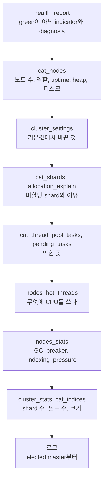

금융, 제조, 공공 고객의 클러스터는 대부분 폐쇄망에 있습니다. 진단 결과 파일을 밖으로 내려면 반출 심의를 거쳐야 하고, 아예 낼 수 없는 곳도 많습니다. 그러면 장애 원인을 찾는 데 필요한 정보가 고객 쪽 담당자 손에만 남습니다.
support diagnostic 도구가 무엇을 모으는지부터 보고, 반출할 수 없을 때 같은 정보를 직접 모아 분석하는 방법을 봅니다.

:::note[기준]
- Elasticsearch 9.x, self-managed 기준입니다. 공식 문서와 support-diagnostics 저장소는 2026년 11월에 다시 확인했습니다.
- 수집 스크립트는 [`labs/operations/offline-collect.sh`](https://github.com/Munsik/engineering-notes/blob/main/labs/operations/offline-collect.sh)에 있습니다. 모든 요청은 GET입니다.
:::

## support diagnostic 도구가 모으는 것

Elastic의 [Support Diagnostic](https://github.com/elastic/support-diagnostics) 도구는 클러스터 통계와 설정 대부분을 한 시점에 모아 압축 파일로 만듭니다. 모든 호출이 읽기 전용 GET이고, 공식 문서는 운영 클러스터에서 돌려도 안전하다고 설명합니다. index가 아주 많으면 `_cluster/state`, `_stats` 같은 몇 개의 호출이 오래 걸릴 수 있습니다([Capture diagnostics](https://www.elastic.co/docs/troubleshoot/elasticsearch/diagnostic)).

| 모드 | 모으는 것 | 어디서 돌리나 |
| --- | --- | --- |
| `local`(기본) | REST API, OS 명령 결과, Elasticsearch 로그와 GC 로그, thread dump | Elasticsearch가 도는 호스트 |
| `remote` | `local`과 같은 내용을 ssh로 | 다른 호스트 |
| `api` | REST API만 | 아무 곳. Elastic Cloud Hosted, ECE, ECK도 이 모드 |

저장소의 `elastic-rest.yml`에는 9.x 기준 100개가 넘는 API 호출이 버전별로 정의되어 있습니다. 클러스터 상태, 노드 통계, shard 배치, mapping과 설정, ILM과 SLM, ML, 보안 설정까지 들어 있습니다. `local` 모드는 여기에 `top`, `ss`, `iostat`, `sysctl -a`, `dmesg`, `/proc/<pid>/limits`, `jstack` 결과를 더합니다(`diags.yml` 기준).

```bash
./diagnostics.sh --type local --host localhost --port 9200 -u elastic -p --bypassDiagVerify --ssl --noVerify
```

`--bypassDiagVerify`는 시작할 때 새 버전이 있는지 인터넷으로 확인하는 단계를 건너뜁니다. 폐쇄망에서는 이 옵션을 줍니다. 도구는 Java 런타임이 필요하므로, 배포본 zip과 함께 반입 절차를 미리 밟아 둡니다.

## 반출할 수 있다면: 가리고 보낸다

도구에는 결과를 가리는 `scrub` 기능이 따로 있습니다. 설정 없이 돌려도 노드 ID, 노드 이름, IPv4, IPv6, MAC 주소를 임의의 값으로 바꿉니다. 클러스터 이름은 기본 대상이 아니므로 가리려면 token으로 지정합니다. 같은 값은 모든 파일에서 같은 값으로 바뀌므로 노드를 구분해서 읽을 수 있습니다. 다만 실행할 때마다 바뀌는 값은 달라집니다([support-diagnostics README: File Sanitization Utility](https://github.com/elastic/support-diagnostics#file-sanitization-utility)).

```yaml
# config/scrub.yml(도구 설치 디렉터리 안의 config 아래에 있어야 함)
tokens:
  - token: 'corp-[a-z0-9]+'       # 호스트 이름 규칙
  - token: 'logs-billing-.*'      # index 이름 규칙
remove:
  - ".*.gz"                       # 압축된 과거 로그는 빼기
```

```bash
./scrub.sh -i /path/to/local-diagnostics-20261127-101500.zip
```

결과는 원래 파일 이름 앞에 `scrubbed-`가 붙은 압축 파일로 나옵니다. 자동으로 가려지지 않는 것은 직접 token으로 지정해야 합니다.

| 가려야 할 수 있는 것 | 들어 있는 파일 |
| --- | --- |
| index, data stream, alias 이름 | 거의 모든 파일 |
| 필드 이름 | `mapping`, `indices_stats`, `cluster_state` |
| 사용자, 역할 이름 | `security_users`, `security_roles`, `security_role_mappings` |
| 인증서 정보 | `ssl_certs` |
| ingest pipeline 안의 값 | `pipelines` |
| 로그 메시지 안의 문서 내용 | Elasticsearch 로그, slow log |

반출 심의에는 "어떤 API를 불렀는지(읽기 전용 목록), 무엇을 가렸는지(scrub 설정)"를 같이 제출하면 승인이 빨라지는 경우가 많습니다.

## 반출할 수 없다면: 같은 정보를 직접 모은다

도구를 반입하지 못하거나 결과를 낼 수 없으면, 목적에 맞는 API만 직접 모아 현장에서 읽습니다. 아래는 support diagnostic이 모으는 API 가운데 장애 원인을 찾는 데 자주 쓰는 것을 고른 목록입니다. 수집 스크립트는 이 목록을 그대로 돌려 파일로 남깁니다.

| 목적 | API |
| --- | --- |
| 전체 상태와 원인 진단 | `_health_report`, `_cluster/health` |
| 기본값과 다르게 바꾼 설정 | `_cluster/settings?flat_settings`, `_cluster/settings?include_defaults&flat_settings` |
| 노드 구성과 자원 | `_cat/nodes`, `_nodes`, `_nodes/stats` |
| 지금 하는 일 | `_nodes/hot_threads`, `_tasks?detailed`, `_cat/thread_pool`, `_cluster/pending_tasks` |
| shard 배치와 미할당 원인 | `_cat/shards`, `_cat/allocation`, `_cluster/allocation/explain`, `_cat/recovery` |
| 메모리 보호 | `_cat/circuit_breaker`, `_nodes/stats`의 `breakers`, `indexing_pressure` |
| 데이터 구조 | `_cluster/stats`, `_cat/indices`, `_stats?level=shards`, `_mapping`, `_settings`, template |
| 수명 관리와 백업 | `_ilm/status`, `*/_ilm/explain?only_errors=true`, `_slm/stats`, `_snapshot` |

```bash
ES_URL=https://localhost:9200 ES_API_KEY=<key> ./offline-collect.sh
# 결과: es-collect-<시각>/ 아래 API별 파일, _status.txt(HTTP 코드), os.txt
```

- 상태가 나쁠 때 한 번만 모으면 원인을 놓칩니다. 증상이 있는 동안 5분에서 10분 간격으로 두세 번 모으면 누적값(rejection, GC 횟수)의 증가분과 계속 같은 hot threads를 볼 수 있습니다.
- `allocation_explain`은 할당되지 않은 shard가 없으면 400을 돌려줍니다. 정상 상태에서는 이 파일이 오류여도 문제가 아닙니다(로컬 9.5.5 확인).
- API가 401을 돌려주면 `.security` index를 못 쓰는 상태일 수 있습니다. 노드마다 file realm 사용자를 만들어 그 노드에 직접 요청합니다([10](../10-incident-runbook/#로그인이-안-될-때)). 503 `master_not_discovered_exception`이면 master가 없는 상태라 대부분의 API가 답하지 않습니다. 이때는 로그가 유일한 단서입니다([07](../07-unstable-cluster/#master가-자주-바뀔-때)).
- 로그는 API로 모을 수 없습니다. 노드마다 `<cluster>.log`(또는 `_server.json`), `gc.log`를 장애 시간 앞뒤로 복사합니다. 불안정한 클러스터는 elected master의 로그가 가장 중요합니다.

## 읽는 순서

아래 순서는 제가 현장에서 쓰는 방법입니다.



| 파일 | 먼저 볼 것 | 이어서 갈 곳 |
| --- | --- | --- |
| `health_report` | `status`가 green이 아닌 indicator의 `diagnosis` | 해당 글 |
| `cat_nodes` | 기대한 노드 수, 짧은 `uptime`, 혼자 높은 heap이나 디스크 | [03](../03-node-failure-triage/), [04](../04-disk-full/) |
| `cluster_settings` | `cluster.routing.allocation.enable`, watermark, breaker, thread pool을 바꿨는지 | [02](../02-red-yellow/) |
| `allocation_explain` | `can_allocate`와 decider 이름 | [02의 원인별 조치](../02-red-yellow/#원인별-조치) |
| `cat_thread_pool` | `rejected`가 0이 아닌 pool, 계속 높은 `queue` | [05](../05-slow-cluster/#thread-pool과-거부) |
| `tasks`, `cluster_pending_tasks` | 오래 도는 task, 쌓인 `put-mapping`, `ilm-` | [05](../05-slow-cluster/#cluster-작업이-쌓일-때), [06](../06-expensive-queries/) |
| `nodes_stats` | `jvm.gc.collectors`, `breakers.*.tripped`, `indexing_pressure` 거부 수 | [03](../03-node-failure-triage/#circuit-breaker-429) |
| `cluster_stats` | 전체 shard 수, `mappings.total_field_count` | [07의 cluster state가 클 때](../07-unstable-cluster/#cluster-state가-클-때) |

`cluster_settings`는 기본값을 뺀 것과 포함한 것을 둘 다 모읍니다. 앞의 파일이 "누가 무엇을 바꿨는지"를 바로 보여 주기 때문에, 원인이 설정 변경인 장애를 빨리 찾을 수 있습니다.

## 판단 기준

| 상황 | 권장 |
| --- | --- |
| 반출 가능, 심의 필요 | support diagnostic `local` 모드 + `scrub`. 호출 목록과 scrub 설정을 심의에 같이 제출 |
| 도구 반입 가능, 반출 불가 | 도구로 모으고 현장에서 위 순서로 읽음 |
| 도구 반입도 불가 | `offline-collect.sh` 같은 GET 스크립트와 로그 복사 |
| 장애가 진행 중 | 재시작 전에 수집을 먼저. 5분에서 10분 간격으로 두세 번 |
| API가 답하지 않음 | 로그와 OS 정보만이라도 모음. elected master 로그 우선 |

## 참고 문서

- [GitHub elastic/support-diagnostics](https://github.com/elastic/support-diagnostics)
- [Capture diagnostics](https://www.elastic.co/docs/troubleshoot/elasticsearch/diagnostic)
